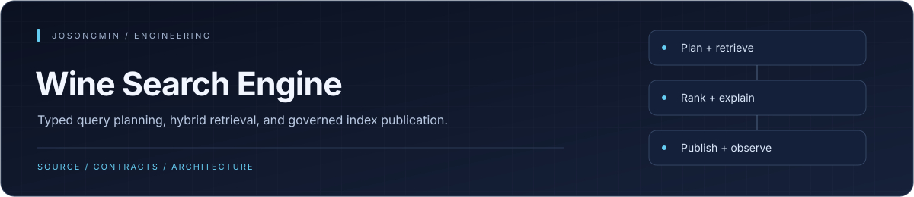
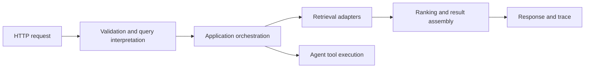

<p align="center"></p>

# Wine Search Engine

A TypeScript search and wine-intelligence backend combining entity interpretation, retrieval, ranking, natural-language agent workflows, and a Fastify HTTP API. PostgreSQL, Redis, Vespa, and optional HTTP ML services provide separate infrastructure capabilities.

[Architecture](#architecture) · [Quick start](#quick-start) · [Verification](#verification) · [Configuration](#configuration)


## Engineering highlights

| Mechanism | Engineering purpose |
| :--- | :--- |
| **Domain-first search pipeline** | Query and retrieval policy live in domain/application layers; infrastructure adapters and HTTP response builders have separate ownership. |
| **Hybrid retrieval and ranking** | Candidate retrieval, entity resolution, and rank/decision stages have distinct contracts and observability. |
| **Snapshot-scoped publication** | Search snapshot publication and runtime-handle binding make the serving generation an explicit operating concern. |
| **Declared HTTP contracts** | Route catalogs, response/schema contracts, and OpenAPI parity checks provide an inspectable public interface. |
| **Evaluation as an independent plane** | Unit, regression, contract, integration, Vespa-backed, and offline-evaluation lanes target different failure modes. |

## Search flow



Query interpretation, retrieval/ranking, and agent execution have separate owners. Optional ML adapters must be configured and evaluated in the selected path; their presence in source does not establish model quality or production availability.

<a id="technical-stack"></a>

## Technology

| Area | Foundation |
| --- | --- |
| Runtime and API | Node.js 22+, TypeScript, Fastify |
| Persistent data | PostgreSQL |
| Coordination/cache | Redis |
| Retrieval | Vespa and repository search adapters |
| Optional ML | HTTP embedding, reranking, and learned-matching services |
| Development | pnpm, Vitest, type/lint/architecture and quality gates |

<a id="architecture--composition"></a>

## Architecture

Ports/adapters keep domain/application decisions separate from HTTP, storage, search, and model providers. The composition root assembles those dependencies. HTTP routes validate and deliver requests rather than owning retrieval policy or upstream orchestration.

| Path | Responsibility |
| --- | --- |
| [src/domain](src/domain) | Domain models and policies |
| [src/application](src/application) | Search/agent orchestration |
| [src/interface](src/interface) | HTTP and CLI delivery |
| [src/infrastructure](src/infrastructure) | Storage/search/provider adapters |
| [src/observability](src/domain/observability) | Traces and pipeline diagnostics |
| [config](config) | Tooling and verification configuration |
| [scripts](scripts) | Evaluation, ETL, migration, and operating commands |
| [data](data) | Evaluation and development datasets |
| [test](test) | Scoped unit, integration, contract, and E2E tests |

Check the current [source tree](src) and [documentation](docs) for detailed owners. Product terminology and contracts live in the RFCs, not in historical test-count summaries.

<a id="bootstrap"></a>

## Quick start

Use Node.js 22+, pnpm 9.15.9, and the infrastructure required by your selected runtime path. The repository enforces pnpm installation.

```sh
git clone https://github.com/josongmin/wine-search-engine.git
cd wine-search-engine
corepack enable
pnpm install --frozen-lockfile
cp .env.example .env
```

Configure a local development database and required service URLs before migration or startup:

```sh
pnpm run migrate
pnpm run dev
```

`migrate` changes the database selected by the environment. The API defaults to port 3000; inspect `/health` after startup. Build and production-entry commands are `pnpm run build` and `pnpm run start`.

<a id="configuration-env"></a>

## Configuration

`.env.example` and the environment parser define the accepted settings. Configure PostgreSQL, `REDIS_URL`, `VESPA_URL`, optional ML endpoints, and the secrets required by the chosen features. Keep secrets outside source control.

The development stack and isolated test stack use separate Compose configurations:

- [docker-compose.yml](docker-compose.yml): local development services.
- [docker-compose.test.yml](docker-compose.test.yml): test-specific services and ports.

A successful in-memory or recorded-response path is separate from a live Vespa/PostgreSQL/model path.

<a id="test-coverage--e2e-scenarios"></a>

## Verification

| Command | Scope |
| --- | --- |
| `pnpm run check:dev` | Default type checks and development tests |
| `pnpm run test:unit` | Unit configuration |
| `pnpm run test:integration` | Integration configuration |
| `pnpm run test:e2e:contract` | Bounded HTTP/contract smoke path |
| `pnpm run test:e2e:runtime` | Runtime-dependent E2E path |
| `pnpm run test:e2e:inmemory` | In-memory end-to-end scenarios |
| `pnpm run test:e2e:vespa` | Actual Vespa integration path |
| `pnpm run test:quality` | Quality and noisy-entity verification |
| `pnpm run test:coverage` | Configured unit coverage collection |

Use file/related selectors from [package.json](package.json) for focused feedback. Default `test:e2e` selects contract smoke, not every runtime or external-service scenario. Missing providers, skipped tests, and unexecuted scopes cannot be counted as a product pass.

<a id="evaluation-metrics-definitions--gates"></a>

## Search quality and performance

Offline relevance, noisy-entity matching, retrieval ceilings, and provider-backed behavior are separate evaluation scopes. Preserve corpus/split identity, query mode, provider/model configuration, expected results, and executed counts when interpreting a score.

A metric's implementation or configured threshold does not establish measured relevance, latency, throughput, or operating SLOs. Use the owning evaluation scripts, datasets, and source-bound results for those claims.

<a id="http-api-entry-points--request-flow"></a>

## HTTP surface

The repository includes search and agent/session interfaces, including `POST /v1/search/hybrid` and `/v1/agent`. Exact registered routes, request schemas, response envelopes, authentication, and error contracts are owned by current route declarations and their contract tests.

Debug request flow through [pipeline debug steps](src/domain/observability/pipeline-debug-steps.ts). The [debugging playbook](.ai/llm-debugging-playbook.md) and [debug-mode guide](.ai/debug-mode.md) explain configuration and limits.

## Operating and contributing

- [Repository instructions](AGENTS.md)
- [Architecture and command context](CLAUDE.md)
- [Documentation](docs)
- [Environment template](.env.example)
- [Script and test selection](package.json)

Deployment, data ingestion, external-model calls, and production migrations require their own environment and authorization. This entry point describes development and operating boundaries rather than asserting a current production qualification.
