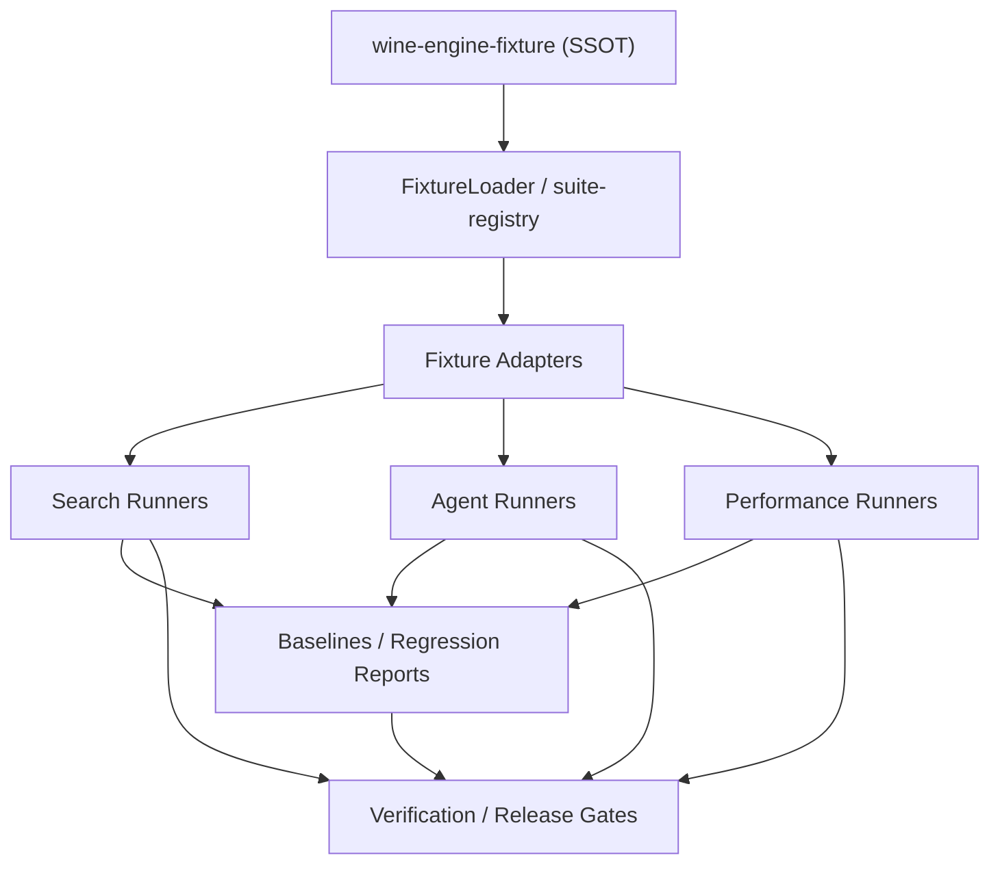
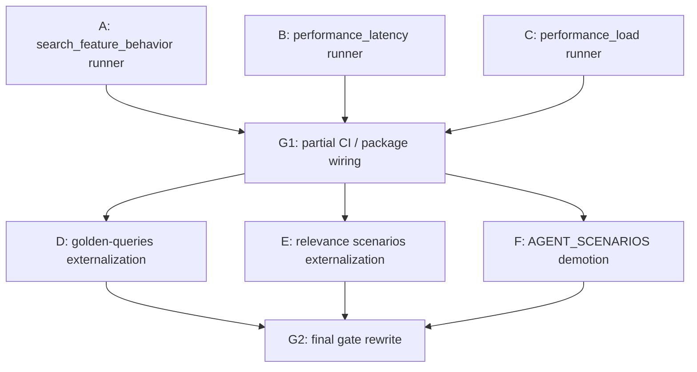

# ADR-005: Fixture-Native Benchmark Architecture

## Status: Accepted

## Context

ADR-004 established the external benchmark repository
(`wine-engine-fixture`) as the governance and contract source for benchmark
fixtures.

That solved the **truth-source** problem, but not yet the full **runtime
consumption** problem.

Historically, the engine still had multiple in-repo benchmark truths:

- `data/noisy-entity-benchmark.jsonl`
- `data/noisy-entity-predictions-smoke.jsonl`
- `data/golden-queries-*.jsonl`
- `data/relevance/scenarios-*.ndjson`
- `test/benchmark/agent/scenarios.ts`

This created a structural split:

1. external fixture repo existed as the declared source of truth
2. engine runners still consumed internal artifacts in several critical paths
3. release gates therefore remained partially coupled to internal datasets
4. search, agentic, and performance benchmarks were not uniformly fixture-native

This is not acceptable for a SOTA+ evaluation architecture.

We need the benchmark system to satisfy all of the following:

- external fixture repo is the runtime SSOT for release-gating benchmark inputs
- search, agentic, and performance runners consume the same benchmark contract family
- thresholds come from fixture governance, not hardcoded runner constants
- internal datasets are either:
  - tiny local unit fixtures, or
  - derived/non-gating artifacts

## Decision

The benchmark system will use a **fixture-native layered architecture**.

The external fixture repo remains the SSOT for benchmark contracts.
The engine repo owns:

- loaders
- adapters
- benchmark runners
- report generation
- CI / release gates

The engine repo MUST NOT own competing benchmark truth definitions for release
gates.

## Architecture

### 1. Layer model

The benchmark stack is split into five layers:

1. **Fixture SSOT**
   - external repo only
   - suite definitions
   - case definitions
   - thresholds
   - catalogs / goldens

2. **Fixture access layer**
   - `FixtureLoader`
   - suite registry
   - schema validation
   - availability / governance verification

3. **Fixture adapter layer**
   - transforms fixture cases into runner-native typed inputs
   - contains NO benchmark truth of its own
   - only maps contract vocabulary into execution vocabulary

4. **Runner layer**
   - executes live API calls or deterministic smoke predictions
   - computes typed reports
   - enforces suite thresholds

5. **Gate layer**
   - CI / verification scripts
   - baseline regression checks
   - release blocking logic

### 2. Canonical dependency graph

### 3. Search runner split

Search benchmark runners MUST remain separated by behavioral contract.

They MUST NOT be merged into one averaged score.

Required search families:

- `exact_entity_recovery`
- `ambiguous_shortform`
- `mixed_script_entity`
- `noisy_attribute_recovery`
- `search_feature_behavior`

Required runtime model:

- exact / mixed / ambiguous entity suites use a fixture-native entity retrieval runner
- noisy attribute suite uses a fixture-native noisy eval runner
- search feature behavior uses its own fixture-native contract runner

Reason:

- exact entity recovery is identity retrieval
- ambiguous shortform is safe clarify behavior
- noisy attribute recovery is noisy retrieval under distortion
- search feature behavior is constraint compliance and semantic ranking behavior

Those are different tasks and MUST NOT share one pass metric.

### 4. Agent runner split

The existing monolithic agent benchmark based on `AGENT_SCENARIOS` remains
useful, but it is no longer the release-gate SSOT.

Agent evaluation is split into:

- `agentic_tool_use`
- `agentic_answer_quality`

Rules:

- release gates MUST use fixture-native runners
- `AGENT_SCENARIOS` remains allowed only for broad exploratory/nightly coverage
- fixture-native runners MUST consume external suites directly
- tool-use and answer-quality MUST NOT be scored in the same contract

Reason:

- tool-use correctness is execution behavior
- answer quality is response quality
- combining them hides which subsystem regressed

### 5. Performance runner split

Performance suites also belong under fixture governance.

Required families:

- `performance_latency`
- `performance_load`

Rules:

- SLO definitions come from fixture thresholds
- workload shapes come from fixture cases
- engine repo implements only the execution harness

## Current canonical implementation state

> **Living section.** Keep in sync when adding runners or moving corpora.
> Acceptance criteria and workstreams below remain the source for “done”.

### Already fixture-native

- `verify-external-fixture-governance.ts`
- `FixtureLoader`
- `suite-registry`
- `run-noisy-entity-eval.ts`
  - default external fixture source
  - fixture-derived smoke predictions
- `run-entity-retrieval-fixture-eval.ts`
  - exact / ambiguous / mixed suites
- `run-agentic-tool-use-fixture-eval.ts`
- `run-agentic-answer-quality-fixture-eval.ts`
- `run-search-feature-behavior-fixture-eval.ts` (Workstream A)
- `run-performance-latency-fixture-eval.ts` / `run-performance-load-fixture-eval.ts` (Workstreams B/C)
- `run-offline-eval.ts` — default gate corpus and thresholds resolve from the
  external fixture repo (`fixture-corpus-paths.ts`, `FixtureLoader`); local
  smoke paths use explicit `--input` / `EVAL_CORPUS_PATH` / optional threshold
  fallback flags (non-default for release gates).

### Exploratory-only internal (by design, not release-gate truth)

- `test/benchmark/agent/scenarios.ts` (+ merged adversarial/coverage corpora)
- `test/benchmark/agent/retrieval-runner.ts` (exploratory retrieval profile)

### Legacy / local-only inputs (non-SSOT; do not use as competing gate truth)

- `data/eval-smoke-queries.jsonl` and other small smoke inputs referenced by
  smoke scripts — keep small; prefer fixture-backed corpora for gates.

## Decision details

### 1. Internal benchmark truth policy

Internal benchmark datasets are divided into three classes.

#### A. Allowed

- tiny unit-test fixtures
- serialization / parser smoke inputs
- ephemeral local development data not used in gates

#### B. Allowed temporarily, but non-gating only

- `AGENT_SCENARIOS`
- broad exploratory scenario corpora
- ad-hoc local benchmark result captures

#### C. Forbidden as release-gate truth

- in-repo JSONL / NDJSON benchmark corpora that duplicate external fixture suites
- hardcoded threshold constants in runners
- in-repo case lists that compete with external suite definitions

### 2. Adapter design rule

Adapters MUST be thin and one-way.

Allowed:

- `BenchmarkCase -> FixtureEntityBenchmarkCase`
- `BenchmarkCase -> AgentFixtureCase`
- `Threshold JSON -> typed threshold record`

Forbidden:

- embedding new benchmark expectations inside adapters
- silently defaulting missing fixture semantics to arbitrary heuristics
- deriving threshold policy from runner code

Validation failure policy:

- schema / adapter validation failure on release-gate inputs MUST fail closed
  and fail the gate
- only bulk discovery helpers (for example, governance inventory tooling) may
  skip-with-warning
- benchmark runners themselves MUST NOT skip malformed cases and continue as if
  the gate were valid

### 3. Smoke prediction rule

Smoke mode is allowed, but only as **fixture-derived deterministic smoke**.

That means:

- smoke predictions may be synthesized from fixture truth
- they may NOT introduce extra hidden benchmark truth
- they are used only for structural verification / CI fast lanes
- smoke mode means **no live API call**
- live mode means **call the real endpoint and compare the response against the
  fixture contract**

Examples:

- exact entity smoke may synthesize top-1 = target entity
- clarify-acceptable smoke may synthesize `decision_status='ambiguous'`

This is acceptable because the benchmark truth still originates from the
external fixture repo.

Runner mode selection rule:

- `smoke` is selected explicitly by CLI flag or dedicated package script
- `live` is the default when the runner is invoked without smoke mode and with
  the required runtime/service dependencies available
- runners MUST NOT silently fall back from live mode to smoke mode

### 4. Threshold ownership rule

Threshold ownership is external-only.

The engine repo may read thresholds.
It may NOT define competing minimums for the same suite/metric.

If a runner needs:

- `top1_accuracy`
- `safe_response_rate`
- `tool_selection_accuracy`
- `rubric_pass_rate`
- `latency_p95_ms`

those values must come from external fixture thresholds.

## Migration plan

### Phase 1: Search fixture-native completion

Status:

- `noisy_attribute_recovery` done
- `exact_entity_recovery` done
- `ambiguous_shortform` done
- `mixed_script_entity` done

Remaining:

- `search_feature_behavior` fixture-native runner

Required output:

- constraint compliance
- top-K accuracy
- min pass rate
- per-case failure list

### Phase 2: Agent release-gate split

Status:

- fixture-native tool-use runner done
- fixture-native answer-quality runner done

Remaining:

- explicitly demote `AGENT_SCENARIOS` from release-gate truth to exploratory/nightly corpus
- ensure CI/release entrypoints use fixture-native runners first

### Phase 3: Performance fixture-native completion

Required:

- latency runner consumes `performance_latency`
- load runner consumes `performance_load`
- SLO pass/fail criteria come from external thresholds

### Phase 4: Offline eval corpus externalization

Targets:

- `golden-queries-bronze.jsonl`
- `golden-queries-silver.jsonl`
- `golden-queries-gate.jsonl`
- `golden-queries-val.jsonl`
- `data/relevance/scenarios-*`

Required outcome:

- offline retrieval / ranking / constraint evaluation corpora move under external fixture governance
- engine repo keeps only runner logic and derived result artifacts

### Phase 5: Release-gate unification

Final release gates MUST be composed only from fixture-native runners.

Required release-gate groups:

- `search-identity-gate`
  - exact
  - ambiguous
  - mixed-script
- `search-behavior-gate`
  - noisy attribute
  - search feature behavior
- `agent-gate`
  - tool use
  - answer quality
- `perf-gate`
  - latency
  - load

## Explicit non-goals

This ADR does NOT:

- remove `AGENT_SCENARIOS` immediately
- require every exploratory benchmark to live outside the engine repo
- replace the engine’s internal training/etl data sources in one step
- force one universal report schema for all benchmark families

Those are follow-up migration concerns, not prerequisites for the benchmark
architecture decision.

## Consequences

### Positive

- release-gate benchmark truth becomes externally governed
- search / agent / perf benchmarks stop drifting independently
- thresholds and suite contracts become auditable
- smoke lanes stay fast without reintroducing internal benchmark truth
- exact retrieval quality can be measured separately from semantic behavior quality

### Negative

- more runners exist, because benchmark families are intentionally separated
- fixture schema evolution must be managed carefully
- baseline refresh becomes a governed operation, not a casual file overwrite

## Hard rules

The following are forbidden going forward:

1. adding new release-gate benchmark truth only inside `data/*.jsonl`
2. hardcoding suite thresholds in engine runner code
3. mixing exact retrieval, ambiguity safety, and agent quality into one aggregate gate
4. using `AGENT_SCENARIOS` as the only release-gate source for agent correctness
5. silently inventing runner fallback semantics when fixture contracts are incomplete

## Required follow-up tasks

1. implement fixture-native `search_feature_behavior` runner
2. implement fixture-native `performance_latency` runner
3. implement fixture-native `performance_load` runner
4. migrate offline `golden-queries-*` corpora into external governance scope
5. migrate `data/relevance/scenarios-*` corpora into external governance scope
6. change CI/release workflows so fixture-native gates are the primary blocking signal

## Acceptance criteria

This ADR is considered fully realized when all of the following are true:

1. release-gate search runners consume only external fixture suites
2. release-gate agent runners consume only external fixture suites
3. performance SLO gates consume only external fixture suites
4. thresholds are read only from external fixture governance
5. internal benchmark corpora are either non-gating or derived artifacts

## Concrete implementation tasks

This section is intentionally operational.
It is written so a coding agent can execute the work without inferring hidden
architecture intent.

### Workstream A: `search_feature_behavior` fixture-native runner

#### Goal

Create a dedicated runner for the external `search_feature_behavior` suite.

This runner evaluates:

- top-K retrieval accuracy for attribute-driven queries
- hard-constraint compliance
- min pass rate
- case-level failure diagnostics

It MUST NOT reuse the exact-entity runner scoring contract.

#### New / modified files

- new:
  - `scripts/eval/run-search-feature-behavior-fixture-eval.ts`
  - `test/unit/eval/search-feature-behavior-fixture-eval.test.ts`
- may reuse:
  - `scripts/eval/external-fixture-benchmark.ts`
  - `src/infrastructure/fixture/fixture-loader.ts`
- package wiring:
  - `package.json`

#### Required inputs

- external suite:
  - `search_feature_behavior`
- external thresholds:
  - `constraint_compliance_rate`
  - `top3_accuracy`
  - `min_pass_rate`

#### Required output report shape

The runner output MUST include:

- `benchmark`
- `suite_id`
- `query_count`
- `top3_accuracy`
- `constraint_compliance_rate`
- `min_pass_rate`
- `failures[]`

Each failure record MUST include:

- `benchmark_id`
- `query`
- `expected_constraints_summary`
- `top_entity_id`
- `top_k_entities`
- `constraint_violation_reason`

#### Execution logic

For each fixture case:

1. call `/v1/search`
2. collect top-K entity IDs
3. evaluate whether expected target appears within allowed K
4. evaluate whether returned top result violates declared hard constraints
   using the search response's structured result surface:
   - `results[*].constraints.unmet` — primary source; this field is required
     (not optional) in `SearchResultSchema` and is always present in a valid
     response; a non-empty `unmet` list means the result violates a hard constraint
   - `results[*].violated_constraints` — supplementary diagnostic string list
     (optional field); checked only when `constraints.unmet` is empty
   - `results[*].match_reasons` — informational only; not used for pass/fail
5. if the `constraints` field is structurally absent (schema regression in the
   search response contract), the runner MUST fail closed rather than invent
   regex-only evaluation
6. mark case pass/fail

#### Test requirements

- unit tests for:
  - top-K hit scoring
  - hard-constraint compliance scoring
  - threshold violation detection
- smoke command must run successfully

#### Acceptance

- `npm run eval:search-feature:fixtures` exists
- runner reads only external fixture suite definitions
- thresholds come only from external threshold JSON

#### Forbidden shortcuts

- no regex-only fake constraint evaluation if the response already exposes structured constraint data
- no hardcoded threshold fallback values inside the runner

### Workstream B: `performance_latency` fixture-native runner

#### Goal

Replace any implicit/manual latency gate with a runner driven by the external
`performance_latency` suite.

#### New / modified files

- new:
  - `scripts/eval/run-performance-latency-fixture-eval.ts`
  - `test/unit/eval/performance-latency-fixture-eval.test.ts`
- package wiring:
  - `package.json`

#### Required inputs

- external suite:
  - `performance_latency`
- external thresholds:
  - `slo_pass_rate`
  - `min_pass_rate`

#### Required output report shape

- `benchmark`
- `suite_id`
- `query_count`
- `slo_pass_rate`
- `latency_summary`
  - `p50`
  - `p95`
  - `p99`
- `min_pass_rate`
- `failures[]`

#### Execution logic

For each latency case:

1. execute the configured request shape
2. measure wall-clock duration
3. compare against per-case SLO
4. mark pass/fail

#### Acceptance

- latency gate is derived from fixture-defined SLOs
- report exposes both aggregate and case-level latency failures

#### Forbidden shortcuts

- do not reuse one global hardcoded timeout as the SLO truth
- do not infer pass/fail from historical averages; use case contract

### Workstream C: `performance_load` fixture-native runner

#### Goal

Create a load runner driven by the external `performance_load` suite.

#### New / modified files

- new:
  - `scripts/eval/run-performance-load-fixture-eval.ts`
  - `test/unit/eval/performance-load-fixture-eval.test.ts`
- package wiring:
  - `package.json`

#### Required inputs

- external suite:
  - `performance_load`
- external thresholds:
  - `achieved_rps`
  - `error_rate`
  - `p99_latency_under_load_ms`
  - `min_pass_rate`

#### Required output report shape

- `benchmark`
- `suite_id`
- `query_count`
- `achieved_rps`
- `error_rate`
- `p99_latency_under_load_ms`
- `min_pass_rate`
- `failures[]`

#### Execution logic

For each load case:

1. execute the specified concurrency / duration / request shape
2. measure achieved RPS
3. measure error rate
4. measure p99 latency
5. compare against external thresholds

#### Acceptance

- load gate is fully driven by external suite + threshold contracts
- no internal constant decides the release gate outcome

### Workstream D: offline `golden-queries-*` externalization

#### Goal

Move offline eval corpus governance out of engine-local `data/golden-queries-*.jsonl`
into the external fixture repo.

#### Scope

- `golden-queries-bronze.jsonl`
- `golden-queries-silver.jsonl`
- `golden-queries-gate.jsonl`
- `golden-queries-val.jsonl`

#### Required repository changes

External repo:

- add suite or corpus directories for offline eval splits
- add schema/governance docs for split semantics

Engine repo:

- modify:
  - `scripts/eval/run-offline-eval.ts`
  - `scripts/eval/run-offline-eval-local.ts`
  - `scripts/eval/build-splits.ts`
  - any dependent baseline/assert scripts

#### Required output state

- offline eval runners load corpus from external fixture repo
- in-repo `golden-queries-*` become derived/cache artifacts or are removed

#### Acceptance

- release-gate offline evaluation no longer depends on in-repo `data/golden-queries-*`

#### Forbidden shortcuts

- do not copy the external corpora into `data/` and keep using the copies
- do not maintain two mutable truths

### Workstream E: relevance scenario externalization

#### Goal

Move `data/relevance/scenarios-*` governance into the external fixture repo.

#### Scope

- `data/relevance/scenarios-audit.ndjson`
- `data/relevance/scenarios-gold.ndjson`
- `data/relevance/scenarios-labeling-input.jsonl`
- `data/relevance/scenarios-rejected.ndjson`
- `data/relevance/scenarios-silver-stub.ndjson`

#### Required engine changes

- identify every consumer of `data/relevance/scenarios-*`
- convert each consumer to:
  - load from external fixture repo directly, or
  - read a derived artifact explicitly generated from the external source

#### Acceptance

- relevance scenario governance no longer depends on ad-hoc engine-local NDJSON truth

#### Forbidden shortcuts

- do not copy the external corpora into `data/relevance/` and keep using the copies
- do not maintain two mutable truths (engine-local + external) for the same corpus

### Workstream F: `AGENT_SCENARIOS` demotion

#### Goal

Demote `test/benchmark/agent/scenarios.ts` from release-gate truth to
exploratory/nightly coverage corpus.

#### Required changes

- docs:
  - mark `AGENT_SCENARIOS` as non-gating
- CI:
  - release gates MUST point at fixture-native runners first
- package scripts:
  - distinguish:
    - fixture-native release-gate commands
    - exploratory/nightly scenario commands
  - canonical exploratory entrypoints MUST use explicit names:
    - `bench:agent:exploratory`
    - `bench:agent:exploratory:tier`
    - `benchmark:exploratory:quick`
    - `benchmark:exploratory:standard`
    - `benchmark:exploratory:nightly`
    - `benchmark:exploratory:retrieval`
  - legacy short names may remain only as compatibility aliases and MUST NOT be documented as canonical

#### Acceptance

- agent release correctness is no longer blocked on `AGENT_SCENARIOS` semantics
- `AGENT_SCENARIOS` remains available for broad regression exploration
- exploratory benchmark entrypoints are explicitly named and non-gating

### Workstream G: CI / release-gate rewiring

#### Goal

Make fixture-native runners the primary release gates.

#### Required package scripts

At minimum, the engine repo MUST expose:

- `eval:noisy:gate` ✓ (exists)
- `eval:entity:fixtures` ✓ (exists)
- `eval:search-feature:fixtures` ✓ (added — Workstream A)
- `eval:fixtures:verify` ✓ (exists)
- `test:verification:fixtures:governance` ✓ (alias of `eval:fixtures:verify`, explicit name)
- `bench:agent:fixtures:tool-use` ✓ (exists)
- `bench:agent:fixtures:answer-quality` ✓ (exists)
- `eval:perf:latency:fixtures` ✓ (added — Workstream B)
- `eval:perf:load:fixtures` ✓ (added — Workstream C)

And one or more rollup commands:

- `test:verification:search` ✓ (added)
- `test:verification:agent` ✓ (added)
- `test:verification:perf` ✓ (added)
- `test:verification:fixtures:full` ✓ (added)

#### Acceptance

- CI can run release gates without consulting engine-local benchmark truth sets

## Task DAG

The required dependency DAG is:

Implementation guidance:

- Workstreams `A`, `B`, and `C` are independent and SHOULD be executed in
  parallel when resources allow
- `G1` depends on `A/B/C` because CI/package wiring should reference real
  runner entrypoints, not placeholders
- `D` and `E` depend on `G1` only in the sense that the runner substrate should
  be stable before migrating larger corpora
- `F` depends on `G1` because fixture-native agent gates must exist before
  `AGENT_SCENARIOS` is formally demoted
- `G2` is final cutover and therefore depends on `D/E/F`

Reason:

- `A` is search quality completion
- `B/C` are performance fixture-native completion
- they are same-priority but structurally independent
- offline/relevance corpus migration is broader and should happen after runner
  substrate is stable
- `AGENT_SCENARIOS` demotion should happen only after fixture-native agent
  gates are already operational

## Phase to workstream mapping

The migration phases and implementation workstreams map as follows:

| Migration Phase | Corresponding Workstreams | Notes |
|---|---|---|
| Phase 1: Search fixture-native completion | A | completes the remaining search behavior runner gap |
| Phase 2: Agent release-gate split | F, G2 (agent gate cutover portion) | runner substrate already exists; this phase is mostly demotion/cutover |
| Phase 3: Performance fixture-native completion | B, C | latency and load are independent parallel tracks |
| Phase 4: Offline eval corpus externalization | D, E | corpora/governance migration |
| Phase 5: Release-gate unification | G1, G2 | G1 = partial wiring, G2 = final cutover |

## Done definition per workstream

A workstream is not complete unless all of the following are true:

1. code path reads external fixture contracts directly or through approved adapter layer
2. thresholds come only from external threshold governance
3. package script exists
4. unit tests exist
5. at least one smoke command was executed successfully
6. no parallel internal truth remains as a release-gate input
