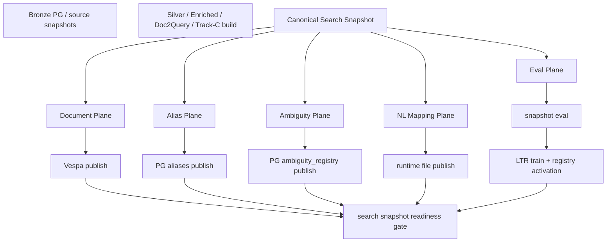
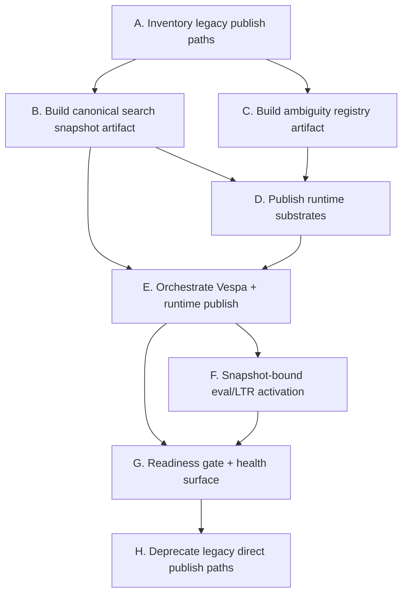

# ADR-006: Search Snapshot Publish Architecture

## Status: Proposed

## Context

ADR-004와 ADR-005로 benchmark fixture의 truth source와 benchmark runner 구조는
상당 부분 정리됐다.

하지만 최종 live 검증에서 드러난 병목은 benchmark SSOT가 아니라
**runtime search substrate publish 구조 부재**였다.

실제로 확인된 상태:

- Vespa document corpus는 존재하고 조회도 됨
- Postgres runtime substrate는 스키마만 있고 row가 비어 있음
  - `aliases = 0`
  - `ambiguity_registry = 0`
  - `ltr_model_registry = 0`
- `~/.wine-search-engine/data/nl-mappings.json` 부재

즉 현재 구조는 다음 두 plane 중 하나만 안정적으로 채운다.

1. **document plane**
   - `scripts/etl/index-to-vespa.ts`
   - Vespa `wine_entity`

2. **runtime resolution plane**
   - `aliases`
   - `ambiguity_registry`
   - `nl-mappings.json`
   - `ltr_model_registry`

문제는 이 둘이 **같은 snapshot contract로 publish되지 않는다**는 점이다.

그 결과:

- 문서 corpus는 존재하지만 noisy / exact entity recovery는 0점에 가까울 수 있음
- alias / ambiguity / LTR / NL mapping이 비어도 Vespa 인덱싱은 성공해버림
- benchmark smoke는 green인데 live quality는 붕괴할 수 있음
- 재현성과 release gate가 snapshot 단위로 닫히지 않음

이 상태는 SOTA++ 지향 구조가 아니다.

우리가 필요한 것은:

- heuristic fallback이 아니라 snapshot-bound runtime substrate
- Vespa publish와 resolution substrate publish를 하나의 계약으로 묶는 구조
- eval / LTR / activation이 동일 snapshot version에 종속되는 구조
- partial publish를 금지하는 fail-closed orchestration

## Final Review Summary

최종 리뷰 기준, 구조적으로 남아 있는 핵심 결함은 이 네 가지였다.

1. `index-to-vespa.ts`는 document plane만 publish한다.
2. alias / ambiguity / NL mapping / LTR artifact는 별도 수동 스크립트로 흩어져 있다.
3. snapshot readiness가 runtime substrate count를 gate하지 않는다.
4. live benchmark는 Vespa만 살아 있어도 실행되지만, resolution plane이 비어 있으면
   결과가 사실상 무의미해진다.

이 ADR의 목적은 위 네 가지를 구조적으로 제거하는 것이다.

## Decision

검색 인덱싱/보조 substrate/평가/LTR activation은 앞으로
**Canonical Search Snapshot**을 기준으로 동작한다.

엔진은 단일 snapshot manifest를 생성하고, 그 snapshot에서 다음을 함께 publish한다.

1. Vespa document plane
2. Postgres runtime resolution plane
3. file-based runtime artifacts
4. snapshot-bound evaluation artifacts
5. snapshot-bound active LTR model

부분 성공은 허용하지 않는다.

즉:

- `index-to-vespa.ts` 단독 성공은 더 이상 “publish 완료”가 아니다
- `aliases`만 채우고 `ambiguity_registry`가 비어 있어도 완료가 아니다
- `nl-mappings.json`이 없으면 runtime-ready가 아니다
- LTR이 없으면 명시적 `no_ltr_mode`로만 허용되며, default success로 간주하지 않는다

## Canonical Model

### 1. Search Snapshot

Search Snapshot은 search runtime을 재현하는 최소 완전 집합이다.

반드시 포함해야 하는 것:

- `snapshot_id`
- `generated_at`
- `content_hash`
- `source_snapshot_refs`
- `schema_versions`
- `document_plane`
- `alias_plane`
- `ambiguity_plane`
- `nl_mapping_plane`
- `eval_plane`
- `ltr_plane`

### 2. Snapshot Planes

#### A. Document plane

검색 문서 인덱싱에 필요한 RetrievalDocument 집합.

현재 소스:

- `scripts/etl/index-to-vespa.ts`
- `scripts/etl/generate-doc-queries.ts`
- `scripts/etl/run-track-c.ts`

#### B. Alias plane

exact/noisy entity recovery용 canonical alias graph.

현재 소스 후보:

- `scripts/etl/generate-aliases.ts`
- `scripts/etl/generate-korean-aliases.ts`
- `scripts/etl/generate-transliteration-aliases.ts`

#### C. Ambiguity plane

shortform / collision / producer-only surface의 disambiguation substrate.

현재 문제:

- runtime table은 존재하지만 ETL publish flow에 속하지 않음

#### D. NL mapping plane

constraint / interpretation / entity phrase resolution에 쓰는
natural-language mapping artifact.

현재 소스:

- `scripts/etl/generate-nl-mappings.ts`

현재 문제:

- file artifact가 snapshot publish의 필수 단계가 아님

#### E. Eval plane

offline / fixture-native eval과 LTR 학습에 사용하는
snapshot-bound dataset linkage와 metrics manifest.

현재 소스 후보:

- `scripts/eval/run-offline-eval.ts`
- `scripts/eval/build-splits.ts`
- external fixture repo corpora

#### F. LTR plane

query-class별 active model과 그 학습/검증 provenance.

현재 소스:

- `scripts/eval/run-eval-and-train-ltr.ts`

현재 문제:

- search snapshot version과 느슨하게 연결됨

## Target Architecture

## Design Rules

### 1. Single publish contract

runtime-ready publish는 다음이 전부 성공해야만 성립한다.

- Vespa document publish 성공
- alias plane publish 성공
- ambiguity plane publish 성공
- NL mapping artifact publish 성공
- readiness verification 성공

LTR는 두 모드 중 하나여야 한다.

- `ltr_active`
- `no_ltr_mode_explicit`

즉 “모델이 없지만 그냥 진행”은 금지다.

### 2. Fail closed

다음 상황은 전부 publish 실패다.

- Vespa docs > 0 이지만 aliases = 0
- aliases > 0 이지만 ambiguity registry = 0
- runtime config가 NL mapping file을 요구하는데 file이 없음
- readiness check 없이 benchmark/live activation 실행
- snapshot manifest 없이 table/file만 수동 적재

### 3. No heuristic recovery substrate

금지:

- query-time alias 생성으로 ETL gap을 가리는 것
- ambiguity registry가 비었을 때 rule-of-thumb clarify fallback으로 덮는 것
- LTR registry가 비었을 때 silent heuristic rerank로 대체하는 것
- NL mapping 부재를 regex-only emergency mode로 운영하는 것

부재는 부재로 드러내고 publish gate에서 막아야 한다.

### 4. Snapshot-bound determinism

search snapshot은 benchmark determinism과 연결돼야 한다.

반드시 snapshot metadata에 포함:

- `vespa_document_count`
- `alias_row_count`
- `ambiguity_row_count`
- `nl_mapping_count`
- `active_ltr_model_versions`
- `fixture_repo_version`
- `eval_dataset_version`

이 값들은 `determinism_fingerprint`와도 연결 가능해야 한다.

## Required Components

### A. `scripts/etl/build-search-snapshot.ts`

역할:

- Silver / Enriched / Doc2Query / Track-C 산출물을 읽어서
  canonical snapshot bundle 생성

출력:

- `data/search-snapshots/<snapshot_id>/manifest.json`
- `data/search-snapshots/<snapshot_id>/documents.ndjson`
- `data/search-snapshots/<snapshot_id>/aliases.ndjson`
- `data/search-snapshots/<snapshot_id>/ambiguity-registry.ndjson`
- `data/search-snapshots/<snapshot_id>/nl-mappings.json`
- `data/search-snapshots/<snapshot_id>/metadata.json`

규칙:

- deterministic ordering
- content-hash 계산
- partial artifact 허용 금지

### B. `scripts/etl/publish-runtime-substrates.ts`

역할:

- snapshot artifact를 runtime substrate로 publish

대상:

- `aliases`
- `ambiguity_registry`
- `~/.wine-search-engine/data/nl-mappings.json`

규칙:

- truncate + replace 또는 versioned upsert 전략을 명시
- publish 후 count 검증 필수

### C. `scripts/etl/publish-search-snapshot.ts`

역할:

- runtime publish orchestration entrypoint

순서:

1. build snapshot
2. publish Vespa documents
3. publish runtime substrates
4. run readiness verification
5. persist active snapshot pointer

금지:

- default production path에서 `index-to-vespa.ts` 단독 실행

### D. `scripts/etl/verify-search-snapshot-readiness.ts`

역할:

- snapshot이 runtime-ready인지 fail-closed로 검증

최소 체크:

- `vespa_document_count > 0`
- `alias_row_count > 0`
- `ambiguity_row_count > 0`
- `nl_mapping_count > 0`
- `active_ltr_model_count > 0` 또는 `no_ltr_mode_explicit = true`
- `snapshot_id`가 manifest / DB / runtime file에 일관되게 반영됨

### E. `scripts/eval/train-ltr-for-snapshot.ts`

역할:

- 특정 snapshot version에 대해 eval 실행 후 LTR 학습

출력:

- `ltr_model_registry`
- `snapshot_id -> active_ltr_model_version` linkage

규칙:

- snapshot mismatch model activation 금지
- eval dataset version과 model version linkage 강제

## Migration Plan

### Phase 0. Freeze current publish semantics

목표:

- 현재 산발적 publish 경로를 inventory화
- 어떤 스크립트가 document plane만 채우고 어떤 스크립트가 runtime plane을 채우는지 명시

작업:

- `index-to-vespa.ts` 단독 publish를 “legacy path”로 표기
- ADR-005와 system overview에 legacy 경계 명시

### Phase 1. Snapshot artifact build

목표:

- search snapshot artifact schema 도입

작업:

- `build-search-snapshot.ts`
- snapshot manifest schema
- content hash
- deterministic writer

### Phase 2. Runtime substrate publish

목표:

- alias / ambiguity / NL mapping을 snapshot-bound publish로 묶기

작업:

- `publish-runtime-substrates.ts`
- alias import path 정리
- ambiguity registry builder 추가
- NL mapping write를 publish flow에 포함

### Phase 3. Vespa publish orchestration

목표:

- document plane + runtime plane atomic publish

작업:

- `publish-search-snapshot.ts`
- `index-to-vespa.ts`를 orchestration 내부 step으로 격하

### Phase 4. Snapshot-bound evaluation / LTR

목표:

- active model과 active search substrate가 같은 snapshot version을 보게 함

작업:

- `train-ltr-for-snapshot.ts`
- `ltr_model_registry`에 `snapshot_id` / `eval_dataset_version` 연결

### Phase 5. Readiness gate + health surface

목표:

- live bench 이전에 readiness를 fail-closed

작업:

- `verify-search-snapshot-readiness.ts`
- `/health` 또는 별도 readiness endpoint에 substrate count/snapshot_id 노출

## Workstream DAG

병렬 가능 구간:

- `B`와 `C`
- `F`와 `G`

## Concrete Implementation Tasks

### Task B1. Snapshot manifest schema

수정 파일:

- 신규 `scripts/etl/build-search-snapshot.ts`
- 신규 `scripts/etl/search-snapshot-schema.ts`

Acceptance:

- 동일 입력이면 동일 `content_hash`
- artifact ordering deterministic

### Task B2. Alias plane artifact export

수정 파일:

- `scripts/etl/generate-aliases.ts`
- `scripts/etl/generate-korean-aliases.ts`
- `scripts/etl/generate-transliteration-aliases.ts`
- 신규 snapshot builder

Acceptance:

- alias artifact가 snapshot 산출물로 저장됨
- runtime publish 이전에 count 확인 가능

### Task C1. Ambiguity registry builder

수정 파일:

- 신규 `scripts/etl/build-ambiguity-registry.ts`
- 관련 domain model / import adapter

Acceptance:

- alias collision surface에서 deterministic registry 생성
- producer-only / vintage-less / transliteration collision을 artifact로 남김

### Task D1. Runtime substrate publisher

수정 파일:

- 신규 `scripts/etl/publish-runtime-substrates.ts`

Acceptance:

- aliases, ambiguity registry, NL mapping이 같은 snapshot_id로 publish됨
- publish 후 count mismatch면 즉시 fail

### Task E1. Publish orchestrator

수정 파일:

- 신규 `scripts/etl/publish-search-snapshot.ts`
- `package.json`

Acceptance:

- 운영 기본 publish entrypoint가 orchestration 하나로 수렴
- `etl:index`는 legacy/developer-only로 격하되거나 orchestration 내부로 호출

### Task F1. Snapshot-bound LTR registry

수정 파일:

- `scripts/eval/run-eval-and-train-ltr.ts`
- `src/infrastructure/adapter/pg-ltr-model-registry.ts`

Acceptance:

- active model은 snapshot_id 없이 저장/활성화될 수 없음

### Task G1. Runtime readiness gate

수정 파일:

- 신규 `scripts/etl/verify-search-snapshot-readiness.ts`
- health/readiness surface

Acceptance:

- live bench / release gate 전에 readiness 검증 실패 시 즉시 stop

## Operational Rules

### Allowed

- local dev에서 개별 스크립트 dry-run
- exploratory rebuild
- fixture-native smoke eval

### Forbidden

- production-like publish에서 `index-to-vespa.ts`만 실행
- aliases / ambiguity / NL mapping 수동 적재 후 snapshot publish를 생략
- snapshot version과 무관한 LTR activation
- readiness 실패 상태에서 live benchmark 숫자를 품질 지표로 사용

## Acceptance Criteria

장기 완료 기준은 아래를 모두 만족해야 한다.

1. search snapshot 하나만으로 runtime search substrate를 완전 재현할 수 있다.
2. Vespa docs가 있는데 alias/ambiguity/NL mapping이 비어 있는 상태로는 publish 성공이 불가능하다.
3. active LTR model은 항상 특정 snapshot_id에 귀속된다.
4. live benchmark 실행 전 readiness gate가 substrate 결손을 반드시 잡는다.
5. determinism/audit surface에서 active snapshot version을 추적할 수 있다.
6. heuristic fallback 없이도 exact/noisy/entity quality substrate가 데이터적으로 닫힌다.

## Consequences

좋은 점:

- live 품질 붕괴 원인을 runtime substrate 결손으로 바로 진단 가능
- snapshot 단위 재현성 확보
- benchmark / audit / runtime publish가 같은 버전 언어를 공유
- SOTA++ 방향의 exact/noisy recovery substrate를 구조적으로 유지 가능

비용:

- publish orchestration 복잡도 증가
- 기존 개별 ETL 스크립트 운영 습관 교체 필요
- ambiguity plane builder 설계/검증 비용 발생

하지만 이 비용은 필수다.
현재 구조처럼 “document plane만 존재하는 성공”을 허용하면
live quality는 계속 허상과 실제가 분리된다.

## Immediate Next Step

다음 1순위는 `Task B1 + C1 + D1`이다.

즉:

1. snapshot manifest schema 정의
2. ambiguity registry artifact builder 추가
3. aliases / ambiguity / NL mapping publish를 한 단계로 묶기

이 세 개가 닫혀야 Vespa publish를 구조적으로 정상화할 수 있다.
