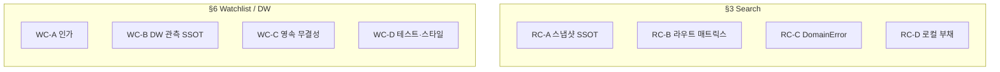

# Bug bash — `src/application/search` audit

> **SOTA++ 요약**: **§0** = 병렬 레인·심각도·DoD·안티패턴(운영 메타). **§3 / §6** = RC·WC 루트 코어스(기술 본문). 스프린트 할당은 §0.2만 봐도 됨.

`src/application/search` 하위 **전체 감사** 결과와 **문제점·남은 과제**를 모았다. **`src/application/watchlist`·`src/application/drinking-window` 감사는 §6.**

**범위**: 기본은 `src/application/search/**/*.ts` + 유스케이스 주입 `src/config/container-usecases.ts`. §6은 경계 모듈 보조.

**최종 갱신**: 2026-04-06 (전체 감사 재실행 · 아래 항목 코드와 대조 확인 · **§0.6** 100점 인정 체크리스트)

**구조**: §3·§6 남은 과제는 **루트 코어스(RC-*, WC-*)** 로 묶음 — 번호(3.1, 6.3…) 나열이 아니라 **원인별 한 방향 액션** 위주.

---

## 0A. Re-baseline SSOT (2026-04-06 implementation)

이번 구현 반영 후 이 문서는 아래 태스크를 **코드 기준 완료/부분 완료** 상태로 본다.

| Task | 상태 | 코드 기준 |
|------|------|-----------|
| **T10–T12** | **완료** | replay가 search 응답의 `decision_snapshot`을 우선 비교하고, nested `feature_flags`까지 계약 필드 기준 deep compare. legacy runtime snapshot은 호환 fallback으로만 유지. |
| **T20–T22** | **부분 완료** | search/hybrid/interpret/resolve capability matrix를 문서·계약 기준으로 고정. Hybrid는 shared pre-route(`security + SAT + cache + decomposition`)를 공유, Interpret는 planner only, Resolve는 `security + SAT + resolver only`. |
| **T40–T43** | **완료** | watchlist는 `X-Authenticated-Subject` 기반 subject-scoped CRUD/list/deliveries. `POST` body의 `user_id` 제거, `GET /v1/watchlist` 추가, cross-user는 `404`, missing subject는 `401`, delivery log append는 부모 존재 시에만 기록. |
| **T50–T52** | **완료** | drinking-window는 canonical check DTO에 `targetYear`를 필수화하고, 결과 block에 optional `peakYear` 노출. predictor 실패는 block omit + warning log의 soft-fail. |
| **T60** | **완료** | LTR rerank는 duplicate `entityId` overwrite 없이 stable bucket으로 보정. cache integration 파일은 runtime 코드가 아닌 documentation-only reference로 명시. |
| **T90** | **진행 중** | 관련 unit/e2e/contract 회귀 테스트 추가. 전체 lane 검증은 `typecheck + targeted vitest` 기준으로 확인. |

### 0A.1 Search-Family Matrix (fixed)

| Route | 고정 capability |
|------|------------------|
| **`POST /v1/search`** | `security + decomposition + planner + SAT + cache + route resolution + ranked post-route` |
| **`POST /v1/search/hybrid`** | `security + decomposition + planner + SAT + cache + forced hybrid retrieval + ranked post-route` |
| **`POST /v1/search/interpret`** | `security + planner only` |
| **`POST /v1/entity/resolve`** | `security + planner + SAT + resolver only` |

### 0A.2 Deferred / not closed here

- **RC-C**: search application layer plain `Error` 잔여는 이번 패치 기준 새 증거 없음. 기존 domain error 경로 유지.
- **응답 grouping / broader contract enrichments**: `ResultGrouper`의 추가 메타 노출 같은 API 확장은 이번 묶음 범위 밖.

---

## 0. 병렬 실행 · 완료 정의 (SOTA 메타)

**목표**: 패치를 한 줄씩 쌓지 않고, **트랙 단위로 병렬 착수**하고 **DoD로 끝을 명시**한다.

### 0.1 심각도 × 영향 (우선순위 한 장)

| 루트 | 유형 | 제품/보안 영향 | 기술 부채 |
|------|------|----------------|-----------|
| **WC-A** | 신뢰 경계 | **높음** — IDOR·주체 위조 가능 시 프로덕션 노출 불가 | 인증 붙이면 API 계약 전면 |
| **RC-A** | 정합성 | **중~높음** — 리플레이·회귀 비교 의미 흔들림 | 스냅샷 빌더·비교 규칙 한 번에 고쳐야 함 |
| **WC-B** | 정합성 | **중간** — 응답 품질·연도 불일치는 점진적 악화 | DTO·매퍼·유스케이스 동시 정리 |
| **RC-B** | 기능 패리티 | **중간** — 라우트별 기대 불일치 | 매트릭스 확정 후 일괄 wiring |
| **RC-C** | 운영성 | **낮음~중간** — 디버깅·HTTP 일관성 | 소수 에러 코드로 수렴 가능 |
| **WC-C** | 무결성 | **낮음** (PG FK 있으면 DB가 보조) | 정책 한 번이면 끝 |
| **RC-D / WC-D** | 유지보수 | 낮음 | 파일 단위 |

### 0.2 병렬 레인 (동시에 가져갈 수 있는 조합)

**파일/도메인 충돌이 적어 동시 착수에 좋은 조합:**

| 레인 | 루트 | 주요 터치 영역 | 비고 |
|------|------|----------------|------|
| **L1** | RC-A | `replay.usecase.ts`, `search-usecase-decision-snapshot.ts`, `replay` 비교 | 제품/RFC와 **스냅샷 의미** 합의 선행 권장 |
| **L2** | RC-B + 일부 RC-D | `hybrid.usecase.ts`, `decomposed-search`, `interpret`, `resolve`, OpenAPI | **기능 매트릭스** 문서 한 장 먼저 |
| **L3** | RC-C | `decomposed-search.usecase.ts`, 도메인 에러 타입 | RC-A와 **거의 독립** — 병렬 가능 |
| **L4** | WC-A | `watchlist.route.ts`, `watchlist.schema.ts`, `WatchlistService`, 인증 훅 | 검색 코드와 **경로 분리** — 병렬 가능 |
| **L5** | WC-B | `search-usecase-map-result-items.ts`, `drinking-window.usecase.ts`, DTO | **WC-B는 L5 단일 PR**이 이상적 (쪼개면 또 패치) |
| **L6** | WC-C | `watchlist.service.ts`, 스토리지 포트 | WC-A와 **나중에 맞춰도 됨**; 무결성만 먼저도 가능 |
| **L7** | RC-D + WC-D | LTR, 캐시 가이드, watchlist 단위 테스트 | **언제든 병렬** |

**직렬로 묶는 편이 나은 것**: **WC-B**(입력/출력 DTO·실패 정책)는 한 번에 설계 → 구현. **RC-A**(비교 제외 필드 vs SSOT)는 제품 결정 한 번 후 구현.

### 0.3 루트 코어별 완료 정의 (DoD)

- **RC-A DoD**: (1) “리플레이가 비교하는 스냅샷”과 “검색 응답 스냅샷”의 필드 의미가 문서에 표로 고정되거나 (2) 동일 빌더를 쓴다. `SNAPSHOT_MISMATCH`가 **의도된 것만** 난다는 회귀 테스트 또는 체크리스트.
- **RC-B DoD**: 라우트 × (decomposed / SAT / 캐시 / …) **매트릭스**가 RFC 또는 이 문서에 있고, 코드·OpenAPI와 불일치 항목 0.
- **RC-C DoD**: 해당 경로에 plain `Error` 0, DomainError(또는 합의된 타입) + 코드 + HTTP 매핑 테스트.
- **RC-D DoD**: LTR·캐시 가이드 항목이 “완료” 또는 “의도적 유지”로 표시.

- **WC-A DoD**: 인증된 주체만 본인 리소스 CRUD; `user_id` 스키마가 주체 모델과 일치; IDOR 재현 시나리오 테스트 실패(차단).
- **WC-B DoD**: `targetYear`·critic·peak 노출 여부·실패 시 동작이 **한 타입/한 헬퍼**에서 결정되고, 매퍼는 그걸 호출만 함.
- **WC-C DoD**: 로그 append 불변식이 코드 또는 DB 제약으로 보장되거나 문서화; `clear()`는 운영 경로에서 분리.
- **WC-D DoD**: 앱 레이어 최소 1개 파일에 단위 테스트 또는 계약 테스트로 고정.

### 0.4 의존성 (병렬 vs 직렬)

- **검색(§3)** 과 **워치리스트/음주창(§6)** 은 코드 경로가 다르므로 **팀·PR 단위로 병렬** 가능.
- **판단 선행 권장(직렬이 덜 아픈 순서)**: RC-A·WC-B는 “의미/스키마” 합의 → 구현. WC-A 인가 모델이 잡혀야 “내 워치리스트” UX(WC-A 표의 ‘목록’)가 자연스럽게 닫힘.

### 0.5 안티패턴 (점수 깎는 행위)

- 동일 루트에서 나온 증상을 **파일마다 다른 숫자로만** 고치기.
- RC-A에서 필드 하나만 맞추고 `recordsMatch`는 그대로 두기.
- WC-B에서 `targetYear`만 넣고 critic 기본값·실패 무음은 나중에.
- WC-A에서 라우트만 막고 서비스 레이어는 그대로 두기(우회 경로 남음).

### 0.6 도메인 연결·품질 **100점 인정** 체크리스트 (이번 트랙)

아래를 **전부** 만족하면 “이번 변경 묶음(도메인 연결 + 도구)”은 **100점 인정**으로 본다. (항목은 병렬로 찍어도 됨.)

| # | 완료 기준 |
|---|-----------|
| **1** | `npm run typecheck` + `npm run test` (unit) + `npm run verify:http-contracts` **통과**. |
| **2** | `npm run domain:orphans` 실행 시 **비-barrel orphan 0건** (배럴 `index.ts` 안내만 나오는 것은 OK). |
| **3** | **페어링 soft 제약**: 의도 쿼리 1건 이상에서 `pairing` 제약이 플랜에 붙는 것을 **단위 테스트 또는 스모크**로 고정 (NL 매퍼와 중복 시 우선순위/중복이 의도인지 한 줄 코멘트). |
| **4** | **`resultType` (Epic 8)**: `targetEntityType`이 있을 때 `producer_set` / `region_set` / `style_set` / `wine_set`이 나오는 경로가 **OpenAPI·`SearchResponseV1` 주석과 모순 없음** (스키마 필드 누락 시 §3 RC-B와 합의). |
| **5** | **Ingestion 오염 플래그**: `marketplace_contamination_suspected`가 **다음 중 하나**로 문서화됨 — (a) 매칭 게이트에서 소비, (b) 수동 리뷰 큐만, (c) “플래그만·추후” **의도 명시**. |
| **6** | **Feedback TTL**: `npm run feedback:prune-ttl`을 **스테이징 또는 로컬 PG**에서 1회 실행해 에러 없이 종료(또는 `feedbackTtlEnforcer`를 호출하는 크론/잡이 합의됨). |
| **7** | **모드 가중치**: `getModeWeights`가 **랭킹 수식에 아직 안 섞였다면** “RFC-017 대기 / 배럴 노출만”이 코드 주석 또는 이 문서 **한 줄**에 있음 (나중에 섞을 때 회귀 기준). |

---

### 이번 실행에서 확인한 것 (요약)

- **51개** `.ts` 유지; `TODO` / `FIXME` / `console.*` 프로덕션 매치 **없음** (grep).
- **`hybrid.usecase.ts`**: shared `decomposedSearch` wiring 반영; `/v1/search/hybrid`도 compare query에서 `ComparisonSearchResponse`를 반환할 수 있도록 contract 포함 정렬됨.
- **Replay** (`replay.usecase.ts`): `currentSnapshot = buildDecisionSnapshotFromRuntimeVersions(...)`; 비검색 응답은 **`UnexpectedReplayResponseError`** (DomainError).
- **Decomposed / Resolve**: 부모 `context` / `sessionContext` / `queryBudget` 전달과 `Resolve` Constraint SAT fail-fast는 반영됨.
- **스냅샷** (`search-usecase-decision-snapshot.ts`): 런타임 기본 vs 플랜 오버레이 의미 정리는 여전히 **RC-A**.
- **`throw new Error`**: 프로덕션 `src/application/search/**/*.ts` 기준 **매치 없음**.
- **Decision trace policy cast**: 제거됨. trace 전용 policy 타입으로 정리됨.

---

## 1. 감사 요약

| 항목 | 결과 |
|------|------|
| **파일 수** | **51개** `*.ts` (유스케이스, 헬퍼, `port/`, DTO, `__tests__/`) |
| **교차 확인** | `src/config/container-usecases.ts` |
| **자동 검색** | 프로덕션 `*.ts`에서 `TODO` / `FIXME` / `console.(log\|error\|warn\|debug)` — **매치 없음** |
| **테스트 참고** | `src/application/search/__tests__/`, `test/unit/application/search/` |

### 1.1 자동 스캔 스냅샷 (리스크 후보)

| 패턴 | 위치 |
|------|------|
| `plan.policy as unknown as …` | **매치 없음** |
| `throw new Error` | **매치 없음** |
| ` as any` | **테스트만**: `__tests__/search-injection-defense.test.ts` |

### 1.2 파일 인벤토리 (51)

| 구분 | 파일 |
|------|------|
| 유스케이스 | `search`, `hybrid`, `interpret`, `resolve`, `replay`, `decomposed-search`, `batch-search` (`.usecase.ts`) |
| DTO | `search-request`, `hybrid-request`, `interpret-request`, `resolve-request`/`resolve-response`, `replay-request`, `batch-search` (`.dto.ts`) |
| port | `search-pipeline-deps`, `search-executor`, `search-route-usecases` |
| 보안·프리라우트·캐시 | `query-entry-security`, `search-usecase-security-gate`, `search-usecase-pre-route-phase`, `search-usecase-cache-*`, `search-usecase-constraint-*`, `search-usecase-planner-context` |
| 라우트·랭킹·후처리 | `search-usecase-route-*`, `search-usecase-hybrid-*`, `search-usecase-mixed-route`, `search-usecase-post-route-phase`, `search-usecase-ranked-route-resolve`, `search-usecase-resolver-candidates`, `search-usecase-entity-resolver-input`, `search-usecase-ltr-rerank`, `search-usecase-ranking-scores`, `search-usecase-map-result-items`, `search-usecase-execute-builders` |
| 결정·스냅샷 | `search-usecase-decision-input`, `search-usecase-decision-snapshot`, `search-usecase-counterfactuals`, `drinking-window-confidence`, `search-usecase-cache-integration` |
| barrel | `index.ts` |
| `__tests__` | `query-entry-security`, `search-injection-defense`, `specialized-retrieval-routing`, `search-usecase-post-route-phase`, `drinking-window-confidence` |

---

## 2. 해소된 항목 (이전 감사 대비)

### Query-entry 보안 스택 parity (Search / Hybrid / Interpret / Resolve)

- `src/config/container-usecases.ts`에서 공통으로 **`injectionJudge`**, **`judgeFailureMode`**, **`queryEntrySecurityObserver`** (`getQueryEntrySecurityMetricsCollector()`)를 주입한다.
- `InterpretUseCase`, `ResolveUseCase`는 `createSearchQuerySecurityGate`에 위 필드를 전달한다.

### Replay — 비검색 응답 분기

- 비교 응답 등 비정상 케이스는 **`UnexpectedReplayResponseError`** (`DomainError`, 코드 `UNEXPECTED_REPLAY_RESPONSE`)로 처리. 구 `throw new Error(...)` 제거.

---

## 3. 남은 문제점 — 루트 코어스 (patch 스택 쌓지 말 것)

같은 원인에서 나온 증상은 **한 번에 설계로 닫는다.** 아래 네 덩어리가 상위 원인이다.

---

### RC-A — 스냅샷·비교의 **단일 소스 오브 트루스**가 없음

**원인**: “검색 응답에 실린 스냅샷”과 “리플레이가 쓰는 현재 스냅샷”이 **서로 다른 빌더·다른 필드 의미**를 쓰면, 비교·리그레션 의미가 흔들린다.

| 증상 | 정리 |
|------|------|
| Replay vs 검색 | 리플레이는 `buildDecisionSnapshotFromRuntimeVersions`만 → policy/threshold/planner는 `DEFAULT_*`. 검색 쪽은 플랜 오버레이. → `SNAPSHOT_MISMATCH` 과검출 가능 (`replay.usecase.ts`, `search-usecase-decision-snapshot.ts`). |
| `feature_flags` 비교 | `recordsMatch()`가 **얕은** 키/값 비교 — 중첩이 생기면 비교 의미가 깨짐. |

**한 방향 액션**: (1) 비교에 쓰는 스냅샷을 **한 빌더·한 스키마**로 고정하거나 (2) “어떤 필드는 비교 제외”를 **문서·계약**으로 고정. 그 다음에 필요하면 deep compare 등 **구현 한 번**.

**부수**: decision trace policy 입력은 전용 타입으로 정리됐고, 남은 핵심은 snapshot comparison semantics 쪽이다.

---

### RC-B — **라우트별 유스케이스 조합**이 메인 검색과 어긋남

**원인**: Hybrid / Decomposed / Resolve / Interpret가 **같은 사용자 기대(컨텍스트·제약·기능)**를 공유한다고 가정하지 않고, wiring만 다르게 두면 **제품 단위로 깨진 경험**이 된다.

| 증상 | 정리 |
|------|------|
| Interpret | Constraint SAT·캐시 **없음** — “플래너만”이면 의도적일 수 있음. |

**한 방향 액션**: “검색 패밀리”에 대한 **기능 매트릭스**(어떤 라우트에 어떤 게 들어가는지)를 한 번 정하고, 코드는 그 표에 맞춰 **한 번에** wiring·OpenAPI·RFC를 맞춘다.

---

### RC-C — **검색 패밀리 비정상 응답 에러 계약**

이 축은 현재 search 영역 기준으로는 대부분 닫혔다.

- Replay: `UnexpectedReplayResponseError`
- Decomposed: `UnexpectedDecomposedResponseError`
- 프로덕션 `src/application/search/**/*.ts` 기준 plain `Error` 매치 없음

남은 일은 “새 비정상 응답 분기 추가 시 DomainError를 기본값으로 유지”하는 정도의 운영 규율이다.

---

### RC-D — **로컬 구현·문서 부채** (위 세 가지와 독립)

| 항목 | 내용 |
|------|------|
| LTR rerank | `search-usecase-ltr-rerank.ts` — `Map` 키 `entityId as string`, 중복 엔티티 엣지 시 보강·테스트. |
| 캐시 가이드 파일 | `search-usecase-cache-integration.ts` — 의사코드 성격; 실제 캐시 경로와 **문서 링크·위치** 정리. |

---

### P3 — 낮은 우선순위 (RC-D에 가깝게 유지)

- **Barrel `index.ts`**: DTO·에러 타입 deep import — 표면 API 정책 문서화.
- **테스트 `as any`**: `__tests__/search-injection-defense.test.ts`.
- **LTR 헬퍼 단위 테스트**: 전용 테스트가 얇으면 회귀 추적 비용 증가 가능.

---

## 4. 긍정적으로 확인된 것

- 프로덕션 `src/application/search/**/*.ts`(테스트 제외)에서 **TODO/FIXME/console 로깅 남발** 패턴은 감사 시 유의미하게 잡히지 않음.
- `dispatchSearchRouteExecution`은 `QueryRoute` 유니온으로 라우트 분기 누락을 타입으로 막기 쉬운 형태.
- `BatchSearchUseCase`는 비교 응답 등 비정상 케이스를 아이템 실패로 매핑하는 등 방어 로직이 있음.
- **Replay** 비검색 응답은 **DomainError** 계열로 정리됨.

---

## 5. 권장 처리 순서 (루트 코어스 기준)

**병렬 할당은 §0.2 레인 표**를 쓴다. 아래는 **리스크 대비 권장 순서**(한 줄기로만 읽을 때).

1. **RC-A**: 스냅샷 비교 SSOT 한 번에 고정(또는 비교 제외 필드 문서화) → shallow compare·policy 캐스트는 그 다음에만.
2. **RC-B**: 검색 패밀리 **기능 매트릭스** 확정 → Hybrid / Decomposed / Resolve / Interpret wiring·문서를 한 번에.
3. **RC-C**: decomposed 등 남은 plain `Error` → DomainError 승격을 한 규칙으로.
4. **RC-D**: LTR·캐시 가이드 파일 등 로컬 부채.
5. **WC-A ~ WC-B**: Watchlist **인가 모델** + Drinking window **관측 컨텍스트 SSOT**(한 번에 잡는 게 `targetYear`/critic/실패 노출 패치를 반복하지 않게 함).

**동시에 진행 예시**: (RC-C + RC-D + WC-D) 는 (RC-A + WC-A) 과 **다른 사람/브랜치**로 병렬 가능 — §0.1 심각도로 WC-A·RC-A에 리소스 우선 배정.

---

## 6. `watchlist` / `drinking-window` — 루트 코어스

**최종 갱신**: 2026-04-06

애플리케이션 파일: [watchlist.service.ts](/Users/songmin/wine-search-engine/src/application/watchlist/watchlist.service.ts) 1개, [drinking-window.usecase.ts](/Users/songmin/wine-search-engine/src/application/drinking-window/drinking-window.usecase.ts) + [port](/Users/songmin/wine-search-engine/src/application/drinking-window/port/drinking-window-usecase.port.ts) 2개. HTTP·검색 연계는 **같은 루트에서 나온 증상**으로 묶음.

---

### WC-A — **식별·인가 모델 부재** (누가 어떤 리소스에 접근하는가)

**원인**: API와 서비스가 “요청자 = 주체”를 전제하지 않고 **id·body만** 본다. 그래서 아래가 **한 줄기**로 이어진다.

| 증상 | 정리 |
|------|------|
| IDOR | [watchlist.route.ts](/Users/songmin/wine-search-engine/src/interface/http/routes/watchlist.route.ts) `GET/DELETE/:id`, `.../deliveries` — UUID만 알면 타인 엔트리·배송 로그 접근. [WatchlistService](/Users/songmin/wine-search-engine/src/application/watchlist/watchlist.service.ts)도 소유권 미검증. |
| 임의 `user_id` | `POST` body의 `user_id`가 [스키마](/Users/songmin/wine-search-engine/src/interface/http/schemas/watchlist.schema.ts)상 UUID 형식만 강제 — **인증 subject와 무관**. |
| “내 목록” 불가 | [listByEntityId](/Users/songmin/wine-search-engine/src/application/watchlist/watchlist.service.ts)만 있고 **user 기준 목록·HTTP 없음** — 정상 UX는 결국 **인증 + list**와 같은 설계에서만 나온다. |

**한 방향 액션**: **인증 주체 → 리소스 소유** 규칙을 한 번 정하고, 라우트·스키마·서비스를 그에 맞게 **통째로** 맞춘다(부분 패치로 6.1만 고치지 말 것).

---

### WC-B — Drinking window **관측 컨텍스트 SSOT** 없음 (연도·입력·출력·실패)

**원인**: 검색 후처리·유스케이스·포트가 “같은 의미의 한 순간(연도·점수·피크)”을 **한 객체/한 파이프라인**으로 공유하지 않는다. 증상이 여러 번호로 쪼개져 보일 뿐이다.

| 증상 | 정리 |
|------|------|
| 연도 불일치 | [search-usecase-map-result-items.ts](/Users/songmin/wine-search-engine/src/application/search/search-usecase-map-result-items.ts)는 `currentYear`로 캐시 행 drinkable을 계산하지만 `check()`에 **`targetYear` 미전달** → [DrinkingWindowUseCase](/Users/songmin/wine-search-engine/src/application/drinking-window/drinking-window.usecase.ts)는 서버 `getFullYear()` 고정. |
| `peakYear` 드롭 | [predictor port](/Users/songmin/wine-search-engine/src/domain/drinking-window/port/drinking-window-predictor.port.ts)에는 있으나 [DrinkingWindowBlock](/Users/songmin/wine-search-engine/src/domain/response/model/result-item.ts)·유스케이스로 안 넘김 — **제품 스키마 결정**이 선행. |
| 입력 중복·시그니처 혼란 | port·use case에 **동일 request 타입 중복**, `check()`는 `Promise`인데 예측은 동기 — 필드 추가 시 **파일 여러 개 패치** 위험. |
| critic 기본 80·실패 무음 | 같은 매퍼에서 `avgCriticProxyScore ?? 80`, `Promise.allSettled`로 **거부 시 블록 생략** — 정책·관측 없이 숫자만 바꾸면 또 패치. |

**한 방향 액션**: “검색 결과에 붙는 drinking window 한 건”에 대해 **입력 DTO(연도·critic·…)** 와 **출력 DTO(peak 포함 여부)** 와 **실패 시 정책(omit vs 오류 vs 메트릭)** 을 한 표로 정한 뒤, 매퍼·`check()`·블록을 **한 번에** 맞춘다.

---

### WC-C — Watchlist **영속 계층 무결성**을 앱이 보장하지 않음

**원인**: 로그·전체 삭제가 “도메인 규칙”이 아니라 **스토리지 편의**에 가깝게 노출됨.

| 증상 | 정리 |
|------|------|
| `recordDeliveryLog` | [WatchlistService](/Users/songmin/wine-search-engine/src/application/watchlist/watchlist.service.ts)가 존재 확인 없이 `append` — FK 없는 저장소에선 고아 로그 가능. |
| `clear()` on port | 운영 서비스 포트에 **전체 삭제** — 테스트/전용 API와 분리 안 하면 오용 위험. |

**한 방향 액션**: 불변식(“로그는 항상 존재하는 watchlist에만”)을 **한 정책**으로 정하고, 앱 vs 인프라 경계를 맞춤.

---

### WC-D — 테스트·스타일

- 앱 디렉터리 **전용 단위 테스트** 부족 — 규칙은 [라우트·predictor 테스트](/Users/songmin/wine-search-engine/src/__tests__/watchlist-routes.test.ts) 등에 분산.
- [watchlist.route.ts](/Users/songmin/wine-search-engine/src/interface/http/routes/watchlist.route.ts) 일부 핸들러 **들여쓰기**만 어색(동작 무관).

---

*리팩터링 후 §3·§6·§0 DoD를 루트 코어스 기준으로 맞출 것.*
