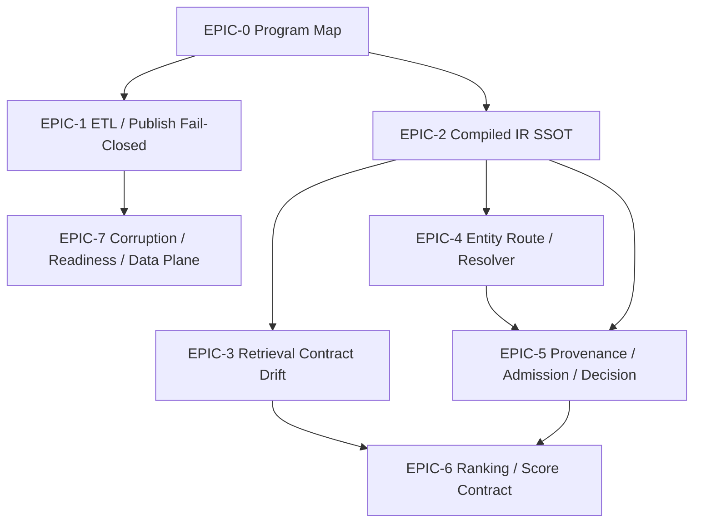

# Apr 14 Pipeline Retrival Bughbash

> 목표: `/v1/search`의 `retrieval -> ranking -> decision -> publish/readiness` 전 구간을 `fail-closed + compiled-first + provenance-closed`로 재정렬한다.  
> 원칙: ROI 무관, heuristic fallback 금지, partial success 금지, broken signal 정상값 위장 금지.

## 왜 지금 조지나

현재 파이프라인은 개별 축의 개선은 많이 들어갔지만, 아직 아래 문제가 남아 있다.

- ETL/publish가 "검증 불가"를 artifact 성공처럼 통과시킬 수 있다.
- runtime retrieval이 unknown/corrupt input을 정상 lexical/hybrid 값처럼 위장하는 seam이 남아 있다.
- entity route는 exact resolution인데도 hydration/evidence/projection이 partial state를 허용하는 곳이 있었다.
- decision trace는 훨씬 좋아졌지만 `policy / observed / missing`을 한 눈에 재구성하는 closure surface는 아직 완전히 닫히지 않았다.
- readiness/data-plane은 일부 corrupted/default/drift 상태를 "empty/ok"처럼 처리하는 경향이 남아 있다.

이 보드는 그 seam들을 에픽 단위로 잘라서, merge 순서까지 포함해 닫는 것이 목적이다.

## 이번 보드의 절대 불변식

1. `CompiledWineQuery`는 production search runtime의 유일한 execution SSOT다.
2. unknown / missing / corrupt / validation-failed input은 정상값으로 위장하지 않는다.
3. retrieval / ranking / rerank / resolver signal은 authority가 아니다.
4. exact/entity route는 partial hydration 또는 fake evidence로 성공을 위장하지 않는다.
5. publish / backfill / readiness는 검증 불가 상태에서 fail-open 하지 않는다.

## 오늘 바로 조질 P0 8개

1. `validate-silver` coverage gate를 기본 blocker로 유지하고 partial opt-in만 예외로 둔다.  
   근거: [validate-silver.ts](</Users/songmin/Documents/code-wine/wine-search-engine/scripts/etl/validate-silver.ts:30>), [validate-silver.ts](</Users/songmin/Documents/code-wine/wine-search-engine/scripts/etl/validate-silver.ts:169>)
2. `publish-search-snapshot`은 fixture repo 없으면 prod publish를 중단한다.  
   근거: [publish-search-snapshot.ts](</Users/songmin/Documents/code-wine/wine-search-engine/scripts/etl/publish-search-snapshot.ts:498>)
3. `drinking-window-backfill`은 partial output write를 금지한다.  
   근거: [drinking-window-backfill.ts](</Users/songmin/Documents/code-wine/wine-search-engine/scripts/etl/drinking-window-backfill.ts:167>), [drinking-window-backfill.ts](</Users/songmin/Documents/code-wine/wine-search-engine/scripts/etl/drinking-window-backfill.ts:212>)
4. entity candidate hydration에서 batch/single fetch failure를 삼키지 않는다.  
   근거: [search-usecase-resolver-candidates.ts](</Users/songmin/Documents/code-wine/wine-search-engine/src/application/search/search-usecase-resolver-candidates.ts:176>)
5. `uncertaintyPenalty`가 NaN이면 neutral confidence로 위장하지 않는다.  
   근거: [search-usecase-map-result-items.ts](</Users/songmin/Documents/code-wine/wine-search-engine/src/application/search/search-usecase-map-result-items.ts:24>), [search-usecase-map-result-items.ts](</Users/songmin/Documents/code-wine/wine-search-engine/src/application/search/search-usecase-map-result-items.ts:349>)
6. unknown retrieval channel은 `sparse_bm25`로 강제하지 않는다.  
   근거: [retrieval-channel.ts](</Users/songmin/Documents/code-wine/wine-search-engine/src/domain/retrieval/model/retrieval-channel.ts:101>)
7. unknown retrieval mode는 legacy heuristic으로 떨어뜨리지 않는다.  
   근거: [retrieval-profile.ts](</Users/songmin/Documents/code-wine/wine-search-engine/src/domain/retrieval/service/retrieval-profile.ts:330>)
8. threshold default row 누락/shape drift는 prod에서 in-memory default로 위장하지 않는다.  
   근거: [pg-threshold-store.ts](</Users/songmin/Documents/code-wine/wine-search-engine/src/infrastructure/adapter/pg-threshold-store.ts:72>)

## 에픽 맵

| Epic | 주제 | 선행 | 핵심 산출물 |
|---|---|---|---|
| `EPIC-0` | 프로그램 맵, 공통 invariant, failure taxonomy | 없음 | 공통 vocabulary |
| `EPIC-1` | ETL / publish fail-closed | 없음 | artifact gate 재정의 |
| `EPIC-2` | compiled IR SSOT | 없음 | runtime execution contract 통일 |
| `EPIC-3` | retrieval contract drift cutoff | `EPIC-2` | unknown/fallback 차단 |
| `EPIC-4` | entity route / resolver closure | `EPIC-2` | exact path fail-closed + evidence closure |
| `EPIC-5` | provenance / admission / decision closure | `EPIC-2` | policy-observed-missing trace |
| `EPIC-6` | ranking / score contract closure | `EPIC-3`, `EPIC-5` | broken score masking 제거 |
| `EPIC-7` | corruption / readiness / data plane | `EPIC-1` | corrupted/default/drift fail-closed |

## 구현률 상태

| Epic | 상태 | 남은 핵심 closure |
|---|---|---|
| `E1` | 거의 구현 완료 | monitor only |
| `E2` | 부분 구현 | compiled fallback residual seam |
| `E3` | 거의 구현 완료 | monitor only |
| `E4` | 부분 구현 | batch hard-requirement, resolver trace, native projection |
| `E5` | 부분 구현 | stable provenance trace, unified taxonomy, typed schema |
| `E6` | 부분 구현 | NaN masking, rerank failure contract, score projection |
| `E7` | 부분 구현 | JSONB/PG loud failure, threshold/readiness strictness |
| `E8` | 미구현 | public id authority model |
| `E9` | 미구현에 가까움 | client union safety, query contract parity |
| `E10` | 미구현에 가까움 | replay golden trace, shortfall timeline |

## Dependency Graph

## 병렬 실행 Wave

- Wave A
  - `EPIC-1`
  - `EPIC-2`
- Wave B
  - `EPIC-3`
  - `EPIC-4`
  - `EPIC-5`
- Wave C
  - `EPIC-6`
  - `EPIC-7`

## 완료 정의

다음이 모두 성립해야 이번 버그배시를 닫는다.

1. production search runtime에서 compiled-less fallback이 제거된다.
2. entity/hybrid/mixed 전 경로가 공통 execution/provenance vocabulary를 사용한다.
3. unknown/missing/corrupt input이 empty/neutral/fallback normal state로 위장되지 않는다.
4. publish/backfill/readiness가 "검증 불가" 상태에서 fail-closed 한다.
5. response/meta/audit/debug만 보면 `왜 resolved/ambiguous/failed 인지`를 policy-observed-missing 기준으로 재구성할 수 있다.

## 읽기 순서

1. [EPIC-0-program-map.md](./EPIC-0-program-map.md)
2. [EPIC-1-etl-publish-fail-closed.md](./EPIC-1-etl-publish-fail-closed.md)
3. [EPIC-2-compiled-ir-ssot.md](./EPIC-2-compiled-ir-ssot.md)
4. [EPIC-3-retrieval-contract-drift.md](./EPIC-3-retrieval-contract-drift.md)
5. [EPIC-4-entity-route-resolver-closure.md](./EPIC-4-entity-route-resolver-closure.md)
6. [EPIC-5-provenance-admission-decision-closure.md](./EPIC-5-provenance-admission-decision-closure.md)
7. [EPIC-6-ranking-score-contract-closure.md](./EPIC-6-ranking-score-contract-closure.md)
8. [EPIC-7-corruption-readiness-data-plane.md](./EPIC-7-corruption-readiness-data-plane.md)
9. [TASK-DAG.md](./TASK-DAG.md)
10. [tasks/README.md](./tasks/README.md)

## 구현 티켓 인덱스

실제 남은 구현분은 `tasks/` 아래에 티켓 단위로 쪼개뒀다.

- [tasks/README.md](./tasks/README.md)
- Wave 1부터 순서대로 구현하면 된다.

각 티켓은 이제 단순 TODO가 아니라 아래를 포함하는 implementation packet이다.

- 수정 대상 파일
- 구현 단계
- 금지사항
- 테스트
- 검증 명령
- 완료 조건

## 상위 SSOT 문서

- [retriever-pipeline.md](</Users/songmin/Documents/code-wine/wine-search-engine/docs/system-overview/retriever-pipeline.md:1>)
- [ingestion-pipeline.md](</Users/songmin/Documents/code-wine/wine-search-engine/docs/system-overview/ingestion-pipeline.md:1>)
- [RFC-016.md](</Users/songmin/Documents/code-wine/wine-search-engine/docs/RFC-016.md:47>)
- [RFC-017.md](</Users/songmin/Documents/code-wine/wine-search-engine/docs/RFC-017.md:745>)
- [adr/002-error-handling-tiers.md](</Users/songmin/Documents/code-wine/wine-search-engine/docs/adr/002-error-handling-tiers.md:7>)
