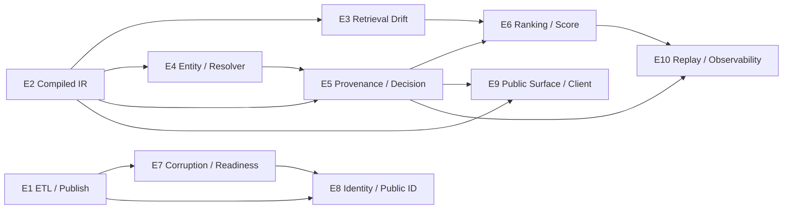

# TASK DAG

## Wave Plan

### Wave A

- `EPIC-1 ETL / Publish Fail-Closed`
- `EPIC-2 Compiled IR SSOT`

### Wave B

- `EPIC-3 Retrieval Contract Drift Cutoff`
- `EPIC-4 Entity Route / Resolver Closure`
- `EPIC-5 Provenance / Admission / Decision Closure`

### Wave C

- `EPIC-6 Ranking / Score Contract Closure`
- `EPIC-7 Corruption / Readiness / Data Plane`

### Wave D

- `EPIC-8 Identity / Public ID Immutability`

### Wave E

- `EPIC-9 Public Surface / Client Contract Discipline`
- `EPIC-10 Replay / Observability / Golden Set`

## Dependency Graph

## 병렬 실행 규칙

| 병렬 가능 | 이유 |
|---|---|
| `E1` + `E2` | ETL/publish와 runtime IR는 write set이 다름 |
| `E3` + `E4` | retrieval drift 차단과 entity exact closure는 공통 vocabulary만 맞추면 병렬 가능 |
| `E3` + `E5` | execution facts와 decision closure는 인터페이스 합의 후 병렬 가능 |
| `E6`는 `E3/E5` 이후 | score contract는 retrieval/decision vocabulary가 먼저 고정돼야 함 |
| `E7`은 `E1` 이후 | publish/readiness acceptance를 ETL fail-closed 기준으로 맞춰야 함 |
| `E8`은 `E1/E7` 이후 | public id authority는 exact artifact/publish substrate semantics가 먼저 고정돼야 함 |
| `E9`는 `E2/E5` 이후 | public surface는 compiled vocabulary와 provenance block이 먼저 고정돼야 함 |
| `E10`은 `E5/E6` 이후 | replay/eval/log harness는 trace vocabulary와 degraded score semantics를 기준으로 묶어야 함 |

## merge 순서

1. `E1`
2. `E2`
3. `E3`
4. `E4`
5. `E5`
6. `E6`
7. `E7`
8. `E8`
9. `E9`
10. `E10`

## 차단 조건

- `E2`가 끝나기 전에는 `E3`, `E5`의 public contract 문구를 확정하지 않는다.
- `E4`는 `E5`가 정의한 provenance/evidence vocabulary를 따라야 merge 가능하다.
- `E6`는 rerank failure와 uncertainty degradation contract를 `E5`의 trace vocabulary와 맞춰야 한다.
- `E7`은 strict readiness와 corrupted row loud failure가 실제 runtime consumers를 깨지 않는지 통합 검증 후 머지한다.
- `E8`은 immutable snapshot/public id authority contract가 `E1`, `E7`의 exactness/strictness 문구와 충돌하지 않아야 merge 가능하다.
- `E9`는 comparison/search union과 explain/debug surface가 `E2`, `E5`의 public contract를 다시 흐리지 않아야 merge 가능하다.
- `E10`은 replay/golden/log vocabulary가 `E5`, `E6`의 trace/score semantics와 동일해야 merge 가능하다.

## 완료 체크리스트

- [ ] compiled-less production runtime seam 제거
- [ ] unknown retrieval channel/mode fail-closed
- [ ] entity route partial hydration 제거
- [ ] provenance trace stable surface 도입
- [ ] rerank/uncertainty masking 제거
- [ ] corrupted/default/drift fail-closed
- [ ] publish/backfill partial success 금지
- [ ] exact artifact replay/rollback contract 고정
- [ ] public entity id immutability contract 도입
- [ ] public API/web/client contract drift 제거
- [ ] replay/golden/observability trace closure 도입
