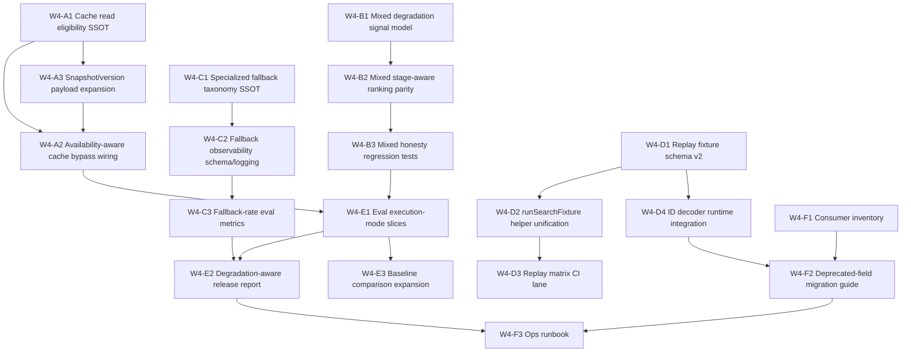

# Apr 7 — Hardening Wave 4 (operations closure → mixed parity → replay/eval consumption)

**목적:** Wave 3에서 surface한 `authority_trace_ref` / `execution_mode` / `degradation_reasons`를 **운영 레일 전체(cache read, mixed route, replay, eval, downstream)** 가 실제로 소비하게 만든다.  
**범위:** “응답에 필드는 있다”에서 멈추지 않고, **캐시·mixed/hybrid parity·specialized fallback provenance·replay matrix·eval segmentation·consumer migration**까지 **실행 가능한 작업 단위**로 고정한다.

**상위 로드맵:** `docs/rfc-apr-6-retrieval-improvement-roadmap.md` §13.1의 Wave 3 후속 운영 closure로 본 문서를 참조한다.

---

## 왜 Wave 4인가

Wave 3에서 닫힌 것은 다음이다.

- bootstrap / readiness / smoke / CI
- canonical serialization / authority rail / deterministic ids
- honesty contract (`authority_trace_ref`, `runtime_correlation_ref`, `execution_mode`, `blocking_eligible`, `degradation_reasons`)
- replay fixture 구조 검증 + executable subset
- eval advisory vs blocking 정책의 초석

Wave 4에서 닫아야 하는 것은 다음이다.

- cache가 surfaced honesty contract를 **read/write 모두** 존중
- mixed route가 hybrid와 **같은 degradation rail** 을 사용
- specialized retrieval fallback이 조용히 숨지 않고 **structured provenance** 로 남음
- replay가 구조 테스트가 아니라 **운영 회귀 레일** 로 승격
- eval/report가 authoritative/degraded/heuristic을 **분리된 축** 으로 소비
- downstream/ops가 deprecated trace 대신 새 contract를 **실제로 사용**

---

## 구현 반영 상태 (현재)

| 항목 | 상태 | 비고 |
|------|------|------|
| Cache write gate (`degraded`/`heuristic`/`advisory` 비캐시) | 완료 | `cache-policy.ts`, `CacheService.setSearchResponse` |
| Cache read fail-closed | 완료 | `cache-policy.ts`, `kill-switch-policy.ts`, `CacheService.getSearchResponse`, integration tests |
| Hybrid route degradation surfacing | 완료 | reranker / learned matcher / specialized fallback reason까지 surface |
| Mixed route degradation parity | 완료 | mixed가 `routeDegradation` / `fallbackReason` / `funnelMetrics`를 hybrid parity semantics로 surface |
| Replay fixture executable subset | 완료 | `endpoint` discriminator 기준으로 self-contained `/v1/search` + `/v1/search/replay` fixture 모두 HTTP 실행 가능 |
| Full replay HTTP/runtime matrix | 완료 | `execution_lane` 기준 self-contained + runtime-required replay fixture를 capability-aware in-memory HTTP lane에서 실행하고 CI에 고정 |
| Eval metric policy SSOT | 완료 | `eval-metric-policy.ts`, `run-offline-eval.ts` |
| Eval execution-mode segmentation | 완료 | `by_execution_mode`, `by_blocking_eligible`, degradation histogram, release report, baseline mix delta |
| ID schema version decoder | 완료 | authority / batch / snapshot v1/v2 parser |
| Decoder를 replay/audit runtime에서 실제 활용 | 완료 | replay helper + observability log enrichment에서 structured decode path 사용 |
| Deprecated `decision_trace_ref` active-gate consumer migration | 완료 | active repo/runtime/docs canonical surface 완료; historical Wave 3 doc consumer는 `retired` historical reference로 gate에서 제외 |

## Current Exit Posture

- 코드/CI/문서 기준으로 `W4-A1` ~ `W4-F3`는 대부분 구현 또는 산출물 상태로 닫힘
- local replay/eval safety rail:
  - `npm run test:e2e:replay:fixtures:self-contained`
  - `npm run test:replay:fixtures:runtime-required:audit`
  - `npm run eval:offline:smoke:local`
- 남은 운영 closure 주의:
  - runtime-required replay는 아직 full execution lane이 아니라 routing audit lane이다
  - `npm run eval:offline:with-splits:local`는 in-memory fixture corpus와 bronze 500 gold-set의 구조 mismatch 때문에 기본적으로 fail-closed 한다
  - full dataset eval은 real serving target 또는 명시적 `--allow-full-dataset` mismatch diagnostics 용도로만 사용한다

---

## Ticket DAG

**규칙**

- `1 ticket = 1 PR`
- 같은 파일 family를 건드리는 ticket은 기본 직렬이다.
- 병렬 실행은 아래 `병렬 실행 슬롯`에 명시된 조합만 허용한다.
- 본 문서는 prose backlog가 아니라 **issue-ready DAG board** 다. 구현자는 ticket 블록만 보고 작업을 시작할 수 있어야 한다.

## 병렬 실행 슬롯

| Slot | 병렬 실행 가능 ticket | 선행 완료 필요 |
|------|-----------------------|----------------|
| **1** | `W4-A1`, `W4-B1`, `W4-C1`, `W4-D1`, `W4-F1` | — |
| **2** | `W4-A3`, `W4-B2`, `W4-C2`, `W4-D2` | `W4-A1`, `W4-B1`, `W4-C1`, `W4-D1` |
| **3** | `W4-A2`, `W4-B3`, `W4-C3`, `W4-D4` | `W4-A3`, `W4-B2`, `W4-C2`, `W4-D1` |
| **4** | `W4-E1` | `W4-A2`, `W4-B3` |
| **5** | `W4-E2`, `W4-E3`, `W4-D3` | `W4-E1`, `W4-C3`, `W4-D2` |
| **6** | `W4-F2` | `W4-F1`, `W4-D4` |
| **7** | `W4-F3` | `W4-F2`, `W4-E2` |
| **EXIT** | Wave 4 Gate | 전 ticket 완료 + `Wave 4 exit` 충족 |

## Linked Deliverables

- Consumer inventory: [apr-6-hardening-wave4-consumer-inventory.md](/Users/songmin/wine-search-engine/docs/bugbash/apr-6-hardening-wave4-consumer-inventory.md)
- Deprecated-field migration guide: [apr-6-hardening-wave4-migration-guide.md](/Users/songmin/wine-search-engine/docs/bugbash/apr-6-hardening-wave4-migration-guide.md)
- Ops runbook: [apr-6-hardening-wave4-ops-runbook.md](/Users/songmin/wine-search-engine/docs/bugbash/apr-6-hardening-wave4-ops-runbook.md)

---

## Ticket Specs

### W4-A1 — Cache read eligibility SSOT

**목표**

- `decideResponseCacheReadPolicy()`를 write policy 옆에 추가해 cache read eligibility를 SSOT로 고정한다.

**선행 ticket**

- 없음

**핵심 변경**

- 대표 file family:
  - `src/domain/cache/cache-policy.ts`
  - `src/application/search/search-usecase-cache-lookup.ts`
  - `src/domain/performance/service/cache-service.ts`
- `src/domain/cache/cache-policy.ts`에 `decideResponseCacheReadPolicy(input)` 추가
- 입력 shape는 최소 다음 축을 가진다:
  - `cachedExecutionMode`
  - `cachedBlockingEligible`
  - `cachedSnapshotId`
  - `cachedContractVersion`
  - `currentSnapshotId`
  - `currentContractVersion`
  - optional `currentModelVersions`
- cached `degraded` / `heuristic` / `advisory` 응답은 read miss 취급
- contract version drift / snapshot drift / model version drift면 read bypass
- read policy와 write policy를 같은 module family로 정리하고, reason enum도 같은 파일에서 관리
- read policy result는 최소 `eligibility: 'cache_hit' | 'bypass'`와 `reason`을 반환한다
- reason enum은 최소 다음을 고정한다:
  - `cached_execution_not_authoritative`
  - `cached_blocking_ineligible`
  - `snapshot_mismatch`
  - `contract_version_mismatch`
  - `model_version_mismatch`
- bypass는 cache miss 취급이지 request failure가 아니다
- 비범위:
  - cache key 구조 변경
  - cache write policy 재설계
  - runtime availability 주입은 `W4-A2`에서만 처리

**완료 조건**

- authoritative hit / degraded cached miss / contract-version drift miss 규칙이 단일 policy에서 결정된다
- read path가 ad-hoc if 분기 없이 policy 함수를 사용한다
- `search-usecase-cache-lookup`에서 정책 반환값만 보고 hit/miss를 결정한다
- bypass reason이 테스트에서 stable string으로 고정된다

**검증**

- authoritative hit 단위 테스트
- degraded cached miss 단위 테스트
- contract-version drift miss 단위 테스트
- snapshot id drift 단위 테스트
- model version drift 단위 테스트
- policy result reason snapshot test

### W4-A2 — Availability-aware cache bypass wiring

**목표**

- runtime availability / kill-switch state가 cache lookup decision에 실제로 들어오게 만든다.

**선행 ticket**

- `W4-A1`
- `W4-A3`

**핵심 변경**

- 대표 file family:
  - `src/application/search/search-usecase-cache-lookup.ts`
  - `src/config/readiness.ts`
  - `src/config/kill-switch-policy.ts`
- cache lookup 입력 shape에 최소 다음 runtime state를 포함:
  - `learningKillSwitchEnabled: boolean`
  - `denseRetrievalEnabled: boolean`
  - `rerankerAvailable: boolean`
  - `currentExecutionModeHint?: 'authoritative' | 'degraded' | 'heuristic' | 'advisory'`
- current degraded runtime는 otherwise-valid authoritative cache를 bypass 가능해야 한다
- `learning_kill_switch`, `dense_retrieval_disabled`, reranker unavailable을 cache read decision에 반영
- cache lookup이 current runtime state를 모른 채 stale authoritative response를 반환하는 경로 제거
- bypass reason은 최소 `learning_disabled`, `dense_retrieval_disabled`, `reranker_unavailable`, `runtime_degraded` 수준으로 구분 가능해야 한다
- runtime state는 readiness/kill-switch SSOT에서 파생된 값만 주입하고, 각 usecase가 env를 직접 읽지 않는다
- cache bypass는 “현재 authoritative path가 불가능/불안정”할 때만 발동하고, 단순 optional feature off 상태를 자동 degraded로 확대 해석하지 않는다
- 비범위:
  - 새로운 kill switch 추가
  - readiness probe semantics 변경

**완료 조건**

- read bypass가 current runtime availability를 반영한다
- degraded runtime에서 stale authoritative cache blind hit가 재현되지 않는다
- runtime state가 healthy일 때는 기존 authoritative cache hit가 불필요하게 깨지지 않는다
- bypass decision이 debug/logging에서 재현 가능하다

**검증**

- learning kill switch integration test
- dense retrieval disabled integration test
- reranker unavailable integration test
- healthy runtime authoritative hit regression test
- bypass reason mapping test

### W4-A3 — Snapshot/version payload expansion

**목표**

- stale detection이 비교해야 할 version payload를 확장한다.

**선행 ticket**

- `W4-A1`

**핵심 변경**

- 대표 file family:
  - `src/application/search/search-usecase-decision-snapshot.ts`
  - `src/domain/performance/service/cache-service.ts`
  - `src/domain/decision/model/id-schema-version.ts`
- snapshot payload에 최소 다음 필드를 포함:
  - `snapshot_id`
  - `threshold_profile_id`
  - `planner_version`
  - `policy_version`
  - `model_versions: { drinking_window?: string; reranker?: string; learned_matcher?: string }`
  - `response_contract_version`
- stale-check helper가 `snapshot_id`, `response_contract_version`, `model_versions.*` drift를 각각 독립 축으로 비교
- snapshot payload가 확장되어도 canonical serialization 및 versioned schema 규약은 유지한다
- stale 판정은 전체 payload equality만 보지 말고 drift reason을 설명 가능한 field-aware 비교를 사용한다
- `response_contract_version`은 HTTP contract/schema version의 SSOT를 참조하며 ad-hoc string literal로 채우지 않는다
- model version 미존재는 “같음”이 아니라 명시적 unknown/mismatch 정책으로 처리한다
- 비범위:
  - snapshot id schema 자체 재설계
  - authority trace hash input 변경

**완료 조건**

- response contract drift도 stale 판정에 반영된다
- hidden model drift가 cache hit로 가려지지 않는다
- stale 판정 결과가 최소 debug reason 또는 enum으로 설명 가능하다
- `W4-A1` read-policy 입력 shape와 충돌 없이 합쳐진다

**검증**

- `drinking_window` version drift test
- `reranker` version drift test
- `learned_matcher` version drift test
- response contract version drift test
- unchanged payload cache-hit regression test
- stale-check reason mapping test

### W4-B1 — Mixed degradation signal model

**목표**

- mixed route도 hybrid와 동등한 구조적 degradation / fallback / funnel output shape를 갖게 만든다.

**선행 ticket**

- 없음

**핵심 변경**

- 대표 file family:
  - `src/domain/mixed/service/mixed-solver.ts`
  - `src/application/search/search-usecase-route-dispatch.ts`
  - `src/application/search/search-usecase-post-route-phase.ts`
- mixed solver 결과에 최소 다음 필드 추가:
  - `routeDegradation?: { executionMode: 'degraded' | 'heuristic' | 'advisory'; degradationReasons: readonly string[] }`
  - `fallbackReason?: string`
  - `funnelMetrics?`
- anchor resolution 실패, similar retrieval fallback, ranker degradation을 고정 reason set으로 수집
- reason taxonomy는 최소 다음 후보를 포함한다:
  - `mixed_anchor_resolution_failed`
  - `mixed_similar_retrieval_unavailable`
  - `mixed_similar_retrieval_fallback`
  - `mixed_ranker_unavailable`
- `search-usecase-mixed-route.ts`에서 route dispatch shape로 승격 가능해야 한다
- mixed 결과 shape는 hybrid route의 `routeDegradation` 계약과 동일 semantics를 사용한다
- `fallbackReason` absent는 fallback 없음 의미로 고정하고, empty string이나 자유 문장을 허용하지 않는다
- `funnelMetrics`는 최소 `anchorResolved`, `similarRetrievalAttempted`, `similarRetrievalHitCount`, `rankingApplied` 수준의 필드를 갖고 이후 parity ticket에서 확장 가능해야 한다
- 비범위:
  - mixed ranking parity 구현 자체
  - mixed HTTP contract surface 테스트는 `W4-B3`

**완료 조건**

- mixed 결과가 post-route phase까지 degradation signal을 전달할 수 있다
- mixed fallback이 자유문자열이 아니라 구조화된 reason으로 남는다
- mixed degradation reason set이 unit test로 고정된다
- mixed path에서 `routeDegradation` absent/present 기준이 구현자 판단에 맡겨지지 않는다

**검증**

- anchor-resolution failure unit test
- mixed fallback reason mapping unit test
- mixed route result mapping test (`mixedQueryResultToSearchRouteExecution`)
- mixed degradation reason enum snapshot test

### W4-B2 — Mixed stage-aware ranking parity

**목표**

- mixed route를 base ranker가 아니라 stage-aware `RankingPort` 위에 올려 hybrid와 ranking semantics를 맞춘다.

**선행 ticket**

- `W4-B1`

**핵심 변경**

- 대표 file family:
  - `src/domain/mixed/service/mixed-solver.ts`
  - `src/domain/ranking/service/*`
  - `src/application/search/search-usecase-post-route-phase.ts`
- mixed pipeline이 base ranker 직접 호출 대신 stage-aware `RankingPort` 또는 동등 abstraction만 사용한다
- mixed ranking path가 최소 다음 runtime signal을 상위 phase로 반환한다:
  - `rerankerApplied: boolean`
  - `rerankerTimedOut?: boolean`
  - `rerankerUnavailable?: boolean`
  - `rankingDegradationReasons?: readonly string[]`
- `funnelMetrics`는 hybrid와 동일 키 체계를 사용하고 mixed 전용 ad-hoc metric 이름을 만들지 않는다
- mixed route의 `execution_mode` / `degradation_reasons` 결정 규칙은 hybrid와 같은 honesty semantics를 사용한다
- `search-usecase-post-route-phase`가 mixed route를 hybrid와 같은 contract-builder path로 처리할 수 있어야 한다
- mixed 전용 runtime signal type을 새로 만들지 않고, 가능하면 hybrid ranking signal SSOT를 재사용한다
- ranking degradation reason은 mixed route local string이 아니라 ranking layer reason vocabulary에서 파생되어야 한다
- 비범위:
  - reranker 자체 품질 개선
  - mixed candidate generation 재설계

**완료 조건**

- mixed에서도 reranker failure가 structured degraded contract로 surface된다
- mixed/hybrid 간 ranking provenance semantics 차이가 제거된다
- mixed 전용 ranking shortcut이 남지 않는다
- mixed ranking runtime signal naming이 hybrid와 parity를 가진다

**검증**

- mixed reranker timeout unit test
- mixed funnel metrics propagation unit test
- mixed `execution_mode=degraded` contract test
- mixed/hybrid ranking runtime signal parity test

### W4-B3 — Mixed honesty regression tests

**목표**

- mixed route용 전용 honesty regression rail을 세운다.

**선행 ticket**

- `W4-B2`

**핵심 변경**

- 대표 file family:
  - `test/unit/application/search/*mixed*`
  - `test/e2e/*mixed*`
  - `test/replay-fixtures/search/*mixed*`
- 최소 다음 회귀 시나리오를 고정한다:
  - anchor missing => degraded 또는 clarify/admission behavior
  - reranker timeout in mixed => degraded surface
  - similar-items seed exclusion과 honesty contract 동시 검증
  - mixed fallback reason이 response/observability/eval vocabulary와 충돌하지 않음
- unit suite는 mapping / contract builder / route execution shape를 검증하고, e2e suite는 실제 HTTP response contract를 검증한다
- mixed route regression fixture가 생기면 replay matrix로 승격 가능한 구조를 사용한다
- response body assertion은 최소 `execution_mode`, `degradation_reasons`, `authority_trace_ref`, `runtime_correlation_ref` presence를 포함한다
- 비범위:
  - replay CI lane 편입은 `W4-D3`
  - mixed ranking semantics 변경은 `W4-B2`

**완료 조건**

- mixed route contract regression suite가 존재한다
- hybrid만 정직하고 mixed는 조용한 상태가 테스트상 재발하지 않는다
- mixed route에서 trace/meta/contract field 누락이 회귀 테스트로 잡힌다

**검증**

- mixed route unit suite
- mixed route e2e contract suite
- mixed route response meta presence test
- mixed route degradation reason parity test

### W4-C1 — Specialized fallback taxonomy SSOT

**목표**

- specialized retrieval fallback reason set을 SSOT로 고정한다.

**선행 ticket**

- 없음

**핵심 변경**

- 대표 file family:
  - `src/application/search/search-usecase-hybrid-candidates.ts`
  - `src/observability/search-log-schema.ts`
  - `scripts/eval/*`
- 허용 reason set:
  - `producer_browse_unavailable`
  - `producer_browse_fallback`
  - `region_browse_unavailable`
  - `region_browse_fallback`
  - `compare_retriever_unavailable`
  - `compare_anchor_resolution_failed`
  - `compare_candidates_fallback`
- 위 set을 코드 SSOT 상수 또는 literal union으로 고정하고, observability / response / eval이 같은 vocabulary를 사용
- `search-usecase-hybrid-candidates.ts` 외 다른 위치에서 새로운 fallback reason을 직접 문자열로 만들지 못하게 정리
- fallback reason은 “specialized path가 시도되지 않음”과 “시도했으나 fallback”을 구분한다
- specialized route 미요청 상태는 reason enum으로 표현하지 않고 `null/absent`로 남긴다
- compare 계열은 “anchor 해석 실패”와 “retriever unavailable”을 구분하고, producer/region 계열은 “unavailable”과 “fallback”을 구분한다
- 비범위:
  - fallback 감소 자체
  - 새로운 specialized route 추가

**완료 조건**

- ad-hoc fallback reason 추가가 테스트에서 막힌다
- specialized fallback semantics가 문서/코드에서 동일하다
- producer / region / compare 세 family 모두에 대해 unavailable vs fallback 의미가 일관된다

**검증**

- fallback reason set unit test
- specialized route별 reason mapping test
- response contract reason parity test

### W4-C2 — Fallback observability schema/logging

**목표**

- specialized fallback을 운영 로그에서 바로 추적할 수 있게 한다.

**선행 ticket**

- `W4-C1`

**핵심 변경**

- 대표 file family:
  - `src/observability/search-log-schema.ts`
  - `src/observability/log-search-event.ts`
  - `src/application/search/search-usecase-post-route-phase.ts`
- observability schema에 다음 필드 추가:
  - `specialized_route_requested`
  - `specialized_route_executed`
  - `fallback_applied`
  - `fallback_reason`
- field semantics를 다음으로 고정:
  - `specialized_route_requested`: `producer_browse | region_browse | compare_candidates | null`
  - `specialized_route_executed`: 같은 enum 또는 `null`
  - `fallback_applied`: boolean
  - `fallback_reason`: `W4-C1` SSOT vocabulary 또는 `null`
- `fallback_applied=false`이면 `fallback_reason=null`이어야 한다
- `specialized_route_requested`와 `specialized_route_executed`가 다를 때만 fallback/reroute로 해석하며, 둘 다 `null`인 일반 path와 구분한다
- observability vocabulary와 response contract vocabulary는 helper/table을 통해 1:1 매핑한다
- `fallback_applied=true`이면 `specialized_route_requested`는 null일 수 없다
- log emission은 post-route 단일 emit path에서 수행하고, route별 중복 emit를 만들지 않는다
- 비범위:
  - metrics aggregation backend 변경
  - response contract field 추가

**완료 조건**

- 운영 로그에서 specialized fallback 비율과 종류를 추적할 수 있다
- response contract와 observability vocabulary가 어긋나지 않는다
- specialized request 없음 / 있음 / fallback 적용됨 세 상태가 로그에서 구분된다

**검증**

- log schema test
- post-route logging test
- `fallback_applied=false => fallback_reason=null` invariant test
- requested/executed parity mapping test

### W4-C3 — Fallback-rate eval metrics

**목표**

- fallback을 surface하는 데서 끝내지 않고 감소 추세를 측정한다.

**선행 ticket**

- `W4-C2`

**핵심 변경**

- 대표 file family:
  - `scripts/eval/metrics.ts`
  - `scripts/eval/run-offline-eval.ts`
  - `test/e2e/specialized-modes-quality.test.ts`
- producer/region/compare별 fallback rate metric 추가
- metric shape를 최소 아래처럼 고정:
  - `fallback_rate.producer_browse`
  - `fallback_rate.region_browse`
  - `fallback_rate.compare_candidates`
  - optional `fallback_reason_histogram`
- 분모는 “specialized route requested count”로 고정하고, 단순 전체 query count를 분모로 쓰지 않는다
- 초기는 advisory metric으로 시작하고 blocking gate에는 포함하지 않는다
- metric 계산은 response contract가 아니라 observability/requested-executed route provenance를 기준으로 한다
- requested count가 0이면 NaN 대신 `null` 또는 명시적 zero-safe representation을 사용한다
- metric 산출은 release gate와 분리되어 “보여주되 막지 않는” advisory rail로 유지한다
- 비범위:
  - blocking gate 승격
  - specialized route 품질 개선 자체

**완료 조건**

- eval output이 mode별 fallback rate를 포함한다
- specialized quality test에서 fallback regression을 관찰할 수 있다
- metric 정의가 producer/region/compare 간 일관되다
- advisory metric이라도 baseline delta에서 가시적으로 확인 가능하다

**검증**

- eval output snapshot test
- specialized-modes quality test
- fallback denominator definition test
- fallback reason histogram test

### W4-D1 — Replay fixture schema v2

**목표**

- replay fixture를 구조 테스트용 JSON에서 실행 가능한 runtime fixture schema로 승격한다.

**선행 ticket**

- 없음

**핵심 변경**

- 대표 file family:
  - `test/replay-fixtures/search/*`
  - `test/unit/replay-fixtures/*`
  - `test/e2e/search-replay-fixtures.test.ts`
- fixture shape를 아래로 고정:
  - `name: string`
  - `request?: SearchRequestBody`
  - `replay_request?: ReplayRequestBody`
  - `expected: { execution_mode: string; degradation_reasons: string[] }`
  - `snapshot_override?: { ... }`
  - `requires_runtime_capability?: string[]`
- `request`와 `replay_request`는 동시에 optional이 아니며, 최소 하나는 존재해야 한다
- executable subset / runtime-required subset 분리
- self-contained fixture는 capability 없이 로컬 test server에서 실행 가능해야 한다
- runtime-required fixture는 capability tag만 보고 lane routing이 가능해야 한다
- fixture 파일명 규칙은 scenario slug 기반으로 고정하고, `expected.execution_mode` / `expected.degradation_reasons`는 항상 포함한다
- runtime-required fixture는 왜 capability가 필요한지 주석 또는 metadata로 설명 가능해야 한다
- `requires_runtime_capability` absent 또는 empty 배열이면 self-contained fixture로 간주한다
- `expected.degradation_reasons`는 빈 배열을 허용하되, 필드 생략은 허용하지 않는다
- fixture schema는 unknown top-level key를 허용할지 여부를 명시하고, 허용한다면 `metadata.*` namespace로만 확장한다
- 비범위:
  - helper 통합 자체는 `W4-D2`
  - CI lane 분리는 `W4-D3`

**완료 조건**

- fixture만 읽어도 CI executable 여부가 구분된다
- runtime-required fixture가 self-contained fixture와 혼동되지 않는다
- schema만 보고 `/v1/search` fixture와 `/v1/search/replay` fixture를 구분할 수 있다
- fixture loader가 “실행 가능/불가” 판정을 별도 ad-hoc 로직 없이 수행할 수 있다
- fixture schema 확장 지점이 통제되어 arbitrary top-level drift가 생기지 않는다

**검증**

- fixture schema test
- executable subset existence test
- `request` vs `replay_request` exclusivity test
- capability-tagged fixture routing test
- empty capability array self-contained classification test
- unknown top-level key rejection or namespaced metadata test

### W4-D2 — `runSearchFixture` helper unification

**목표**

- replay execution helper를 `/v1/search`와 `/v1/search/replay` 모두를 커버하는 단일 진입점으로 정리한다.

**선행 ticket**

- `W4-D1`

**핵심 변경**

- 대표 file family:
  - `test/replay-fixtures/search/run-search-fixture.ts`
  - `test/e2e/search-replay-fixtures.test.ts`
  - `test/unit/replay-fixtures/*`
- helper interface를 최소 아래 shape로 고정:
  - `runSearchFixture(fixture, options) -> { response, assertionSummary, mode }`
- helper가 공통으로 처리할 책임:
  - fixture schema validation
  - endpoint selection (`/v1/search` vs `/v1/search/replay`)
  - request dispatch
  - common expectation assertion (`execution_mode`, `degradation_reasons`, trace/meta presence)
  - runtime-capability skip or route
- endpoint별 차이는 helper 내부 branching으로 캡슐화하고 suite 바깥에서 ad-hoc 분기하지 않는다
- e2e suite와 replay contract suite는 같은 helper를 사용하고 각 테스트는 fixture 선택만 담당한다
- `assertionSummary`는 최소 `endpoint`, `skipped`, `skipReason?`, `assertedFields`를 포함한다
- helper는 fixture load까지 책임질지, loaded fixture 실행만 책임질지 하나로 고정하고 두 방식을 혼용하지 않는다
- 비범위:
  - fixture schema 정의 변경은 `W4-D1`
  - workflow/CI 분리는 `W4-D3`

**완료 조건**

- fixture execution logic이 e2e/unit 사이에서 중복되지 않는다
- replay helper가 route 종류별 branching만 담당한다
- fixture assertion semantics가 suite마다 달라지지 않는다
- capability-based skip logic이 helper 밖 ad-hoc `if` 문으로 퍼지지 않는다

**검증**

- e2e fixture suite가 공통 helper를 사용함을 보이는 test
- `/v1/search` fixture execution test
- `/v1/search/replay` fixture execution test
- runtime-capability skip routing test

### W4-D3 — Replay matrix CI lane

**목표**

- replay fixture를 실제 운영 회귀 CI lane으로 승격한다.

**선행 ticket**

- `W4-D2`

**핵심 변경**

- 대표 file family:
  - `.github/workflows/*`
  - `scripts/bootstrap-smoke.sh`
  - `test/e2e/search-replay-fixtures.test.ts`
- self-contained fixture는 항상 CI
- runtime-required fixture는 현재 opt-in routing audit lane으로만 분리돼 있다
- smoke / workflow에서 replay lane을 명시
- lane 이름과 트리거를 문서에 고정한다:
  - always-on self-contained replay lane
  - opt-in runtime-required replay routing audit lane
- lane 분리는 fixture metadata만 보고 결정하며, workflow 내부 hard-coded fixture allowlist를 최소화한다
- 비범위:
  - 외부 서비스 안정화
  - runtime-required lane을 main gate로 승격

**완료 조건**

- replay가 self-contained fixture 기준으로 runtime regressions를 잡는 lane이 된다
- self-contained execution lane과 runtime-required routing audit lane이 분리된다
- CI 설정만 읽어도 어떤 fixture가 어느 lane에 가는지 설명 가능하다

**검증**

- workflow test 또는 CI config parity check
- smoke/replay lane invocation 검증

### W4-D4 — ID decoder runtime integration

**목표**

- decoder를 dead utility가 아니라 replay/audit runtime이 실제로 소비하는 경로로 연결한다.

**선행 ticket**

- `W4-D1`

**핵심 변경**

- 대표 file family:
  - `src/domain/decision/service/id-schema-decoder.ts`
  - `test/replay-fixtures/search/run-search-fixture.ts`
  - `src/observability/*`
- `decodeAuthorityTraceRef`, `decodeBatchId`, `decodeSnapshotId`를 replay/audit helper가 실제 사용
- runtime path에서 parsed decoder output을 최소 다음 용도로 활용:
  - schema version dispatch
  - audit log enrichment
  - replay fixture validation 또는 mismatch explanation
- decoder failure는 fail-open 문자열 passthrough가 아니라 structured invalid-id path로 처리한다
- replay/audit path가 raw string split/parsing을 직접 구현하지 못하게 decoder helper를 단일 진입점으로 고정한다
- invalid-id path는 최소 `kind`, `rawValue`, `reason`을 가진 structured result 또는 error를 반환한다
- 비범위:
  - 새로운 id schema version 정의
  - authority/snapshot/batch id 포맷 변경

**완료 조건**

- decoder utility가 테스트 전용 helper에 머무르지 않는다
- replay/audit가 versioned id structure를 이해한다
- invalid id handling이 문서와 runtime behavior에서 일치한다
- schema version별 branch가 decoder output 중심으로 재현 가능하다

**검증**

- replay runtime usage test
- audit helper usage test
- invalid id handling test
- schema-version dispatch test

### W4-E1 — Eval execution-mode slices

**목표**

- eval 결과를 surfaced execution contract 기준으로 분해한다.

**선행 ticket**

- `W4-A2`
- `W4-B3`

**핵심 변경**

- 대표 file family:
  - `scripts/eval/run-offline-eval.ts`
  - `scripts/eval/metrics.ts`
  - `src/domain/evaluation/*`
- eval output에 최소 다음 집계를 추가:
  - `by_execution_mode`
  - `by_blocking_eligible`
  - `degradation_reason_histogram`
  - optional `execution_mode_x_blocking_eligible`
- 집계 대상 mode는 최소 `authoritative`, `degraded`, `heuristic`, `advisory`를 포함한다
- unknown/missing mode가 있으면 silent drop이 아니라 별도 bucket 또는 validation failure로 처리한다
- eval summary는 전체 aggregate와 sliced aggregate를 동시에 보존해 기존 리포트 소비자를 깨지 않게 한다
- output field name은 snake_case로 고정하고, downstream report가 그대로 재사용할 수 있게 한다
- 비범위:
  - 신규 품질 metric 발명
  - release gate threshold 변경

**완료 조건**

- authoritative / degraded / heuristic / advisory가 같은 bucket에 섞이지 않는다
- eval report가 honesty contract를 실제 분석 축으로 사용한다
- sliced aggregate가 baseline/report downstream에서 재사용 가능한 안정 field name을 가진다

**검증**

- execution-mode slice test
- blocking-eligible slice test
- degradation histogram test
- unknown-mode handling test

### W4-E2 — Degradation-aware release report

**목표**

- release report가 degradation visibility를 1급 정보로 다루게 만든다.

**선행 ticket**

- `W4-E1`
- `W4-C3`

**핵심 변경**

- 대표 file family:
  - `scripts/eval/run-offline-eval.ts`
  - `scripts/eval/report-*`
  - `test/unit/scripts/eval/*`
- release report에 최소 다음 섹션 추가:
  - `degraded_query_share`
  - `heuristic_query_share`
  - `blocking_vs_advisory_summary`
  - `top_degradation_reasons`
  - optional `specialized_fallback_summary`
- report는 absolute count와 ratio를 함께 보여야 한다
- advisory metric과 blocking metric 섹션을 시각적으로 분리해 gate 해석이 섞이지 않게 한다
- `W4-C3` fallback metric이 있으면 release report에서 degradation summary와 나란히 노출한다
- report artifact는 CI/job summary와 JSON artifact 중 적어도 하나에 안정적으로 남아야 한다
- 비범위:
  - 새 dashboard 구축
  - report consumer rollout

**완료 조건**

- release report만 봐도 품질 저하 원인이 분해된다
- 정확도 외의 degradation 증가도 리뷰 가능하다
- report 소비자가 gate failure와 advisory warning을 혼동하지 않는다

**검증**

- release report snapshot test
- blocking vs advisory section separation test

### W4-E3 — Baseline comparison expansion

**목표**

- baseline comparison이 execution contract mix 차이까지 감지하게 만든다.

**선행 ticket**

- `W4-E1`

**핵심 변경**

- 대표 file family:
  - `scripts/eval/run-offline-eval.ts`
  - `test/unit/scripts/eval/*`
- baseline 대비 최소 다음 delta를 추가:
  - execution-mode mix delta
  - blocking-eligible share delta
  - degradation reason distribution delta
- delta 출력은 count와 percentage-point 변화를 함께 제공한다
- “accuracy stable but degraded share up” 사례를 별도 summary line으로 강조 가능하게 한다
- baseline과 current의 필드 정렬 순서를 고정해 diff noise를 줄인다
- 비범위:
  - baseline 저장소 구조 재설계
  - 시각화 툴 추가

**완료 조건**

- “정확도 유지 + degraded 비율 급증” 회귀를 따로 잡을 수 있다
- baseline/current 간 mode mix 변화가 release review에서 숨지지 않는다

**검증**

- synthetic current/baseline comparison test
- percentage-point delta formatting test

### W4-F1 — Consumer inventory

**목표**

- old/new trace field와 honesty field consumer를 inventory로 고정한다.

**산출물**

- [Wave 4 Consumer Inventory](./apr-6-hardening-wave4-consumer-inventory.md)

**선행 ticket**

- 없음

**핵심 변경**

- 산출물 위치는 `docs/bugbash/apr-6-hardening-wave4.md` 또는 별도 linked inventory doc로 고정한다
- repo 내부 증빙은 `rg` 기반 file path를 남기고, 외부/downstream consumer는 owner/team 정보를 함께 남긴다
- repo + downstream consumer table 작성
- 각 consumer row에 최소 다음 컬럼을 포함:
  - `consumer_name`
  - `location`
  - `surface` (`http`, `internal`, `ops`, `eval`, `docs`)
  - `reads_decision_trace_ref`
  - `reads_authority_trace_ref`
  - `reads_runtime_correlation_ref`
  - `reads_execution_mode`
  - `reads_blocking_eligible`
  - `reads_degradation_reasons`
  - `migration_status`
- repo 내부 consumer는 `rg` 결과로 근거를 남기고, 외부/downstream consumer는 “known external” 섹션으로 분리
- `decision_trace_ref` 의존 consumer와 새 contract consumer를 명시적으로 구분
- `migration_status`는 최소 `not_started | partial | complete | retired | unknown`으로 고정한다
- 각 row에 optional `owner`, `last_verified_at`, `notes`를 둘 수 있지만, core columns는 생략하지 않는다
- repo 내부 consumer는 최소 하나의 file reference 또는 command evidence를 남기고, “추정”만으로 row를 만들지 않는다
- 비범위:
  - 실제 downstream 코드 수정
  - deprecated field 제거 실행

**완료 조건**

- migration 대상 consumer가 문서상 확정된다
- implementer가 “누가 아직 `decision_trace_ref`를 보는지” 새로 조사할 필요가 없다
- inventory만으로 F2 migration guide의 대상/우선순위를 결정할 수 있다
- repo 내부 consumer는 file path 근거가 연결된다
- unknown 상태의 external consumer가 있으면 그 사실 자체가 문서에 노출된다

**검증**

- inventory doc가 known consumer와 field set을 나열
- repo-internal consumer spot-check
- RFC/README/example payload consumer 누락 여부 검토 체크리스트
- inventory row schema parity check

### W4-F2 — Deprecated-field migration guide

**목표**

- `decision_trace_ref` 제거까지의 migration story를 decision-complete하게 문서화한다.

**선행 ticket**

- `W4-F1`
- `W4-D4`

**핵심 변경**

- 산출물 위치는 RFC 또는 `docs/bugbash` 하위 migration guide로 고정한다
- 대표 file family:
  - `docs/RFC-014.md`
  - `docs/RFC-008.md`
  - `docs/bugbash/*`
- Phase A/B/C consumer action과 removal timeline 명시
- 각 phase마다 최소 다음을 문서화:
  - producer behavior
  - consumer required action
  - compatibility expectation
  - removal gate
- RFC-014 / RFC-008 / migration doc이 동일 lifecycle을 보게 정리
- `decision_trace_ref`, `authority_trace_ref`, `runtime_correlation_ref`의 역할 차이를 예시 payload로 설명한다
- Phase 종료 조건은 inventory row status와 연결하고, “모두 완료” 판단 기준을 문서에 적는다
- 비범위:
  - 실제 field 제거 PR
  - downstream 강제 배포

**완료 조건**

- downstream이 무엇을 언제 바꿔야 하는지 문서만 보고 알 수 있다
- deprecated field 제거 조건이 “누가 아직 남았는지” inventory와 연결된다
- migration doc만 보고 consumer별 체크리스트를 실행할 수 있다

**검증**

- RFC docs와 migration doc의 field lifecycle parity check
- example payload parity check

### W4-F3 — Ops runbook

**목표**

- surfaced honesty contract를 support/oncall이 실제로 사용할 수 있는 runbook으로 정리한다.

**선행 ticket**

- `W4-F2`
- `W4-E2`

**핵심 변경**

- 산출물 위치는 `docs/bugbash` 하위 runbook 또는 linked ops doc로 고정한다
- 대표 file family:
  - `docs/bugbash/*`
  - `src/observability/*`
  - `scripts/eval/*`
- runbook에 최소 다음 시나리오를 포함:
  - `execution_mode=degraded`
  - `execution_mode=heuristic`
  - `blocking_eligible=false`
  - `degradation_reasons`가 있는 authoritative mismatch suspicion
- `authority_trace_ref` / `runtime_correlation_ref` 추적 절차와 사용 구분을 단계별로 문서화
- support triage flow는 “사용자 영향 확인 -> trace 확인 -> degradation reason 분류 -> known fallback 여부 확인 -> escalation” 순서를 따른다
- oncall이 바로 사용할 수 있도록 sample log/query 예시를 포함한다
- runbook은 “무엇을 확인할지”뿐 아니라 “무엇을 escalation하지 않아도 되는 known degraded state인지”도 명시한다
- 비범위:
  - 실제 alerting policy 수정
  - support tooling 구현

**완료 조건**

- 운영자가 field-based troubleshooting을 할 수 있다
- degraded/heuristic 응답이 “이상한 상태”가 아니라 runbook 대상 상태가 된다
- support/oncall이 trace field를 혼동하지 않는다

**검증**

- runbook에 exact field-based troubleshooting steps 포함
- degraded triage checklist review

---

## 검증 계획

### Planning artifact 검증

- 문서에 정확히 18개 ticket ID(`W4-A1` ~ `W4-F3`)가 존재한다
- orphan track item 없이 모든 작업이 ticket block으로 매핑된다
- Mermaid DAG와 병렬 실행 슬롯 표가 동일 dependency를 반영한다
- roadmap §13.1이 Wave 4 board를 가리킨다
- `Wave 4 exit`이 ticket outputs로만 설명된다

### 구현 시 예상 검증

- `npm run typecheck`
- `npm run build`
- `npm run verify:http-contracts`
- replay fixture suite
- hybrid / mixed honesty contract tests
- eval policy / segmentation tests
- cache read / write policy tests

---

## Assumptions

- Wave 4 board는 기존 prose 위에 덧붙이는 것이 아니라 **현재 문서를 issue-ready DAG board로 대체** 한다.
- ticket ID는 `W4-<Track><Index>` 형식으로 고정한다.
- `1 ticket = 1 PR`이 기본이며, 나중에 write-scope conflict가 드러날 때만 추가 분할한다.
- mixed route parity는 Wave 4 범위에 포함된다.
- personalization / retrieval-quality research / richer UX는 Wave 4 바깥이다.
- downstream migration은 Wave 4에서 **문서/runbook/inventory** 까지 포함하며, 강제 rollout 자체는 별도 작업이다.

---

## 완료 조건 (Wave 4 exit)

1. cache read/write가 모두 honesty-aware다.
2. mixed / hybrid / specialized route가 같은 degradation rail을 사용한다.
3. replay fixture subset이 CI에서 실제 HTTP로 실행되고, runtime-required subset lane이 분리된다.
4. eval 결과가 `execution_mode` / `blocking_eligible` / `degradation_reasons` 기준으로 분해된다.
5. decoder가 replay/audit runtime에서 실제 사용된다.
6. downstream migration과 ops runbook이 존재한다.

---

## 참고

- 직전 웨이브: `docs/bugbash/apr-6-hardening-wave3.md`
- 상위 로드맵: `docs/rfc-apr-6-retrieval-improvement-roadmap.md`
- DAG 스타일 참고: `docs/plans/apr-6-engine-v2/task-dag.md`
- 기존 감사 백로그: `docs/sessions/bugbash-apr-6/TASKS.md`, `docs/sessions/bugbash-apr-6/BACKLOG.md`

본 문서는 **Apr 6 hardening 후속 운영 closure 티켓 보드**이며, archive `WAVE-4-*` 문서와는 별도 문맥이다.
