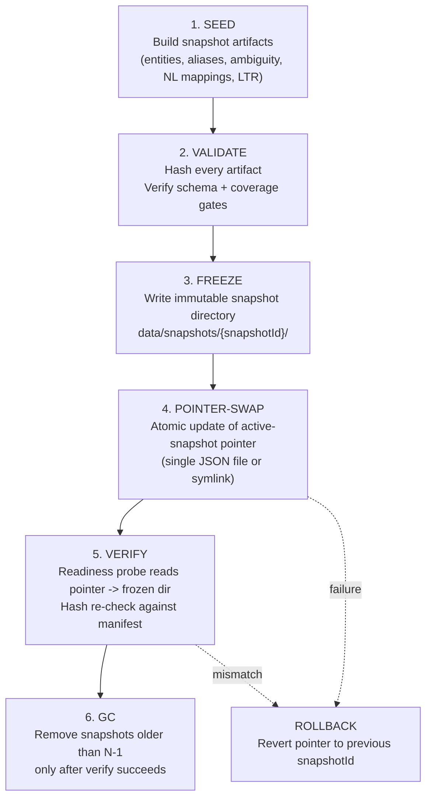

# Immutable Runtime Substrate Pointer Cutover Design

> Parent: [EPIC-7 Corruption / Readiness / Data Plane](../bugbash/apr-14-pipeline-retrival/EPIC-7-corruption-readiness-data-plane.md)
> Ticket: [T-E7-03](../bugbash/apr-14-pipeline-retrival/tasks/T-E7-03-immutable-runtime-substrate-pointer-cutover-design.md)
> Related: [EPIC-8 Identity / Public ID Immutability](../bugbash/apr-14-pipeline-retrival/EPIC-8-identity-public-id-immutability.md)

## 1. Overview: Why Immutable Snapshot Plane

The current publish path (`publish-search-snapshot.ts` -> `publish-runtime-substrates.ts`) performs in-place mutations: staged files are written, then atomically promoted over the active runtime state file. Between staging and promotion, the runtime reads a **mutable** substrate that can drift from the validated snapshot.

Corruption drift scenarios this design eliminates:

- **Partial promotion**: process crash after PG upsert but before `runtime-search-snapshot.json` promotion leaves DB and file out of sync.
- **Stale GC race**: old Vespa documents deleted while a concurrent query still references the previous snapshot's entity set.
- **Hash mismatch masking**: readiness probes compare hashes against a file that was overwritten mid-flight.

The immutable snapshot plane makes every published substrate version a frozen, content-addressed artifact. Activation is a single pointer swap; rollback is a pointer revert.

## 2. Cutover Flow



### Substrate inventory per frozen snapshot

| Artifact | Current location (mutable) | Target location (immutable) |
|----------|---------------------------|----------------------------|
| Runtime state JSON | `data/runtime-search-snapshot.json` | `data/snapshots/{sid}/runtime-state.json` |
| NL mappings | `data/nl-mappings.json` | `data/snapshots/{sid}/nl-mappings.json` |
| Entity/Alias/Ambiguity rows | PG `search_snapshot_id` column | PG rows tagged with `{sid}` (immutable by publish contract) |
| Vespa documents | Vespa corpus (overwritten in-place) | Vespa corpus tagged with `{sid}`; stale delete after pointer swap |
| LTR model weights | PG `ltr_models` table | PG rows tagged with `{sid}` |
| Active pointer | (implicit: the single runtime state file) | `data/snapshots/active-pointer.json` |

### Active pointer schema

```jsonc
{
  "activeSnapshotId": "ss-20260414-abc123",
  "previousSnapshotId": "ss-20260413-def456",  // rollback target
  "activatedAt": "2026-04-14T09:30:00Z",
  "activatedBy": "publish-search-snapshot"
}
```

## 3. Rollback

**Owner**: `publish-search-snapshot.ts` owns rollback during publish. After publish completes, the operator (or a future watchdog) owns manual rollback.

**Rollback contract**:
1. Revert `active-pointer.json` to `previousSnapshotId`.
2. Readiness probe re-validates hashes against the rolled-back snapshot directory.
3. Vespa stale-delete of the failed snapshot's documents (if any were indexed).

**Active queries during swap**:
- Queries in flight at pointer-swap time continue using whatever substrate they loaded at request start (runtime state is loaded once per request, not per-query-step).
- The pointer file is read at server startup and on readiness probe intervals. Swap is invisible to in-flight requests.
- New requests after swap see the new snapshot. There is no request draining requirement because substrates are read-once-at-request-entry.

## 4. Garbage Collection

**GC owner**: `publish-search-snapshot.ts` post-verify step.

**Policy**: retain `active` + `previous` (N=2). All older snapshot directories are eligible for deletion.

**GC sequence**:
1. Verify the new pointer is active and readiness passes.
2. Identify snapshot directories not referenced by `activeSnapshotId` or `previousSnapshotId`.
3. Delete eligible snapshot directories (file artifacts only).
4. PG rows tagged with old `search_snapshot_id` values are deleted by a separate `gc-stale-snapshot-rows` script (not inline, to avoid long transactions during publish).
5. Vespa stale documents are already deleted during publish (existing `deleteStaleVespaDocuments` logic).

**Safety**: GC never runs if verify failed. GC is idempotent (re-running on an already-clean state is a no-op).

## 5. Boundary with Public ID Authority (E8)

This design is **substrate-level**: it governs how runtime artifacts are frozen, swapped, and rolled back. It does NOT define:

- Which `entityId` values are canonical (that is [EPIC-8 / public-id-immutability-authority](./public-id-immutability-authority.md)).
- How identity signatures map to public IDs (that is [ADR-007](../adr/007-canonical-entity-identity-cutover.md)).

**Interface contract**: the frozen snapshot directory contains entity rows whose `entity_id` values are already resolved by the E8 public ID authority before the SEED step. The substrate plane treats `entity_id` as an opaque string; it guarantees they are frozen, not that they are correct.

E8's publish hard gate (public ID immutability check) runs BEFORE this design's FREEZE step. If E8 rejects, FREEZE never happens.

## 6. Migration Path from Current Mutable State

### Phase 1: Shadow directory (backwards-compatible)

- `publish-runtime-substrates.ts` writes artifacts to both the current flat path AND the new `data/snapshots/{sid}/` directory.
- Readiness probes continue reading the flat file.
- No runtime behavior change. Validates that immutable directories are correctly populated.

### Phase 2: Pointer activation

- Introduce `active-pointer.json`.
- Readiness probes switch to: read pointer -> resolve snapshot directory -> validate hashes.
- The flat `data/runtime-search-snapshot.json` becomes a symlink to the active snapshot's file (backwards compat for any scripts that read it directly).
- Rollback is now pointer revert instead of file restore.

### Phase 3: Flat file removal

- Remove symlink. All consumers read through the pointer.
- GC policy enforced. Old snapshot directories cleaned automatically.
- The `promoteStagedFile` function in `publish-runtime-substrates.ts` is replaced by `swapActivePointer`.

### Backwards compatibility

- Phase 1 and 2 are fully backwards-compatible; existing readiness probes, dev scripts, and CI pipelines continue to work via the flat file or symlink.
- Phase 3 requires a coordinated update of any external script that reads `data/runtime-search-snapshot.json` directly.
