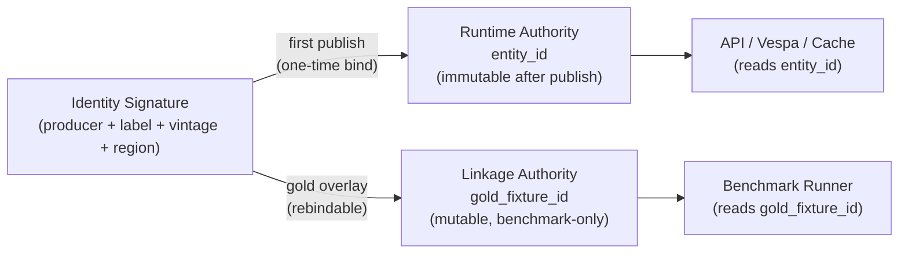
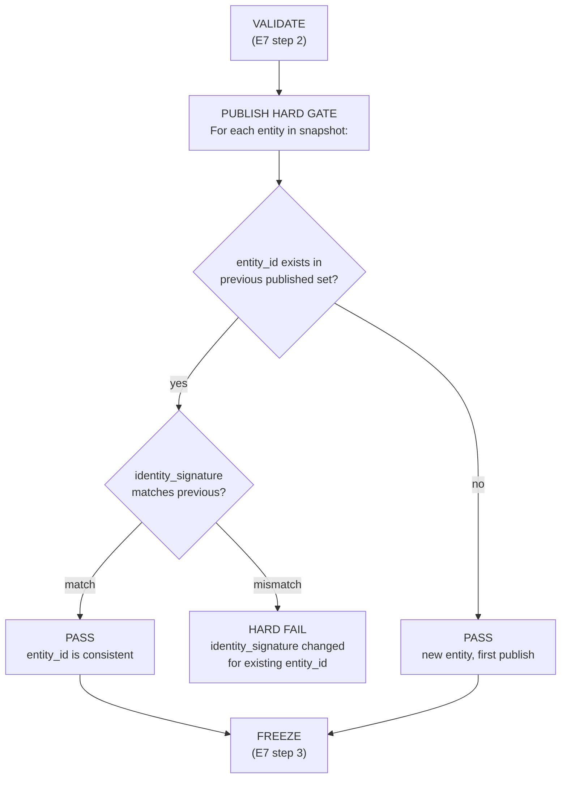

# Public ID Immutability Authority Model

> Parent: [EPIC-8 Identity / Public ID Immutability](../bugbash/apr-14-pipeline-retrival/EPIC-8-identity-public-id-immutability.md)
> Ticket: [T-E8-01](../bugbash/apr-14-pipeline-retrival/tasks/T-E8-01-public-id-immutability-authority-model.md)
> Related: [ADR-007 Canonical Entity Identity Cutover](../adr/007-canonical-entity-identity-cutover.md), [E7 Substrate Cutover](./immutable-runtime-substrate-cutover.md)

## 1. Problem: Shared Namespace Causes Remap Conflicts

Currently, runtime public IDs (`entities.entity_id`) and benchmark/gold fixture linkage IDs occupy the **same column** in the same table. This creates two failure modes:

1. **Gold overlay overwrite**: when a gold fixture file maps an identity signature to a different canonical slug than the runtime authority produced, the gold overlay silently replaces the runtime public ID. Downstream API consumers, cached references, and Vespa document IDs all shift.

2. **Remap conflict on re-publish**: if a gold fixture is updated (e.g., `opus-one-2018` renamed to `opus-one-napa-2018`), the next publish changes the entity's public ID. Any external system that cached the old ID now has a dangling reference with no migration path.

The root cause: **one field serves two masters** -- runtime stability (immutable once published) and benchmark accuracy (mutable as gold data improves).

## 2. Authority Model

### Two authorities, two fields

| Concern | Authority | Field | Mutability |
|---------|-----------|-------|------------|
| Runtime public identity | **Runtime authority** | `entity_id` (= `canonical_entity_id`) | Immutable once published |
| Benchmark/eval linkage | **Linkage authority** | `gold_fixture_id` | Mutable, benchmark-only |

### Runtime authority rules

- `entity_id` is derived from the **identity signature** (`computeIdentitySignature` in `snapshot-entity-identity.ts`) at first publish.
- Once an `entity_id` has been published to runtime (appeared in a promoted snapshot), it is **permanently bound** to that identity signature.
- No subsequent gold overlay, fixture update, or re-publish may change the `entity_id` for a given identity signature.

### Linkage authority rules

- `gold_fixture_id` is a separate column that maps a runtime entity to its benchmark/eval canonical slug.
- Gold overlay files populate `gold_fixture_id`, not `entity_id`.
- Benchmark runners join on `gold_fixture_id` to resolve expected entities.
- `gold_fixture_id` may be updated freely without affecting runtime identity.



## 3. Publish Hard Gate

The **publish hard gate** is the point at which a public ID becomes immutable. It sits between E7's VALIDATE and FREEZE steps.

### Gate logic



### What the gate checks

1. **No entity_id reassignment**: if `entity_id = X` was published with `identity_signature = S1`, then no future snapshot may publish `entity_id = X` with `identity_signature = S2`.
2. **No identity_signature remapping**: if `identity_signature = S` was published as `entity_id = X`, then no future snapshot may publish `identity_signature = S` as `entity_id = Y`.
3. Both checks run against the **published entity registry** -- a persistent table of all `(entity_id, identity_signature)` pairs that have ever been promoted.

### Published entity registry

```sql
CREATE TABLE published_entity_registry (
    entity_id       TEXT PRIMARY KEY,
    identity_signature TEXT NOT NULL UNIQUE,
    first_published_at TIMESTAMPTZ NOT NULL DEFAULT now(),
    first_snapshot_id  TEXT NOT NULL
);
```

This table is append-only. Rows are never updated or deleted (except via an explicit migration workflow).

## 4. Remap Conflict Example with Resolution

### Scenario

A gold fixture previously mapped identity signature `sig-opus-one-2018` to `gold_fixture_id = opus-one-2018`. The fixture maintainer renames it to `opus-one-napa-2018`.

| Step | Before rename | After rename |
|------|--------------|--------------|
| `identity_signature` | `sig-opus-one-2018` | `sig-opus-one-2018` |
| `entity_id` (runtime) | `wine-ce-a3f8...` | `wine-ce-a3f8...` (unchanged) |
| `gold_fixture_id` | `opus-one-2018` | `opus-one-napa-2018` |
| API response `entityId` | `wine-ce-a3f8...` | `wine-ce-a3f8...` (unchanged) |
| Benchmark expected ID | `opus-one-2018` | `opus-one-napa-2018` |

**Resolution**: The runtime public ID (`entity_id`) does not change. Only the linkage field (`gold_fixture_id`) updates. API consumers, Vespa documents, and cached references are unaffected. The benchmark runner uses the new `gold_fixture_id` for matching.

### Conflict: two identity signatures claim the same gold_fixture_id

If two different wines both claim `gold_fixture_id = margaux-2015`, the gold overlay loader must reject the second assignment with a hard error and audit log entry. `gold_fixture_id` has a unique constraint within a snapshot.

## 5. Boundary with E7 Substrate Plane

The E7 immutable substrate design ([immutable-runtime-substrate-cutover.md](./immutable-runtime-substrate-cutover.md)) treats `entity_id` as an **opaque frozen string**. The E8 authority model defines **which string** gets frozen.

### Execution order in publish pipeline

`SEED -> E8 hard gate -> E7 VALIDATE -> E7 FREEZE -> E7 POINTER-SWAP`

### Separation of concerns

| Concern | Owner | Failure mode |
|---------|-------|-------------|
| "Is this entity_id stable?" | E8 (this design) | Hard fail before VALIDATE |
| "Is this snapshot internally consistent?" | E7 substrate | Hard fail at VALIDATE |
| "Is the swap atomic and rollback-safe?" | E7 substrate | Hard fail at POINTER-SWAP |
| "Which gold slug maps to this entity?" | Linkage authority | Separate from publish gate |

### Invariant

After both E7 and E8 are implemented, the following holds:

> A published `entity_id` is frozen in an immutable substrate directory, bound permanently to its identity signature, and reachable only through the active snapshot pointer. Neither gold overlay updates, nor substrate rollbacks, nor re-publishes can change the `entity_id <-> identity_signature` binding.
