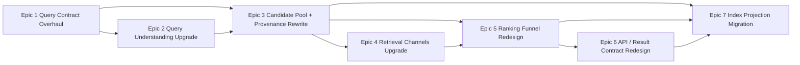

# Wine Engine v2 — 100점 설계 리팩토링 플랜

**날짜:** 2026-04-06  
**범위:** 현재 레포를 “잘 동작하는 검색 서비스”에서 “대형 retrieval/ranking 리팩토링을 안정적으로 흡수하는 엔진”으로 끌어올린다.  
**전제:** 브레이킹 체인지 허용. 단, 한 번에 모든 축을 뒤엎는 빅뱅 마이그레이션은 금지한다.  
**목표 상태:** query contract, retrieval contract, ranking funnel, API contract, index projection이 서로 명시적 인터페이스로 분리되고, 각 계층이 독립적으로 진화 가능하다.

---

## 왜 v2인가

현재 레포는 이미 강한 기반을 갖고 있다.

- `application / domain / infrastructure / interface / config` 구조가 명확하다.
- unit / integration / e2e / vespa lane까지 테스트 안전망이 있다.
- Fastify + Zod + OpenAPI parity로 HTTP 계약이 강하게 잠겨 있다.
- Vespa, ETL, eval, LTR, reranker까지 검색 스택이 이미 돌아간다.

하지만 retrieval platform 관점에서는 아직 몇 가지 결합이 크다.

- `QueryPlanV1`이 planner 산출물이라기보다 런타임 전역 IR로 쓰인다.
- `src/application/search`가 orchestration을 넘어 사실상 검색 엔진 중심 허브 역할을 한다.
- `RetrievalDocument`가 ETL, Vespa, runtime, tests 전역 계약이라 projection 변경 반경이 넓다.
- candidate assembly와 ranking funnel이 존재하긴 하지만, channel/provenance 중심의 명시적 contract로 완전히 승격되진 않았다.

즉 이 v2 계획의 목적은 기능 몇 개 추가가 아니다.

> 이 레포를 “계속 기능을 덧붙이는 검색 서비스”에서  
> “retrieval / ranking / API / index를 축별로 재설계 가능한 엔진”으로 바꾸는 것

현재 프로젝트 맥락 요약은 [appendix-a-current-project-context.md](/Users/songmin/wine-search-engine/docs/plans/apr-6-engine-v2/appendix-a-current-project-context.md)에 압축해 두었다.  
이 문서는 설계 판단 시 수시로 참조하는 부속 문서이며, container wiring, HTTP 계약, 테스트 레인, ETL/Vespa coupling을 함께 요약한다.

---

## 현재 구조에서 본 핵심 제약

### 1. QueryPlan 결합도

`QueryPlanV1`은 planner, resolver, ranker, mixed solver, cache, snapshot, replay까지 폭넓게 전파된다.  
이 상태에서는 query contract 실험이 planner 내부 리팩터링이 아니라 시스템 전체 변경이 된다.

### 2. Search orchestration 응집

`SearchUseCase`는 `pre-route -> route resolution -> route dispatch -> post-route`로 잘 나뉘어 있지만, 실제 실행 계약은 여전히 하나의 선형 오케스트레이션에 많이 묶여 있다.

### 3. RetrievalDocument 전역 계약

`RetrievalDocument`는 ingestion, Vespa mapping, in-memory index, test fixtures, watchlist-aware index, LTR 스크립트까지 연결된다.  
이 계층은 바꿀 수는 있지만, 반드시 독립 epic로 다뤄야 한다.

### 4. HTTP surface 엄격성

이 레포는 HTTP 계약 drift를 허용하지 않는다.  
따라서 새 engine contract를 public API에 반영할 계획도 별도 epic로 다뤄야 한다.

---

## 100점 설계 원칙

1. query IR는 planner 전용 산출물이 아니라 “engine boundary contract”로 명시한다.
2. retrieval candidate는 단순 score list가 아니라 provenance-rich envelope로 다룬다.
3. ranking은 단일 거대 단계가 아니라 funnel stages로 분리한다.
4. public API와 internal retrieval contract를 분리한다.
5. index projection은 runtime contract가 먼저 안정화된 뒤 마지막에 재설계한다.
6. 브레이킹 체인지는 허용하되, 동시에 하나의 axis만 깨뜨린다.
7. observability, eval, promotion gate는 모든 epic의 공통 선행조건이다.

### 공통 운영 규칙

1. 새 epic는 시작 전에 baseline eval과 representative e2e lane을 고정한다.
2. epic 완료 전에는 route contract / OpenAPI parity / replay determinism이 깨지지 않게 관리한다.
3. `application/search`의 orchestration 부담을 줄이는 것이 목표이지, 다른 거대 허브를 새로 만들면 안 된다.
4. `RetrievalDocument` 또는 public response를 바꾸는 epic는 fixtures / scripts / docs까지 같은 change set에서 정리한다.
5. 브레이킹 surface는 반드시 문서의 별도 섹션으로 기록한다.

---

## Epic 구성

| Epic | 이름 | 성격 | 우선순위 |
|---|---|---|---|
| 1 | Query Contract Overhaul | must | highest |
| 2 | Query Understanding Upgrade | must | highest |
| 3 | Candidate Pool + Provenance Rewrite | must | high |
| 4 | Retrieval Channels Upgrade | must | high |
| 5 | Ranking Funnel Redesign | must | high |
| 6 | API / Result Contract Redesign | should | medium |
| 7 | Index Projection Migration | should | last |

---

## 왜 7개로 자르나

브레이킹 허용이라고 해서 2~3개 대형 epic으로 뭉치면 안 된다.

- query contract 변경
- retrieval contract 변경
- ranking funnel 변경
- API contract 변경
- index projection 변경

이 다섯 축은 실패 시 디버깅 단위가 달라서, 같은 epic로 묶으면 회귀 원인 분리가 어려워진다.

반대로 지금 레포는 테스트와 구조가 충분히 좋아서, 위 축들을 독립 epic로 진행할 수는 있다.

즉 v2는 “빅뱅 rewrite”가 아니라 “브레이킹을 허용하는 축별 재설계”다.

---

## 권장 순서

### Wave 1 — Engine boundary 고정

```text
Epic 1 -> Epic 2 -> Epic 3
```

이 단계에서 query contract, query understanding, candidate/provenance contract를 먼저 고정한다.

### Wave 2 — Retrieval / ranking 성능 계층

```text
Epic 3 -> Epic 4 -> Epic 5
```

candidate contract가 정리된 뒤 learned sparse, anchor/relative retrieval, ranking funnel 개편을 얹는다.

> **Wave gate:** Epic 3 완료 = Wave 1 종료 gate. Wave 2 진입 전에 candidate envelope contract, provenance vocabulary, assembly integration test가 안정화돼야 한다.

### Wave 3 — Public API / index migration

```text
Epic 5 -> Epic 6 -> Epic 7
```

runtime core가 안정화된 뒤 public result contract와 index projection migration을 진행한다.

---

## 의존성 그래프



---

## 완료 기준

이 계획이 끝났다고 말하려면 아래가 성립해야 한다.

- planner IR와 runtime IR의 경계가 명확하다.
- retrieval candidate가 channel/provenance를 잃지 않는다.
- ranking stage별 입력/출력이 테스트 가능한 독립 계약이다.
- public API가 human search와 machine/LLM use를 의도적으로 구분한다.
- Vespa projection 변경이 query/runtime/API 변경과 분리돼 수행 가능하다.
- eval / observability / regression gate가 각 epic 승격을 막아준다.

### 비목표

- Decision authority 경계를 바꾸지 않는다.
- “LLM 하나로 검색을 대체”하는 설계는 채택하지 않는다.
- personalization, full multimodal, late interaction은 이 v2의 필수 종료 조건이 아니다.
- real-time user signal(click, dwell, purchase) 기반 feedback loop는 이 v2에서 도입하지 않는다.
- online A/B interleaving infrastructure는 이 v2 scope 밖이다 (단, Epic 5에서 offline counterfactual eval은 포함한다).

---

## 파일 구조

```text
docs/plans/apr-6-engine-v2/
├── 00-overview.md
├── appendix-a-current-project-context.md
├── epic-1-query-contract-overhaul.md
├── epic-2-query-understanding-upgrade.md
├── epic-3-candidate-pool-provenance-rewrite.md
├── epic-4-retrieval-channels-upgrade.md
├── epic-5-ranking-funnel-redesign.md
├── epic-6-api-result-contract-redesign.md
└── epic-7-index-projection-migration.md
```
