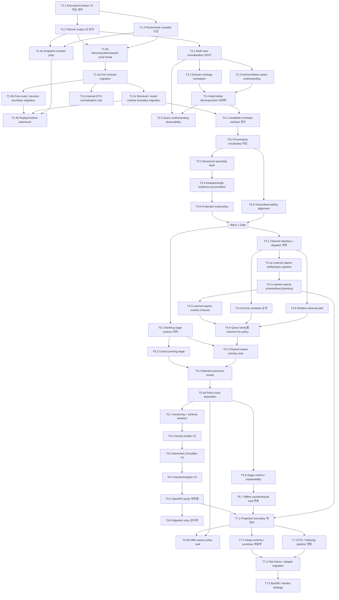
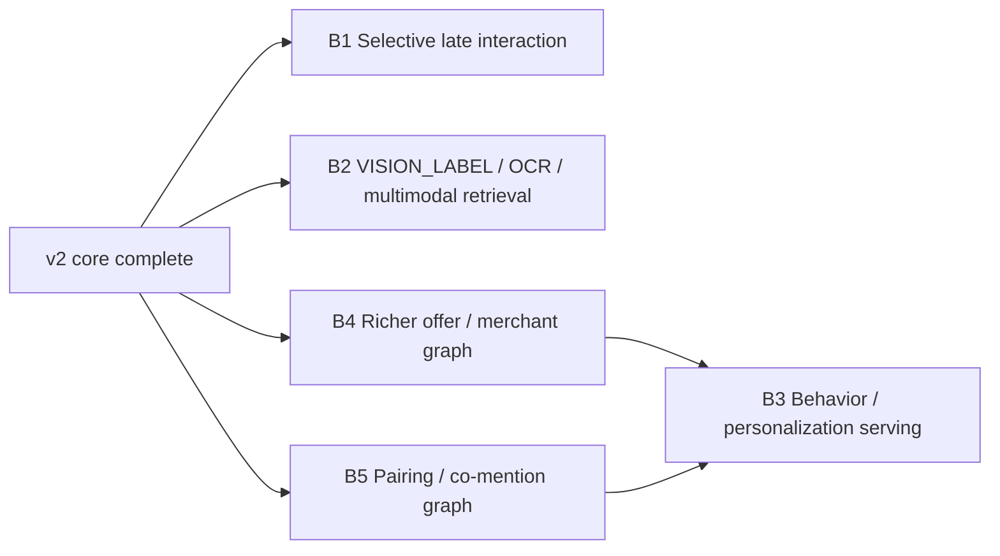

# Wine Engine v2 — Task DAG

**날짜:** 2026-04-06  
**목적:** 7개 에픽을 실행 가능한 task 단위로 분해하고, 병렬 실행 가능한 DAG를 정의한다.  
**범위 선언:** 이 문서는 **current-engine-compatible implementation core**를 위한 DAG다. selective late interaction, `VISION_LABEL`, behavior/personalization, richer commerce graph는 마지막 `Post-v2 backlog DAG`로 분리한다.  
**규칙:** 같은 파일을 건드리는 task는 직렬. 독립 파일/계층은 병렬. 각 task는 1PR 단위. Epics 1–5 동안 public HTTP adapter compatibility 유지.

---

## DAG 개요



---

## 병렬 실행 슬롯

### Wave 1 — Engine boundary 고정

| Phase | 병렬 실행 가능 tasks | 선행 완료 필요 |
|---|---|---|
| 1-A | T1.1 | — |
| 1-B | T1.2, T1.3 | T1.1 |
| 1-C | T1.3b, T1.4a | T1.2, T1.3 |
| 1-D | T1.5a | T1.3b |
| 1-E | T1.5b, T1.5c, T1.6 | T1.5a |
| 1-F | T1.4b | T1.5b, T1.5c, T1.4a |
| 2-A | T2.1 | T1.2 |
| 2-B | T2.2, T2.3 | T2.1 |
| 2-C | T2.4 | T2.2, T2.3 |
| 2-D | T2.5 | T2.1, T2.4 |
| 3-A | T3.1 | T1.5c, T2.4 |
| 3-B | T3.2 | T3.1 |
| 3-C | T3.3, T3.6 | T3.2 |
| 3-D | T3.4 | T3.3 |
| 3-E | T3.5 | T3.4 |
| GATE | Wave 1 Gate | T3.5, T3.6 |

### Wave 2 — Retrieval / ranking 성능 계층

| Phase | 병렬 실행 가능 tasks | 선행 완료 필요 |
|---|---|---|
| 4-A | T4.1, T5.1 | Wave 1 Gate |
| 4-B | T4.1a, T4.4, T5.2 | T4.1, T5.1 |
| 4-C | T4.2 | T4.1a |
| 4-D | T4.3 | T4.2 |
| 4-E | T4.5 | T4.1, T4.4 |
| 4-F | T4.6 | T4.3, T4.4, T4.5 |
| 5-A | T5.3 | T5.2, T4.6 |
| 5-B | T5.4 | T5.3 |
| 5-C | T5.5a | T5.4 |
| 5-D | T5.6 | T5.5a |
| 5-E | T5.7 | T5.6 |
| GATE | Wave 2 Gate | T5.7 |

### Wave 3 — Public API / Index Migration

| Phase | 병렬 실행 가능 tasks | 선행 완료 필요 |
|---|---|---|
| 6-A | T6.1 | T5.5a |
| 6-B | T6.2 | T6.1 |
| 6-C | T6.3 | T6.2 |
| 6-D | T6.4 | T6.3 |
| 6-E | T6.5 | T6.4 |
| 6-F | T6.6 | T6.5 |
| 7-A | T7.1 | T6.5, T5.7, T4.2 |
| 7-B | T7.2, T7.3 | T7.1 |
| 7-C | T7.4 | T7.2, T7.3 |
| 7-D | T7.5 | T7.4 |
| 7-E | T5.5b (optional follow-on) | T7.1, T5.5a |
| GATE | Wave 3 Gate | T7.5 |

---

## Wave Gate

### Wave 1 Gate

진입 조건:

- candidate envelope contract integration test 통과
- provenance vocabulary가 runtime logs와 eval slices에서 동일하게 사용됨
- candidate-pool output, `response.meta.retrievalProvenanceSlices`, evaluator output이 같은 provenance SSOT를 재사용하고 heuristic 재구성이 없음
- pre-route early decomposition log와 planner-path query observability slice가 같은 `decompositionStrategy`를 사용함
- `npm run test:integration` 통과
- `npm run test:integration:search-pipeline` 통과
- `npm run test:e2e:contract` 통과
- `npm run verify:http-contracts` 통과
- replay determinism 회귀 없음

의미:

- Epic 3는 현재 레포가 가장 잘 제공하는 seam이며, 여기서 Wave 1을 닫는 게 가장 안전하다.

### Wave 2 Gate

진입 조건:

- learned sparse artifact/spec, schema/feed, runtime channel이 같은 contract vocabulary를 사용함
- anchor/relative retrieval path가 generic hybrid fallback에 묻히지 않고 trace에서 식별 가능함
- channel mix policy가 query family별로 고정되고 runtime/eval에서 관측 가능함
- ranker가 coarse pruning / channel-aware primary rank / selective rerank / policy hook seam으로 분리됨
- `npm run test:integration:search-pipeline` 통과
- `npm run test:quality` 통과
- `npm run test:e2e:vespa:smoke` 통과
- `npm run eval:offline:with-splits` 통과

의미:

- Wave 2는 retrieval/ranking 품질 계층을 닫는 구간이므로, 단일 오프라인 점수 개선이 아니라 retrieval trace와 ranking stage vocabulary가 함께 안정화돼야 완료로 본다.

### Wave 3 Gate

진입 조건:

- V1 route family는 adapter-compatible하게 유지되고, V2 route family만 명시적으로 병행 공개됨
- human / interpret V2 schema는 route contract/OpenAPI/e2e contract lane에서, machine V2 schema는 existing `/v1/claude-tools` seam/e2e contract lane에서 같은 surface를 사용함
- projection boundary가 `RetrievalDocument` 전체 노출이 아니라 summary / retrieval-feature / embedding payload seam 기준으로 분리됨
- Vespa schema, mapping, ETL, in-memory adapter, e2e fixtures가 같은 projection vocabulary를 사용함
- `npm run verify:http-contracts` 통과
- `npm run test:e2e:contract` 통과
- `npm run test:ingest:contract` 통과
- `npm run test:e2e:vespa:smoke` 통과
- `npm run test:integration` 통과

의미:

- Wave 3는 public API와 index projection migration을 닫는 구간이므로, 새 schema를 "정의만" 하는 것으로 끝나지 않고 route exposure, OpenAPI parity, fixture/indexing migration이 모두 같은 vocabulary로 정렬돼야 완료로 본다.

---

## Task 상세

### Epic 1

| Task | 1PR 크기 | Write-set | 목적 | 브레이킹 표면 | 검증 명령 |
|---|---|---|---|---|---|
| T1.1 | S | `src/domain/query/model/*` | execution contract 타입 도입 | internal only | `npm run typecheck`, `npm run test:unit` |
| T1.2 | M | `src/domain/query/model/query-plan.ts`, `src/domain/query/service/planner.ts`, `src/application/search/interpret.usecase.ts` | planner output를 planner-only 산출물로 축소 | internal types | `npm run typecheck`, `npm run test:unit` |
| T1.3 | M | `src/domain/query/service/execution-compiler.ts`, `src/application/search/search-usecase-route-resolution.ts` | route/mode compiler 도입 | internal runtime | `npm run typecheck`, `npm run test:integration` |
| T1.3b | M | `src/config/container-usecases.ts`, `src/application/search/*` | decomposition/search cycle break | internal runtime | `npm run test:integration`, `npm run test:e2e:contract` |
| T1.5a | M | `src/application/search/port/*`, `src/application/search/search-usecase-execute-builders.ts`, `src/application/search/search.usecase.ts`, `src/config/container.ts`, `src/domain/performance/port/search-response-cache.port.ts`, `src/domain/performance/service/cache-service.ts`, `src/domain/performance/service/cache-eligibility.ts` | port contract와 runtime execute builder, cache port를 execution contract 기준으로 분리 | internal runtime | `npm run typecheck`, `npm run test:integration`, `npm run test:integration:search-pipeline` |
| T1.5b | M | `src/application/search/search-usecase-post-route-phase.ts`, `src/application/search/search-usecase-decision-input.ts`, `src/application/search/search-usecase-execute-builders.ts`, `src/domain/response/service/response-builder.ts`, `src/domain/decision/model/decision-input.ts`, `src/domain/decision/service/authority-trace.ts` | post-route / decision boundary를 execution contract 기준으로 재배선 | internal runtime + decision/response helpers | `npm run test:integration`, `npm run test:e2e:contract` |
| T1.5c | M | `src/domain/retrieval/model/retrieval-input.ts`, `src/application/search/search-usecase-hybrid-candidates.ts`, `src/application/search/search-usecase-hybrid-ranking-pipeline.ts`, `src/domain/mixed/service/mixed-solver.ts` | retrieval / mixed route가 planner raw shape 대신 compiled execution input을 사용하게 전환 | internal retrieval/mixed runtime | `npm run test:integration`, `npm run test:quality` |
| T1.4a | M | `src/application/search/search-usecase-decision-snapshot.ts`, `src/application/search/search-usecase-post-route-phase.ts`, `src/application/search/replay.usecase.ts`, `src/infrastructure/adapter/pg-snapshot-store.ts` | execution contract 기준 snapshot SSOT와 comparable contract 준비 | replay/snapshot fixtures | `npm run test:unit`, `npm run test:integration` |
| T1.4b | M | `src/application/search/replay.usecase.ts`, `src/domain/performance/model/cache-key.ts`, `src/domain/performance/service/cache-service.ts`, replay/e2e snapshot consumers | replay와 cache gating을 새 runtime snapshot contract로 전환 | replay/cache internal | `npm run test:integration`, `npm run test:e2e:contract` |
| T1.6 | S | `src/application/search/search-request.dto.ts`, `src/application/search/*request*.dto.ts`, internal usecase adapters only | internal DTO normalization only | none on public HTTP; `src/interface/http/routes/search-request-mappers.ts` / schema untouched until Epic 6 | `npm run typecheck`, `npm run test:unit` |

### Epic 2

| Task | 1PR 크기 | Write-set | 목적 | 브레이킹 표면 | 검증 명령 |
|---|---|---|---|---|---|
| T2.1 | M | `src/domain/query/service/query-normalizer.ts`, `src/domain/query/model/query-views.ts` | multi-view normalization SSOT | internal query | `npm run typecheck`, `npm run test:unit` |
| T2.2 | M | `src/domain/attribute/service/*`, `src/domain/query/service/rule-based-constraint-extractor.ts` | ontology normalization | internal query/attribute | `npm run test:unit` |
| T2.3 | M | `src/domain/query/service/anchor-extractor.ts`, `src/domain/mixed/service/anchor-profiler.ts` | anchor/relative understanding | internal query/mixed | `npm run test:unit`, `npm run test:integration` |
| T2.4 | M | `src/domain/query/service/decomposition-detector.ts`, `src/application/search/search-usecase-pre-route-phase.ts`, `src/domain/mixed/service/mixed-solver.ts` | decomposition semantics 통합 | internal runtime | `npm run test:integration`, `npm run test:e2e:contract` |
| T2.5 | S | `src/domain/query/model/query-observability-vocab.ts`, `src/domain/query/model/query-plan.ts`, `src/domain/query/model/query-understanding-snapshot.ts`, `src/domain/query/service/decomposition-detector.ts`, `src/domain/query/service/planner.ts`, `src/application/search/search-usecase-pre-route-phase.ts`, `src/observability/search-log-schema.ts`, `scripts/eval/*` | query observability vocabulary와 decomposition semantics를 planner/runtime/eval slice에 공통 반영 | logs/eval only | `npm run test:quality`, `npm run eval:noisy:validate` |

### Epic 3

| Task | 1PR 크기 | Write-set | 목적 | 브레이킹 표면 | 검증 명령 |
|---|---|---|---|---|---|
| T3.1 | S | `src/domain/retrieval/model/hybrid-candidate.ts`, `src/domain/retrieval/model/candidate-envelope.ts` | candidate envelope 정의 | internal retrieval model | `npm run typecheck`, `npm run test:unit` |
| T3.2 | S | `src/domain/retrieval/model/retrieval-trace.ts`, `src/domain/retrieval/model/provenance.ts` | provenance vocabulary 타입 정의 | internal trace/eval | `npm run typecheck`, `npm run test:unit` |
| T3.3 | M | `src/domain/retrieval/service/candidate-assembly.ts`, `src/domain/retrieval/service/candidate-pool.ts`, `src/domain/retrieval/model/candidate-envelope.ts` | structured assembly layer | internal retrieval runtime | `npm run test:integration`, `npm run test:quality` |
| T3.4 | M | `src/domain/retrieval/service/evidence-accumulator.ts`, `src/domain/retrieval/service/candidate-pool.ts`, `src/domain/retrieval/model/hybrid-candidate.ts`, `src/domain/retrieval/model/candidate-envelope.ts` | dedupe/merge evidence accumulation | internal retrieval runtime | `npm run test:integration`, `npm run test:quality` |
| T3.5 | S | `src/domain/retrieval/service/candidate-pool.ts` | protected recall policy | internal retrieval policy | `npm run test:integration`, `npm run test:quality` |
| T3.6 | S | `src/domain/retrieval/service/trace-vocab-aligner.ts`, `src/application/search/search-usecase-eval-provenance.ts`, `src/application/search/search-usecase-post-route-phase.ts`, `src/application/search/search.usecase.ts`, `src/domain/response/model/counterfactual.ts`, `src/domain/response/service/response-builder.ts`, `src/interface/http/schemas/search-response.schema.ts`, `src/infrastructure/adapter/search-pipeline-evaluator.ts` | trace/observability vocabulary를 response/evaluator까지 같은 provenance SSOT로 반영 | logs/eval only | `npm run test:quality`, `npm run eval:noisy:validate` |

---

## Wave 1 Implementation Notes

이 섹션은 Wave 1 task를 implementation agent가 바로 집행할 수 있도록 만든 실행 규칙이다.  
각 task는 아래 `닫는 기준`, `Must change`, `Must not change`, `필수 신규 테스트`를 만족해야 완료로 본다.

### Stage Gates

#### Stage Gate A — Query boundary skeleton

대상:
- `T1.1`
- `T1.2`
- `T1.3`

통과 조건:
- planner output 타입과 execution contract 타입이 코드상 분리됨
- [search-usecase-route-resolution.ts](/Users/songmin/wine-search-engine/src/application/search/search-usecase-route-resolution.ts)가 planner raw shape에 직접 의존하지 않음
- [interpret.usecase.ts](/Users/songmin/wine-search-engine/src/application/search/interpret.usecase.ts)는 내부 planner output 변경과 무관하게 V1-compatible transport adapter를 유지함
- `npm run typecheck`
- `npm run test:unit`
- `npm run test:integration`

#### Stage Gate B — Runtime migration core

대상:
- `T1.3b`
- `T1.5a`
- `T1.5b`
- `T1.5c`
- `T1.6`

통과 조건:
- `SearchUseCase` orchestration이 planner raw shape를 runtime currency로 직접 유통하지 않음
- mixed / retrieval / post-route 경계가 execution contract 또는 route-specific compiled input 기준으로 동작
- public HTTP request/response schema drift 없음
- cache port/cache eligibility가 planner raw shape 전체가 아니라 compiled execution input 또는 dedicated cache context를 기준으로 동작함
- `npm run test:integration`
- `npm run test:integration:search-pipeline`
- `npm run test:e2e:contract`
- `npm run verify:http-contracts`

#### Stage Gate C — Snapshot and replay cutover

대상:
- `T1.4a`
- `T1.4b`

통과 조건:
- snapshot SSOT가 execution contract 기준으로 단일화됨
- replay / cache gating / e2e snapshot consumer가 같은 comparable snapshot contract를 사용
- `npm run test:unit`
- `npm run test:integration`
- `npm run test:integration:search-pipeline`
- `npm run test:e2e:contract`

#### Stage Gate D — Query understanding and candidate seam

대상:
- `T2.1` ~ `T2.5`
- `T3.1` ~ `T3.6`

통과 조건:
- query understanding vocabulary와 retrieval provenance vocabulary가 runtime/eval에서 같은 용어를 사용
- candidate assembly가 envelope/provenance 기반으로 동작
- `npm run test:integration`
- `npm run test:integration:search-pipeline`
- `npm run test:quality`
- `npm run eval:noisy:validate`

### Hard Ambiguity Guardrails

아래 네 가지는 코드 확인 후 확정한 Wave 1 guardrail이다.

1. `InterpretUseCase`와 `ResolveUseCase`는 Wave 1 동안 public V1 transport를 유지한다.
   내부 planner output이 바뀌어도 [interpret.usecase.ts](/Users/songmin/wine-search-engine/src/application/search/interpret.usecase.ts), [resolve.usecase.ts](/Users/songmin/wine-search-engine/src/application/search/resolve.usecase.ts)에는 compatibility adapter를 둔다.
2. decision layer는 raw `QueryPlanV1` 직접 의존을 즉시 없애는 것이 목표지만, 한 PR에서 다 못 없애면 [search-usecase-decision-input.ts](/Users/songmin/wine-search-engine/src/application/search/search-usecase-decision-input.ts) 한 곳에만 임시 adapter를 허용한다.
   [decision-input.ts](/Users/songmin/wine-search-engine/src/domain/decision/model/decision-input.ts), [authority-trace.ts](/Users/songmin/wine-search-engine/src/domain/decision/service/authority-trace.ts)에 새 raw dependency를 추가하면 안 된다.
3. cache migration은 `T1.5a`와 `T1.4b`의 책임이다.
   [search-response-cache.port.ts](/Users/songmin/wine-search-engine/src/domain/performance/port/search-response-cache.port.ts), [cache-service.ts](/Users/songmin/wine-search-engine/src/domain/performance/service/cache-service.ts), [cache-eligibility.ts](/Users/songmin/wine-search-engine/src/domain/performance/service/cache-eligibility.ts)를 task 밖에서 조용히 수정하지 않는다.
4. query observability와 retrieval observability는 서로 다른 payload를 가진다.
   `T2.5`는 query understanding payload를, `T3.6`은 retrieval provenance payload를 맡는다. 둘 다 [search-log-schema.ts](/Users/songmin/wine-search-engine/src/observability/search-log-schema.ts)를 무작정 재활용하는 방식으로 해결하지 않는다.

### Wave 1 Task Closure Checklist

#### `T1.1 ExecutionContract V2 타입 정의`

닫는 기준:
- planner output 전용 타입과 execution contract 전용 타입이 별도 심볼로 존재
- 새 타입이 추가돼도 기존 `QueryPlanV1` 의미를 묵시적으로 확장하지 않음

Must change:
- query model 타입 정의
- execution contract 초안 타입 export 지점

Must not change:
- planner 로직
- public HTTP schema

필수 신규 테스트:
- execution contract 타입 shape unit test
- planner output과 execution contract를 혼용하지 못하게 하는 compile-time fixture

#### `T1.2 Planner output V2 분리`

닫는 기준:
- planner 산출물이 route execution용 정보와 해석 정보로 구분됨
- planner가 downstream runtime helper를 import하지 않음

Must change:
- [query-plan.ts](/Users/songmin/wine-search-engine/src/domain/query/model/query-plan.ts)
- [planner.ts](/Users/songmin/wine-search-engine/src/domain/query/service/planner.ts)
- [interpret.usecase.ts](/Users/songmin/wine-search-engine/src/application/search/interpret.usecase.ts) compatibility adapter

Must not change:
- route contract catalog
- response builder
- interpret public transport schema

필수 신규 테스트:
- planner output shape regression test
- planner deterministic snapshot fixture update
- interpret route compatibility regression test

#### `T1.3 Route/mode compiler 도입`

닫는 기준:
- route 선택과 retrieval mode 결정이 compiler stage로 이동
- `planner suggestion`과 `effective execution mode`가 별도 필드로 존재

Must change:
- execution compiler
- route resolution helper

Must not change:
- route handler request/response schema

필수 신규 테스트:
- route resolution unit tests
- API override precedence integration test

#### `T1.3b Decomposition/search cycle break`

닫는 기준:
- [container-usecases.ts](/Users/songmin/wine-search-engine/src/config/container-usecases.ts)의 deferred cycle이 formal adapter boundary로 치환됨
- `SearchUseCase`와 `DecomposedSearchUseCase`가 서로 concrete runtime contract를 직접 요구하지 않음

Must change:
- container wiring
- application search port boundary

Must not change:
- public route path
- public request DTO schema

필수 신규 테스트:
- container wiring integration test
- decomposed vs search cycle regression test

#### `T1.5a Port contract migration`

닫는 기준:
- [search-pipeline-deps.port.ts](/Users/songmin/wine-search-engine/src/application/search/port/search-pipeline-deps.port.ts) 계열이 planner raw shape 대신 execution contract 또는 route-specific compiled input을 받음
- [search-usecase-execute-builders.ts](/Users/songmin/wine-search-engine/src/application/search/search-usecase-execute-builders.ts)가 runtime input builder SSOT가 됨
- cache read/write eligibility가 raw `QueryPlanV1` 확산 없이 dedicated cache context 또는 compiled execution input을 기준으로 정리됨

Must change:
- application port signatures
- execute builder helpers
- container wiring for updated ports
- cache port/cache service/cache eligibility boundary

Must not change:
- decision snapshot semantics
- HTTP route mapper/schema
- resolve/interpret public route contracts

필수 신규 테스트:
- port signature compile-time fixtures
- search pipeline integration test covering entity and hybrid route
- cache eligibility and cache port compatibility tests

#### `T1.5b Post-route / decision boundary migration`

닫는 기준:
- [search-usecase-post-route-phase.ts](/Users/songmin/wine-search-engine/src/application/search/search-usecase-post-route-phase.ts), [search-usecase-decision-input.ts](/Users/songmin/wine-search-engine/src/application/search/search-usecase-decision-input.ts), [response-builder.ts](/Users/songmin/wine-search-engine/src/domain/response/service/response-builder.ts)가 planner raw shape 직접 의존을 줄이고 execution contract 또는 narrowed runtime input에 의존
- decision / response helper의 authority trace, snapshot, route meta가 동일한 source에서 생성
- [decision-input.ts](/Users/songmin/wine-search-engine/src/domain/decision/model/decision-input.ts)와 [authority-trace.ts](/Users/songmin/wine-search-engine/src/domain/decision/service/authority-trace.ts)의 raw `QueryPlanV1` 직접 읽기가 제거되거나, 제거 전이라면 [search-usecase-decision-input.ts](/Users/songmin/wine-search-engine/src/application/search/search-usecase-decision-input.ts) 한 곳으로만 격리됨

Must change:
- post-route phase
- decision input builder
- response builder
- authority trace / execute builders adapter glue

Must not change:
- public response schema field names
- replay route contract
- interpret/resolve response transport

필수 신규 테스트:
- post-route phase unit tests
- response hash / authority trace regression test
- decision input contract integration test
- admission / authority-trace compatibility tests

#### `T1.5c Retrieval / mixed runtime boundary migration`

닫는 기준:
- [retrieval-input.ts](/Users/songmin/wine-search-engine/src/domain/retrieval/model/retrieval-input.ts)와 [mixed-solver.ts](/Users/songmin/wine-search-engine/src/domain/mixed/service/mixed-solver.ts)가 planner raw shape 전체를 currency로 쓰지 않음
- hybrid candidate builder와 mixed route가 compiled route input 기반으로 동작

Must change:
- retrieval input contract
- hybrid candidate builder
- mixed solver input

Must not change:
- retrieval quality policy 자체
- public mixed route semantics

필수 신규 테스트:
- hybrid retrieval input mapping test
- mixed solver integration regression
- quality lane regression for mixed/anchor queries

#### `T1.4a Snapshot contract prep`

닫는 기준:
- [search-usecase-decision-snapshot.ts](/Users/songmin/wine-search-engine/src/application/search/search-usecase-decision-snapshot.ts)가 snapshot comparable contract SSOT가 됨
- post-route writer, replay reader, snapshot store가 같은 comparable snapshot shape를 사용

Must change:
- decision snapshot helper
- snapshot persistence adapter
- replay prep path

Must not change:
- replay public request schema
- determinism failure semantics

필수 신규 테스트:
- comparable snapshot unit tests
- snapshot store serialization roundtrip tests
- post-route snapshot write integration test

#### `T1.4b Replay/runtime switchover`

닫는 기준:
- replay mismatch와 cache gating이 같은 runtime snapshot comparison을 사용
- e2e snapshot consumers가 legacy fallback이 아니라 primary comparable snapshot을 읽음

Must change:
- replay use case
- cache key/cache service snapshot comparison
- replay/e2e helper consumers

Must not change:
- replay HTTP route shape
- fail-closed replay policy

필수 신규 테스트:
- replay determinism integration test
- cache snapshot gating regression
- e2e response snapshot compatibility test

#### `T1.6 Internal DTO normalization only`

닫는 기준:
- search/hybrid/resolve/replay/interpret 내부 DTO가 compiler input 기준으로 정리됨
- public request mapper/schema untouched 원칙이 지켜짐

Must change:
- internal application DTOs
- use case adapter normalization

Must not change:
- [search-request-mappers.ts](/Users/songmin/wine-search-engine/src/interface/http/routes/search-request-mappers.ts)
- request/response Zod schemas
- route contract catalog

필수 신규 테스트:
- DTO mapping unit tests
- no-public-schema-drift smoke check via `npm run verify:http-contracts`

#### `T2.1 Multi-view normalization SSOT`

닫는 기준:
- query normalizer가 lexical/semantic/anchor-aware view를 명시적으로 산출
- downstream query understanding 단계가 ad-hoc string rewrite를 새로 만들지 않음

필수 신규 테스트:
- normalized query views unit tests
- multilingual / transliteration normalization regression

#### `T2.2 Domain ontology normalizer`

닫는 기준:
- ontology/attribute normalization이 query understanding 단계의 canonical vocabulary로 수렴

필수 신규 테스트:
- attribute synonym normalization unit tests
- constraint extractor alignment tests

#### `T2.3 Anchor/relative query understanding`

닫는 기준:
- anchor, comparative, relative intent가 query understanding 단계에서 구조화됨

필수 신규 테스트:
- anchor extractor tests
- relative query interpretation integration tests

#### `T2.4 Multi-intent decomposition 내재화`

닫는 기준:
- decomposition detector와 mixed solver input semantics가 동일 vocabulary를 사용
- [search-usecase-pre-route-phase.ts](/Users/songmin/wine-search-engine/src/application/search/search-usecase-pre-route-phase.ts)의 pre-planner decomposition은 독자 규칙 엔진이 아니라 query understanding compatibility adapter가 됨

Must change:
- decomposition detector
- pre-route compatibility adapter
- mixed solver input semantics

Must not change:
- decomposed search public route semantics
- public comparison response contract

필수 신규 테스트:
- decomposition detector integration tests
- mixed route contract regression
- pre-route decomposition compatibility regression

#### `T2.5 Query understanding observability`

닫는 기준:
- planner/runtime logs와 offline eval slices가 같은 query vocabulary를 사용
- query understanding observability가 retrieval trace vocabulary와 별도 payload/schema로 존재
- ambiguous / comparison / multi-intent 분류 우선순위가 pre-route early log와 planner output observability slice에서 동일함
- decomposition detector가 만든 strategy가 pre-route early return path와 planner path에서 같은 helper로 계산됨

Must not change:
- retrieval trace vocabulary
- [search-log-schema.ts](/Users/songmin/wine-search-engine/src/observability/search-log-schema.ts)를 query/retrieval payload의 단일 dumping ground로 확장하는 방식

필수 신규 테스트:
- observability payload snapshot tests
- eval slice serialization tests
- query understanding log schema unit tests
- planner / pre-route decomposition parity tests
- decomposition 기반 `multi_intent` classification tests

#### `T3.1 Candidate envelope contract 정의`

닫는 기준:
- candidate envelope에 source channel, matched query view, raw score family, protected inclusion reason 필드가 존재

필수 신규 테스트:
- candidate envelope model unit tests

#### `T3.2 Provenance vocabulary 타입`

닫는 기준:
- retrieval trace와 provenance 타입이 같은 source vocabulary를 공유

필수 신규 테스트:
- provenance serialization tests

#### `T3.3 Structured assembly layer`

닫는 기준:
- candidate pool이 단순 fuse 결과가 아니라 structured assembly policy를 적용
- assembly 순서가 `hard filter -> dedupe -> sort -> protection -> quota`로 고정됨
- hard-constraint 실패 후보가 더 높은 fused score를 갖더라도, 같은 entity의 valid lower-score 후보를 제거하지 않음

필수 신규 테스트:
- candidate pool integration test for channel quota/diversity
- assembly policy quality regression
- invalid high-score duplicate + valid lower-score duplicate regression test

#### `T3.4 Dedupe/merge evidence accumulation`

닫는 기준:
- 동일 entity merge가 overwrite가 아니라 evidence accumulation으로 동작
- merged provenance가 `mergedEnvelope`를 통해 실제 assembled output으로 전달됨
- `channels`, `matchedFilterConstraints`, `failedHardConstraints`, `queryViewMatches`, `channelScores`, `anchorConditioned`, `protectedInclusionReason` merge 규칙이 deterministic하게 고정됨

필수 신규 테스트:
- duplicate entity merge unit tests
- evidence accumulation integration tests
- candidate-pool output candidate가 merged provenance를 실제로 carry-forward 하는지 검증

#### `T3.5 Protected recall policy`

닫는 기준:
- exact/known-item, anchor-conditioned, constraint-compatible candidate 보호 규칙이 assembly 단계에 존재

필수 신규 테스트:
- protected recall integration tests
- known-item regression slice

#### `T3.6 Trace/observability alignment`

닫는 기준:
- runtime trace, response meta, evaluator output, offline eval script가 같은 provenance vocabulary를 읽고 씀
- retrieval provenance observability가 query understanding payload와 다른 schema/field namespace를 가짐
- evaluator가 result-item heuristic reconstruction 없이 `response.meta.retrievalProvenanceSlices` 또는 same-source runtime slices만 재사용함

Must not change:
- candidate envelope semantics
- query understanding observability payload

필수 신규 테스트:
- runtime trace -> response meta -> evaluator roundtrip tests
- eval script compatibility tests
- retrieval provenance log schema tests
- ranked result provenance slice determinism tests

### Epic 4

| Task | 1PR 크기 | Write-set | 목적 | 브레이킹 표면 | 검증 명령 |
|---|---|---|---|---|---|
| T4.1 | S | `src/domain/retrieval/model/retrieval-channel.ts`, `src/domain/retrieval/model/retrieval-input.ts`, `src/domain/retrieval/model/retrieval-trace.ts`, `src/domain/retrieval/port/search-index.port.ts`, `src/domain/retrieval/service/retrieval-profile.ts`, `src/domain/retrieval/service/cascade-router.ts`, `src/domain/retrieval/service/candidate-pool.ts`, `src/application/search/port/search-pipeline-deps.port.ts`, `src/application/search/search-usecase-hybrid-candidates.ts` | channel interface + dispatch 계약 | internal retrieval contract | `npm run typecheck`, `npm run test:integration`, `npm run test:integration:search-pipeline` |
| T4.1a | M | `docs/plans/apr-6-engine-v2/epic-4-retrieval-channels-upgrade.md`, `scripts/etl/index-to-vespa.ts`, `src/infrastructure/vespa/mapping.ts`, `scripts/eval/run-offline-eval.ts` | learned sparse artifact/spec pipeline | ETL/eval interface only | `npm run test:ingest:contract`, `npm run eval:offline:smoke` |
| T4.2 | M | `src/infrastructure/vespa/vespa-schema.sd`, `src/infrastructure/vespa/mapping.ts`, `scripts/etl/index-to-vespa.ts`, `src/infrastructure/vespa/__tests__/mapping.test.ts`, `src/infrastructure/vespa/__tests__/vespa-search-index.test.ts` | learned sparse schema/feed plumbing | Vespa schema + ETL | `npm run test:ingest:contract`, `npm run test:e2e:vespa:smoke` |
| T4.3 | M | `src/domain/retrieval/port/search-index.port.ts`, `src/domain/retrieval/model/retrieval-trace.ts`, `src/infrastructure/vespa/vespa-search-index.ts`, `src/domain/retrieval/service/fusion.ts`, `src/domain/retrieval/service/candidate-pool.ts`, `src/domain/retrieval/service/retrieval-profile.ts`, `src/application/search/search-usecase-hybrid-candidates.ts` | learned sparse runtime channel | internal retrieval runtime | `npm run test:integration:search-pipeline`, `npm run test:quality` |
| T4.4 | M | `src/domain/retrieval/service/fusion.ts`, `src/domain/retrieval/service/candidate-pool.ts`, `src/infrastructure/vespa/vespa-similar-retrieval.ts`, `src/domain/retrieval/service/retrieval-profile.ts`, `src/domain/retrieval/model/retrieval-trace.ts`, `src/application/search/search-usecase-hybrid-candidates.ts`, `src/infrastructure/vespa/__tests__/vespa-similar-retrieval.test.ts` | anchor similarity channel 승격 | internal retrieval runtime | `npm run test:integration:search-pipeline`, `npm run test:quality` |
| T4.5 | M | `src/domain/retrieval/service/compare-retriever.ts`, `src/domain/retrieval/service/candidate-constraint-evidence.ts`, `src/domain/retrieval/service/constraint-filter.ts`, `src/domain/retrieval/service/candidate-pool.ts`, `src/domain/retrieval/service/retrieval-profile.ts`, `src/application/search/search-usecase-hybrid-candidates.ts` | relative retrieval path | internal retrieval runtime | `npm run test:integration:search-pipeline`, `npm run test:quality` |
| T4.6 | S | `src/domain/retrieval/service/retrieval-profile.ts`, `src/domain/retrieval/service/cascade-router.ts`, `src/domain/retrieval/service/candidate-pool.ts`, `src/domain/retrieval/model/retrieval-trace.ts`, `scripts/eval/run-noisy-entity-eval.ts` | query family별 channel mix policy | internal retrieval policy | `npm run test:quality`, `npm run eval:noisy:validate` |

### Epic 5

| Task | 1PR 크기 | Write-set | 목적 | 브레이킹 표면 | 검증 명령 |
|---|---|---|---|---|---|
| T5.1 | M | `src/domain/ranking/model/ranking-stage.ts` (new), `src/domain/ranking/model/ranking-input.ts`, `src/domain/ranking/model/ranked-result.ts`, `src/domain/ranking/service/ranker.ts`, `src/domain/ranking/service/ranking-stage-pipeline.ts`, `src/application/search/search-usecase-hybrid-ranking-pipeline.ts` | ranking stage contract 정의 | internal ranking contract | `npm run typecheck`, `npm run test:unit` |
| T5.2 | M | `src/domain/ranking/service/ranker.ts`, `src/domain/ranking/service/score-aggregator.ts`, `src/domain/ranking/model/ranked-result.ts`, `src/domain/ranking/__tests__/score-aggregator.test.ts` | coarse pruning stage | internal ranking | `npm run test:unit`, `npm run test:quality` |
| T5.3 | M | `src/domain/ranking/model/ranked-result.ts`, `src/domain/ranking/service/signal-computer.ts`, `src/domain/ranking/service/score-aggregator.ts`, `src/domain/ranking/service/ltr-feature-extractor.ts`, `src/domain/ranking/service/lambdamart-ranker.ts`, `src/domain/ranking/__tests__/signal-computer.test.ts` | channel-aware primary rank | internal ranking features | `npm run test:unit`, `npm run test:quality` |
| T5.4 | M | `src/application/search/search-usecase-ltr-rerank.ts`, `src/application/search/search-usecase-hybrid-ranking-pipeline.ts`, `src/domain/ranking/service/ranker.ts`, `src/domain/ranking/service/ltr-feature-extractor.ts`, `src/domain/ranking/service/ltr-ranker.ts`, `src/domain/ranking/port/reranker.port.ts` | selective precision rerank | internal ranking/LTR | `npm run test:quality`, `npm run test:integration:search-pipeline` |
| T5.5a | S | `src/domain/ranking/service/ranker.ts`, `src/domain/ranking/model/ranked-result.ts`, `src/application/search/search-usecase-hybrid-ranking-pipeline.ts` | policy hook separation | internal ranking contract | `npm run test:unit`, `npm run test:quality` |
| T5.6 | S | `src/domain/ranking/service/ranker.ts`, `src/observability/log-search-event.ts`, `src/observability/search-log-schema.ts`, `src/domain/evaluation/model/eval-result.ts` | stage metrics / explainability | logs/eval only | `npm run test:quality`, `npm run eval:noisy:validate` |
| T5.7 | M | `src/domain/evaluation/service/eval-runner.ts`, `src/domain/evaluation/service/slice-evaluator.ts`, `src/domain/evaluation/service/evidence-auditor.ts`, `src/infrastructure/adapter/pg-eval-result-store.ts`, `scripts/eval/run-offline-eval.ts`, `scripts/eval/metrics.ts`, `scripts/eval/significance.ts` | offline counterfactual eval | eval pipeline only | `npm run test:quality`, `npm run eval:offline:with-splits` |
| T5.5b | M | ranker + projection-aware policy inputs | offer-aware policy rank | internal ranking, requires projection | `npm run test:quality`, `npm run test:e2e:vespa:smoke` |

---

## Wave 2 Implementation Notes

이 섹션은 Wave 2 task를 implementation agent가 바로 집행할 수 있도록 만든 실행 규칙이다.  
Wave 2에서는 retrieval/ranking 품질 향상을 이유로 API, projection, offer policy까지 같이 흔드는 것이 가장 큰 실패 패턴이므로, 각 task는 아래 `닫는 기준`, `Must change`, `Must not change`, `필수 신규 테스트`를 만족해야 완료로 본다.

### Stage Gates

#### Stage Gate E — Retrieval channel contract skeleton

대상:
- `T4.1`
- `T4.1a`
- `T5.1`

통과 조건:
- retrieval input과 ranking stage input이 각각 독립된 vocabulary를 갖고, planner/runtime/public API vocabulary와 섞이지 않음
- learned sparse artifact/spec 명세가 ETL stub와 offline eval entry에서 같은 필드명과 serialization rule을 사용
- `npm run typecheck`
- `npm run test:unit`
- `npm run test:ingest:contract`
- `npm run test:integration:search-pipeline`
- `npm run eval:offline:smoke`

#### Stage Gate F — Retrieval runtime channel closure

대상:
- `T4.2`
- `T4.3`
- `T4.4`
- `T4.5`
- `T4.6`

통과 조건:
- learned sparse / anchor / relative path가 trace에서 서로 구분 가능한 channel source로 남음
- learned sparse / anchor / relative path가 기존 `candidateSources = ['sparse'|'dense'|'anchor']` 의미를 덮어쓰지 않고 확장 또는 정렬됨
- query family별 channel mix가 retrieval profile과 runtime trace에서 동일 vocabulary를 사용
- `candidate-pool.ts` main path와 `vespa-similar-retrieval.ts` mixed path가 anchor channel semantics를 서로 다르게 정의하지 않음
- generic hybrid fallback이 specialized retrieval path를 조용히 덮어쓰지 않음
- `npm run test:ingest:contract`
- `npm run test:e2e:vespa:smoke`
- `npm run test:integration:search-pipeline`
- `npm run test:quality`
- `npm run eval:noisy:validate`

#### Stage Gate G — Ranking funnel core

대상:
- `T5.2`
- `T5.3`
- `T5.4`
- `T5.5a`

통과 조건:
- ranker가 coarse pruning / primary rank / selective rerank / policy insertion point를 코드상 별도 seam으로 가짐
- provenance-aware feature가 primary ranking SSOT에 반영되고, rerank stage가 이를 재정의하지 않음
- rerank 이후 `finalScore` / `rank`를 최종적으로 mutate하는 owner가 정확히 하나로 정리됨
- public HTTP response field names나 explanation schema를 건드리지 않음
- `npm run test:unit`
- `npm run test:integration:search-pipeline`
- `npm run test:quality`

#### Stage Gate H — Explainability / counterfactual eval closure

대상:
- `T5.6`
- `T5.7`

통과 조건:
- ranking stage별 drop/promote reason이 runtime log schema와 eval result schema에서 같은 vocabulary를 사용
- offline eval이 stage-aware delta와 baseline comparison을 함께 출력 가능
- serving behavior를 바꾸지 않고 observability/eval capability만 확장함
- `npm run test:quality`
- `npm run eval:noisy:validate`
- `npm run eval:offline:with-splits`

### Wave 2 Task Closure Checklist

#### `T4.1 Channel interface + dispatch 계약`

닫는 기준:
- retrieval input이 channel-aware input으로 명시되고, channel 이름이 trace / port / dispatch에서 동일하게 사용됨
- specialized browse/compare handoff와 candidate-pool 내부 channel dispatch의 경계가 분리되고, 후자가 ad-hoc boolean 조합 대신 channel vocabulary를 통해 retrieval path를 선택함

Must change:
- canonical retrieval channel vocabulary
- retrieval input contract
- retrieval trace vocabulary
- search index port contract
- retrieval profile / cascade dispatch vocabulary
- candidate-pool phase/channel dispatch seam
- hybrid candidate dispatch glue

Must not change:
- `HybridRetrievalInput['route']` existing literals
- browse / compare specialized retrieval mode switch
- Vespa schema
- ranking score formula
- public HTTP request/response schema

필수 신규 테스트:
- retrieval contract shape unit tests
- canonical channel vocabulary / legacy alias compatibility tests
- channel dispatch integration test via `npm run test:integration:search-pipeline`

#### `T4.1a Learned sparse artifact/spec pipeline`

닫는 기준:
- learned sparse artifact format, serialization key, offline validation rule이 문서/ETL/eval entry에서 같은 이름으로 정리됨
- runtime search path 없이도 artifact/spec contract만 독립 검증 가능함

Must change:
- Epic 4 spec 문서
- ETL stub or serialization adapter
- offline eval script entry

Must not change:
- runtime candidate generation
- `search-index.port.ts`
- `vespa-search-index.ts`
- `candidate-pool.ts`
- ranking features
- public API schema

필수 신규 테스트:
- ingest contract validation
- offline eval smoke path for learned sparse artifact presence

#### `T4.2 Learned sparse schema/feed plumbing`

닫는 기준:
- Vespa schema와 ETL mapping/feed가 learned sparse field를 실제로 생산하고 소비함
- schema/feed 변경이 Vespa smoke lane에서 깨지지 않음

Must change:
- Vespa schema
- Vespa mapping / feed transformation
- ETL indexing path

Must not change:
- candidate pool policy
- ranking stage contract
- public API surface

필수 신규 테스트:
- Vespa schema/mapping regression test
- ingest contract test
- Vespa smoke lane

#### `T4.3 Learned sparse runtime channel`

닫는 기준:
- learned sparse channel이 runtime retrieval에서 실행되고 candidate trace에 source/provenance가 남음
- candidate pool/fusion path가 learned sparse channel을 기존 `sparse`/`dense` source label 재사용 없이 별개 source로 다룸
- production/test `SearchIndexPort` implementations가 같은 learned sparse contract를 구현함

Must change:
- search index runtime query builder
- fusion source labeling
- candidate pool runtime assembly
- retrieval profile defaults for learned sparse
- port implementation parity

Must not change:
- channel policy retune beyond minimal defaults
- browse / compare specialized retrieval dispatch
- rerank dispatch
- public explain schema

필수 신규 테스트:
- learned sparse retrieval integration test
- quality regression with learned sparse-enabled slices

#### `T4.4 Anchor similarity channel 승격`

닫는 기준:
- anchor similarity retrieval이 generic dense fallback과 구분되는 dedicated channel로 trace됨
- anchor query family에서 retrieval profile이 dedicated channel mix를 사용함
- main hybrid path와 mixed solver path가 anchor source vocabulary를 공유함
- main hybrid path trace가 anchor hit를 `dense`로 오인하지 않고, mixed solver path도 같은 source semantics를 사용함

Must change:
- `fusion.ts` source labeling
- `candidate-pool.ts` main anchor-neighborhood path
- `vespa-similar-retrieval.ts` mixed-solver anchor adapter alignment
- retrieval profile / trace vocabulary

Must not change:
- `HybridRetrievalInput['route']` existing literals
- relative retrieval semantics
- ranking stage interface
- public response contract

필수 신규 테스트:
- anchor channel integration tests
- anchor trace vocabulary regression tests

#### `T4.5 Relative retrieval path`

닫는 기준:
- relative query가 compare/generic hybrid fallback과 구분되는 retrieval path를 가지며 anchor-conditioned evidence가 남음
- hard/soft/inferred constraint evidence가 relative path에서도 동일하게 반영됨
- specialized compare path가 존재하는 경우 generic candidate-pool fallback이 먼저 relative intent를 삼켜버리지 않음

Must change:
- compare/relative retrieval helper
- constraint evidence/filter helper
- retrieval profile for comparative query family
- relative-query / anchor-conditioned orchestration seam
- candidate pool or hybrid candidate orchestration

Must not change:
- producer/region browse dispatch
- `plan.retrievalMode` existing literals
- 새 public query mode 정의
- Vespa schema 재설계
- offer-aware policy

필수 신규 테스트:
- relative retrieval integration tests
- specialized compare short-circuit precedence regression test
- comparative query quality regression

#### `T4.6 Query family별 channel mix policy`

닫는 기준:
- query family별 retrieval mix가 profile/policy/trace에 명시되고 eval slice에서 관측 가능함
- policy 변경이 candidate envelope/provenance vocabulary를 깨지 않음
- `retrievalProfile`, `candidateSources`, `skippedPhases`가 서로 다른 임의 string 집합으로 드리프트하지 않음

Must change:
- retrieval profile policy
- cascade router difficulty/phase policy
- candidate pool policy glue
- retrieval trace vocabulary for mix decisions

Must not change:
- ranking score weights
- specialized browse / compare route switch
- public explain contract

필수 신규 테스트:
- query family policy regression tests
- noisy eval slice validation

#### `T5.1 Ranking stage contract 정의`

닫는 기준:
- ranking pipeline이 coarse pruning / primary rank / rerank / policy insertion point 타입을 분리해 표현함
- stage 간 input/output 경계가 `ranker.ts` 내부 임시 상태가 아니라 모델/contract로 드러남

Must change:
- ranking stage model
- ranking input contract
- ranked result contract
- ranking stage pipeline seam
- ranker pipeline glue

Must not change:
- scoring retune
- LTR feature semantics
- public response schema

필수 신규 테스트:
- stage contract unit tests
- ranker pipeline structure regression tests
- ranking-stage-pipeline trace contract tests

#### `T5.2 Coarse pruning stage`

닫는 기준:
- coarse pruning이 명시적 stage가 되고, 탈락 이유가 이후 explain/eval에서 소비 가능한 형태로 남음
- pruning이 rerank or policy stage에 암묵적으로 숨지 않음
- prune/drop reason이 `-Infinity` 같은 구현 디테일 추론이 아니라 contract field/metadata로 드러남

Must change:
- ranker stage execution
- score aggregator or ranked result metadata

Must not change:
- rerank dispatch policy
- channel-aware feature vocabulary
- public response fields

필수 신규 테스트:
- coarse pruning unit tests
- quality regression for pruning safety

#### `T5.3 Channel-aware primary rank`

닫는 기준:
- channel id, query view, anchor/relative provenance가 primary rank feature로 반영됨
- primary rank가 retrieval policy와 ranking policy를 뒤섞지 않음
- provenance-aware feature가 `ComponentScores`, LTR feature input, learned ranking feature contract 중 어디에 들어가는지 명시되고 metadata-only side channel로 숨지 않음

Must change:
- ranked result component score model
- signal computer
- score aggregator
- LTR feature extractor
- learned ranking feature contract

Must not change:
- rerank threshold policy
- offer-aware policy
- public explain schema

필수 신규 테스트:
- channel-aware signal unit tests
- ranking quality regression with provenance-aware features

#### `T5.4 Selective precision rerank`

닫는 기준:
- rerank stage가 query family별/latency-aware policy로 제어되고, 전 쿼리 강제 rerank가 아님
- rerank가 primary rank feature vocabulary를 그대로 입력으로 사용함
- `ranker.ts` 내부 rerank seam과 `search-usecase-ltr-rerank.ts` post-rank seam 중 SSOT가 하나로 정리됨
- rerank 이후 `finalScore` / `rank`를 수정하는 경로가 정확히 하나만 남음

Must change:
- rerank dispatch helper
- ranker-internal vs post-rank rerank ownership 정리
- final order mutation owner
- LTR feature extractor / ranker hookup
- reranker port contract if needed

Must not change:
- coarse pruning semantics
- policy insertion point contract
- public response schema

추가 실행 규칙:
- `ranker.ts` 또는 `search-usecase-ltr-rerank.ts` 중 하나만 최종 score/rank mutation owner로 남긴다
- `search-usecase-hybrid-ranking-pipeline.ts`는 chosen owner 바깥에서 결과 순서를 다시 바꾸지 않는다

필수 신규 테스트:
- rerank dispatch integration test
- single mutation owner regression test
- selective rerank quality regression

#### `T5.5a Policy hook separation`

닫는 기준:
- relevance ordering과 downstream policy insertion point가 분리되고, hook absence 시 ranking behavior가 유지됨
- offer-aware rank 없이도 hook contract가 독립적으로 존재함

Must change:
- ranker output contract
- ranking stage pipeline / policy port glue
- hybrid ranking pipeline glue

Must not change:
- projection-aware policy logic
- public V2 explain/result family

필수 신규 테스트:
- policy hook no-op regression test
- ranking contract compatibility test
- stage pipeline policy identity regression test

#### `T5.6 Stage metrics / explainability`

닫는 기준:
- stage별 drop/promote reason이 runtime log와 eval result에 동일 vocabulary로 남음
- explainability 추가가 ranking outcome을 변경하지 않음

Must change:
- ranking observability payload
- search log schema
- eval result schema

Must not change:
- retrieval mix policy
- ranking score formula
- public HTTP schema

필수 신규 테스트:
- observability payload snapshot tests
- eval result schema regression tests

#### `T5.7 Offline counterfactual eval 연동`

닫는 기준:
- offline eval이 ranking stage별 delta, significance, baseline comparison을 계산 가능함
- counterfactual eval이 runtime serving path를 침범하지 않고 offline pipeline으로 닫힘

Must change:
- eval runner/services
- eval result persistence adapter
- offline eval metrics/significance scripts

Must not change:
- online serving behavior
- public response schema
- projection boundary

필수 신규 테스트:
- offline eval with splits regression
- stage-aware metric serialization tests


### Epic 6

| Task | 1PR 크기 | Write-set | 목적 | 브레이킹 표면 | 검증 명령 |
|---|---|---|---|---|---|
| T6.1 | M | `src/interface/http/schemas/search-response-v2.schema.ts` (new), `src/domain/response/model/search-response-v2.ts` (new), `src/interface/http/schemas/search.schema.ts`, `src/interface/http/routes/route-contracts.ts`, `src/interface/http/routes/http-route-contract-catalog.ts`, migration docs | versioning matrix + schema skeleton | public V2 skeleton only | `npm run typecheck`, `npm run verify:http-contracts` |
| T6.2 | M | `src/domain/response/service/response-builder.ts`, `src/domain/response/model/search-response-v2.ts`, `src/interface/http/schemas/search-response-v2.schema.ts`, `test/unit/response/response-builder.test.ts`, `test/e2e/schema-contract.test.ts` | human builder V2 | public V2 human model only; route exposure deferred | `npm run test:e2e:contract`, `npm run verify:http-contracts` |
| T6.3 | M | `src/domain/response/service/response-builder.ts`, `src/domain/response/model/search-response-v2.ts`, `src/interface/http/schemas/search-response-v2.schema.ts`, `src/interface/claude-tools/tool-executor.ts`, `src/interface/http/routes/claude-tools.route.ts`, `src/interface/http/routes/route-contracts.ts`, `test/e2e/helpers/http-transport.ts`, `test/e2e/claude-tools-api.test.ts` | machine/LLM builder V2 | tool/machine surface only | `npm run test:e2e:contract`, `npm run verify:http-contracts`, `npm run test:integration` |
| T6.4 | M | `src/application/search/interpret.usecase.ts`, `src/interface/http/schemas/search-response-v2.schema.ts`, `src/interface/http/routes/route-contracts.ts`, `test/integration/http/schemas/interpret-response.schema.test.ts`, `test/e2e/helpers/http-transport.ts` | interpret/explain V2 adapter prep | V2 interpret contract only; route exposure deferred | `npm run test:e2e:contract`, `npm run verify:http-contracts` |
| T6.5 | M | `src/interface/http/routes/route-contracts.ts`, `src/interface/http/routes/http-route-contract-catalog.ts`, `src/interface/http/routes/http-route-contract-openapi.ts`, `src/interface/http/routes/search.route.ts`, `src/interface/http/routes/hybrid.route.ts`, `src/interface/http/routes/interpret.route.ts`, `src/interface/http/routes/claude-tools.route.ts`, `src/interface/http/routes/openapi.route.ts`, `src/interface/http/routes/__tests__/*`, `test/integration/http/routes/public-query-contracts.test.ts` | OpenAPI parity 재정렬 + V2 route exposure | public V2 surface | `npm run verify:http-contracts`, `npm run test:e2e:contract`, `npm run test:integration` |
| T6.6 | S | docs | migration story 문서화 | docs only | `npm run verify:http-contracts` |

### Epic 7

| Task | 1PR 크기 | Write-set | 목적 | 브레이킹 표면 | 검증 명령 |
|---|---|---|---|---|---|
| T7.1 | L | `src/domain/retrieval/model/retrieval-document.ts`, `src/domain/retrieval/port/search-index.port.ts`, `src/domain/retrieval/service/hybrid-candidate-summary.ts`, `src/infrastructure/vespa/vespa-candidate-attributes.ts`, `src/infrastructure/vespa/vespa-anchor-resolver.ts`, `src/application/search/search-usecase-resolver-candidates.ts`, `src/interface/claude-tools/tool-executor.ts`, `scripts/ltr/reindex-embeddings.ts` | projection boundary 재정의 | highest-radius internal projection contract | `npm run typecheck`, `npm run test:ingest:contract`, `npm run test:integration` |
| T7.2 | L | `src/infrastructure/vespa/vespa-schema.sd`, `src/infrastructure/vespa/mapping.ts`, `src/infrastructure/vespa/vespa-search-index.ts`, `src/infrastructure/vespa/__tests__/mapping.test.ts`, `src/infrastructure/vespa/__tests__/vespa-search-index.test.ts`, `test/e2e/vespa/infrastructure-pipeline.test.ts` | Vespa schema / summary 재설계 | Vespa schema + runtime | `npm run test:e2e:vespa:smoke`, `npm run test:ingest:contract` |
| T7.3 | L | `scripts/etl/index-to-vespa.ts`, `scripts/etl/run-ingest-indexing-smoke.ts`, `scripts/seed-vespa-test-data.ts`, `test/unit/etl/index-to-vespa.test.ts` | ETL / indexing pipeline 정렬 | ETL feed contract | `npm run test:ingest:contract`, `npm run test:ingest:indexing` |
| T7.4 | L | `test/integration/helpers/in-memory-adapters.ts`, `test/integration/helpers/test-fixtures.ts`, `test/e2e/vespa/helpers/vespa-test-fixtures.ts`, `test/e2e/vespa/infrastructure-pipeline.test.ts`, seed/fixture helpers | fixture / adapter migration | tests + helper infra | `npm run test:all` |
| T7.5 | M | `docs/plans/apr-6-engine-v2/epic-7-index-projection-migration.md`, reindex docs, `scripts/ltr/reindex-embeddings.ts` | backfill / reindex strategy | operational only | `npm run test:e2e:vespa:smoke`, `npm run test:ingest:contract` |

---

## Wave 3 Implementation Notes

이 섹션은 Wave 3 task를 implementation agent가 바로 집행할 수 있도록 만든 실행 규칙이다.  
Wave 3에서는 public contract와 projection contract를 동시에 다루므로, response family와 index family를 한 PR에서 함께 재설계하려는 충동을 막는 것이 핵심이다.

### Stage Gates

#### Stage Gate I — V2 result family skeleton

대상:
- `T6.1`
- `T6.2`
- `T6.3`
- `T6.4`

통과 조건:
- V2 human / machine / interpret schema가 서로 다른 목적을 가지며 field overloading 없이 정의됨
- [response-builder.ts](/Users/songmin/wine-search-engine/src/domain/response/service/response-builder.ts)와 [interpret.usecase.ts](/Users/songmin/wine-search-engine/src/application/search/interpret.usecase.ts)가 기존 V1 response와 새 V2 family를 명시적으로 분리함
- LLM/tool surface가 machine response family를 우회하지 않고 existing `/v1/claude-tools` wrapper 안의 `tool_result` seam에서만 노출됨
- `npm run typecheck`
- `npm run verify:http-contracts`
- `npm run test:e2e:contract`

#### Stage Gate J — HTTP parity and migration closure

대상:
- `T6.5`
- `T6.6`

통과 조건:
- route contract catalog, OpenAPI bridge, migration docs가 같은 versioning matrix를 사용
- V1 adapter-compatible 유지 원칙과 `/v2/search`, `/v2/search/hybrid`, `/v2/search/interpret` opt-in 공개 전략, 그리고 machine V2는 새 `/v2/search/*` route를 만들지 않고 existing `/v1/claude-tools` seam에서만 공개한다는 규칙이 동시에 문서/코드에 반영됨
- `npm run verify:http-contracts`
- `npm run test:e2e:contract`

#### Stage Gate K — Projection boundary closure

대상:
- `T7.1`
- `T7.2`
- `T7.3`
- `T7.4`
- `T7.5`

통과 조건:
- projection family vocabulary가 retrieval model, search index port, `RetrievalHitSummary`, Vespa mapping, ETL, fixtures에 동일하게 반영됨
- `getDocument()` full-document consumer들과 hit-summary consumer들이 같은 projection ownership 규칙을 따름
- Vespa schema / indexing / smoke lane이 새 projection family를 기준으로 통과함
- `npm run test:ingest:contract`
- `npm run test:ingest:indexing`
- `npm run test:e2e:vespa:smoke`
- `npm run test:all`

### Wave 3 Task Closure Checklist

#### `T6.1 Versioning + schema skeleton`

닫는 기준:
- `SearchResponseV2Human`, `SearchResponseV2Machine`, `InterpretResponseV2`가 별도 schema 심볼로 존재
- V1/V2 versioning matrix가 문서와 schema 파일에 동시에 반영됨
- V2 route skeleton은 catalog 수준에서만 정의되고, 기존 `/v1/search*` family contract는 그대로 유지됨
- existing `/v1/claude-tools` wrapper는 유지하되, machine V2가 이 seam을 통해 나간다는 규칙이 contract naming에 반영됨

Must change:
- V2 schema 파일
- V2 response model type
- route contract symbol skeleton
- migration matrix docs

Must not change:
- V1 schema field names
- V1 route URLs
- retrieval/ranking runtime behavior

필수 신규 테스트:
- V2 schema shape validation tests
- V1/V2 coexistence contract tests

#### `T6.2 Human builder V2`

닫는 기준:
- human response builder가 summary-friendly evidence와 UX-oriented result unit을 명시적으로 생성
- [response-builder.ts](/Users/songmin/wine-search-engine/src/domain/response/service/response-builder.ts) 내부에서 machine/tool envelope와 공유 필드를 무분별하게 재사용하지 않음
- route contract exposure 없이 builder/model/schema 단위에서 닫힘

Must change:
- response builder human branch
- V2 response model
- V2 human schema wiring

Must not change:
- machine/tool response shape
- V1 route contract

필수 신규 테스트:
- human response builder unit tests
- human contract e2e tests

#### `T6.3 Machine/LLM builder V2`

닫는 기준:
- machine response builder가 structured provenance/evidence envelope를 생성
- [tool-executor.ts](/Users/songmin/wine-search-engine/src/interface/claude-tools/tool-executor.ts)와 existing `/v1/claude-tools` wrapper가 machine-friendly response family를 사용할 수 있는 migration seam을 가짐
- V2 route exposure 없이 machine family contract만 고정됨

Must change:
- response builder machine branch
- tool/LLM response wiring
- `claude-tools` route contract/wrapper if tool_result typing changes
- V2 machine schema

Must not change:
- human response summarization contract
- search/hybrid public route exposure
- ranking/retrieval runtime logic

필수 신규 테스트:
- machine envelope schema tests
- claude-tools contract regression tests
- machine response e2e contract tests

#### `T6.4 Interpret/explain V2`

닫는 기준:
- interpret/explain response가 planner dump가 아니라 explicit explain contract가 됨
- human/machine result family와 explain family가 구분된 목적을 유지함
- [interpret.usecase.ts](/Users/songmin/wine-search-engine/src/application/search/interpret.usecase.ts)가 planner raw output 직접 반환 대신 explain contract adapter를 가짐
- public `/v2/search/interpret` route exposure는 `T6.5`에서만 수행하고, `T6.4`에서는 `/v1/search/interpret` payload를 먼저 깨지 않음

Must change:
- interpret/explain V2 schema
- interpret adapter/mapper for explain contract

Must not change:
- search result card schema
- `/v1/search/interpret` public payload
- route versioning strategy

필수 신규 테스트:
- interpret response schema tests
- explain contract regression tests

#### `T6.5 OpenAPI parity 재정렬`

닫는 기준:
- route contract catalog와 OpenAPI bridge가 V2 result family를 정확히 반영
- `x-search-capabilities`, body/params/headers, success/error codes가 V1/V2 route family에서 드리프트하지 않음
- `/v1/search`, `/v1/search/hybrid`, `/v1/search/interpret`, `/v1/search/replay`, `/v1/batch-search`는 유지되고, 새 V2 route만 추가됨
- machine V2는 새 `/v2/search/*` machine route를 만들지 않고 existing `/v1/claude-tools` seam에서만 typed exposure를 가짐

Must change:
- route contract catalog
- OpenAPI bridge builder
- V2 route registration files
- parity tests

Must not change:
- serving logic
- projection vocabulary

필수 신규 테스트:
- HTTP route catalog parity test
- OpenAPI bridge export regression tests

#### `T6.6 Migration story 문서화`

닫는 기준:
- V1 유지, V2 공개, deprecation timing, tool/LLM migration rule이 한 문서 세트에서 설명됨
- 구현자가 route를 추가할 때 어떤 surface를 택해야 하는지 결정 규칙이 존재함

Must change:
- migration docs

Must not change:
- runtime code behavior

필수 신규 테스트:
- 문서용 테스트는 없지만 `npm run verify:http-contracts`를 migration smoke로 사용

#### `T7.1 Projection boundary 재정의`

닫는 기준:
- [retrieval-document.ts](/Users/songmin/wine-search-engine/src/domain/retrieval/model/retrieval-document.ts) 단일 비대 계약이 projection family vocabulary로 분해됨
- [search-index.port.ts](/Users/songmin/wine-search-engine/src/domain/retrieval/port/search-index.port.ts)의 summary / feature / document contract가 projection boundary를 반영
- 이미 존재하는 `RetrievalHitSummary`를 display/evidence summary seam으로 채택하고, `getDocument` full payload와 hit summary payload를 더 이상 같은 층위로 다루지 않음
- resolver candidates, anchor resolver, candidate attributes, tool entity lookup 같은 `getDocument()` 소비자가 축소된 full-document contract에 맞게 정렬됨

Must change:
- retrieval projection model
- search index port contract
- summary extraction helpers / candidate attribute adapter
- full-document consumer adapters

Must not change:
- public V2 route semantics
- ranking policy logic beyond input adaptation

필수 신규 테스트:
- projection boundary model tests
- search index port contract regression tests

#### `T7.2 Vespa schema / summary 재설계`

닫는 기준:
- [vespa-schema.sd](/Users/songmin/wine-search-engine/src/infrastructure/vespa/vespa-schema.sd), [mapping.ts](/Users/songmin/wine-search-engine/src/infrastructure/vespa/mapping.ts), [vespa-search-index.ts](/Users/songmin/wine-search-engine/src/infrastructure/vespa/vespa-search-index.ts)가 새 projection family를 기준으로 정렬됨
- retrieval summary fields와 ranking feature fields가 섞이지 않음
- `fromVespaFields()` / `toVespaFields()` roundtrip, `readRawVespaRetrievalSummary()`, search-hit summary extraction이 같은 field ownership 규칙을 사용함

Must change:
- Vespa schema
- Vespa mapping
- Vespa runtime adapter

Must not change:
- ETL source semantics
- public response contract

필수 신규 테스트:
- Vespa mapping roundtrip tests
- Vespa smoke lane

#### `T7.3 ETL / indexing pipeline 정렬`

닫는 기준:
- [index-to-vespa.ts](/Users/songmin/wine-search-engine/scripts/etl/index-to-vespa.ts)와 관련 ETL 스크립트가 projection family를 생산
- feed pipeline이 projection family별 required/optional field contract를 검증 가능함
- seed script와 ingest smoke script가 ETL contract와 다른 projection vocabulary를 새로 만들지 않음

Must change:
- ETL transformation
- indexing smoke path

Must not change:
- query/runtime execution contract
- HTTP route contract

필수 신규 테스트:
- ingest contract tests
- ingest indexing smoke tests

#### `T7.4 Test fixture / adapter migration`

닫는 기준:
- in-memory adapters, Vespa helpers, fixtures, seeds가 새 projection family vocabulary를 사용
- fixture layer가 runtime adapter를 몰래 재정의하지 않음
- integration helper의 fake documents와 Vespa fixture documents가 같은 required summary/feature field set을 사용함

Must change:
- in-memory adapters
- Vespa helpers
- fixtures/seeds

Must not change:
- production serving behavior

필수 신규 테스트:
- in-memory adapter parity tests
- full test suite regression via `npm run test:all`

#### `T7.5 Backfill / reindex strategy`

닫는 기준:
- full reindex / staged reindex / dual-write 여부가 문서와 스크립트에서 결정됨
- 운영 migration 시점에 어떤 artifact와 verification을 확인해야 하는지 적혀 있음
- `reindex-embeddings.ts` 같은 기존 운영 스크립트가 projection boundary 이후에도 어떤 field set을 읽고 쓸지 명시됨

Must change:
- reindex docs/scripts

Must not change:
- runtime query path

필수 신규 테스트:
- operational smoke via `npm run test:e2e:vespa:smoke`

#### `T5.5b Offer-aware policy rank`

비고:
- `T5.5b`는 Wave 3 projection seam 위에 얹는 optional follow-on이다.
- Wave 3 core gate의 필수 조건은 아니고, projection-aware policy bridge를 같은 분기에서 이어서 검증하고 싶을 때만 수행한다.

닫는 기준:
- offer/availability/promotion-aware policy rank가 projection-aware input contract 위에서만 동작
- entity-only fallback path에서 no-op 또는 explicit bypass semantics를 가짐

Must change:
- ranker policy stage
- projection-aware policy input adapter

Must not change:
- public V2 schema
- base relevance ordering semantics when policy hook is disabled

필수 신규 테스트:
- offer-aware policy no-op compatibility tests
- projection-aware policy integration test

---

## 크리티컬 패스

```text
T1.1 -> T1.2 -> T1.3 -> T1.3b -> T1.5a -> T1.5c -> T3.1 -> T3.2 -> T3.3 -> T3.4 -> T3.5 -> Wave 1 Gate
     -> T4.1 -> T4.1a -> T4.2 -> T4.3
     -> T5.1
     -> T4.4 -> T4.5 -> T4.6 -> T5.2 -> T5.3 -> T5.4 -> T5.5a -> T5.6 -> T5.7 -> Wave 2 Gate
     -> T6.1 -> T6.2 -> T6.3 -> T6.4 -> T6.5 -> T7.1 -> T7.2 -> T7.3 -> T7.4 -> T7.5 -> Wave 3 Gate
```

비고:

- `T1.4a/T1.4b`는 더 이상 너무 이르지 않게 배치했다.
- `T1.5a/T1.5b/T1.5c`로 분할해 runtime currency migration을 포트/결정/검색경로 단위로 나눴다.
- `T3.3 -> T3.4`와 `T6.1 -> T6.2 -> T6.3 -> T6.4 -> T6.5`는 write-set 충돌 때문에 직렬이다.
- `T4.4 -> T4.5 -> T4.6`은 `candidate-pool.ts`, `retrieval-profile.ts`, `retrieval-trace.ts` 충돌 때문에 직렬이다.
- `T5.2 -> T5.3 -> T5.4 -> T5.5a`는 `ranker.ts`, `score-aggregator.ts`, `ltr-feature-extractor.ts` 충돌 때문에 직렬이다.
- `T6.2 -> T6.3 -> T6.4 -> T6.5`는 `response-builder.ts`, `search-response-v2.schema.ts`, route contract catalog 충돌 때문에 직렬이다.
- `T7.1 -> T7.2 -> T7.3 -> T7.4`는 `retrieval-document.ts`, `search-index.port.ts`, `mapping.ts`, fixture vocabulary 충돌 때문에 사실상 직렬이다.
- `T5.5b`는 `T7.1` 이후 follow-on이다. v2 core의 critical path에는 넣지 않는다.

---

## 교차 의존 요약

| From | To | 이유 |
|---|---|---|
| T1.3 | T1.3b | route/execution shape가 바뀌기 전에 decomposition/search cycle을 formal boundary로 끊어야 함 |
| T1.5b + T1.5c | T1.4b | replay/runtime switchover는 decision/retrieval runtime boundary migration 이후가 안전 |
| T4.1a | T4.2 | learned sparse artifact/spec 없이는 schema/feed plumbing이 정의되지 않음 |
| T4.4 | T4.5 | relative retrieval path는 promoted anchor semantics와 trace vocabulary 위에서 정의하는 편이 안전 |
| T4.2 | T7.1 | learned sparse schema 변경이 projection boundary 재정의에 포함됨 |
| T4.6 | T5.3 | channel mix policy가 먼저 고정돼야 channel-aware ranking feature가 일관됨 |
| T5.3 | T5.4 | selective rerank는 primary rank feature vocabulary 위에서만 안전하게 켜짐 |
| T5.6 | T5.7 | counterfactual eval은 stage metrics/explainability vocabulary 이후에 붙여야 비교가 가능 |
| T5.5a | T6.1 | public V2 result family는 internal policy/relevance boundary 분리 후에 정의 |
| T6.4 | T6.5 | explain contract가 먼저 고정돼야 V2 route catalog/OpenAPI에 안정적으로 노출 가능 |
| T6.5 | T7.1 | public V2 result family와 projection migration을 같은 PR에서 동시에 흔들지 않기 위해 API closure를 먼저 닫음 |
| T7.1 | T7.2 | projection family 경계가 먼저 고정돼야 Vespa schema/mapping field ownership을 정할 수 있음 |
| T7.2 | T7.3 | schema/mapping ownership 없이 ETL feed contract를 안전하게 바꿀 수 없음 |
| T7.3 | T7.4 | fixtures/adapters는 production indexing vocabulary가 고정된 뒤에만 맞출 수 있음 |
| T7.1 | T5.5b | offer-aware policy rank는 projection boundary 정의 이후에만 가능 |

---

## Post-v2 Backlog DAG

이 DAG는 **v2 completion gate 밖**에 있는 strongest-engine backlog다.


