# Wine Search SOTA++ Blueprint — apr-7-v0.4

**날짜:** 2026-04-07  
**범위:** 와인 검색 엔진을 업계/학계 상한선 기준으로 재정의하고, 현재 레포가 어디까지 와 있는지 위에서부터 다시 설계한다.  
**전제:** `hybrid 1차 + gated rerank 2차`는 유지하되, 검색기를 하나 더 붙이는 수준이 아니라 query understanding, retrieval lanes, ranking funnel, calibration, explanation, eval/train loop까지 하나의 시스템으로 본다.  
**목표 상태:** 현재 엔진을 `검색 기능 모음`에서 `intent-aware retrieval and ranking platform`으로 끌어올린다.  
**문서 역할:** 이 문서는 최종 목표 아키텍처와 상위 방향을 정의한다. 실제 구현 착수 순서와 PR-sized backlog는 [01-epic-task-backlog.md](/Users/songmin/wine-search-engine/docs/plans/apr-7-v0.4/01-epic-task-backlog.md)를 authoritative execution backlog로 두고, **LLM이 바로 집어들 수 있는 unit-level handoff spec**은 [02-execution-unit-cards.md](/Users/songmin/wine-search-engine/docs/plans/apr-7-v0.4/02-execution-unit-cards.md)를 따른다. 실제 worker 상태/DAG 진행 현황은 [03-execution-status-board.md](/Users/songmin/wine-search-engine/docs/plans/apr-7-v0.4/03-execution-status-board.md)에 기록한다. unit 품질 평가는 `02`의 `100점 기준`, `작업 전 30초 채점`, `리뷰어용 빠른 판정`을 기준으로 본다. 현재 레포의 구현 현황과 갭 분석은 [appendix-a-current-state.md](/Users/songmin/wine-search-engine/docs/plans/apr-7-v0.4/appendix-a-current-state.md), 이 방향의 근거는 [appendix-b-evidence-and-benchmarks.md](/Users/songmin/wine-search-engine/docs/plans/apr-7-v0.4/appendix-b-evidence-and-benchmarks.md), 앞으로의 SOTA 업데이트를 건강하게 흡수하는 구조 원칙은 [appendix-c-evolutionary-architecture.md](/Users/songmin/wine-search-engine/docs/plans/apr-7-v0.4/appendix-c-evolutionary-architecture.md), 정량 목표와 승격 기준은 [appendix-d-metrics-and-promotion-gates.md](/Users/songmin/wine-search-engine/docs/plans/apr-7-v0.4/appendix-d-metrics-and-promotion-gates.md), 운영 리스크와 롤백 원칙은 [appendix-e-risk-and-rollback.md](/Users/songmin/wine-search-engine/docs/plans/apr-7-v0.4/appendix-e-risk-and-rollback.md), 더 공격적인 상한선 구조는 [appendix-f-adaptive-retrieval-os.md](/Users/songmin/wine-search-engine/docs/plans/apr-7-v0.4/appendix-f-adaptive-retrieval-os.md), LLM의 고ROI 활용과 MVP/확장 원칙은 [appendix-g-llm-roi-and-abstention.md](/Users/songmin/wine-search-engine/docs/plans/apr-7-v0.4/appendix-g-llm-roi-and-abstention.md), 코드 기준 교체 지점과 중복방지 가드는 [appendix-h-implementation-map.md](/Users/songmin/wine-search-engine/docs/plans/apr-7-v0.4/appendix-h-implementation-map.md), **성능 레버 우선순위의 rationale**은 [appendix-i-performance-first-roadmap.md](/Users/songmin/wine-search-engine/docs/plans/apr-7-v0.4/appendix-i-performance-first-roadmap.md), 그리고 **중복개발을 막기 위한 기존 자산 분류표**는 [appendix-j-existing-asset-registry.md](/Users/songmin/wine-search-engine/docs/plans/apr-7-v0.4/appendix-j-existing-asset-registry.md)에 정리한다.

---

## 한 줄 정의

> SOTA++급 와인 검색 엔진은  
> `canonical catalog + unified query understanding + multi-lane hybrid retrieval + staged ranking + gated precision rerank + calibrated decision + evidence-grounded explanation + continuous eval/distillation`
> 으로 본다.

---

## 왜 다시 펼치나

현재 레포는 이미 아래를 갖고 있다.

- hybrid retrieval
- sparse / dense / anchor 계열 채널
- learned sparse retrieval path + Vespa schema seam
- cross-encoder rerank
- LTR scaffold
- ontology normalizer + retrieval document master-data seam
- contradiction SAT + uncertainty/policy spine
- query-entry security + alias adversarial guard
- pairing / relative / mixed query 흔적
- browse/compare specialized retrieval + fallback transparency
- eval / replay / snapshot / cache / contract safety
- response provenance / parsed constraint / fallback transparency surface
- grouped result surface for browse/exploration

즉 바닥부터 새로 만드는 상황은 아니다.

하지만 지금 상태는 “강한 부품들이 각자 존재하는 엔진”에 가깝다.

- query taxonomy가 공식 SSOT가 아니다
- retrieval lane이 정책 테이블로 통합돼 있지 않다
- rerank gate가 얇다
- LTR / CE / explanation / eval이 같은 taxonomy 위에서 정렬돼 있지 않다

이 문서의 목적은 “지금보다 조금 더 좋게”가 아니라, **끝판 구조를 먼저 명시하고 그 기준으로 현재 엔진을 재배치하는 것**이다.

이 방향이 단순 취향이 아니라는 근거는 아래 appendix에 정리한다.

- hybrid / normalization / rank fusion의 업계 표준화
- retrieve-then-rerank 패턴의 공식 문서화
- learned sparse / late interaction의 학계 상한선 근거
- reasoning-intensive retrieval에서 query-aware routing이 필요한 이유

참조:

- [appendix-b-evidence-and-benchmarks.md](/Users/songmin/wine-search-engine/docs/plans/apr-7-v0.4/appendix-b-evidence-and-benchmarks.md)
- [appendix-c-evolutionary-architecture.md](/Users/songmin/wine-search-engine/docs/plans/apr-7-v0.4/appendix-c-evolutionary-architecture.md)
- [appendix-f-adaptive-retrieval-os.md](/Users/songmin/wine-search-engine/docs/plans/apr-7-v0.4/appendix-f-adaptive-retrieval-os.md)
- [appendix-g-llm-roi-and-abstention.md](/Users/songmin/wine-search-engine/docs/plans/apr-7-v0.4/appendix-g-llm-roi-and-abstention.md)

---

## 최종 목표 아키텍처

### 0. Target Architecture Snapshot

```mermaid
flowchart LR
  Q["Raw Query / Session Context"] --> U["Unified Query Understanding"]
  U --> P["Policy Tables<br/>taxonomy / lane mix / budgets / gates"]
  P --> R1["Retrieval Lanes<br/>lexical / learned sparse / dense / late interaction / facet / ontology / anchor / multi-view"]
  R1 --> A["Candidate Assembly / Fusion / Protected Recall"]
  A --> K["R1 Lightweight LTR / Mid-stage Rerank"]
  K --> G{"Precision Gate"}
  G -- "ON" --> C["R2 Cross-Encoder / Precision Rerank"]
  G -- "OFF" --> D["Direct to Decision"]
  C --> D["Calibrated Decision / Abstain / Clarify"]
  D --> E["Evidence-Grounded Explanation"]
  E --> O["Human / Machine Response"]
  O --> F["Eval / Replay / Failure Mining / Online Learning"]
  F --> T["Distillation / Model Updates / Policy Updates"]
  T --> P
```



### 1. Canonical Catalog Layer

검색 품질의 바닥이다.

- canonical label / winery / producer / region / appellation / country / vintage / grape / style
- body / acidity / tannin / sweetness / oak / fruit / mineral / earthy 같은 sensory axis
- pairing / occasion / gift / beginner-friendly / classic / premium 같은 ontology axis
- alias / transliteration / multilingual normalization
- critic / review / note richness / metadata completeness / stock / ETA / merchant state

원칙:

- exact entity 품질은 retrieval 이전에 catalog normalization에서 많이 결정된다
- substitute / comparison / sensory explanation도 catalog canonicalization이 약하면 무너진다

### 2. Unified Query Understanding Layer

Q1~Q7급 taxonomy를 1급 계약으로 둔다.

- Q1 `exact_entity`
- Q2 `structured_filter`
- Q3 `sensory_taste`
- Q4 `pairing_occasion`
- Q5 `similar_substitute`
- Q6 `broad_exploration`
- Q7 `long_nl_composed`

출력 contract 예시:

```text
dominant_intent
side_intents
hard_constraints
soft_preferences
anchor_entities
relative_ops
pairing_targets
sensory_descriptors
budget
exact_confidence
ambiguity
route_complexity
value_weight
```

원칙:

- single-label classifier가 아니라 parser + rules + model ensemble
- `dominant intent + side-signal` 구조로 score fusion과 gate를 함께 제어

### 3. Multi-Lane Retrieval

SOTA++ 기준 기본 lane은 5개, 확장 상한선은 8개다.

1. `lexical sparse`
BM25, phrase match, field boost, exact alias safe search

2. `learned sparse`
SPLADE 계열 또는 BGE-M3 sparse

3. `dense semantic`
multilingual sentence/document embedding retrieval

4. `late interaction`
ColBERTv2류 token-level interaction 또는 BGE-M3 multi-vector

5. `structured facet lane`
typed hard filter / numeric / categorical constraint engine

6. `ontology prior lane`
pairing, gift, beginner, classic, steak/salmon류 prior

7. `anchor substitute lane`
anchor wine profile 기반 similarity / substitution / transfer retrieval

8. `product multi-view lane`
title / metadata / tasting note / review / pairing / gift / neighborhood view를 별도 표현으로 유지

원칙:

- sparse와 dense는 대체재가 아니라 보완재다
- ontology/rule은 main engine이 아니라 candidate prior와 ranking feature로 쓴다
- anchor substitute는 일반 hybrid에 흡수시키지 말고 별도 책임으로 분리한다
- retrieval unit은 단일 문서보다 `product-centered multi-view item`으로 가는 것이 상한선에 가깝다

### 4. Candidate Fusion

상한선 아키텍처는 lane별 결과를 그냥 평균내지 않는다.

- early phase: RRF + normalization
- mature phase: intent-aware normalized fusion

fusion 입력:

- lane score
- lane rank
- exact confidence
- constraint compatibility
- anchor consistency
- metadata quality

### 5. Ranking Funnel

랭킹은 최소 3단으로 본다.

#### R0. Cheap Fusion / Assembly

- lane merge
- dedup
- hard filter enforcement
- protected recall

#### R1. Lightweight LTR

넓게 적용하는 저비용 정리 계층.

대표 feature:

- sparse / dense / learned sparse / late interaction raw score
- exact field hit
- hard/soft constraint satisfaction
- anchor preservation
- popularity / stock / ETA / metadata completeness
- critic / prestige / note richness
- catalog cleanliness
- difficulty-aware fusion
- uncertainty proxy signals

#### R2. Precision Rerank

고모호도 / 고가치 query에서만 적용.

- cross-encoder
- domain fine-tuned reranker
- 필요하면 late interaction 후 top-N CE

원칙:

- 1차는 recall
- 2차는 정리
- 3차는 판결

### 6. Calibrated Decision Layer

검색 품질은 top-1 score만으로 끝나지 않는다.

- resolve / recommend / abstain / clarify
- uncertainty calibration
- selective prediction
- route-specific confidence semantics
- difficulty-aware budget control
- value-aware compute allocation

원칙:

- long-NL / sensory / pairing은 “그럴듯한 헛소리”를 막기 위해 abstain/refine가 필요하다
- exact / compare / substitute는 evidence obligation을 더 강하게 둔다

### 7. Explanation Layer

와인 검색은 설명이 relevance의 일부다.

- sensory: aroma/body/acidity/tannin 이유
- pairing: 음식 궁합 근거
- substitute: anchor 대비 비슷한 점 / 다른 점
- exact/filter: matched fields / satisfied constraints
- policy layer: uncertainty / catalog quality / availability / taste-state 근거

원칙:

- 자유 생성형 한 줄 요약보다 structured evidence slot filling을 우선
- explanation은 랭킹과 분리된 decoration이 아니라 evidence-grounded output contract다

### 8. Continuous Eval / Distillation Loop

상한선 엔진은 offline eval과 train loop가 반드시 붙는다.

- taxonomy slice eval
- calibration eval
- explanation faithfulness eval
- teacher-student distillation
- hard negative mining
- noisy entity / transliteration / long-tail slice
- online learning from CTR / reformulation / substitution acceptance / rerank uplift

---

## 검색 실행 정책

### Query별 기본 실행표

| Query class | Primary retrieval | R1 LTR | R2 CE | Notes |
|---|---|---:|---:|---|
| exact_entity | lexical sparse + exact alias | optional | mostly off | vintage / alias / phrase precision 최우선 |
| structured_filter | typed filter + hybrid | on | mostly off | hard/soft 분리 필수 |
| sensory_taste | dense + learned sparse + notes | on | on | note/review/tag quality 중요 |
| pairing_occasion | ontology prior + hybrid | on | on | explanation required |
| similar_substitute | anchor lane + constraints | on | on | anchor preservation 필수 |
| broad_exploration | browse + collections + facet-first | light | off | 정답 찾기보다 refinement UX |
| long_nl_composed | all-lane retrieve + constraint ledger | on | on | abstain/refine 정책 필요 |

### Query difficulty and compute policy

상한선 구조에서는 `Intent`만으로는 부족하다.  
최종 경로는 아래 네 축의 곱으로 본다.

`IntentRoute × Difficulty × Value × LatencyBudget`

예:

- 같은 pairing query라도 쉬우면 cheap path
- 같은 sensory query라도 disagreement가 작으면 CE 생략
- exact query라도 오탈자/음역/혼종언어 충돌이 크면 expensive path

즉 `query difficulty estimation`은 taxonomy 위에 붙는 두 번째 제어 계층이다.

### CE Gate 원칙

ON 조건의 대표 예:

- `route ∈ {sensory, pairing, substitute, long_nl}`
- ambiguity high
- exact confidence low
- sparse/dense disagreement high
- score gap small
- session value high

OFF 조건의 대표 예:

- exact entity confidence high
- typeahead / autosuggest
- broad first entry
- trivial facet query
- latency pressure high

---

## SOTA++ 구현 파도

### Wave 0. Ground Truth Reset

목표:

- canonical taxonomy 확정
- current-state inventory 정리
- evaluation slice 정의

완료 조건:

- Q1~Q7 taxonomy 문서화
- current engine mapping 완료
- offline eval slice 표준화

### Wave 1. Query Contract and Routing

목표:

- unified query understanding contract 도입
- route / retrieval mode / budget / gate feature를 한 계약으로 통합

핵심 산출물:

- canonical query schema
- dominant + side-intent policy
- router feature contract
- CE/LTR gate feature contract

### Wave 2. Retrieval Lane Formalization

목표:

- 현재 채널들을 공식 lane architecture로 승격
- lane별 budget / fusion / provenance를 표준화

핵심 산출물:

- lane registry
- intent별 candidate budget table
- lane score normalization
- protected recall / lane diversity contract

### Wave 3. Ranking Funnel Separation

목표:

- R0 / R1 / R2를 완전히 분리
- LTR broad, CE narrow 원칙 구현

핵심 산출물:

- stage contracts
- CE score / LTR feature integration 정책
- business guardrail
- calibrated decision semantics

### Wave 4. Domain Intelligence Upgrade

목표:

- sensory ontology
- pairing ontology
- anchor substitute profile
- explanation templates

핵심 산출물:

- taste descriptor normalization
- pairing prior/evidence system
- anchor substitution contract
- explanation slot schema

### Wave 5. Upper-Bound Retrieval

목표:

- learned sparse production hardening
- late interaction selective serving
- domain fine-tuned reranker

핵심 산출물:

- SPLADE/BGE-M3 sparse
- ColBERTv2 or multi-vector lane
- CE distillation loop

### Wave 6. Closed-Loop Learning

목표:

- eval -> mine -> train -> deploy 루프 고도화

핵심 산출물:

- hard negative mining
- slice-aware regression gate
- selective risk / calibration gate
- teacher-student retriever/reranker updates

---

## SOTA++ 운영 기준

높은 목표로 간다는 건 “좋은 아이디어를 많이 넣는다”가 아니라 아래를 의미한다.

1. 새 모델은 offline uplift와 latency/cost gate를 동시에 통과해야 한다
2. exact/filter/sensory/pairing/substitute/long-NL slice별로 승격 기준이 따로 있어야 한다
3. high-cost lane과 reranker는 selective serving이 원칙이다
4. regression은 평균 점수가 아니라 critical slice 기준으로 막아야 한다
5. 설명과 confidence는 relevance와 분리되지 않고 같이 검증해야 한다

구체 수치와 승격 규칙은 아래 appendix를 SSOT로 둔다.

- [appendix-d-metrics-and-promotion-gates.md](/Users/songmin/wine-search-engine/docs/plans/apr-7-v0.4/appendix-d-metrics-and-promotion-gates.md)
- [appendix-e-risk-and-rollback.md](/Users/songmin/wine-search-engine/docs/plans/apr-7-v0.4/appendix-e-risk-and-rollback.md)

---

## 현 시점에서의 전략적 우선순위

지금 당장 가장 중요한 건 “최고 성능 retrieval 모델을 하나 더 붙이는 것”이 아니다.

주의:

- 이 섹션은 **상위 아키텍처 우선순위**를 말한다.
- 실제 구현 착수 순서와 태스크 dependency는 [01-epic-task-backlog.md](/Users/songmin/wine-search-engine/docs/plans/apr-7-v0.4/01-epic-task-backlog.md)를 따른다.
- execution unit별 touchpoint / acceptance / no-touch boundary / start-finish gate / primary unlocks는 [02-execution-unit-cards.md](/Users/songmin/wine-search-engine/docs/plans/apr-7-v0.4/02-execution-unit-cards.md)를 따른다.

아키텍처 관점 우선순위는 아래 순서다.

1. taxonomy와 query contract를 SSOT로 만든다
2. 현재 채널/프로필/게이트/예산의 분산 상태를 하나의 policy table로 통합한다
3. ranking funnel에서 LTR과 CE 역할을 분리한다
4. sensory/pairing/substitute explanation을 evidence contract로 고정한다
5. 그 다음 learned sparse / late interaction / domain-tuned reranker를 얹는다

즉, **천장은 model choice보다 policy architecture가 먼저 결정한다.**

그리고 이 정책 아키텍처는 “지금 한 번 정하면 끝”이 아니라, 앞으로의 업데이트를 계속 받아들일 수 있어야 한다.

- 새 retriever를 lane 추가로 받아들일 수 있어야 한다
- 새 reranker를 R2 policy 교체로 받아들일 수 있어야 한다
- 새 benchmark나 failure slice를 eval taxonomy 확장으로 받아들일 수 있어야 한다
- 새 business / UX 요구를 scoring guardrail 안에서 받아들일 수 있어야 한다

이 구조 원칙은 [appendix-c-evolutionary-architecture.md](/Users/songmin/wine-search-engine/docs/plans/apr-7-v0.4/appendix-c-evolutionary-architecture.md)를 SSOT로 둔다.

더 공격적인 상한선 구조인 `adaptive retrieval OS` 방향은 아래 appendix를 SSOT로 둔다.

- [appendix-f-adaptive-retrieval-os.md](/Users/songmin/wine-search-engine/docs/plans/apr-7-v0.4/appendix-f-adaptive-retrieval-os.md)

LLM은 검색 코어를 대체하는 엔진이 아니라, 이해/보정/설명/저확신 대응에 높은 ROI를 내는 보조 계층으로 둔다.

- [appendix-g-llm-roi-and-abstention.md](/Users/songmin/wine-search-engine/docs/plans/apr-7-v0.4/appendix-g-llm-roi-and-abstention.md)

---

## 비목표

- LLM 하나로 검색을 대체하는 구조는 채택하지 않는다
- 무조건 CE everywhere 전략은 채택하지 않는다
- broad exploration을 exact-search처럼 다루지 않는다
- business score가 relevance를 뒤집는 구조는 채택하지 않는다
- explanation을 ranking과 무관한 마케팅 문구 생성기로 취급하지 않는다

---

## 파일 구조

```text
docs/plans/apr-7-v0.4/
├── 00-overview.md
├── 01-epic-task-backlog.md
├── 02-execution-unit-cards.md
├── appendix-a-current-state.md
├── appendix-b-evidence-and-benchmarks.md
├── appendix-c-evolutionary-architecture.md
├── appendix-d-metrics-and-promotion-gates.md
├── appendix-e-risk-and-rollback.md
├── appendix-f-adaptive-retrieval-os.md
├── appendix-g-llm-roi-and-abstention.md
├── appendix-h-implementation-map.md
├── appendix-i-performance-first-roadmap.md
└── appendix-j-existing-asset-registry.md
```

이 문서 세트의 출발점은 **최종 목표 아키텍처를 먼저 고정하고, 그 다음 현재 엔진을 그 목표에 매핑하는 것**이다.
