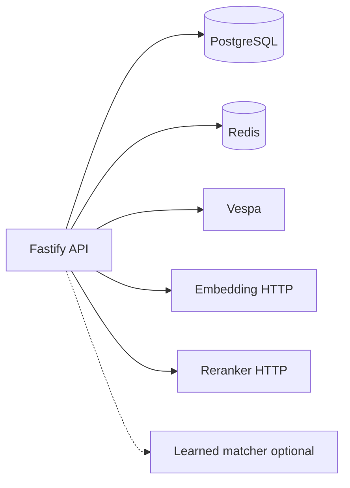

RFC-Apr-6
Retrieval Improvement Roadmap for 2026 SOTA++ Wine Search

**상위·연관 문서**

- `RFC-000` — 전체 아키텍처, Decision 경계, SignalSet, eval 철학
- `RFC-005` — `QueryPlanV1`, route, query class, planner 책임
- `RFC-010` — feedback / learning loop
- `RFC-012` — hybrid retrieval contract
- `RFC-013` — ranking signal 해석 경계
- `RFC-016` — retrieval / rerank는 authority가 아니라 signal
- `RFC-017` — eval, LTR, reranker, IR quality flywheel
- `RFC-INDEX.md` — RFC 목차·용어 정렬
- `docs/system-overview/README.md` — 리뷰용 읽기 순서
- `docs/system-overview/retriever-pipeline.md` — 런타임 hybrid 리트리버 경로
- `docs/system-overview/ingestion-pipeline.md` — Bronze→Vespa·ETL·평가 스크립트
- `docs/bugbash/apr-6-hardening-wave3.md` — **Wave 3** 레포 클로저: canonical JSON SSOT, authority/snapshot/batch id, cache·kill-switch 정책, HTTP 계약 필드, observability 로그, bootstrap CI

**충돌 시 `RFC-000` 우선.**

---

## 배경 (외부 리뷰용)

이 절은 **레포 외부**에서 본 RFC를 읽고 의견을 줄 수 있도록, 현재 준비된 **알고리즘·인프라·데이터 파이프라인·런타임 구성**을 한곳에 모은 요약이다. 세부 계약은 각 `RFC-*.md`와 `docs/system-overview/*`가 SSOT이며, 여기서는 **연결 관계와 파일 위치**를 중심으로 적는다.

### 배경.1 이 문서의 위치

| 항목 | 내용 |
|------|------|
| 목적 | 2026 기준 `SOTA++`급 와인 검색으로 가기 위한 **개선 로드맵** 제안 |
| 전제 | 이미 **hybrid retrieval + ranking + eval + feedback** 골격이 코드에 존재 |
| 독자 | 검색·IR·ML·인프라·제품 아키텍처 리뷰어 |
| SSOT | `RFC-000` 우선, 세부는 `RFC-INDEX.md` 목차 참고 |

### 배경.2 레포지토리·런타임 스택

| 계층 | 선택 |
|------|------|
| 언어 / 런타임 | TypeScript (strict), Node.js ≥ 22, ESM |
| HTTP | Fastify, Zod, Pino |
| 데이터 | PostgreSQL (`pg`), Redis (`redis` 공식 패키지) |
| 검색 인덱스 | Vespa (HTTP 클라이언트로 쿼리·피드) |
| 임베딩 | 별도 **HTTP embedding 서비스** (`EMBEDDING_SERVICE_URL`, 기본 모델 id `bge-m3`) |
| 재랭킹 | 별도 **HTTP cross-encoder reranker** (`RERANKER_SERVICE_URL`) |
| 선택 | Learned matcher HTTP (`LEARNED_MATCHER_SERVICE_URL`), Anthropic (보안·일부 ETL) |

환경 변수 스키마는 `src/config/env.ts`에 정의되어 있다. 대표값:

- `PG_*`, `REDIS_URL`, `VESPA_URL`, `VESPA_CONTENT_CLUSTER`
- `EMBEDDING_SERVICE_URL`, `EMBEDDING_MODEL`, `RERANKER_SERVICE_URL`, `RERANK_BLEND_SCALE`
- `KILL_SWITCH_*` (alias overlay, learning, dense retrieval, injection judge 등)

### 배경.3 RFC·도메인 레이어 맵 (읽기 순서 힌트)

마스터는 **`RFC-000`**. 본 레포의 검색·리트리버 논의는 아래와 직결된다.

| 축 | RFC | 역할 |
|----|-----|------|
| Planner·정책·`QueryPlanV1` | `RFC-005` | query class, constraints, route |
| Entity resolve | `RFC-006` | calibrated C, gap, abstention |
| Decision·admission | `RFC-007`, `RFC-016` | 최종 authority, 실패 의미 |
| Hybrid retrieval | `RFC-012` | sparse+dense+fusion, candidate만 |
| Ranking signals | `RFC-013` | 신호 vs authority 구분 |
| IR 품질 플라이휠 | `RFC-017` | ETL, golden, LTR, reranker |
| Learning·feedback | `RFC-010` | behavioral signal, TTL |

### 배경.4 런타임 의존 인프라 (서비스 경계)

```text
[Client] → Fastify API (wine-search-engine)
    → PostgreSQL     : entity / eval_cases / feedback / migrations 등
    → Redis          : query cache, embedding cache, injection judge cache, watchlist pub/sub (기능별)
    → Vespa          : sparseSearch, denseSearch (ANN), document summaries
    → Embedding Svc  : embed / embedBatch (candidate pool dense 경로)
    → Reranker Svc   : cross-encoder top-K rerank (RankingPort)
    → (optional) Learned Matcher HTTP : resolver 쪽 ML 블렌드
```

`createContainer` (`src/config/container.ts`)가 **QueryPlanner, EntityResolver, CandidatePool, Ranker, DecisionEngine, MixedSolver, Search/Hybrid/… UseCase** 등을 묶는다. Vespa 어댑터는 `src/config/container-adapters.ts`에서 `VespaSearchIndex`, `VespaClient`, anchor/similar/attributes 등으로 연결된다.



### 배경.5 런타임 검색 파이프라인 (요약)

**한 줄:** 보안·플래너·(캐시/SAT) 이후 **effective route**에 따라 `entity` / `hybrid` / `mixed` 중 하나로 실행되며, `hybrid`는 후보 생성 → 랭킹 → (선택 LTR) → 합성 리졸브까지 이어진다.

상세 다이어그램·코드 인용은 `docs/system-overview/retriever-pipeline.md`에 있다. 논리 순서만 적으면:

```text
HTTP Search
  → pre-route (보안·플래너·캐시·SAT 등)
  → route resolution (entity | hybrid | mixed)
  → [hybrid] retrieveHybridCandidatesForPlan
        → (선택) browseProducer / browseRegion / compareAgainstAnchor
        → (폴백) CandidatePoolService.generate
              → sparse (BM25/lexical) + dense (embedding ANN) + hard filters
              → RRF fusion → HybridCandidate[]
  → runHybridRankingPipeline
        → Ranker.rank (다중 시그널 스코어)
        → (조건) cross-encoder rerank top-K
        → applyLtrRerankIfAvailable (query-class별 LambdaMART 가중치가 있을 때)
        → buildHybridRouteResolveResult
  → post-route (결정·응답·캐시 등)
```

`mixed` 경로는 `MixedSolver` + anchor similarity retrieval 등 **별도** 모듈 (`RFC-011`, `src/domain/mixed/`).

### 배경.6 데이터 인입·인덱싱 파이프라인 (오프라인)

Bronze → Silver → Enriched → (선택 확장) → 품질 게이트 → Vespa 피드. 한 줄과 권장 순서는 `docs/system-overview/ingestion-pipeline.md` SSOT.

```text
PG wine_pdp_snapshot (Bronze)
  → vivino-to-silver.ts        → Silver NDJSON
  → generate-aliases.ts        → Enriched NDJSON (RFC-003 alias bundle)
  → (선택) KO / doc-query / Track C 단계
  → validate-silver.ts
  → index-to-vespa.ts          → Vespa (RetrievalDocument + embedding)
```

추가로: 골든 쿼리 생성·하드 네거티브·스플릿·오프라인 eval·LTR 학습 스크립트는 `scripts/eval/*`, `scripts/ltr/*`, `scripts/etl/load-eval-cases.ts` 등에 정리되어 있다.

### 배경.7 평가·학습·피드백 (품질 루프)

| 구성요소 | 역할 | 대표 경로 |
|----------|------|-----------|
| Golden queries | 회귀·학습용 질의 세트 | `data/golden-queries-bronze.jsonl`, `scripts/eval/generate-golden-queries.ts` |
| Splits / leakage 방지 | train/val/gate 분리 | `scripts/eval/build-splits.ts`, `verify-splits.ts`, `RFC-017` |
| Offline eval | 메트릭 산출 | `scripts/eval/run-offline-eval.ts` |
| LambdaMART 학습 | query-class별 가중치 | `src/domain/ranking/service/ltr-training-service.ts`, `scripts/eval/run-eval-and-train-ltr.ts` |
| Feedback ingest | 클릭/구매/무시 등 | `POST /v1/feedback`, `RFC-010`, PG `feedback_signals` |

### 배경.8 현재 구현된 알고리즘·기능 총목 (인벤토리)

아래는 **“이미 코드에 있다”**는 의미의 목록이다. 로드맵에서 `Absent`로 표기한 항목과 대비하면 된다.

| 분류 | 항목 | 비고 |
|------|------|------|
| Query | `QueryPlanV1`, intent, `query_class`, constraints (hard/soft/inferred) | `RFC-005`, `planner.ts` |
| Retrieval | Vespa sparse + dense ANN, hard constraint filter, RRF fusion | `RFC-012`, `candidate-pool.ts`, `fusion.ts` |
| Retrieval | Cascade difficulty → phase 선택 (sparse / dense / anchor_neighborhood 등) | `cascade-router.ts` |
| Retrieval | Specialized browse/compare | `browse-retriever.ts`, `compare-retriever.ts` |
| Ranking | 다중 컴포넌트 스코어 집계 (semantic, popularity, attribute …) | `signal-computer.ts`, `RFC-013` |
| Rerank | Cross-encoder HTTP, wine-aware passage | `ranker.ts`, `reranker.ts` |
| LTR | Per-query-class LambdaMART 재정렬 (모델 있을 때) | `search-usecase-ltr-rerank.ts` |
| Decision | Admission, gap threshold, query-class별 프로파일 | `decision-engine.ts`, `RFC-016` |
| Decision / authority | 결정론적 authority trace·스냅샷·배치 id, canonical 직렬화 SSOT | `authority-trace.ts`, `canonical-json.ts`, `hash.ts`, `id-schema-version.ts`, `pg-snapshot-store.ts`, `batch-search.usecase.ts`; 상세는 `docs/bugbash/apr-6-hardening-wave3.md` |
| Policy | 응답 캐시 적격 판단, kill-switch 정책 표 | `cache-policy.ts`, `kill-switch-policy.ts` |
| Observability | 검색 실행 구조화 로그 스키마 | `src/observability/search-log-schema.ts`, `log-search-event.ts` |
| Security | Query sanitize, optional LLM injection judge (Redis cache) | `query-sanitizer.ts`, `llm-injection-judge.ts` |
| Cache | Redis query cache, embedding cache | `redis-query-cache.ts`, `redis-embedding-cache.ts` |
| ETL | Vivino→Silver→Enriched, KO alias, doc-query, Track C, PG transliteration | `scripts/etl/*` |
| Data | Drinking window ONNX (선택), critic proxy 등 enrichment | `RFC-017`, 관련 스크립트 |

**아직 없거나 로드맵 대상:** learned sparse (SPLADE/MILCO 등), Vespa second-phase ColBERT / late interaction 전용 경로, query multi-view rewrite를 planner가 풍부하게 생성, multimodal label OCR, 강한 personalization ranking.

### 배경.9 외부 리뷰어에게 요청하고 싶은 관점

1. **Candidate generation vs final authority** 분리가 `RFC-012`·`RFC-016`과 모순 없는지.
2. **RRF → query-dependent fusion/LTR** 전환 시 필요한 **관측 가능한 feature** (channel id, rewrite id 등)가 충분한지.
3. **Late interaction** 도입 시 latency·인덱스 비용 대비 기대 이득 (와인 복합 질의 slice).
4. **Learned sparse** vs **dense 품질** 트레이드오프, 한국어·영어 혼합 질의에서의 우선순위.
5. 경쟁 앱 대비 **차별 포인트**로 무엇을 노출할지 (아래 로드맵 §7과 연결).

---

## 0. 한 줄 정의

> 현재의 `BM25 + dense + RRF + cross-encoder + LTR scaffold` 기반을 유지하되,
> 2026년 기준 SOTA++급 와인 검색기로 승격하기 위해
> query understanding, learned sparse, late interaction, query-dependent ranking,
> personalization, multimodal search를 단계적으로 도입하는 로드맵을 정의한다.

---

## 1. 문제 정의

현재 스택은 "좋은 1세대 hybrid retrieval"에는 도달해 있다.
하지만 아래 네 종류의 와인 질의를 동시에 강하게 처리하는 수준까지는 아직 아니다.

1. known-item: `"오푸스원"`, `"샤또 마고 2018"`
2. constraint search: `"10만원 이하 나파 카베르네"`, `"안 단 스파클링"`
3. semantic preference: `"고기랑 잘 어울리는 묵직한 레드"`
4. anchor similarity: `"오푸스원 같은 와인"`, `"케이머스 비슷한데 덜 비싼 것"`

2026 기준 상위권 시스템은 단일 dense retriever나 단순 hybrid만으로 이 문제를 풀지 않는다.
일반적으로 다음이 함께 필요하다.

- 강한 query understanding
- 멀티채널 candidate generation
- late interaction 기반 top precision 향상
- query-dependent fusion / ranking
- behavioral loop / personalization
- multilingual / typo / alias robustness
- multimodal entrypoint

즉, 이 RFC의 목적은 "dense를 조금 더 잘 쓰자"가 아니다.
**와인 검색을 product search + entity retrieval + preference search의 합성 문제로 재정의하고, 검색 스택 전체를 2026 수준으로 재편하는 것**이다.

---

## 2. 비목표

| 하지 않음 | 담당 |
|---|---|
| Decision authority 경계 변경 | `RFC-000`, `RFC-016` |
| Entity SSOT 재정의 | `RFC-001`~`RFC-004` |
| HTTP contract 자체 변경 | 별도 RFC |
| 단일 모델 하나로 검색 전체를 대체 | 본 RFC 범위 밖 |
| "LLM만으로" retrieval 대체 | 본 RFC에서 금지 |

이 RFC는 **retrieval / ranking / learning loop roadmap**을 정의한다.
최종 answer authority는 계속 downstream decision layer에 남는다.

---

## 3. 목표 아키텍처 재정의

### 3.1 핵심 한 줄

이 RFC의 최종 제안은 다음 한 문장으로 요약된다.

> 와인 검색을 **하나의 hybrid retrieval 문제**가 아니라
> **6개 retrieval problem의 합성**으로 재정의한다.

그 6개는 다음이다.

1. `ENTITY` — exact entity retrieval
2. `FACET_CONSTRAINT` — typed constraint retrieval
3. `DISCOVERY_SEMANTIC` — taste / semantic preference retrieval
4. `ANCHOR_SIMILARITY` — anchor-conditioned similarity retrieval
5. `LLM_RESEARCH` — LLM consumption oriented retrieval
6. `VISION_LABEL` — multimodal label / bottle retrieval

### 3.2 Breaking-change 허용 원칙

본 RFC는 **브레이킹 체인지 허용**을 전제로 한다.
즉 현재 `hybrid` 중심 구조를 "조금 보완"하는 수준이 아니라,
필요하면 아래를 깨고 재설계한다.

- 런타임 query compile contract
- retrieval mode / route contract
- index projection contract
- candidate provenance schema
- ranking feature schema
- result shaping schema

단, **결정 authority 경계**는 깨지 않는다.
즉 `retrieval → ranking → decision` 분리와 `RFC-016`의 sealing / admission 철학은 유지한다.

### 3.3 왜 이렇게까지 바꾸는가

현재 시스템은 `BM25 + dense + RRF + cross-encoder + LTR scaffold`라는 좋은 기반 위에 있다.
하지만 2026 기준 SOTA++ 수준에서는 다음이 더 중요하다.

1. query family별로 retrieval contract를 나누는 것
2. canonical wine entity 중심의 multi-representation index로 바꾸는 것
3. typed query compiler를 도입하는 것
4. channel provenance를 최종 rank까지 보존하는 것
5. human search와 LLM search의 result unit을 분리하는 것

즉 이 RFC는 "더 좋은 dense 모델"을 권하는 문서가 아니라,
**와인 검색 엔진 전체를 mode-aware, graph-aware, provenance-aware architecture로 바꾸는 문서**다.

---

## 4. 현재 시스템에서 최종 구조로 가는 방향

### 4.1 현재 구현 진단

#### 이미 있는 것

| 영역 | 현재 구현 | 파일 / 경로 | 상태 |
|---|---|---|---|
| Query class 분기 | `short_entity`, `ambiguous_short_form`, `comparison_query`, `anchored_similarity`, `pure_constraint`, `semantic_preference`, `unknown` | `src/domain/query/service/planner.ts` | `Implemented` |
| Hybrid candidate generation | specialized browse / compare 우선, 실패 시 candidate pool fallback | `src/application/search/search-usecase-hybrid-candidates.ts` | `Implemented` |
| Sparse retrieval | BM25 / sparse search 경로 | `src/infrastructure/vespa/vespa-search-index.ts` | `Implemented` |
| Dense retrieval | embedding 기반 dense search, cache 지원 | `src/domain/retrieval/service/candidate-pool.ts`, `src/infrastructure/cache/redis-embedding-cache.ts` | `Implemented` |
| Hard filter at retrieval | hard constraint sparse token filter + hard filter pass | `src/domain/retrieval/service/candidate-pool.ts` | `Implemented` |
| Candidate fusion | RRF | `src/domain/retrieval/service/fusion.ts` | `Implemented` |
| Cross-encoder rerank | remote HTTP reranker + score blend | `src/domain/ranking/service/ranker.ts`, `src/infrastructure/vespa/reranker.ts` | `Implemented` |
| LTR scaffold | per-query-class LambdaMART training / inference | `src/application/search/search-usecase-ltr-rerank.ts`, `src/domain/ranking/service/ltr-training-service.ts` | `Implemented` |
| Eval pipeline | golden queries, hard negatives, splits, offline eval | `scripts/eval/*`, `scripts/ltr/*` | `Implemented` |
| Feedback ingestion | click / purchase / dismiss ingest + TTL | `src/interface/http/routes/feedback.route.ts`, `src/domain/learning/service/feedback-ttl-enforcer.ts` | `Implemented` |
| KO alias / transliteration assets | alias generation, transliteration backfill | `scripts/etl/generate-korean-aliases.ts`, `scripts/etl/generate-transliteration-aliases.ts` | `Implemented` |

#### 부분 구현 / 없는 것

| 영역 | 현재 상태 | 판단 |
|---|---|---|
| Semantic query generation | `semanticQueries`가 사실상 `plan.rawQuery` 1개 | `Partial` |
| Retrieval profile | profile object는 있으나 실제 channel policy로 충분히 반영되지 않음 | `Partial` |
| Anchor retrieval | `mixed`에서는 살아 있으나 전체 retrieval system의 중심 채널은 아님 | `Partial` |
| Query-dependent ranking | query-class별 LTR는 있으나 channel-aware final rank는 약함 | `Partial` |
| Query-time multilingual normalization | ingestion alias는 있으나 런타임 normalization은 약함 | `Partial` |
| Behavioral loop serving 연결 | feedback 저장은 있으나 ranking feature로는 제한적 | `Partial` |
| Learned sparse retrieval | 없음 | `Absent` |
| Late interaction reranking | 없음 | `Absent` |
| Vision label / OCR retrieval | 없음 | `Absent` |
| Personalization / taste profile ranking | 없음 | `Absent` |

### 4.2 내 의견: 버릴 것과 살릴 것

현재 시스템은 **폐기 대상이 아니다**.
살릴 것과 깨고 바꿀 것을 분리해야 한다.

#### 그대로 살릴 것

- Vespa 기반 인덱스 / phased ranking 가능성
- Query planner / decision / admission 철학
- BM25 sparse 경로
- dense retrieval + embedding cache
- browse / compare specialized retriever
- offline eval / golden / hard negatives / LTR 자산
- feedback ingest / TTL

#### 브레이킹 체인지로 바꿀 것

- `QueryPlanV1` 중심의 retrieval 입력 계약
- `RetrievalDocument + embedding` 중심 단일 문서 projection
- `hybrid`라는 넓은 라벨 아래 뭉친 retrieval family
- 단순 RRF 중심 candidate pool
- 사람용 결과와 LLM용 결과를 같은 result unit으로 다루는 발상

즉, **기존 IR 엔진을 버리는 게 아니라, 기존 IR 엔진 위에 얹힌 contract를 깨고 다시 설계**하는 것이 맞다.

---

## 5. 데이터 모델 재설계

### 5.1 핵심 주장

와인에서는 문서 단위를 그냥 "상품 1건"으로 두면 약하다.
최소 **4계층 entity graph**가 필요하다.

### 5.2 목표 4계층

#### 1) Canonical Wine Entity

검색의 중심이 되는 엔티티.

- producer
- wine line / cuvee
- vintage
- region / appellation
- grape blend
- style
- sweetness
- body
- acidity
- tannin
- alcohol
- price bands
- awards / critics
- drinking window
- food pairing
- merchant availability summary

#### 2) Market SKU / Offer Entity

구매 가능성과 가격을 담당하는 표현.

- retailer SKU
- bottle size
- current price
- stock
- shipping region
- promo
- tax / delivery

#### 3) Evidence / Text Entity

retrieval feature와 explanation의 원천.

- tasting notes
- critic reviews
- user reviews
- merchant copy
- winery descriptions
- cellar / pairing notes
- OCR extracted label text

#### 4) Image / Label Entity

vision entrypoint를 담당하는 표현.

- front label
- back label
- bottle silhouette
- emblem / crest region crop
- OCR blocks

### 5.3 현재 파이프라인과의 관계

현재 `scripts/etl/*`는 Bronze → Silver → Enriched → Vespa로 잘 정리돼 있다.
이 자산은 계속 쓴다. 다만 **Gold projection을 재정의**해야 한다.

현재:

```text
Silver / Enriched
-> RetrievalDocument
-> Vespa document
```

목표:

```text
Silver / Enriched
-> CanonicalWineEntity projection
-> Offer projection
-> Evidence projection
-> Image / OCR projection
-> canonical-centric multi-representation index
```

### 5.4 내 의견

문서 표현은 "데이터 모델을 갈아엎는다"보다 아래처럼 쓰는 것이 좋다.

> 논리 모델은 canonical-centric 4-layer graph로 전환하고,
> 물리 구현은 staged migration으로 이전한다.

즉, 외부 리뷰어가 "full rewrite"로 오해하지 않게 해야 한다.

---

## 6. Query Compiler 재설계

### 6.1 핵심 주장

현재 planner를 더 밀어 **typed retrieval intent compiler**로 승격해야 한다.
이건 단순 semantic rewrite기가 아니다.

### 6.2 목표 스키마

```text
CompiledWineQueryV2
  mode: ENTITY | FACET_CONSTRAINT | DISCOVERY_SEMANTIC | ANCHOR_SIMILARITY | LLM_RESEARCH | VISION_LABEL
  locale: ko | en | mixed
  entity_mentions
  hard_filters
  soft_prefs
  anchor_entity_id
  compare_target_ids
  query_views
  llm_task
  safety
  candidate_budget_profile
```

### 6.3 이 스키마에 반드시 들어가야 하는 것

| 필드 | 이유 |
|---|---|
| `mode` | retrieval contract를 결정 |
| `locale` | KR/EN mixed query 대응 |
| `entity_mentions` | producer / cuvee / vintage / grape / region 추출 |
| `hard_filters` | price / sweetness / sparkling / availability 등 |
| `soft_prefs` | bold / elegant / smoky / pairing / gifting 등 |
| `anchor_entity_id` | `"X 같은 와인"` 계열 처리 |
| `query_views` | multi-view rewrite contract |
| `safety.protected_fields` | rewrite가 producer / vintage / price 등을 바꾸지 못하게 제한 |
| `candidate_budget_profile` | mode별 top-N / rerank budget 제어 |

### 6.4 반드시 필요한 알고리즘

#### A. Constraint extraction

classifier가 아니라 **slot filling + ontology normalization + typed parser** 조합이어야 한다.

예:

- `"10만원 이하 나파 카베르네"`
- `"안 단 샴페인"`
- `"오푸스원이랑 비슷한데 더 저렴한 거"`

여기서 최소 추출해야 하는 것:

- `price_max`
- `region = Napa Valley`
- `grape = Cabernet Sauvignon`
- `sweetness = dry`
- `sparkling = true/false`
- `anchor = Opus One`
- `price_relation = lower_than_anchor`

#### B. Multi-view rewrite

한 query에서 최소 아래 5개 view를 만든다.

1. exact lexical view
2. normalized alias view
3. bilingual pivot view
4. sparse expansion view
5. semantic preference view

단, rewrite safety contract가 필요하다.
`producer`, `vintage`, `region`, `price`, `sweetness` 같은 protected field는 rewrite가 바꾸면 안 된다.

#### C. Query-time normalization

ingestion alias만으로는 부족하다.
query-time에서 아래를 first-class로 처리해야 한다.

- Korean transliteration
- English canonicalization
- misspelling
- abbreviations
- colloquial wine jargon

### 6.5 현재 엔진에서의 이행

현재 `planner.ts`는 이미 좋은 출발점이다.
초기 마이그레이션은 다음 순서가 맞다.

1. `QueryPlanV1`을 즉시 삭제하지 않는다.
2. `CompiledWineQueryV2`를 병행 도입한다.
3. `QueryPlanV1`은 `CompiledWineQueryV2`의 downgraded compatibility view가 된다.
4. retrieval / ranking은 순차적으로 `CompiledWineQueryV2`를 소비하도록 바꾼다.

---

## 7. 6 Mode와 8 Channel 구조

### 7.1 Mode 정의

| Mode | primary goal | result unit |
|---|---|---|
| `ENTITY` | exact entity / vintage lookup | canonical wine entity |
| `FACET_CONSTRAINT` | constraint-satisfying wine set | canonical wine entity set |
| `DISCOVERY_SEMANTIC` | taste / pairing / preference discovery | discovery candidates |
| `ANCHOR_SIMILARITY` | anchor-relative similar wines | anchor-conditioned candidates |
| `LLM_RESEARCH` | evidence-rich retrieval for LLM | wine retrieval envelope |
| `VISION_LABEL` | label / bottle identification | label-linked entity candidates |

### 7.2 Route / query class / mode 관계

| 개념 | 역할 | 비고 |
|---|---|---|
| `queryClass` | planner/compiler가 본 질의 유형 | 기존 자산 유지 가능 |
| `route` | 내부 실행 경로 | entity / hybrid / mixed 호환용 |
| `mode` | 최종 retrieval contract | 본 RFC의 신규 중심 개념 |

내 의견은 다음과 같다.

- `mode`를 상위 retrieval contract로 둔다.
- `route`는 점진 이행 중의 내부 execution path로 남긴다.
- 장기적으로 `route`는 implementation detail이 된다.

### 7.3 8 Channel 정의

| 채널 | 용도 | 권장 알고리즘 |
|---|---|---|
| 1. Exact lexical entity retriever | known-item, producer + vintage, appellation exact | BM25 + phrase + field boosts + alias exact |
| 2. Facet-constrained lexical retriever | typed filter query | BM25/WAND + hard facet filters + numeric pre-filter |
| 3. Learned sparse retriever | typo / transliteration / long-tail recall | BGE-M3 sparse weights, SPLADE, MILCO 계열 |
| 4. Dense retriever | semantic preference / pairing / natural language | BGE-M3 dense or domain-tuned dense encoder |
| 5. Multi-vector / late-interaction retriever | token-level semantic precision | ColBERTv2 / Jina-ColBERT-v2 |
| 6. Anchor neighborhood retriever | `"오푸스원 같은"` 계열 | structured + semantic + behavioral + price-relative axes |
| 7. Browse / compare specialized retriever | producer browse / region browse / compare / gift | existing specialized retriever 확장 |
| 8. Vision label retriever | label scan / bottle search | OCR + entity linking + visual embedding |

### 7.4 내 의견

이 8채널은 "한 번에 다 만든다"가 아니다.
리뷰 문서에는 아래처럼 rollout tier를 같이 적는 게 좋다.

| Tier | 채널 |
|---|---|
| Day-1 core | exact lexical, constrained lexical, dense, anchor, browse/compare |
| Phase-2 | learned sparse, late interaction |
| Phase-3 | vision label |

---

## 8. Structured Candidate Pool Assembly

### 8.1 핵심 주장

2026 기준으로 candidate pool은 단순 union + RRF로 끝나면 약하다.
**structured pool assembly**가 필요하다.

### 8.2 권장 방식

1. 채널별 top-N 독립 수집
2. canonical wine id 기준 dedupe
3. source provenance 보존
4. protected coverage guarantee
5. anchor diversity control
6. pool quota control

예시 budget:

- exact lexical: 40
- constrained lexical: 60
- learned sparse: 80
- dense: 80
- anchor neighborhood: 60
- browse/compare: 30
- vision OCR: 40

dedupe 후 약 `150~250` 후보를 유지한다.

### 8.3 provenance feature 계약

아래는 반드시 남겨야 한다.

- `source_channel`
- `source_rank_in_channel`
- `matched_query_view`
- `hard_filter_pass_mask`
- `matched_entity_fields`
- `anchor_axes_scores`
- `ocr_match_confidence`
- `sparse_score_raw`
- `dense_score_raw`
- `lexical_score_raw`

### 8.4 현재 구현에서 무엇을 버리고 무엇을 남길지

현재 `fusion.ts`의 RRF는 **baseline fallback**으로 남길 수 있다.
하지만 long-term primary assembly는 아니다.

내 의견:

- 지금 RRF는 제거 대상이 아니라 fallback / ablation baseline이다.
- 최종 시스템은 **RRF-only**가 아니라 **pool assembly + learned ranking**으로 가야 한다.

---

## 9. Ranking Funnel 재설계

### 9.1 4단계 funnel

#### Stage A. First-phase coarse ranking

역할:

- 너무 많은 후보 컷
- cheap feature only

사용 feature:

- BM25 / phrase / field match
- learned sparse score
- dense closeness
- hard filter pass
- exact entity hit
- basic popularity
- freshness / availability
- country / locality fit

목표:

`2000 -> 300`

#### Stage B. Second-phase channel-aware tree ranker

역할:

- heterogeneous channel을 실제로 섞기
- source utility를 학습

모델:

- LightGBM ranker 또는 LambdaMART

feature 예시:

- query mode
- query class
- query locale
- source channel
- overlap count
- exact / alias hit
- protected field consistency
- structured attribute match strength
- anchor structured similarity
- anchor semantic similarity
- behavioral priors
- merchant availability
- price deviation from user habit / anchor

목표:

`300 -> 80`

#### Stage C. Late interaction rerank

역할:

- token-level semantic precision 극대화

모델:

- ColBERTv2 / Jina-ColBERT-v2 계열

언제 켜나:

- `DISCOVERY_SEMANTIC`
- `ANCHOR_SIMILARITY`
- `LLM_RESEARCH`
- mixed entity + taste query

언제 끄나:

- exact vintage lookup
- pure facet browse
- narrow exact entity query

목표:

`80 -> 30`

#### Stage D. Final policy / UX ranker

역할:

- user / session / business / explainability 반영
- final response shaping

목표:

`30 -> 10 or 20`

### 9.2 mode별 활성화 정책

| Mode | Stage A | Stage B | Stage C | Stage D |
|---|---|---|---|---|
| `ENTITY` | on | light | usually off | on |
| `FACET_CONSTRAINT` | on | on | off by default | on |
| `DISCOVERY_SEMANTIC` | on | on | on | on |
| `ANCHOR_SIMILARITY` | on | on | on | on |
| `LLM_RESEARCH` | on | on | on | on |
| `VISION_LABEL` | on | on | selective | on |

### 9.3 내 의견

현재 레포의 `cross-encoder rerank`는 Stage C 또는 Stage D의 일부 역할을 한다.
즉 당장 버릴 필요는 없고:

- 단기: cross-encoder를 precision rerank로 계속 사용
- 중기: selective late interaction 추가
- 장기: cross-encoder는 very-top polish 또는 LLM evidence scoring으로 역할 축소

---

## 10. Human Search와 LLM Search 분리

### 10.1 핵심 주장

사람 검색과 LLM 검색은 **같은 인덱스**를 써도 되지만,
**결과 단위는 다르게** 가져가야 한다.

### 10.2 사람용 결과

사람은 보통 다음이 필요하다.

- 10~20개 결과
- facets
- compare
- 짧은 explanation
- price / stock / badge

즉 `canonical wine entity + offer aggregation` 결과를 준다.

### 10.3 LLM용 결과

LLM은 다음이 필요하다.

- why matched
- structured evidence
- snippet
- conflicting evidence
- comparison matrix
- provenance

따라서 LLM에는 raw hits 대신 **envelope**를 줘야 한다.

### 10.4 권장 스키마

```text
WineRetrievalEnvelopeV1
  entity core
  ranked offers
  structured attributes
  why matched
  supporting evidence snippets
  OCR evidence if any
  anchor explanation
  constraint satisfaction report
  trust / completeness flags
```

### 10.5 내 의견

`LLM_RESEARCH`는 retrieval mode이면서 response contract까지 포함하는 특수 mode다.
문서에 이 점을 명시해야 혼동이 줄어든다.

---

## 11. 도메인 특화 알고리즘

### 11.1 Vintage-aware ranking

같은 cuvee라도 vintage가 중요하다.
별도 feature가 필요하다.

- vintage exact
- vintage proximity
- missing vintage penalty
- non-vintage handling

### 11.2 Price-relative retrieval

`"오푸스원보다 저렴한"`은 절대가격 필터가 아니다.
anchor 대비 아래를 feature로 넣어야 한다.

- `price_ratio`
- `prestige_ratio`
- `critic_score_delta`

### 11.3 Taste manifold

초기에는 너무 연구지향적으로 쓰기보다,
**typed sensory axes**부터 시작하는 것이 좋다.

- body
- acidity
- tannin
- sweetness
- oak
- fruit
- earthiness
- minerality
- fizz
- dessertness

이후 semantic retrieval과 shared latent space로 확장한다.

### 11.4 Pairing graph

pairing은 text match만으로 끝내지 않는다.

- food category ontology
- co-mention graph
- expert pairing edges

### 11.5 Availability-aware ranking

catalog match만 좋고 못 사면 UX가 꺾인다.
사람용 top rank는 stock / ship region을 반드시 반영해야 한다.

### 11.6 Behavioral similarity 주의

anchor similarity의 한 축으로 behavioral similarity는 유용하다.
다만 아래 경고를 문서에 남겨야 한다.

- cold start에 약함
- popularity loop를 강화할 수 있음
- offline eval leakage 위험
- explainability 저하 가능성

따라서 behavioral similarity는 **auxiliary feature**로만 다룬다.

---

## 12. 경쟁사 비교와 포지셔닝

이 절은 **공개 기능 기준 비교**다.
경쟁사 내부 모델 구조는 공개되지 않았으므로,
알고리즘 비교는 공개 UX와 업계 표준을 바탕으로 한 추정만 허용한다.

### 12.1 경쟁사 포지션

| 플레이어 | 공개적으로 강한 영역 | 약한 영역 또는 빈틈 | 우리에게 의미 |
|---|---|---|---|
| `Vivino` | 방대한 catalog, label scan, crowd ratings, recommendation, 개인화 강화 방향 | popularity bias 가능성, explainable structured retrieval는 제한적일 가능성 | "정확히 잘 찾는 와인 검색"으로 차별화 가능 |
| `Wine-Searcher` | known-item, price comparison, merchant / availability 탐색 | semantic discovery, preference search는 상대적으로 약함 | commerce signal과 semantic retrieval를 합치면 차별화 가능 |
| `CellarTracker` | collector notes, cellar management, drink window, serious enthusiast data | 일반 사용자 semantic discovery / mobile-first search는 상대적으로 약함 | expert-grade retrieval + consumer-grade discovery 결합 가능 |

### 12.2 우리가 지향할 포지션

우리는 `제일 큰 catalog`나 `제일 많은 merchant`로 이기기보다,
다음 조합으로 이기는 것이 현실적이다.

1. wine-native typed query compiler
2. semantic + structured + anchor retrieval 동시 처리
3. explainable provenance-rich ranking
4. knowledge-aware similarity
5. LLM-ready envelope
6. 후속 personalization / multimodal UX

즉 포지셔닝 문장은 아래와 같다.

> "와인 이름을 찾는 앱"이 아니라
> "취향, 맥락, 제약, 비교, 쇼핑, LLM 사용까지 이해하는 wine-native search engine"

---

## 13. 구현 로드맵 (브레이킹 체인지 허용)

### Phase 0. Observability 먼저

목표:

- 현재 엔진의 승패를 정확히 측정
- 이후 migration 리스크를 줄임

작업:

1. mode-style eval slice 정의
2. retrieval trace에 channel / rewrite / anchor provenance 추가
3. result logging schema 정비
4. offline regression gate 강화

### Phase 1. Query contract migration

목표:

- `QueryPlanV1` 중심 세계에서 `CompiledWineQueryV2` 세계로 전환

작업:

1. `CompiledWineQueryV2` 도입
2. constraint extraction + ontology normalization 구축
3. query-time normalization 구축
4. multi-view rewrite 계약 추가
5. `QueryPlanV1` compatibility layer 제공

브레이킹 포인트:

- planner 출력 계약
- retrieval input schema

### Phase 2. Index projection migration

목표:

- 단일 `RetrievalDocument` 중심에서 canonical-centric multi-representation index로 이동

작업:

1. canonical wine entity projection 정의
2. offer projection 정의
3. evidence projection 정의
4. OCR / image projection 정의
5. Vespa schema 및 feed pipeline 재정의

브레이킹 포인트:

- Vespa document schema
- ETL Gold projection contract
- ranking feature extraction input

### Phase 3. Multi-channel retrieval 구축

목표:

- 6 mode × 8 channel 구조의 최소 실전형 완성

작업:

1. exact / constrained / dense / anchor / specialized browse를 core channel로 재구성
2. provenance-rich structured pool assembly 도입
3. learned sparse 채널 추가
4. mode별 candidate budget 적용

### Phase 4. Ranking funnel 재편

목표:

- RRF 중심에서 stage-aware ranking으로 이동

작업:

1. Stage A coarse rank
2. Stage B channel-aware LightGBM / LambdaMART
3. Stage C selective late interaction
4. Stage D final policy / UX rank

브레이킹 포인트:

- ranking feature schema
- result ordering semantics
- explanation schema

### Phase 5. Human / LLM / Vision 결과 분화

목표:

- 소비자 검색, LLM retrieval, 이미지 검색을 하나의 엔진에서 다르게 노출

작업:

1. human card result shaping
2. `WineRetrievalEnvelopeV1` 도입
3. OCR -> entity linking -> vision retrieval path 추가

### Phase 6. Personalization

목표:

- repeat user 차별화

작업:

1. user taste profile
2. session-aware ranking
3. price habit / region habit feature
4. diversity / novelty policy

### 13.1 Wave 3 — 레포·권위 결정론 클로저 (구현 반영)

본 절의 Phase 0~6은 **검색 스택 대형 마이그레이션** 시간축이다. 그와 별도로, “문서·스크립트·권위 id·HTTP 계약이 한 줄로 맞는다”는 **레포 운영 클로저**를 Wave 3로 문서화·구현했다.

| 축 | 내용 | 코드·문서 |
|----|------|-----------|
| Canonical 직렬화 | authority hash·`response_hash` 입력에 `JSON.stringify` 직접 사용 금지 | `src/domain/shared/utils/canonical-json.ts`, `hash.ts` |
| ID 버전 | `decision:v1:…`, `admission:v1:…`, `snapshot:v1:…`, `batch:v1:…` | `id-schema-version.ts`, `authority-trace.ts`, `pg-snapshot-store.ts`, `batch-search.usecase.ts` |
| Admission 다신호 | `decideAdmission` + 기존 게이트와 병행 (confidence 중복 거절은 `ConfidenceRefusalPolicy`에 위임) | `admission-policy.ts`, `admission-gate.ts` |
| HTTP 계약 | `authority_trace_ref`, `runtime_correlation_ref`, `execution_mode`, … | `search-response.schema.ts`, `response-builder.ts` |
| 관측 | `search_execution` 이벤트 | `log-search-event.ts`, post-route |
| CI | `scripts/bootstrap-smoke.sh`, `SKIP_MIGRATE` 옵션 | `.github/workflows/bootstrap-smoke.yml` |
| 응답 캐시 정책 | `degraded`/`heuristic` 등 비캐시 응답은 `setSearchResponse`에서 스킵 | `cache-policy.ts`, `CacheService` |

**후속 (로드맵과 겹침):** replay fixture를 런타임 HTTP 검색과 통합(`runSearchFixture`), `scripts/eval`의 advisory vs blocking 메트릭 정책(`eval-metric-policy`), ID 스키마 버전별 replay/audit 디코더 등은 `docs/bugbash/apr-6-hardening-wave3.md`에 정리됨. readiness SSOT·`CacheService` write 게이트는 **반영 완료**.

---

## 14. 우선순위

| 우선순위 | 항목 | 이유 |
|---|---|---|
| P0 | `CompiledWineQueryV2` 도입 | 이후 모든 retrieval family의 기반 |
| P0 | mode-based eval / trace 강화 | 브레이킹 체인지 리스크 제어 |
| P1 | canonical-centric index projection | 현재 문서/인덱스의 가장 큰 구조적 한계 |
| P1 | anchor retrieval 승격 | 와인 도메인에서 가장 큰 차별 포인트 |
| P1 | learned sparse 도입 | long-tail / multilingual / typo recall 개선 |
| P1 | channel-aware LTR | 고정 RRF의 한계 극복 |
| P2 | selective late interaction | 2026 기준 top precision 핵심 |
| P2 | human / LLM result 분리 | agent / assistant 시대의 핵심 |
| P3 | vision label search | consumer UX 경쟁력 |
| P3 | personalization | 장기 retention 차별화 |

---

## 15. KPI / 평가 체계

### 15.1 mode별 오프라인 slice

| Mode | 핵심 지표 |
|---|---|
| `ENTITY` | `MRR@1`, exact vintage hit, ambiguity-safe abstention |
| `FACET_CONSTRAINT` | constraint satisfaction, filtered Recall@K |
| `DISCOVERY_SEMANTIC` | Recall@100, NDCG@10, save / dwell proxy |
| `ANCHOR_SIMILARITY` | anchor acceptance, price-relative success |
| `LLM_RESEARCH` | answer acceptance, correction rate, evidence completeness |
| `VISION_LABEL` | top-1 entity link accuracy, vintage OCR accuracy |

### 15.2 공통 온라인 지표

| 지표 | 목표 |
|---|---|
| reformulation rate | 하락 |
| save / watchlist / compare action | 상승 |
| purchase proxy / merchant click | 상승 |
| session abandonment | 하락 |
| latency P95 | budget 내 유지 |

### 15.3 승격 계약

새 retriever / reranker / ranker / projection 승격 전 조건:

1. offline quality 개선
2. mode-slice regression 없음
3. latency / cost budget 충족
4. provenance / explainability 유지
5. decision authority 경계 위반 없음

---

## 16. 파일 단위 작업 시작점

| 작업 | 시작 파일 |
|---|---|
| `CompiledWineQueryV2` 도입용 planner/compiler 레이어 | `src/domain/query/service/planner.ts` |
| hybrid candidate 입력 계약 교체 | `src/application/search/search-usecase-hybrid-candidates.ts` |
| candidate pool provenance 확장 | `src/domain/retrieval/service/candidate-pool.ts`, `src/domain/retrieval/service/fusion.ts` |
| anchor axes feature화 | `src/domain/mixed/service/mixed-solver.ts`, `src/domain/ranking/service/signal-computer.ts` |
| learned sparse search index port 추가 | `src/domain/retrieval/port/search-index.port.ts`, `src/infrastructure/vespa/vespa-search-index.ts` |
| late interaction adapter 추가 | `src/infrastructure/vespa/`, `src/domain/ranking/service/ranker.ts` |
| ETL Gold projection 재정의 | `scripts/etl/index-to-vespa.ts`, `scripts/etl/types.ts` |
| evidence / OCR projection 추가 | `scripts/etl/*`, 새 projection 모듈 |
| LTR feature schema 확장 | `src/domain/ranking/service/ltr-feature-extractor.ts` |
| eval slice 재편 | `scripts/eval/*`, `scripts/ltr/*` |

---

## 17. 최종 권고

이 시스템은 단순 보수보다는 **구조 재정의**가 필요한 시점이다.
브레이킹 체인지가 가능하다면, 다음이 최종 권고다.

1. 검색을 `6개 retrieval problem`의 합성으로 재정의한다.
2. `planner`를 `CompiledWineQueryV2` 기반 typed compiler로 승격한다.
3. `RetrievalDocument + embedding` 중심 구조를 canonical-centric multi-representation index로 바꾼다.
4. candidate pool을 RRF-only에서 provenance-rich structured pool assembly로 바꾼다.
5. ranking funnel을 4-stage로 나눈다.
6. 사람 검색과 LLM 검색의 result unit을 분리한다.

내 의견을 섞어 최종적으로 한 줄로 정리하면 이렇다.

> 기존 IR / 엔진 / ETL 자산은 최대한 살리되,
> contract와 projection은 과감하게 깨고,
> mode-aware, graph-aware, provenance-aware wine search engine으로 재편하는 것이 맞다.

이 경로가 비용 대비 성능, explainability, 운영 안정성, 와인 도메인 적합성, 그리고 2026 이후 LLM / multimodal 환경까지 고려했을 때 가장 설득력 있다.
