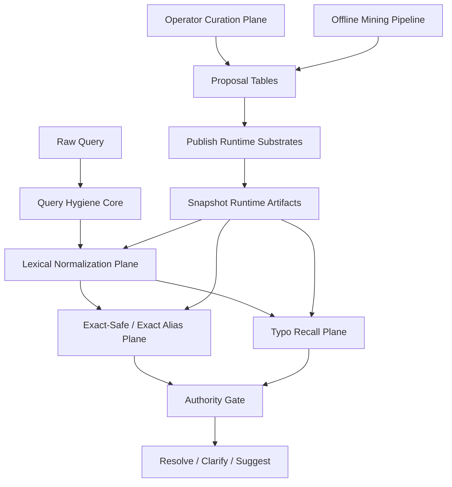

# RFC-023 — Operational Lexical Authority Plane for Alias, Typo, and Keyword Curation

**상태**: Draft  
**작성일**: 2026-06-09  
**상위·연관 문서**
- `RFC-003` — Alias system / alias type / collision discipline
- `RFC-015` — Determinism, Replay, snapshot, kill switch
- `RFC-017` — IR quality flywheel / eval slices / data loop
- `RFC-021` — Primitive search surface and agent orchestration boundary
- `RFC-022` — Analyze 단계 typed dispatch
- `docs/runbook-abbreviation-aliases.md` — existing proposal→review→publish operator pattern

**충돌 시 `RFC-003` alias taxonomy, `RFC-015` snapshot authority, `RFC-014` external contract가 우선한다.**

---

## 0. 한 줄 방향

> **코드에 박힌 한국어 오타·별칭 규칙을 운영 가능한 데이터 plane으로 내리고, lookup V2 miss 뒤에 snapshot-scoped typo recall plane을 붙인다. exact resolve는 reviewed authority만 허용하고, fuzzy는 candidate recall과 clarify/suggest로만 쓴다.**

이 RFC의 목적은 단순히 `"오퍼쓰원" -> "오푸스원"` 한 케이스를 고치는 것이 아니다.  
목표는:

1. routine lexical update에 코드 수정/배포가 필요 없는 구조를 만들고,
2. registered keyword/오타/별칭/약어/IME 변형이 lookup V2에서 실제로 동작하게 하며,
3. fuzzy-only 회수가 wrong exact resolve로 승격되지 않도록 fail-closed policy를 유지하는 것이다.

---

## 1. Problem Statement

### 1.1 현재 구조는 lexical knowledge가 코드와 runtime 사이에 어정쩡하게 분산돼 있다

현재 repo에는 세 층이 섞여 있다.

1. **코드 하드코딩**
   - `src/domain/query/service/korean-wine-aliases.ts`
   - `src/domain/query/service/query-normalizer.ts`
   - `src/domain/alias/service/transliterator.ts`
2. **운영 데이터**
   - `data/lookup-v2/korean-exact-safe-registry-v1.jsonl`
   - `data/gold-wine-catalog.jsonl`
   - `alias_proposals` / `ambiguity_proposals` / `suppression_proposals`
3. **runtime artifact**
   - lookup alias runtime / broad recall runtime / exact-safe runtime / semantic-scope runtime

문제는 lexical knowledge의 ownership이 일관되지 않다는 점이다.

- `"오퍼스원" -> "오푸스원"` 같은 correction은 코드에 있다.
- exact-safe surface는 데이터에 있다.
- typo recovery를 위한 generic fuzzy는 일반 planner에는 있지만 lookup V2에는 wiring되어 있지 않다.

결과적으로:

- operator가 misspelling을 등록해도 lookup V2 runtime behavior와 바로 연결되지 않는다.
- `"오퍼쓰원"` 같은 near-miss는 exact/compact/translit/IME에서 빠지면 그냥 miss다.
- routine update가 TS patch + 배포를 요구한다.
- 변경 blast radius를 snapshot diff / proposal audit / operator approval로 관리하기 어렵다.

### 1.2 현재 lookup V2는 generic typo recovery를 실제로 쓰지 않는다

현재 lookup V2 authority path는 `RuntimeLookupPlanner + MultiChannelRetrievalEngine`이다.

- `RuntimeLookupPlanner` wiring에는 `fuzzyMatcher`가 없다.
- `MultiChannelRetrievalEngine`도 alias matcher의 exact/compact/transliterated/phonetic class를 fan-out할 뿐, BK-tree edit-distance fuzzy를 lookup lane에서 직접 호출하지 않는다.
- repo 안의 `FuzzyMatcher`는 일반 planner fallback용으로 존재하지만 lookup V2 sibling stack에 주입되지 않는다.

즉, 이름상 `fuzzy` substrate가 repo에 있어도 **lookup V2의 실제 entity lookup lane**에서는 `"registered keyword 근처 오타"`를 generic하게 회수하지 못한다.

### 1.3 하드코딩 correction은 scale, audit, ops 측면에서 부적절하다

현재 방식의 운영상 문제:

- lexical update마다 코드 PR이 필요하다.
- operator가 직접 review/publish/canary/rollback 할 수 없다.
- 어떤 correction이 어느 snapshot부터 활성인지 추적이 약하다.
- collision / ambiguity / suppression을 동일한 write-plane discipline으로 다루기 어렵다.
- locale-specific rule 확장이 많아질수록 코드가 vocabulary dump가 된다.

### 1.4 Product expectation

사용자 기대는 다음과 같다.

- 등록한 키워드/별칭/오타는 lookup에 실제로 반영돼야 한다.
- `"오퍼쓰원"` 같은 near-miss는 exact miss 이후 typo recall로 후보가 떠야 한다.
- 그러나 fuzzy만으로 wrong exact resolve가 나면 안 된다.
- operator는 UI/CLI에서 등록, review, publish, diff preview, rollback candidate 확인이 가능해야 한다.

이 RFC는 그 기대를 runtime contract로 명시한다.

---

## 2. Goals and Non-goals

### 2.1 Goals

1. **Routine lexical change는 코드 수정 없이 운영 데이터로 처리**
2. **lookup V2 miss 뒤에 generic typo recall plane 추가**
3. **registered keyword / misspelling / observed query alias / abbreviation / IME incomplete / mixed-script variant 지원**
4. **exact-safe authority와 recall-only candidate를 엄격히 분리**
5. **snapshot-bound / replayable / diffable / rollbackable publish 유지**
6. **operator curation plane와 offline mining pipeline를 하나의 SSOT workflow로 통합**
7. **slice-based eval과 publish gate를 typo/keyword lane까지 확장**

### 2.2 Non-goals

1. free-form operator regex authoring 허용
2. fuzzy hit 하나만으로 바로 resolved 처리
3. black-box spell-corrector가 authority를 대체
4. public search를 agentic behavior로 drift시키는 구조

---

## 3. Design Principles

### 3.1 코드에는 hygiene만 남기고 lexical knowledge는 데이터로 뺀다

코드에 남겨야 하는 것은 다음뿐이다.

- Unicode normalization
- whitespace / punctuation / accent handling
- vintage tokenization
- Hangul decomposition / jamo utilities
- keyboard confusion compiler
- deterministic runtime matcher implementation

코드에 남기면 안 되는 것:

- product/operator가 수시로 추가할 typo surface 목록
- reviewed alias surface 목록
- locale-specific slang/keyword correction catalog

### 3.2 Exact-safe와 recall-only를 분리한다

모든 lexical surface는 다음 둘 중 하나다.

1. **authority-bearing**
   - exact-safe singleton
   - curated canonical / translation / approved alias with safe evidence
2. **recall-only**
   - typo hit
   - observed query alias
   - abbreviation
   - keyboard / IME / phonetic / char-ngram recovery

`recall-only`는 candidate generation을 돕지만, 단독으로 resolved를 만들면 안 된다.

### 3.3 Operator workflow는 proposal→review→publish→snapshot artifact를 따른다

runtime plane direct write는 금지한다.

- staging: proposal tables / review state
- publish: snapshot ETL
- runtime: active snapshot artifact

이 repo의 existing pattern을 유지한다.

### 3.4 Fuzzy는 candidate recovery용이고, resolution authority는 아니다

fuzzy candidate는:

- recall을 넓힌다
- suggest/clarify를 만든다
- exact-safe promotion 후보를 만든다

하지만 다음은 금지한다.

- fuzzy-only singleton을 exact resolve
- phonetic-only collision을 resolved로 승격
- operator가 등록한 low-trust surface를 자동 exact-safe 처리

### 3.5 Active snapshot scoped

모든 lexical authority는 active snapshot에 binding된다.

- alias corpus
- typo recall index
- keyword normalization rules
- ambiguity/suppression registry
- observed query alias priors

snapshot diff 없이 live mutable map를 직접 바꾸지 않는다.

---

## 4. Proposal Overview

본 RFC는 lookup lexical stack을 5개 plane으로 재구성한다.



### 4.1 Query Hygiene Core

계속 코드에 남는다.

책임:

- NFC/NFKC
- whitespace collapse
- punctuation stripping
- attached vintage split
- accent stripping
- Hangul jamo decomposition
- keyboard layout utilities

비책임:

- `"오퍼스원"` 목록
- `"까쇼"` 목록
- product-specific typo dictionary

### 4.2 Lexical Normalization Plane

새 runtime substrate를 도입한다.

목적:

- non-entity lexical rewrite를 코드 밖으로 이동
- operator가 등록한 keyword/variety/region/producer slang correction을 snapshot-bound로 반영

예:

- `까쇼 -> 카베르네 소비뇽`
- `오퍼스원 -> 오푸스원`
- `샤또마고 -> 샤토 마고`

중요:

- normalization은 **raw query destructive overwrite**가 아니라 parallel view 생성이다.
- raw / corrected / compact / transliterated / phonetic views를 모두 유지해야 provenance가 남는다.
- operator rule은 free-form regex가 아니라 typed rule로 등록한다.

### 4.3 Exact Alias / Exact-safe Plane

기존 alias runtime, exact-safe registry, semantic-scope registry를 유지·확장한다.

역할:

- exact / compact exact / transliterated exact / IME completion
- reviewed authority-bearing singleton shortcut
- exact-safe certificate issuance

이 plane은 기존 lookup V2 correctness guarantees의 중심이다.

### 4.4 Typo Recall Plane

lookup V2 miss 뒤에 새로 추가하는 runtime plane이다.

이 plane이 현재 missing seam이다.

채널:

1. `misspelling_registry`
2. `observed_query_alias`
3. `char_ngram`
4. `jamo_ngram`
5. `edit_distance`
6. `keyboard_confusion`
7. `ime_incomplete`
8. `phonetic`
9. `mixed_script_equivalence`

이 plane의 결과는:

- candidate recall
- suggest/clarify
- exact-safe promotion proposal generation

으로만 사용한다.

### 4.5 Operator Curation Plane

기존 `/v2/entity-lookup/ops/*`와 staging tables를 확장한다.

운영자는:

- alias proposal 등록
- typo/keyword normalization proposal 등록
- ambiguity proposal review
- suppression proposal review
- publish preview / blast radius diff 확인
- simulate surface query

을 할 수 있어야 한다.

---

## 5. Data Model

## 5.1 Keep: `alias_proposals`, `ambiguity_proposals`, `suppression_proposals`

기존 staging tables는 유지한다.

특히 `alias_proposals`는 이미 `misspelling`, `observed_query_alias`, `abbreviation` 같은 lexical class를 담을 수 있다. 이 RFC는 이를 lookup V2 runtime과 일관되게 연결하는 쪽에 초점을 둔다.

### 5.2 Add: `lexical_normalization_proposals`

새 staging table을 추가한다.

용도:

- entity-bound alias가 아닌, query-surface normalization rule을 관리
- current `korean-wine-aliases.ts` 하드코딩을 데이터로 내림

제안 스키마:

```sql
CREATE TABLE lexical_normalization_proposals (
  proposal_id TEXT PRIMARY KEY,
  locale TEXT NOT NULL,
  rule_kind TEXT NOT NULL,
  input_surface TEXT NOT NULL,
  normalized_surface TEXT NOT NULL,
  target_kind TEXT NOT NULL,
  target_value TEXT NOT NULL,
  confidence FLOAT NOT NULL,
  evidence JSONB NOT NULL,
  status TEXT NOT NULL CHECK (status IN ('pending', 'approved', 'rejected', 'published')),
  proposed_by TEXT,
  reviewed_by TEXT,
  reviewed_at TIMESTAMPTZ,
  decision_reason TEXT,
  published_at TIMESTAMPTZ,
  target_snapshot_version TEXT,
  created_at TIMESTAMPTZ NOT NULL DEFAULT NOW(),
  updated_at TIMESTAMPTZ NOT NULL DEFAULT NOW()
);
```

필드 의미:

- `rule_kind`
  - `exact_phrase`
  - `collapsed_spacing`
  - `ime_surface`
  - `keyboard_confusion`
  - `mixed_script_surface`
- `target_kind`
  - `query_surface` — canonical lexical surface로 normalize
  - `entity_hint` — specific entity family hint
  - `attribute_value` — variety / region / style canonicalization

### 5.3 Add: `query_surface_events` or offline event export contract

runtime이 query 로그를 직접 DB write하는 것은 이 RFC의 필수는 아니다.  
하지만 offline miner input contract는 필요하다.

최소 필드:

- raw query
- normalized query
- no-hit / low-confidence / clarify outcome
- user reformulation chain
- clicked/resolved entity
- locale
- timestamp
- snapshot id

이 이벤트는 proposal mining의 primary source가 된다.

### 5.4 Extend evidence schema

proposal evidence는 최소한 다음을 포함해야 한다.

- `source`
- `sourceTrust`
- `supportCount`
- `collisionCount`
- `locales`
- `examples`
- `origin`
  - `manual_operator`
  - `coverage_hole`
  - `query_log_miner`
  - `llm_suggestion`
  - `benchmark_gap`

---

## 6. Runtime Artifacts

### 6.1 New artifacts

manifest에 다음 artifact를 추가한다.

- `lookupLexicalNormalizationRuntimeJson`
- `lookupTypoRecallRuntimeJson`

### 6.2 `lookupLexicalNormalizationRuntimeJson`

구성:

- approved normalization rules
- locale partition
- deterministic compiled matching keys
- version / content hash

runtime 사용:

- parallel normalized view generation
- operator-registered keyword correction 반영

### 6.3 `lookupTypoRecallRuntimeJson`

구성:

- approved misspelling alias rows
- observed query alias priors
- compact surface list
- char n-gram inverted index
- jamo n-gram inverted index
- keyboard confusion map
- IME completion records
- popularity priors / support counts

중요:

- BK-tree는 runtime에서 artifact payload로부터 hydrate해도 된다.
- artifact는 hydrated tree dump가 아니라 deterministic source rows + index payload를 담는 쪽이 안전하다.

### 6.4 Snapshot binding

둘 다:

- active snapshot id
- content hash
- generated_at
- schema_version

를 포함해야 한다.

rollback/canary/diff는 기존 runtime bundle contract를 따른다.

---

## 7. Lookup V2 Runtime Flow

새 lookup V2 lexical flow:

1. `Query Hygiene Core`
2. `Lexical Normalization Plane`
3. `Exact-safe registry`
4. `Exact alias / compact / transliterated / IME completion`
5. **if no authority hit: Typo Recall Plane**
6. `Ambiguity / suppression / semantic-scope gates`
7. `resolve | clarify | suggest | redirect_discovery`

### 7.1 Typo Recall Plane trigger

trigger 조건:

- exact-safe miss
- exact alias plane miss or only low-trust recall-only hits
- query class가 entity-like or short-entity-like

skip 조건:

- concept admission에서 entity lane 부적합
- known broad ambiguous surface
- security/policy block

### 7.2 Typo Recall channel details

#### `misspelling_registry`

operator-reviewed misspelling surface.

예:

- `오퍼쓰원 -> 오푸스원`
- `에곤뮬러 -> 에곤 뮐러`

이 채널은 deterministic high-recall candidate source다.  
그러나 alias type이 `misspelling`이어도 단독 exact resolve는 금지한다.

#### `observed_query_alias`

실사용 로그에서 관측된 reformulation / successful click surface.

예:

- user query `opus1`
- reformulation `opus one`
- resolved click `Opus One 2018`

이 표면형은 review 후 `observed_query_alias`로 staging되고 runtime에 반영된다.

#### `char_ngram` / `jamo_ngram`

등록되지 않은 near-miss 회수용.

예:

- `오퍼쓰원`
- `오푸스언`
- `opos one`

한국어는 jamo decomposition 기반 similarity를 반드시 포함해야 한다.

#### `keyboard_confusion`

한영/2-beolsik 근접타 및 된소리/거센소리 confusion 계열.

예:

- `샤토` / `샤또`
- `오퍼스` / `오퍼쓰`

operator가 free-form rule을 직접 쓰는 게 아니라, compiler가 confusion class를 적용한다.

#### `ime_incomplete`

현재 runtime의 Hangul IME completion record를 확장한다.

예:

- `오푸스ㅇ`
- `펜폴ㅈ`

### 7.3 Resolution authority policy

다음은 **resolved 금지**:

- fuzzy-only single hit
- phonetic-only hit
- char-ngram-only hit
- jamo-ngram-only hit
- keyboard-confusion-only hit

다음만 resolved 허용:

1. exact-safe singleton
2. exact-like channel이 authority-bearing singleton을 지지
3. recall-only hit가 있더라도 reviewed exact-safe or corroborated exact-like evidence가 함께 존재

그 외는:

- `clarify`
- `suggest`
- `redirect_discovery`

로 처리한다.

### 7.4 Concrete example: `"오퍼쓰원"`

현재:

1. code hardcoded correction miss
2. exact/translit miss
3. no fuzzy in lookup lane
4. unresolved

제안 후:

1. query hygiene
2. lexical normalization rule miss여도 괜찮음
3. exact alias miss
4. typo recall plane:
   - jamo/char distance가 `오푸스원` / `오퍼스원` 후보를 회수
   - registry에 reviewed misspelling row가 있으면 higher-priority candidate
5. single fuzzy-only candidate면 `suggest` 또는 `clarify`
6. operator가 reviewed misspelling alias를 exact-safe로 승격하지 않은 이상 바로 resolved는 금지

즉:

- candidate는 뜬다
- wrong exact는 막는다
- operator는 이후 review/promotion으로 authority를 올릴 수 있다

---

## 8. Operator Tooling

### 8.1 Extend existing `/v2/entity-lookup/ops/*`

현재 curation plane를 확장한다.

신규 read endpoints:

- `POST /v2/entity-lookup/ops/simulate-surface`
  - 입력 surface가 active snapshot에서 어떤 plane으로 매칭되는지 preview
- `POST /v2/entity-lookup/ops/diff-preview`
  - proposal publish 전 affected candidates / collisions / ambiguity diff preview
- `POST /v2/entity-lookup/ops/reformulation-audit`
  - unresolved→reformulated→resolved chains 조회
- `POST /v2/entity-lookup/ops/normalization-audit`
  - lexical normalization rule 적용 전/후 view preview

신규 write endpoints:

- `POST /v2/entity-lookup/ops/proposals/submit-normalization`
- `POST /v2/entity-lookup/ops/proposals/review-batch`
- `POST /v2/entity-lookup/ops/proposals/promote-exact-safe`
- `POST /v2/entity-lookup/ops/proposals/suppress-surface`

### 8.2 New CLIs

```sh
pnpm tsx scripts/etl/mine-lookup-typo-proposals.ts --input <events> --out data/typo-proposals/
pnpm tsx scripts/etl/mine-observed-query-aliases.ts --input <events> --out data/observed-query-aliases/
pnpm tsx scripts/ops/simulate-lookup-surface.ts --query "오퍼쓰원"
pnpm tsx scripts/ops/diff-lexical-runtime-plane.ts --snapshot-a A --snapshot-b B
pnpm tsx scripts/ops/review-lexical-proposals.ts --input <jsonl>
```

### 8.3 Existing proposal workflow reuse

abbreviation runbook pattern을 lexical/typo에도 재사용한다.

1. generate proposals
2. human/operator review
3. stage to proposal table
4. publish via runtime substrate ETL
5. verify in noisy eval + ops simulate

### 8.4 Blast radius tooling

publish 전 최소 확인 항목:

- 신규 surface 수
- collided normalized surface 수
- ambiguity promotion 수
- suppression affected entity 수
- exact-safe promotion 수
- previous snapshot 대비 recall delta
- previous snapshot 대비 false exact delta

이 preview 없이 operator publish는 금지한다.

---

## 9. Offline Mining Pipeline

### 9.1 Input sources

1. no-result lookup queries
2. low-confidence clarify queries
3. user reformulation chains
4. support-tickets / manual curation notes
5. benchmark coverage holes
6. golden fixture misses

### 9.2 Mining outputs

산출 proposal classes:

- `misspelling`
- `observed_query_alias`
- `lexical_normalization`
- `suppression`
- `ambiguity`
- `exact_safe_promotion_candidate`

### 9.3 Candidate scoring

offline miner score features:

- edit distance
- jamo edit distance
- char n-gram overlap
- keyboard confusion count
- IME completion match
- locale compatibility
- support count
- reformulation success count
- clickthrough success
- ambiguity cluster size
- existing canonical popularity

이 score는 **review priority**에 쓰고, publish authority가 되지 않는다.

### 9.4 Optional LLM assist

LLM은 허용하되 scope를 제한한다.

- suggestion generation
- evidence summarization
- operator draft packet

LLM 금지 영역:

- direct runtime correction authority
- exact-safe auto promotion
- free-form regex emission

---

## 10. Evaluation and Publish Gates

### 10.1 New eval slices

noisy lookup eval를 다음 slice로 분해한다.

- `korean_typo`
- `keyboard_confusion`
- `ime_incomplete`
- `mixed_script_typo`
- `registered_keyword`
- `observed_query_alias`
- `abbreviation`
- `suppression_trap`
- `ambiguity_surface`

### 10.2 Required metrics

- recall@1 / recall@3 by slice
- false exact rate by slice
- clarify precision
- suggestion usefulness
- publish diff delta vs active snapshot
- p50 / p95 latency for typo recall plane

### 10.3 Hard gates

publish blocker:

1. high-risk typo slices에서 false exact rate > 0
2. reviewed exact-safe singleton slice regression
3. ambiguity surface wrong resolve 증가
4. p95 latency budget 초과

### 10.4 Shadow mode rollout

typo recall plane는 처음에는 shadow로 붙인다.

- response에는 candidate/provenance만 기록
- final decision authority는 기존과 동일
- eval slice와 ops preview가 안정화되면 decision path에 승격

---

## 11. Migration Plan

### Phase 0 — RFC / contracts / schema

- proposal schema 확장
- `lexical_normalization_proposals` migration
- manifest schema 확장

### Phase 1 — Move hardcoded corrections to data

대상:

- `korean-wine-aliases.ts`
- `query-normalizer.ts`의 lexical replacement rule
- `transliterator.ts`의 product-level exception surface 일부

이 단계에서는 코드 fallback을 유지하되, data/runtime plane와 parity diff를 먼저 맞춘다.

### Phase 2 — Wire typo recall plane into lookup V2

- `RuntimeLookupPlanner` / `MultiChannelRetrievalEngine`에 typo recall channel 추가
- recall-only provenance 투명화
- fuzzy-only exact resolve 금지 gate 추가

### Phase 3 — Operator tools + offline miners

- ops simulate / diff preview / reformulation audit
- typo/observed alias mining CLI
- batch review flow

### Phase 4 — Remove product-level hardcoded correction tables

코드에는 hygiene only를 남긴다.

잔여 hardcode 허용 범위:

- Unicode / tokenizer safety
- keyboard confusion compiler
- minimal bootstrap exception

---

## 12. Risks and Mitigations

| Risk | 설명 | 대응 |
|------|------|------|
| over-correction | broad rewrite가 unrelated query를 훼손 | typed rule only, blast-radius preview, suppression |
| wrong exact resolve | fuzzy single hit가 resolved 승격 | recall-only / authority-bearing 분리, false-exact hard gate |
| collision explosion | typo/abbreviation이 다수 entity로 확장 | ambiguity registry, exact-safe promotion review |
| operator misuse | free-form regex / over-broad rule | structured rule kinds only |
| stale priors | observed query alias가 오래된 traffic bias 반영 | snapshot versioning, decay, revalidation |
| log poisoning | adversarial query가 observed alias 후보를 오염 | support-count threshold, review gate, source-trust evidence |
| latency regression | typo plane fan-out 비용 | precompiled runtime artifact, shadow measurement, p95 gate |

---

## 13. Why this is SOTA++

이 RFC는 단순 synonym table 확장이 아니다. 다음을 동시에 요구한다.

1. **deterministic hygiene core**
2. **operational lexical authority plane**
3. **snapshot-bound runtime artifacts**
4. **reviewed exact-safe vs recall-only split**
5. **multi-channel typo recall**
6. **operator diff/preview/simulate tooling**
7. **query-log mining flywheel**
8. **slice-based false-exact publish gates**

즉:

- 운영은 data plane
- 런타임은 deterministic artifact
- 품질 개선은 feedback flywheel
- authority는 fail-closed

의 조합이다.

이것이 이 repo의 current constraints와 production realism을 만족하는 SOTA++ 방향이다.

---

## 14. Acceptance Criteria

이 RFC의 구현 완료 조건:

1. `"오퍼쓰원"` 같은 unregistered near-miss가 lookup V2 typo recall plane에서 candidate로 회수된다.
2. reviewed misspelling surface는 code patch 없이 operator workflow만으로 runtime에 반영된다.
3. generic keyword normalization도 code patch 없이 proposal→publish로 반영된다.
4. fuzzy-only candidate는 resolved가 아니라 clarify/suggest로 끝난다.
5. active snapshot diff preview 없이 lexical publish가 불가능하다.
6. typo/keyword slices가 noisy eval gate에 포함된다.
7. 기존 `korean-wine-aliases.ts`류 product-level hardcoded surface table는 제거되거나 bootstrap-only로 축소된다.

---

## 15. Immediate Next Steps

1. `lexical_normalization_proposals` staging schema 추가
2. `lookupTypoRecallRuntimeJson` artifact schema 정의
3. lookup V2 wiring에 typo recall plane shadow-path 추가
4. `/v2/entity-lookup/ops/simulate-surface`와 diff preview API 추가
5. 기존 hardcoded Korean correction table를 data-plane export 대상으로 이관

