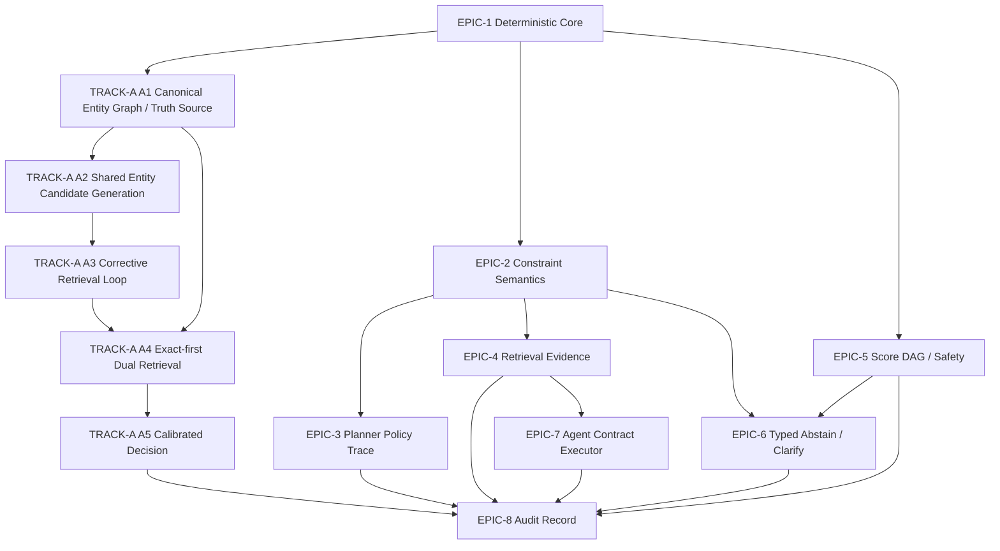

# RFC Task DAG

> **⚠️ Superseded (2026-06 Entity Lookup V2 cutover).** TA3 corrective-retry and
> ResolveUseCase-as-lookup tasks below are historical. Live authority:
> `EntityLookupV2UseCase` + `POST /v2/entity-lookup`. See
> `tools/feature-catalog/features/retrieval/entity-lookup-v2.yaml`.

> 상태: 계획 (historical)  
> 목적: EPIC / TRACK-A를 실제 구현 태스크 단위로 쪼개고 선행 관계를 DAG로 고정  
> 원칙: 기존 substrate 재활용 우선, 병렬 truth 생성 금지, exact recovery 우선

---

## Top-level DAG

---

## Critical Path

1. `E1`
2. `TA1`
3. `TA2`
4. `TA3`
5. `E2`
6. `E5`
7. `E6`
8. `E8`

이 경로가 exact recovery + typed decision + auditability를 동시에 닫는 최소 경로다.

`E3`, `E4`, `E7`, `TA4`, `TA5`는 중요하지만 일부 병렬화가 가능하다.

---

## Wave Plan

### Wave 0. Deterministic Baseline

**목표**

- 모든 후속 개선의 측정 기반 확보
- replay / cache / audit 비교가 가능한 deterministic substrate 확보

**포함 태스크**

- `E1-T1`
- `E1-T2`
- `E1-T3`
- `E1-T4`
- `E1-T5`
- `E1-T6`

**선행조건**

- 없음

**Exit Criteria**

- replay determinism regression suite가 안정적으로 통과
- `RerankDecision.skipReason`가 모든 skip path에서 남음
- `response_hash`와 `determinism_fingerprint` 역할이 문서/코드에서 분리됨

**병렬 가능 범위**

- 없음. 이 웨이브가 baseline이다

### Wave 1. Exact Recovery Core

**목표**

- canonical entity truth source를 먼저 고정해 exact recovery / benchmark / API가 같은
  identity namespace를 보게 만들기
- `anchor miss -> resolver 후보 0개` 병목 제거
- exact entity recovery를 broad search와 분리된 독립 능력으로 승격

**포함 태스크**

- `TA1-T1`
- `TA1-T2`
- `TA1-T3`
- `TA1-T4`
- `TA1-T5`
- `TA2-T1`
- `TA2-T2`
- `TA2-T3`
- `TA2-T4`
- `TA2-T5`
- `TA3-T1`
- `TA3-T2`
- `TA3-T3`
- `TA3-T4`
- `TA3-T5`

**선행조건**

- `Wave 0`

**Exit Criteria**

- runtime `entity_id`와 benchmark fixture `target_entity_id`가 같은 canonical namespace를
  사용
- fixture gold catalog required canonical entity가 active snapshot에 포함
- planner fuzzy hit가 entity hypothesis source로 승격됨
- resolver candidate builder가 anchors-only 계약에서 분리됨
- corrective retry가 요청당 최대 1회 규칙으로 동작
- exact recovery benchmark에서 anchor miss recovery path가 관측 가능

**병렬 가능 범위**

- `TA1`은 `TA2/TA3`보다 앞선 선행조건
- `TA2`와 `TA3`는 일부 병렬 가능
- 단 `TA3`는 `TA2-T1~T4` 없이는 실효성이 낮음

### Wave 2. Constraint / Ranking Semantics

**목표**

- semantic conflict와 rerank safety를 typed policy로 승격
- exact recovery 결과를 잘 찾는 것뿐 아니라 잘 안 틀리게 만들기

**포함 태스크**

- `E2-T1`
- `E2-T2`
- `E2-T3`
- `E2-T4`
- `E2-T5`
- `E5-T1`
- `E5-T2`
- `E5-T3`
- `E5-T4`
- `E5-T5`
- `E5-T6`

**선행조건**

- `Wave 0`
- exact recovery 결과를 살릴 최소 substrate로 `Wave 1` 권장

**Exit Criteria**

- `ConstraintReasoner`가 `soft_tension` / `contradiction`를 typed relation으로 산출
- rerank safety invariant가 exact/protected candidate eviction을 막음
- score drift와 rerank delta가 추적 가능

**병렬 가능 범위**

- `E2`와 `E5`는 병렬 가능
- 단 `E6`는 두 웨이브 산출물을 소비하므로 다음 wave로 넘김

### Wave 3. Retrieval / Planner Trace

**목표**

- planner와 retrieval의 내부 결정을 explain/debug로 재현 가능하게 만들기
- EPIC-8 조립 전에 trace substrate를 확보

**포함 태스크**

- `E3-T1`
- `E3-T2`
- `E3-T3`
- `E3-T4`
- `E3-T5`
- `E4-T1`
- `E4-T2`
- `E4-T3`
- `E4-T4`
- `E4-T5`

**선행조건**

- `Wave 2`

**Exit Criteria**

- planner stage trace가 explain/debug에서 export 가능
- retrieval drop log / filter trace / fusion trace가 조립 가능

**병렬 가능 범위**

- `E3`와 `E4` 병렬 가능

### Wave 4. Typed Abstain / Clarify

**목표**

- "모른다"를 typed decision으로 바꾸고 wrong confident top-1을 억제
- generic clarify를 structured clarify로 승격

**포함 태스크**

- `E6-T1`
- `E6-T2`
- `E6-T3`
- `E6-T4`
- `E6-T5`
- `TA4-T1`
- `TA4-T2`
- `TA4-T3`
- `TA4-T4`
- `TA5-T1`
- `TA5-T2`
- `TA5-T3`

**선행조건**

- `Wave 1`
- `Wave 2`

**Exit Criteria**

- typed abstain reason 4종이 실제 응답에 반영됨
- `ClarificationPayload`가 structured extension을 가짐
- exact-first dual retrieval과 calibrated decision이 같이 동작

**병렬 가능 범위**

- `E6`와 `TA4/TA5`는 병렬 가능
- 단 최종 decision contract는 함께 맞춰야 함

### Wave 5. Audit Assembly

**목표**

- 기존 `engine_decision/meta/decision_snapshot` 위에 full audit trace를 조립
- replay / drift / debug / explain을 같은 response contract 안에 수렴

**포함 태스크**

- `E8-T1`
- `E8-T2`
- `E8-T3`
- `E8-T4`
- `E8-T5`
- `E8-T6`

**선행조건**

- `Wave 3`
- `Wave 4`

**Exit Criteria**

- `determinism_fingerprint`가 meta에 안정적으로 포함
- planner / retrieval / ranking / abstain / fallback trace가 explain/debug에서 조립 가능
- truth-source / fixture / production drift audit export가 canonical identity 기준으로 정리됨

**병렬 가능 범위**

- `E8`은 identity cutover 이후 export semantics를 마감하는 단계

### Wave 6. Agent Contract Hardening

**목표**

- agent path를 search pipeline 계약과 맞춘 typed executor로 승격
- fallback boolean을 richer agent trace로 확장

**포함 태스크**

- `E7-T1`
- `E7-T2`
- `E7-T3`
- `E7-T4`
- `E7-T5`

**선행조건**

- `Wave 3`
- `Wave 5` 권장

**Exit Criteria**

- `ToolOutcome.kind`로 tool result가 typed 분류됨
- batch policy가 data-driven graph로 이동
- fallback trace가 boolean보다 풍부한 구조를 가짐

**병렬 가능 범위**

- 대부분 독립
- 단 audit export를 붙일 때는 `Wave 5`와 계약을 맞춰야 함

---

## Parallel Work Packs

### Pack A: Exact Recovery Core

- `TA2`
- `TA3`
- `TA4`
- `TA5`

### Pack B: Constraint / Decision Semantics

- `E2`
- `E5`
- `E6`

### Pack C: Trace / Audit

- `E3`
- `E4`
- `E8`

### Pack D: Agent Contract

- `E7`

---

## Wave-to-Task Map

| Wave | 포함 work pack | 대표 태스크 |
|------|----------------|------------|
| `Wave 0` | `E1` | `E1-T1` ~ `E1-T6` |
| `Wave 1` | `TA1` + `Pack A` 일부 | `TA1-T1` ~ `TA1-T5`, `TA2-T1` ~ `TA3-T5` |
| `Wave 2` | `Pack B` 일부 | `E2-T1` ~ `E5-T6` |
| `Wave 3` | `Pack C` 일부 | `E3-T1` ~ `E4-T5` |
| `Wave 4` | `Pack B` + `Pack A` 후반 | `E6-T1` ~ `E6-T5`, `TA4-T1` ~ `TA5-T3` |
| `Wave 5` | `Pack C` | `E8-T1` ~ `E8-T6` |
| `Wave 6` | `Pack D` | `E7-T1` ~ `E7-T5` |

---

## Task Breakdown

### E1. Deterministic Core

- `E1-T1` retrieval 채널별 hit ordering canonicalize
- `E1-T2` RRF 후 score desc + entityId asc 정렬 보장
- `E1-T3` ranker tie-break contract 확장
- `E1-T4` `RerankDecision` 타입 도입
- `E1-T5` 기존 `determinism_fingerprint` 입력 계약을 `decision_snapshot` / `index_versions` 중심으로 승격
- `E1-T6` replay determinism regression suite 추가

### TA2. Shared Entity Candidate Generation

- `TA2-T1` `QueryNormalizer.lookupVariants` / alias / blocker / anchor를 묶는 candidate generation contract 정의
- `TA2-T2` planner fuzzy hit를 entity hypothesis source로 승격
- `TA2-T3` resolver candidate builder를 anchors-only 계약에서 분리
- `TA2-T4` blocker output hydrate path 추가
- `TA2-T5` planner / resolver / hybrid가 같은 candidate source를 쓰도록 연결

### TA3. Same-request Corrective Retrieval Loop

- `TA3-T1` corrective retry trigger 조건 구현
- `TA3-T2` retry 시 entity hypotheses 재생성
- `TA3-T3` second-pass retrieval 실행
- `TA3-T4` retry 종료 규칙 / 1회 제한 구현
- `TA3-T5` retry 후 clarify / abstain 전환 규칙 구현

### TA1. Canonical Entity Graph / Truth Source

- `TA1-T1` canonical entity graph 필드 정의
- `TA1-T2` production truth / fixture truth / candidate surface 계약 정의
- `TA1-T3` alias approval state 도입
- `TA1-T4` drift audit 규칙 정의
- `TA1-T5` fixture repo 연동 규칙 고정

### TA4. Exact-first Dual Retrieval

- `TA4-T1` entity-first retrieval path 구체화
- `TA4-T2` discovery path와 우선순위 계약 정의
- `TA4-T3` entity-first / discovery merge 규칙 정의
- `TA4-T4` exact-like query classifier 연동

### TA5. Calibrated Decision

- `TA5-T1` exact recovery posterior feature 정의
- `TA5-T2` top1-top2 gap / ambiguity / protected integrity 결합
- `TA5-T3` `resolved | clarify | abstain | top-N proposal` decision contract 정리

### E2. Constraint Semantics

- `E2-T1` `ConstraintAtom` 타입 정의
- `E2-T2` `ConstraintReasoner` 추가
- `E2-T3` `soft_tension / contradiction / redundancy / overshadow / subsumption` relation 구현
- `E2-T4` `authority_level / source_kind / semantic_scope / conflict_policy` 계산
- `E2-T5` reasoner 결과 기반 retrieval plan 재계산

### E5. Score DAG / Safety Envelope

- `E5-T1` `RankedResult.scoreDecomposition?` 추가
- `E5-T2` heuristic / LTR normalized score decomposition 생성
- `E5-T3` candidate-level safety invariant 구현
- `E5-T4` list-level safety invariant 구현
- `E5-T5` protected candidate eviction 차단
- `E5-T6` rerank drift monitor 구현

### E3. Planner Policy Trace

- `E3-T1` `PolicyDecisionRecord` 타입 정의
- `E3-T2` planner stage별 decision trace 누적
- `E3-T3` `QueryPlanV2.plannerTrace?` 추가
- `E3-T4` execution compiler override trace 추가
- `E3-T5` explain/debug export 게이팅

### E4. Retrieval Evidence

- `E4-T1` `CandidateProvenance` 상세 필드 확장
- `E4-T2` sparse matched terms / filter trace 추가
- `E4-T3` hard filter / coarse prune / assembly drop log 추가
- `E4-T4` evidence accumulator merge 규칙 확장
- `E4-T5` `RrfFusionTrace` 조립

### E6. Typed Abstain / Clarify

- `E6-T1` `TypedAbstainDecision` 타입 추가
- `E6-T2` entropy-only abstain policy를 typed evaluator로 확장
- `E6-T3` 기존 `ClarificationPayload` 확장
- `E6-T4` `semantic_conflict / budget_gap / anchor_disambiguation / preference_gap` 분기 구현
- `E6-T5` search response schema 확장

### E8. Audit Record

- `E8-T1` 기존 `meta.determinism_fingerprint` runtime wiring 고정
- `E8-T2` `response_hash / decision_snapshot / fingerprint` 역할 분리 명시
- `E8-T3` planner policy trace export
- `E8-T4` retrieval fusion trace export
- `E8-T5` ranking delta / rerank decision trace export
- `E8-T6` richer abstain / fallback trace export

### E7. Agent Contract Executor

- `E7-T1` `ToolOutcome` 타입 도입
- `E7-T2` batch policy를 data-driven graph로 전환
- `E7-T3` postcondition validation 추가
- `E7-T4` structured synthesis context 추가
- `E7-T5` 기존 `fallbackApplied` boolean을 richer fallback trace로 확장

---

## No-dup Rules

- `QueryPlanV2` 밖에 planner truth를 다시 만들지 않는다
- `CandidateProvenance` 옆에 병렬 retrieval provenance object를 또 만들지 않는다
- `componentScores`와 분리된 별도 점수 truth를 장기 병행 운영하지 않는다
- `ClarificationPayload`를 폐기하지 않고 확장한다
- `engine_decision/meta/decision_snapshot` 밖에 별도 audit envelope를 만들지 않는다
- `AgentStep`를 버리지 않으면서 다른 메인 agent trace를 또 만들지 않는다

---

## File Ownership Map

| Work Pack | 주요 파일 |
|----------|----------|
| `E1` | `src/domain/retrieval/service/candidate-pool.ts`, `src/domain/ranking/service/ranker.ts`, `src/domain/shared/utils/stable-comparator.ts` |
| `TA2/TA3` | `src/domain/query/service/planner.ts`, `src/application/search/search-usecase-resolver-candidates.ts`, `src/domain/resolver/service/resolver.ts`, `src/application/search/search.usecase.ts` |
| `TA1` | `scripts/etl/vivino-to-silver.ts`, `scripts/etl/build-search-snapshot.ts`, `scripts/etl/build-alias-artifact.ts`, `scripts/etl/publish-runtime-substrates.ts`, canonical graph schema / source-link tables |
| `E2` | `src/domain/query/service/constraint-compiler.ts`, `src/domain/query/service/constraint-sat.ts` |
| `E3` | `src/domain/query/service/planner.ts`, `src/domain/query/service/execution-compiler.ts`, `src/domain/query/model/query-plan.ts` |
| `E4` | `src/domain/retrieval/model/candidate-envelope.ts`, `src/domain/retrieval/service/evidence-accumulator.ts`, `src/domain/retrieval/service/candidate-assembly.ts` |
| `E5` | `src/domain/ranking/model/ranked-result.ts`, `src/domain/ranking/service/ranker.ts` |
| `E6` | `src/domain/query/service/abstain-policy.ts`, `src/domain/response/model/clarification.ts`, `src/interface/http/schemas/search-response.schema.ts` |
| `E7` | `src/application/agent/agent-orchestrator.ts`, `src/domain/agent/model/agent-step.ts`, `src/interface/http/routes/agent.route.ts` |
| `E8` | `src/domain/response/service/response-builder.ts`, `src/application/search/search-usecase-post-route-phase.ts`, `src/interface/http/schemas/search-response.schema.ts` |
