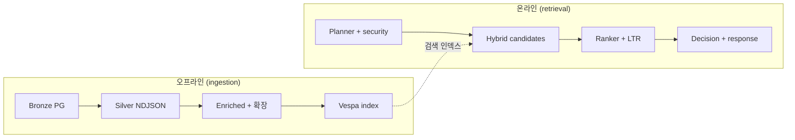

# System overview — review kit

**목적:** 아키텍처·시스템 **리뷰 한 세션**에 필요한 경로를 한 디렉터리에서 끝낸다.  
**아닌 것:** 온보딩 SSOT, 제품 스펙 원문, 버그배시/세션 노트 대체재.

| 문서 | 한 줄 |
|------|--------|
| [`retriever-pipeline.md`](./retriever-pipeline.md) | 런타임 **하이브리드 리트리버** — 후보 생성 → 랭킹까지 코드 앵커 |
| [`ingestion-pipeline.md`](./ingestion-pipeline.md) | **배치 인입·ETL·인덱싱·평가 시딩** — `scripts/`·도구·제외 범위까지 |
| [`doc2query-cohere-integration.md`](./doc2query-cohere-integration.md) | **Doc2Query (recall) + Cohere Rerank (precision)** 통합 결정·아키텍처·운영 가이드 |
| [`wine-query-scenarios.md`](./wine-query-scenarios.md) | **SOTA++** 사용자 질의 매트릭스 — 플래너·`effectiveRoute` 승격·골든≠런타임 구분 |

외부에 한 번만 열면 되는 것: 루트 [`CLAUDE.md`](../../CLAUDE.md), [`docs/http-contract-surface.md`](../http-contract-surface.md), [`docs/RFC-INDEX.md`](../RFC-INDEX.md).

---

## 두 축 (머릿속 모델)

- **Ingestion** 문서: 왼쪽 가지 전부 + 평가·학습 보조 스크립트.
- **Retriever** 문서: 오른쪽 가지 중 **`effectiveRoute === 'hybrid'`** 일 때만 상세.

---

## 읽기 순서 (권장)

1. **`CLAUDE.md`** — 스택, 디렉터리, `pnpm run typecheck|test|lint` 게이트  
2. **`retriever-pipeline.md`** — 질의가 인덱스에 닿는 **런타임** 경로  
3. **`ingestion-pipeline.md`** — 카탈로그가 쌓이는 **오프라인** 경로  
4. **`wine-query-scenarios.md`** — 사용자 질문 유형·강점·약점·비지원 (제품 관점)  
5. **`http-contract-surface.md`** — 공개 HTTP 계약의 SSOT (카탈로그·route-contracts)  
6. **`RFC-INDEX.md`** → 필요 시 **`RFC-000`**, **005–008**, **014–016** (계약·플래너·결정·API)

`docs/sessions/`, `docs/bugbash-*` 는 **필수 리뷰 경로에 넣지 않는다.**

---

## 리뷰 완료 기준 (DoD)

리뷰어가 아래를 **예/아니오**로 채울 수 있으면 이 키트는 역할을 다했다.

| 질문 | 답을 찾는 곳 |
|------|----------------|
| 하이브리드 후보가 어디서 나오고, 언제 Vespa 풀로 폴백하는가? | `retriever-pipeline.md` §4–6 |
| Bronze→Silver→Enriched→Vespa 배치 순서와 파일명 함정(Track C·validate)은? | `ingestion-pipeline.md` §2 |
| `scripts/etl` 전 파일과 그 밖 학습·시딩 스크립트가 표로 잡혀 있는가? | `ingestion-pipeline.md` §3, §11–§15 |
| 공개 API 계약 파일이 어디인가? | `http-contract-surface.md` |
| 인입 문서에 **의도적 제외**로 박힌 스크립트는 무엇인가? | `ingestion-pipeline.md` §17 |
| 어떤 사용자 질문이 **강·약·불가**인가? | `wine-query-scenarios.md` |

---

**Last updated:** 2026-04-10
