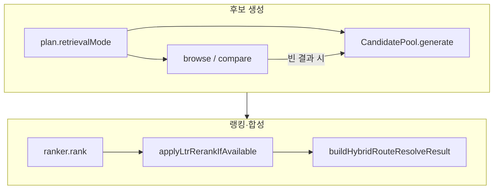

# 리트리버 파이프라인 (Retriever pipeline)

> **Audience:** 시스템·아키텍처 **리뷰** 전용. 상위 맥락은 [`README.md`](./README.md).

**범위:** 플래너·보안·캐시·SAT 이후, **`effectiveRoute === 'hybrid'`** 일 때 **후보(`HybridCandidate[]`)를 만드는 경로**와, 그 직후 **랭킹·합성 리졸브**까지.  
**비범위:** `entity` 전용 리졸브, `mixed` 솔버, `DecisionEngine`·`ResponseBuilder` 전체, HTTP 라우트 등록 — 필요 시 아래 “전후 단계”만 참조.

**Last updated:** 2026-04-10

---

## 목차

1. [한 줄 요약](#1-한-줄-요약)  
2. [전후 단계 (이 문서 밖)](#2-전후-단계-이-문서-밖)  
3. [라우트 스위치 → 하이브리드 실행](#3-라우트-스위치--하이브리드-실행)  
4. [포트 (도메인 경계)](#4-포트-도메인-경계)  
5. [`retrieveHybridCandidatesForPlan`](#5-retrievehybridcandidatesforplan--전문-경로-우선-풀-폴백)  
6. [공유 랭킹 래퍼](#6-공유-랭킹-래퍼-후보--랭커)  
7. [`CandidatePoolService.generate`](#7-candidatepoolservicegenerate--하이브리드-풀)  
8. [DI·구현 클래스](#8-di구현-클래스)  
9. [`entity` / `mixed` 와의 구분](#9-entity--mixed-와의-구분)  
10. [RFC·리뷰 체크](#10-rfc리뷰-체크)

---

## 1. 한 줄 요약



- **진입:** `SearchUseCase.executeHybridRoute` 또는 `HybridUseCase` → `executeHybridRouteRankingPipeline`.  
- **후보:** `retrieveHybridCandidatesForPlan` — `producer_browse` / `region_browse` / `compare_candidates` 시 전문 포트 우선, 아니면 **`CandidatePoolPort.generate`** (sparse + dense + RRF, RFC-012).  
- **이후:** `runHybridRankingPipeline` — `rank` → 선택적 LTR → 합성 `EntityResolveResult`.

---

## 2. 전후 단계 (이 문서 밖)

| 단계 | 위치 | 비고 |
|------|------|------|
| 보안·플래너·SAT·캐시·분해 | `runSearchPreRoutePhase` (`search-usecase-pre-route-phase.ts`) | 하이브리드 **전** |
| 라우트 결정 | `buildSearchRouteResolutionContext` (`search-usecase-route-resolution.ts`) | `retrieval_mode` vs 플래너 |
| 엔트로피·결정·응답·캐시 | `runSearchPostRoutePhase` (`search-usecase-post-route-phase.ts`) | 하이브리드 **후** |

---

## 3. 라우트 스위치 → 하이브리드 실행

`effectiveRoute`가 `hybrid`이면 `dispatchSearchRouteExecution`이 `executeHybrid`만 호출한다.

```23:40:src/application/search/search-usecase-route-dispatch.ts
export async function dispatchSearchRouteExecution(
  effectiveRoute: QueryRoute,
  actions: {
    readonly executeEntity: () => Promise<EntityResolveResult>;
    readonly executeHybrid: () => Promise<SearchRouteExecutionResult>;
    readonly executeMixed: () => Promise<SearchRouteExecutionResult>;
  },
): Promise<SearchRouteExecutionResult> {
  switch (effectiveRoute) {
    case 'entity': {
      const resolveResult = await actions.executeEntity();
      return { resolveResult, rankedResults: [] };
    }
    case 'hybrid':
      return actions.executeHybrid();
    case 'mixed':
      return actions.executeMixed();
  }
}
```

메인 검색의 하이브리드 경로:

```196:210:src/application/search/search.usecase.ts
  private async executeHybridRoute(
    plan: QueryPlanV1,
  ): Promise<{ resolveResult: EntityResolveResult; rankedResults: readonly RankedResult[] }> {
    const candidates = await retrieveHybridCandidatesForPlan(
      plan,
      {
        candidatePool: this.deps.candidatePool,
        browseRetriever: this.deps.browseRetriever,
        compareRetriever: this.deps.compareRetriever,
      },
      (p) => this.executeEntityRoute(p),
    );

    return runHybridRankingPipeline(plan, candidates, this.deps.ranker, this.deps.ltrModels);
  }
```

`HybridUseCase` — pre-route 이후 동일한 `executeHybridRouteRankingPipeline`:

```102:116:src/application/search/hybrid.usecase.ts
    const { plan } = preRoute;
    const { resolveResult, rankedResults, decisionContext } = await executeHybridRouteRankingPipeline(
      plan,
      {
        candidatePool: this.deps.candidatePool,
        browseRetriever: this.deps.browseRetriever,
        compareRetriever: this.deps.compareRetriever,
        ranker: this.deps.ranker,
        ltrModels: this.deps.ltrModels,
      },
      (resolverPlan) => resolveEntityRouteForPlan(resolverPlan, {
        entityResolver: this.deps.entityResolver,
        entityLookup: this.deps.entityLookup,
      }),
    );
```

---

## 4. 포트 (도메인 경계)

```29:57:src/application/search/port/search-pipeline-deps.port.ts
export interface CandidatePoolPort {
  generate(input: HybridRetrievalInput): Promise<readonly HybridCandidate[]>;
}

export interface BrowseRetrieverPort {
  browseProducer(
    producerName: string,
    constraints: ConstraintBundle,
    limit: number,
  ): Promise<readonly HybridCandidate[]>;

  browseRegion(
    regionName: string,
    constraints: ConstraintBundle,
    limit: number,
  ): Promise<readonly HybridCandidate[]>;
}

export interface CompareRetrieverPort {
  compareAgainstAnchor(
    anchorEntityId: EntityId,
    constraints: ConstraintBundle,
    limit: number,
  ): Promise<readonly HybridCandidate[]>;
}
```

---

## 5. `retrieveHybridCandidatesForPlan` — 전문 경로 우선, 풀 폴백

```74:138:src/application/search/search-usecase-hybrid-candidates.ts
/**
 * Specialized browse/compare paths first; falls back to {@link CandidatePoolPort.generate}.
 */
export async function retrieveHybridCandidatesForPlan(
  plan: QueryPlanV1,
  ports: HybridCandidateRetrievalPorts,
  resolveEntity: (p: QueryPlanV1) => Promise<EntityResolveResult>,
): Promise<readonly HybridCandidate[]> {
  const limit = SPECIALIZED_HYBRID_RETRIEVAL_LIMIT;

  switch (plan.retrievalMode) {
    case 'producer_browse': {
      const producerName = extractProducerBrowseSeed(plan);
      if (producerName !== undefined && ports.browseRetriever !== undefined) {
        const candidates = await ports.browseRetriever.browseProducer(
          producerName,
          plan.constraints,
          limit,
        );
        if (candidates.length > 0) {
          return candidates;
        }
      }
      break;
    }
    case 'region_browse': {
      const regionName = extractRegionBrowseSeed(plan);
      if (regionName !== undefined && ports.browseRetriever !== undefined) {
        const candidates = await ports.browseRetriever.browseRegion(
          regionName,
          plan.constraints,
          limit,
        );
        if (candidates.length > 0) {
          return candidates;
        }
      }
      break;
    }
    case 'compare_candidates': {
      if (ports.compareRetriever !== undefined) {
        const anchorResolution = await resolveEntity(plan);
        const anchorEntityId = anchorResolution.topEntity?.entityId
          ?? plan.anchors[0]?.candidateEntityIds[0];
        if (anchorEntityId !== undefined) {
          const candidates = await ports.compareRetriever.compareAgainstAnchor(
            anchorEntityId,
            plan.constraints,
            limit,
          );
          if (candidates.length > 0) {
            return candidates;
          }
        }
      }
      break;
    }
    default:
      break;
  }

  const retrievalInput = buildHybridRetrievalInputForPlan(plan, 'hybrid');

  return ports.candidatePool.generate(retrievalInput);
}
```

`buildHybridRetrievalInputForPlan`: `60:71:src/application/search/search-usecase-hybrid-candidates.ts`.

---

## 6. 공유 랭킹 래퍼 (후보 → 랭커)

```128:144:src/application/search/search-usecase-hybrid-ranking-pipeline.ts
export async function executeHybridRouteRankingPipeline(
  plan: QueryPlanV1,
  deps: HybridRankingRouteDeps,
  resolveEntity: (plan: QueryPlanV1) => Promise<EntityResolveResult>,
): Promise<SearchRouteExecutionResult> {
  const candidates = await retrieveHybridCandidatesForPlan(
    plan,
    {
      candidatePool: deps.candidatePool,
      browseRetriever: deps.browseRetriever,
      compareRetriever: deps.compareRetriever,
    },
    resolveEntity,
  );

  return runHybridRankingPipeline(plan, candidates, deps.ranker, deps.ltrModels);
}
```

```96:121:src/application/search/search-usecase-hybrid-ranking-pipeline.ts
export async function runHybridRankingPipeline(
  plan: QueryPlanV1,
  candidates: readonly HybridCandidate[],
  ranker: RankingPort,
  ltrModels: ReadonlyMap<string, QueryClassWeights> | undefined,
): Promise<SearchRouteExecutionResult> {
  const rankingInput: RankingInput = {
    queryPlan: plan,
    candidates,
    constraints: plan.constraints,
  };

  let rankedResults = await ranker.rank(rankingInput);

  rankedResults = applyLtrRerankIfAvailable(
    rankedResults,
    plan.queryClass,
    ltrModels,
  );

  const resolveResult: EntityResolveResult = buildHybridRouteResolveResult(plan, rankedResults);

  return { resolveResult, rankedResults };
}
```

---

## 7. `CandidatePoolService.generate` — 하이브리드 풀

구현체 `src/domain/retrieval/service/candidate-pool.ts` — `CascadeRouter` 단계, RRF, 하드 필터, top-K.

```15:43:src/domain/retrieval/service/candidate-pool.ts
/**
 * Orchestrates the full hybrid retrieval pipeline (RFC-012).
 *
 * Pipeline steps:
 * 1. Execute sparse search with lexical queries + hard constraint filters.
 * 2. Embed semantic queries and execute dense search (with embedding cache).
 * 3. If an anchor profile is present, embed anchor and run neighbourhood search.
 * 4. Fuse all passes via RRF.
 * 5. Apply hard constraint filter on fused candidates.
 * 6. Return top-K candidates.
 *
 * Dependencies injected for testability and loose coupling (SOLID - D principle).
 */
export class CandidatePoolService {
  private readonly profileService: RetrievalProfileService;
  private readonly cascadeRouter: CascadeRouter;
  private readonly constraintFilter: ConstraintFilter;

  constructor(
    private readonly searchIndex: SearchIndexPort,
    private readonly embeddingService: EmbeddingServicePort,
    private readonly fusionService: FusionService,
    private readonly cacheService?: CacheService | undefined,
    private readonly embeddingModelId: string = 'bge-m3',
  ) {
    this.profileService = new RetrievalProfileService();
    this.cascadeRouter = new CascadeRouter();
    this.constraintFilter = new ConstraintFilter();
  }
```

```51:83:src/domain/retrieval/service/candidate-pool.ts
  async generate(input: HybridRetrievalInput): Promise<readonly HybridCandidate[]> {
    const profile = this.profileService.getProfile(
      input.queryPlan.queryClass,
      input.route,
    );

    const anchorConfidence = input.anchorProfile?.anchorConfidence ?? 0;
    const aliasMatchStrength = this.estimateAliasStrength(input);

    const difficulty = this.cascadeRouter.estimateDifficulty(
      input.queryPlan.queryClass,
      anchorConfidence,
      aliasMatchStrength,
      input.hardConstraints.length + input.softConstraints.length,
    );

    const phases = this.cascadeRouter.getPhases(difficulty);
    const phaseSet = new Set<RetrievalPhase>(phases);

    const allPhases: RetrievalPhase[] = ['sparse', 'dense', 'anchor_neighborhood', 'rerank'];
    const skippedPhases = allPhases.filter((p) => !phaseSet.has(p));

    // Vespa sparse filter tokens (aligned with browse/compare + buildSparseFilters)
    const filters = [...hardConstraintsToSparseFilterTokens(input.hardConstraints)];

    // Step 1: Sparse search
    const sparseHits = phaseSet.has('sparse')
      ? await this.searchIndex.sparseSearch(
          input.lexicalQueries,
          filters.length > 0 ? filters : undefined,
          profile.sparseTopN,
        )
      : [];
```

```129:162:src/domain/retrieval/service/candidate-pool.ts
    // Step 4: Fuse via RRF
    let candidates = this.fusionService.fuse(
      sparseHits,
      denseHits,
      anchorHits,
      profile.fusionK,
    );

    // Enrich traces with pipeline context
    candidates = candidates.map((c) => ({
      ...c,
      retrievalTrace: {
        ...c.retrievalTrace,
        retrievalProfile: profile.name,
        lexicalQueriesUsed: [...input.lexicalQueries],
        semanticQueriesUsed: [...input.semanticQueries],
        filtersApplied: filters,
        skippedPhases,
      } satisfies RetrievalTrace,
    }));

    candidates = annotateCandidateConstraintEvidenceBatch(candidates, {
      hard: input.hardConstraints,
      soft: input.softConstraints,
      inferred: input.queryPlan.constraints.inferred,
    });

    // Step 5: Apply hard constraint filter
    candidates = [
      ...this.constraintFilter.applyHardFilters(candidates, input.hardConstraints),
    ];

    // Step 6: Return top-K
    return candidates.slice(0, profile.finalTopK);
  }
```

---

## 8. DI·구현 클래스

`container-core-builders.ts`에서 풀·브라우즈·컴페어 조립.

**도메인 구현:** `BrowseRetriever` → `src/domain/retrieval/service/browse-retriever.ts`, `CompareRetriever` → `src/domain/retrieval/service/compare-retriever.ts` (`SearchIndexPort` 기반).

```114:134:src/config/container-core-builders.ts
export function buildCandidatePool(
  adapters: CoreAdapterServices,
  support: RuntimeSupportServices,
  config: Config,
): CandidatePoolService {
  return new CandidatePoolService(
    adapters.searchIndex,
    adapters.embeddingService,
    new FusionService(),
    support.cacheService,
    config.embedding.model,
  );
}

export function buildBrowseRetriever(adapters: CoreAdapterServices): BrowseRetrieverPort {
  return new BrowseRetriever(adapters.searchIndex);
}

export function buildCompareRetriever(adapters: CoreAdapterServices): CompareRetrieverPort {
  return new CompareRetriever(adapters.searchIndex);
}
```

**런타임 인덱스:** `VespaSearchIndex` (`src/infrastructure/vespa/vespa-search-index.ts`) — `SearchIndexPort` 구현.

---

## 8.1 Reranker 어댑터 + Doc2Query 자동 적용 (2026-04-10)

> 결정/근거: [`doc2query-cohere-integration.md`](./doc2query-cohere-integration.md)

랭킹 단계 직전 후보(top-K)에 적용되는 cross-encoder reranker는 도메인 포트 `RerankerPort` 한 개로 추상화되어 있고, DI에서 환경에 따라 한 개의 구현체가 선택된다.

```162:173:src/config/container-adapters.ts
    ...(config.cohere.apiKey !== undefined
      ? {
          reranker: new CohereReranker({
            apiKey: config.cohere.apiKey,
            baseUrl: config.cohere.baseUrl,
            model: config.cohere.rerankModel,
            httpTimeoutMs: config.reranker.httpTimeoutMs,
          }),
        }
      : config.reranker.url !== undefined
      ? { reranker: new HttpCrossEncoderReranker() }
      : {}),
```

- **Primary**: `CohereReranker` (`COHERE_API_KEY` 있을 때).  
- **Fallback**: 자체 호스트 `HttpCrossEncoderReranker` (`RERANKER_SERVICE_URL`).  
- **Both unset**: reranker undefined → `Ranker`가 cross-encoder rerank를 skip하고 1차 fusion 결과를 그대로 반환.

**Cohere CircuitBreaker (2026-04-10 추가)**

`CohereReranker.rerank()`는 `runUnderLlmBreaker(this.circuitBreaker, ...)` 안에서 실행된다. OpenAI/Anthropic chat 어댑터와 동일 튜닝:

| 파라미터 | 값 | 효과 |
|---|---|---|
| `failureThreshold` | 5 | 5회 연속 service-failure → OPEN |
| `recoveryTimeoutMs` | 60_000 | OPEN 60초 후 HALF_OPEN |
| `halfOpenMaxAttempts` | 3 | half-open probe 동시 3개까지 |
| `name` | `cohere-rerank` | `globalCircuitBreakerRegistry` 등록 → `/health` 노출 |

`runUnderLlmBreaker`는 4xx (caller-fault, 429 제외) 응답을 service-failure로 카운트하지 않으므로, 잘못된 페이로드가 다른 호출자를 DoS하지 못한다. OPEN 상태면 즉시 `CircuitBreakerOpenError`를 throw → `Ranker`가 reranker를 skip한 채 fusion 결과로 fallback.

운영 스위치:
- 즉시 비활성: `unset COHERE_API_KEY` → DI가 self-host fallback으로 자동 회귀.
- Blend 무효화 (shadow run): `RERANK_BLEND_SCALE=0.0`.

**`synthetic_queries` BM25 필드 자동 적용**

런타임 코드 변경 0. Doc2Query 인덱싱 단계가 `synthetic_queries` array<string> 필드를 채워두면, Vespa rank profile `bm25_wine()` 안의 다음 한 줄이 모든 BM25 채널에서 자동으로 발화한다:

```485:497:vespa/app/schemas/wine_entity.sd
    function bm25_wine() {
      expression {
        bm25(canonical_label) * 4
        + bm25(aliases_identity_safe) * 3
        + bm25(aliases_noisy_recall) * 2
        + bm25(flavor_profiles) * 1.8
        + bm25(producer) * 1.5
        + bm25(appellation) * 1.5
        + bm25(classification) * 1.3
        + bm25(grape_primary) * 1.2
        + bm25(search_text_en)
        + bm25(search_text_ko)
        + bm25(synthetic_queries) * 0.6
      }
    }
```

`bm25_wine`은 `lexical` rank profile에 정의되고, `hybrid` / `wine_aware` / `prestige_hybrid` / `popularity_native`가 모두 `lexical` (또는 `hybrid`) 을 상속하므로 **모든 sparse_bm25 호출 경로가 +0.6 가중치 합성 쿼리 매칭을 자동으로 받는다**. agent flow의 `search_wines` 도구도 `SearchUseCase`를 그대로 재사용하므로 동일하게 적용.

`match-features` 블록에도 `bm25(synthetic_queries)`가 포함되어 디버그/관측성 측정 가능.

---

## 9. `entity` / `mixed` 와의 구분

| 라우트 | 후보 풀 | 메모 |
|--------|---------|------|
| **entity** | 없음 | `executeEntityRoute` → 리졸버만 |
| **hybrid** | 이 문서 전체 | `retrieveHybridCandidatesForPlan` + `runHybridRankingPipeline` |
| **mixed** | 별도 | `MixedSolver.solve` (`src/domain/mixed/`, `buildMixedSolver`) — 하이브리드 풀과 **다른** 코드 경로 |

---

## 10. RFC·리뷰 체크

**RFC**

| RFC | 이 문서와의 관계 |
|-----|------------------|
| **RFC-012** | Hybrid retrieval (sparse+dense+fusion) — 정합의 핵심 |
| **RFC-005** | `QueryPlanV1`, `retrievalMode` — 전문 브라우즈/컴페어 분기 입력 |
| **RFC-013** | Ranking signals — 랭커 출력은 “authority”가 아님 (Decision은 별층) |

**리뷰어 자가 점검**

- [ ] `compare_candidates`에서 앵커가 없으면 어떤 경로로 폴백하는가? (§5 스위치 + `resolveEntity`)  
- [ ] `CandidatePoolService`가 스킵하는 phase는 어디에 기록되는가? (`retrievalTrace.skippedPhases`)  
- [ ] LTR은 어디서 켜지는가? (`applyLtrRerankIfAvailable`, `ltrModels` 주입)

**RFC 목차:** [`docs/RFC-INDEX.md`](../RFC-INDEX.md).

---

## 빠른 파일 인덱스

| 파일 |
|------|
| `search-usecase-route-dispatch.ts` |
| `search.usecase.ts` |
| `hybrid.usecase.ts` |
| `search-usecase-hybrid-candidates.ts` |
| `search-usecase-hybrid-ranking-pipeline.ts` |
| `search-usecase-hybrid-route.ts` (합성 resolve) |
| `candidate-pool.ts` |
| `container-core-builders.ts` |
