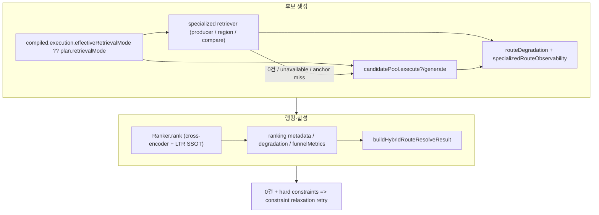

# 리트리버 파이프라인 (Retriever pipeline)

> **Audience:** 시스템·아키텍처 **리뷰** 전용. 상위 맥락은 [`README.md`](./README.md).

**범위:** 플래너·보안·캐시·SAT 이후, **`effectiveRoute === 'hybrid'`** 일 때 **후보(`HybridCandidate[]`)를 만드는 경로**와, 그 직후 **랭킹·합성 리졸브**까지.  
**비범위:** `entity` 전용 리졸브, `mixed` 솔버, `DecisionEngine`·`ResponseBuilder` 전체, HTTP 라우트 등록 — 필요 시 아래 “전후 단계”만 참조.

**Last updated:** 2026-04-13

---

## 목차

1. [한 줄 요약](#1-한-줄-요약)  
2. [전후 단계 (이 문서 밖)](#2-전후-단계-이-문서-밖)  
3. [라우트 스위치 → 하이브리드 실행](#3-라우트-스위치--하이브리드-실행)  
4. [포트 (도메인 경계)](#4-포트-도메인-경계)  
5. [`retrieveHybridCandidatesForPlan`](#5-retrievehybridcandidatesforplan--전문-경로-우선-풀-폴백)  
6. [공유 랭킹 래퍼](#6-공유-랭킹-래퍼-후보--랭커)  
7. [`CandidatePoolService.generate`](#7-candidatepoolservicegenerate--하이브리드-풀)  
8. [DI·구현 클래스](#8-di구현-클래스)  
9. [`entity` / `mixed` 와의 구분](#9-entity--mixed-와의-구분)  
10. [RFC·리뷰 체크](#10-rfc리뷰-체크)

---

## 1. 한 줄 요약



- **진입:** `SearchUseCase.executeHybridRoute` → `executeHybridRouteRankingPipeline(plan, deps, resolveEntity, compiled?, requestContext?)`.
- **후보:** `retrieveHybridCandidatesForPlan`은 `compiled.execution.effectiveRetrievalMode ?? plan.retrievalMode` 기준으로 전문 browse/compare를 먼저 시도하고, 실패 시 `candidatePool.execute?()` 또는 `generate()`로 폴백한다. 반환형은 단순 `HybridCandidate[]`가 아니라 `routeDegradation` / `specializedRouteObservability`를 포함하는 `HybridCandidateRetrievalResult`다.  
- **이후:** `runHybridRankingPipeline`은 `RankingInput`만 조립해 `ranker.rank()`에 위임한다. cross-encoder rerank, rerank gate, learned LTR은 별도 helper가 아니라 `Ranker.rank()` 내부 SSOT(`applyLearnedLtrRerank`)에서 처리된다. 반환 시에는 `RankingMetadata`를 우선 사용하고, 필요 시 legacy getter fallback으로 degradation / funnel metrics를 회수한다.  
- **복구:** `executeHybridRouteRankingPipeline`은 retrieval/ranking degradation을 병합하고, `specializedRouteObservability`를 보존하며, 0건 + hard constraint 조합이면 최대 4단계 constraint relaxation retry까지 수행한다.

---

## 2. 전후 단계 (이 문서 밖)

| 단계 | 위치 | 비고 |
|------|------|------|
| 보안·플래너·SAT·캐시·분해 | `runSearchPreRoutePhase` (`search-usecase-pre-route-phase.ts`) | 하이브리드 **전** |
| 라우트 결정 | `buildSearchRouteResolutionContext` (`search-usecase-route-resolution.ts`) | `retrieval_mode` vs 플래너 |
| 엔트로피·결정·응답·캐시 | `runSearchPostRoutePhase` (`search-usecase-post-route-phase.ts`) | 하이브리드 **후** |

보충:

- 이 문서의 `routeDegradation`은 hybrid execute 단계까지의 signal이다.
- 최종 응답 직전 `runSearchPostRoutePhase` / `runRankedRouteDecisionPhase`가 `resolveResult.degradation`과 kill switch 상태까지 합쳐 `contract` / response meta에 반영한다.

---

## 3. 라우트 스위치 → 하이브리드 실행

`effectiveRoute`가 `hybrid`이면 `dispatchSearchRouteExecution`이 `executeHybrid`만 호출한다.

```23:40:src/application/search/search-usecase-route-dispatch.ts
export async function dispatchSearchRouteExecution(
  effectiveRoute: QueryRoute,
  actions: {
    readonly executeEntity: () => Promise<EntityResolveResult>;
    readonly executeHybrid: () => Promise<SearchRouteExecutionResult>;
    readonly executeMixed: () => Promise<SearchRouteExecutionResult>;
  },
): Promise<SearchRouteExecutionResult> {
  switch (effectiveRoute) {
    case 'entity': {
      const resolveResult = await actions.executeEntity();
      return { resolveResult, rankedResults: [] };
    }
    case 'hybrid':
      return actions.executeHybrid();
    case 'mixed':
      return actions.executeMixed();
  }
}
```

메인 검색의 하이브리드 경로는 `SearchUseCase.executeHybridRoute`가 공유 파이프라인을 호출한다. `compiled`와 `requestContext(stageTimer/abortSignal/requestId)`를 함께 전달한다.

```416:430:src/application/search/search.usecase.ts
  private async executeHybridRoute(
    plan: QueryPlanV1,
    compiled?: CompiledWineQuery,
  ): Promise<SearchRouteExecutionResult> {
    return executeHybridRouteRankingPipeline(
      plan,
      {
        candidatePool: this.deps.candidatePool,
        browseRetriever: this.deps.browseRetriever,
        compareRetriever: this.deps.compareRetriever,
        ranker: this.deps.ranker,
      },
      (p) => this.executeEntityRoute(p),
      compiled,
    );
  }
```

> **Note (2026-06 cutover):** `HybridUseCase` duplicate stack removed. Hybrid primitive traffic is `POST /v1/search/hybrid` → `SearchUseCase` only.

---

## 4. 포트 (도메인 경계)

```29:57:src/application/search/port/search-pipeline-deps.port.ts
export interface CandidatePoolPort {
  execute?(input: HybridRetrievalInput): Promise<readonly HybridCandidate[]>;
  generate(input: HybridRetrievalInput): Promise<readonly HybridCandidate[]>;
}

export interface BrowseRetrieverPort {
  browseProducer(
    producerName: string,
    constraints: ConstraintBundle,
    limit: number,
  ): Promise<readonly HybridCandidate[]>;

  browseRegion(
    regionName: string,
    constraints: ConstraintBundle,
    limit: number,
  ): Promise<readonly HybridCandidate[]>;
}

export interface CompareRetrieverPort {
  compareAgainstAnchor(
    anchorEntityId: EntityId,
    constraints: ConstraintBundle,
    limit: number,
  ): Promise<readonly HybridCandidate[]>;
}

export interface RankingPort {
  rank(input: RankingInput): Promise<RankingOutput>;
  getLastFunnelMetrics?(): FunnelMetrics | undefined;
  getLastRuntimeSignal?(): RankerRuntimeSignal | undefined;
}
```

`SearchRouteExecutionResult`의 hybrid 관련 반환 필드도 실제로 중요하다.

- `routeDegradation`: retrieval fallback, reranker 실패, LTR dimension mismatch, constraint relaxation 등이 축적된 degradation signal
- `funnelMetrics`: stage-aware `RankingStagePipeline`이 있을 때만 채워지는 funnel 관측치
- `specializedRouteObservability`: specialized route 요청/실행/폴백 여부와 대표 fallback reason

---

## 5. `retrieveHybridCandidatesForPlan` — 전문 경로 우선, 풀 폴백

```78:95:src/application/search/search-usecase-hybrid-candidates.ts
export interface HybridCandidateRetrievalResult {
  readonly candidates: readonly HybridCandidate[];
  readonly routeDegradation?: RankingDegradationSignal | undefined;
  readonly specializedRouteObservability?: SpecializedRouteObservability | undefined;
  readonly retrievalFusionTrace?: RrfFusionTrace | undefined;         // E4
  readonly hardFilterDropLog?: readonly CandidateDropRecord[] | undefined;  // E4
}

export async function retrieveHybridCandidatesForPlan(
  plan: QueryPlanV1,
  ports: HybridCandidateRetrievalPorts,
  resolveEntity: (p: QueryPlanV1) => Promise<EntityResolveResult>,
  compiled?: CompiledWineQuery,
  requestContext?: RequestExecutionContext,
): Promise<HybridCandidateRetrievalResult>
```

핵심 동작:

- **전문 경로 선택 기준:** `plan.retrievalMode` 고정이 아니라 `compiled?.execution.effectiveRetrievalMode ?? plan.retrievalMode`가 SSOT다.
- **`producer_browse` / `region_browse`:** seed 추출 성공 + retriever 주입 + non-empty 결과일 때만 전문 경로를 확정한다. 아니면 `*_fallback` 또는 `*_unavailable` degradation reason을 남기고 candidate pool로 폴백한다.
- **`compare_candidates`:** 이제 resolver가 검증한 `anchorResolution.topEntity?.entityId`만 anchor로 쓴다. 예전처럼 `plan.anchors[0]?.candidateEntityIds[0]`로 내려가지 않는다. resolver가 anchor를 못 주면 `compare_anchor_resolution_failed`로 기록하고 폴백한다.
- **fallback 호출 대상:** `candidatePool.execute`가 있으면 그쪽을 우선 쓰고, 없을 때만 `generate()`를 쓴다. 즉 문서상 `generate()` 단일 경로라고 보면 안 된다.
- **반환 부가정보:** 폴백이 발생하면 `routeDegradation`과 `specializedRouteObservability`를 함께 반환해, 후단에서 hybrid degradation과 specialized fallback reason을 합성할 수 있다.
- **RRF Fusion Trace (E4):** `candidatePool.getLastFusionTrace()` / `.getLastDropLog()`를 호출해 `retrievalFusionTrace`와 `hardFilterDropLog`를 반환 구조에 포함한다. 이 trace는 post-route의 `deriveAuditExtension()`까지 전파된다.
- **CircuitBreakerOpenError 구분:** Browse/compare 전문 경로에서 `CircuitBreakerOpenError`와 일반 에러를 구분해 처리한다. CB open은 별도 degradation reason으로 기록.

`buildHybridRetrievalInputForPlan` 역시 현재는 단순 `(plan, 'hybrid')` 래퍼가 아니다.

- `retrievalPlan`: `compiled?.query.retrievalPlan ?? buildRetrievalPlan(plan.constraints)`
- `lexicalQueries` / `semanticQueries`: 원문 쿼리 외에 hard/soft/inferred constraint에서 구조화 확장 쿼리를 합성
- `anchorEntityId`: compare fallback에서 resolver가 검증한 anchor가 있으면 candidate pool에도 전달
- `fuzzyEntityHypotheses` (TA4): 플래너의 fuzzy 앵커에서 추출한 가설 엔티티 용어를 sparse 채널에 전파
- `compiledRetrievalMode`, `requestContext`: observability / request abort / stage timing에 사용

---

## 6. 공유 랭킹 래퍼 (후보 → 랭커)

```194:216:src/application/search/search-usecase-hybrid-ranking-pipeline.ts
export async function executeHybridRouteRankingPipeline(
  plan: QueryPlanV1,
  deps: HybridRankingRouteDeps,
  resolveEntity: (plan: QueryPlanV1) => Promise<EntityResolveResult>,
  compiled?: CompiledWineQuery,
  requestContext?: RequestExecutionContext,
): Promise<SearchRouteExecutionResult> {
  const retrieval = await retrieveHybridCandidatesForPlan(
    plan,
    {
      candidatePool: deps.candidatePool,
      browseRetriever: deps.browseRetriever,
      compareRetriever: deps.compareRetriever,
    },
    resolveEntity,
    compiled,
    requestContext,
  );

  const ranked = await runHybridRankingPipeline(plan, retrieval.candidates, deps.ranker, compiled);
  // 이후 routeDegradation merge + no-result constraint relaxation
}
```

```117:166:src/application/search/search-usecase-hybrid-ranking-pipeline.ts
export async function runHybridRankingPipeline(
  plan: QueryPlanV1,
  candidates: readonly HybridCandidate[],
  ranker: RankingPort,
  compiled?: CompiledWineQuery,
): Promise<SearchRouteExecutionResult> {
  const retrievalPlan = compiled?.query.retrievalPlan ?? buildRetrievalPlan(plan.constraints);
  const rankingInput: RankingInput = {
    queryPlan: plan,
    candidates,
    constraints: plan.constraints,
    retrievalPlan,
    ...(compiled !== undefined ? { compiled } : {}),
  };

  const { results: rankedResults, metadata: rankingMetadata } = await ranker.rank(rankingInput);
  const rankerDegradation = rankingMetadata.runtimeSignal?.degradation ?? ranker.getLastRuntimeSignal?.()?.degradation;
  const funnelMetrics = rankingMetadata.funnelMetrics ?? ranker.getLastFunnelMetrics?.();

  const resolveResult: EntityResolveResult = buildHybridRouteResolveResult(plan, rankedResults);
  return {
    resolveResult,
    rankedResults,
    ...(rankerDegradation !== undefined ? { routeDegradation: rankerDegradation } : {}),
    ...(funnelMetrics !== undefined ? { funnelMetrics } : {}),
  };
}
```

정리하면 현재 SSOT는 다음과 같다.

- `runHybridRankingPipeline()`은 **LTR helper를 직접 호출하지 않는다.**
- rerank gate, cross-encoder rerank, learned LTR(`applyLearnedLtrRerank`)는 모두 `Ranker.rank()` 내부에서 실행된다.
- `ranker.rank()` 반환형은 단순 `RankedResult[]`가 아니라 `RankingOutput { results, metadata }`이며, hybrid pipeline은 여기서 `runtimeSignal.degradation`, `funnelMetrics`를 우선 읽고, 필요 시 `getLastRuntimeSignal()` / `getLastFunnelMetrics()` legacy getter로 폴백한다.
- `executeHybridRouteRankingPipeline()`은 마지막으로 retrieval degradation + ranking degradation을 merge하고, `rankingMetadata`(rerank decision, score decompositions, funnel metrics)도 결과에 포함한다.
- 0건 + hard constraint 조합이면 `buildRelaxationLadder()` 기반으로 최대 `MAX_RELAXATION_STEPS=4`회 재시도한다.

### Constraint Relaxation Ladder (EPIC-7)

**파일:** `src/domain/query/service/constraint-relaxation.ts`

제약 완화 순서 (`RELAXATION_PRIORITY`, 가장 좁은 것부터 제거):

| 순서 | 속성 | 근거 |
|------|------|------|
| 1 | `appellation` | 가장 좁은 지리 |
| 2 | `region` | 중간 지리 |
| 3 | `country` | 가장 넓은 지리 |
| 4 | `vintage_year` / `vintage` | 시간 |
| 5 | `alcohol_pct` / `alcohol` | 물리 사양 |
| 6 | `grape_primary` | 품종 |

**절대 완화 불가:** `wine_type`, `color`, `classification`

각 retry에서 abort signal 체크 후, `relaxOneStep(bundle)`으로 다음 완화 단계를 생성한다.
- `specializedRouteObservability`는 normal path / relaxation success / relaxation exhausted path 모두에서 최대한 보존되어 post-route로 전달된다.
- relaxation retry에서는 **의도적으로 `compiled`를 넘기지 않는다.** 기존 `compiled.query.retrievalPlan`을 재사용하면 완화 전 hard filter가 그대로 남아 retry가 무효화되기 때문이다.
- `ranker.getLastFunnelMetrics`가 없는 bare ranker가 주입되면, hybrid pipeline은 결과는 계속 반환하되 stage-D funnel observability 부재를 debug warning으로 남긴다.
- production 기본 wiring은 bare `Ranker`가 아니라 `RankingStagePipeline(Ranker)`다. 따라서 `funnelMetrics`는 보통 metadata 경로로 채워지고, legacy getter는 주로 방어적 fallback이다.

---

## 7. `CandidatePoolService.generate` — 하이브리드 풀

구현체 `src/domain/retrieval/service/candidate-pool.ts` — canonical entrypoint는 `execute()`이고, `generate()`는 현재 `execute()`로 위임하는 deprecated alias다. 다만 내부는 예전 단순 `sparse + dense + anchor + RRF`보다 훨씬 넓다. runtime retrieval mode / query family 기반 profile 선택, active channel 계산, parallel fanout, per-channel degradation 수집까지 포함한다.

```108:145:src/domain/retrieval/service/candidate-pool.ts
/**
 * Orchestrates the full hybrid retrieval pipeline (RFC-012).
 *
 * Pipeline steps:
 * 1. Execute sparse search with lexical queries + hard constraint filters.
 * 2. Embed semantic queries and execute dense search (with embedding cache).
 * 3. If an anchor profile is present, embed anchor and run neighbourhood search.
 * 4. Fuse all passes via RRF.
 * 5. Apply hard constraint filter on fused candidates.
 * 6. Return top-K candidates.
 *
 * Dependencies injected for testability and loose coupling (SOLID - D principle).
 */
export class CandidatePoolService implements RetrievalExecutorV2Port {
  private readonly profileService: RetrievalProfileService;
  private readonly cascadeRouter: CascadeRouter;
  private readonly constraintFilter: ConstraintFilter;
  private readonly candidateAssembler: CandidateAssembler;

  constructor(
    private readonly searchIndex: SearchIndexPort,
    private readonly embeddingService: EmbeddingServicePort,
    private readonly fusionService: FusionService,
    private readonly cacheService?: CacheService | undefined,
    private readonly embeddingModelId: string = 'bge-m3',
    private readonly killSwitchLearning: boolean = false,
    private readonly degradationObserver?: RetrievalDegradationObserver | undefined,
    private readonly killSwitchDenseRetrieval: boolean = false,
  ) {
    this.profileService = new RetrievalProfileService();
    this.cascadeRouter = new CascadeRouter();
    this.constraintFilter = new ConstraintFilter();
    this.candidateAssembler = new CandidateAssembler();
  }

  async execute(input: HybridRetrievalInput): Promise<readonly HybridCandidate[]> {
    this.degradationObserver?.onRetrievalStarted();
    const queryFamily = deriveQueryFamily(input.queryPlan);
    const retrievalMode = this.resolveRuntimeRetrievalMode(input);
    const profile = this.profileService.getProfile(
      input.queryPlan.queryClass,
      input.route,
      retrievalMode,
      queryFamily,
    );
```

현재 `execute()` 핵심 단계:

- `resolveRuntimeRetrievalMode(input)`와 `deriveQueryFamily(input.queryPlan)`로 generic retrieval profile을 고른다.
- `cascadeRouter.getDispatchDecision(...)` + `resolveActiveChannels(...)`로 실제 채널 집합을 정한다.
  active channel vocabulary는 대략 `sparse_bm25`, `learned_sparse`, `dense_semantic`, `anchor_similarity`, `relative_filter`이고, debug/trace 상 retrieval phase vocabulary는 `sparse`, `learned_sparse`, `dense`, `anchor_neighborhood`, `relative`다.
- hard constraint token 외에도 raw query에서 KRW 가격 표현을 추가 추출해 sparse/dense filter token으로 주입한다.
- `vespaRankProfile`은 retrieval mode별로 선택된다. browse 계열은 prestige-aware native rank profile을 탈 수 있다.
- sparse / learned sparse / dense / anchor similarity는 서로 독립이면 병렬 fanout으로 실행되며, fan-in은 `Promise.allSettled`로 감싼 defense-in-depth 구조다.
- 각 채널은 자체 degradation report를 반환할 수 있고, `RetrievalDegradationObserver` / stage timer / debug log가 함께 기록된다. observer 통지는 fan-in 후 sparse → learned sparse → dense → anchor 순으로 deterministic하게 흘린다.
- dense/anchor는 embedding cache, empty-vector 방어, dense kill switch를 모두 반영한다.
- RRF fusion은 `fusionService.fuse(sparseHits, denseHits, anchorHits, effectiveFusionK, learnedSparseHits)`로 수행된다. 즉 learned sparse도 fusion 입력이며, `k`는 `profile.fusionK`가 아니라 per-class `getFusionConfig(...).rrfK`가 authoritative다.

```627:740:src/domain/retrieval/service/candidate-pool.ts
    // Step 4: Fuse via RRF
    const fusionConfig = getFusionConfig(mapToFusionQueryClass(input.queryPlan.queryClass));
    const effectiveFusionK = fusionConfig.rrfK;
    let candidates = this.fusionService.fuse(
      sparseHits,
      denseHits,
      anchorHits,
      effectiveFusionK,
      learnedSparseHits,
    );

    // Enrich traces with pipeline context
    candidates = candidates.map((c) => ({
      ...c,
      retrievalTrace: {
        ...c.retrievalTrace,
        retrievalProfile: profile.name,
        lexicalQueriesUsed: [...input.lexicalQueries],
        semanticQueriesUsed: [...input.semanticQueries],
        filtersApplied: filters,
        skippedPhases,
      } satisfies RetrievalTrace,
    }));

    candidates = annotateCandidateConstraintEvidenceBatch(candidates, {
      hard: input.hardConstraints,
      soft: input.softConstraints,
      inferred: input.queryPlan.constraints.inferred,
    });

    // Step 5: Apply hard constraint filter
    candidates = [
      ...this.constraintFilter.applyHardFilters(candidates, input.hardConstraints),
    ];

    // Step 6: Return top-K
    return candidates.slice(0, profile.finalTopK);
  }

  /**
   * @deprecated Use execute() for RetrievalExecutorV2 contract.
   */
  async generate(input: HybridRetrievalInput): Promise<readonly HybridCandidate[]> {
    return this.execute(input);
  }
```

최종 후처리도 단순 slice만이 아니다.

- `retrievalTrace`에 `retrievalProfile`, `lexicalQueriesUsed`, `semanticQueriesUsed`, `filtersApplied`, `skippedPhases`를 넣는다.
- `relative_filter` 채널이 활성이고 `anchorEntityId`가 있으면 `applyRelativeFilter(...)`가 fused candidate에 추가 적용된다. anchor를 못 찾으면 degradation warning을 남기고 unfiltered list로 계속 간다.
- `annotateCandidateConstraintEvidenceBatch(...)`로 constraint evidence를 후보에 주입한다.
- `applyHardFilters(...)`로 fused candidate를 다시 hard filter에 통과시킨 뒤 `profile.finalTopK`로 자른다.
- 그 다음 `applyProtectedRecallPolicy(...)` → `accumulateEvidence(...)` → `candidateAssembler.assemble(...)`을 거쳐 최종 후보를 조립하고, 응답 직전에는 `retrievalProvenance`가 포함된 legacy `HybridCandidate` shape로 다시 매핑한다.

---

## 8. DI·구현 클래스

`container-core-builders.ts`에서 풀·브라우즈·컴페어·랭커를 조립하고, `container-core.ts`에서 production ranker를 stage-aware wrapper로 승격한다.

**도메인 구현:** `BrowseRetriever` → `src/domain/retrieval/service/browse-retriever.ts`, `CompareRetriever` → `src/domain/retrieval/service/compare-retriever.ts` (`SearchIndexPort` 기반).

```133:176:src/config/container-core-builders.ts
export function buildCandidatePool(
  adapters: CoreAdapterServices,
  support: RuntimeSupportServices,
  config: Config,
): CandidatePoolService {
  return new CandidatePoolService(
    adapters.searchIndex,
    adapters.embeddingService,
    new FusionService(),
    support.cacheService,
    config.embedding.model,
    config.killSwitch.learning,
    getRetrievalDegradationCollector(),
    config.killSwitch.denseRetrieval,
  );
}

export function buildBrowseRetriever(adapters: CoreAdapterServices): BrowseRetrieverPort {
  return new BrowseRetriever(adapters.searchIndex);
}

export function buildCompareRetriever(adapters: CoreAdapterServices): CompareRetrieverPort {
  return new CompareRetriever(adapters.searchIndex);
}

export function buildRanker(
  adapters: CoreAdapterServices,
  config: Config,
  support?: RuntimeSupportServices,
): Ranker {
  return new Ranker(
    new SignalComputer(),
    new ScoreAggregator(),
    new EvidenceMapper(),
    {
      ...(adapters.reranker !== undefined ? { reranker: adapters.reranker } : {}),
      rerankBlendScale: config.reranker.blendScale,
      ltrModels: support?.ltrModels,
    },
  );
}
```

```91:99:src/config/container-core.ts
  const baseRanker = buildRanker(adapters, config, support);
  const ranker = buildRankingPipeline(baseRanker);
```

**런타임 인덱스:** `VespaSearchIndex` (`src/infrastructure/vespa/vespa-search-index.ts`) — `SearchIndexPort` 구현.
**LTR 모델 로드:** `container-runtime-support.ts`가 registry에서 `ltrModels`를 로드하고, `buildRanker(..., support)` 경유로 `Ranker`에 주입한다.
**실제 use case 주입:** `SearchUseCase`는 bare `Ranker`가 아니라 보통 `RankingStagePipeline`으로 감싼 `core.ranker`를 받는다. 그래서 `funnelMetrics`는 production wiring에서는 대체로 채워지고, bare-ranker warning은 방어적 fallback에 가깝다.

---

## 8.1 Reranker 어댑터 + Doc2Query 자동 적용 (2026-04-10)

> 결정/근거: [`doc2query-cohere-integration.md`](./doc2query-cohere-integration.md)

랭킹 단계 직전 후보(top-K)에 적용되는 cross-encoder reranker는 도메인 포트 `RerankerPort` 한 개로 추상화되어 있고, DI에서 환경에 따라 한 개의 구현체가 선택된다.

```162:173:src/config/container-adapters.ts
    ...(config.cohere.apiKey !== undefined
      ? {
          reranker: new CohereReranker({
            apiKey: config.cohere.apiKey,
            baseUrl: config.cohere.baseUrl,
            model: config.cohere.rerankModel,
            httpTimeoutMs: config.reranker.httpTimeoutMs,
          }),
        }
      : config.reranker.url !== undefined
      ? { reranker: new HttpCrossEncoderReranker() }
      : {}),
```

- **Primary**: `CohereReranker` (`COHERE_API_KEY` 있을 때).  
- **Fallback**: 자체 호스트 `HttpCrossEncoderReranker` (`RERANKER_SERVICE_URL`).  
- **중요:** 이 DI 분기는 **cross-encoder adapter** 선택만 담당한다. learned LTR 모델 주입은 별도(`container-runtime-support.ts` → `buildRanker(..., support?.ltrModels)`)다.
- **cross-encoder unset + LTR model도 없음**: `Ranker`는 aggregated ranking만 반환한다.
- **cross-encoder unset + LTR model은 있음**: rerank gate가 열리면 `Ranker.rank()` 내부 learned LTR은 계속 적용될 수 있다.

**Cohere CircuitBreaker (2026-04-10 추가)**

`CohereReranker.rerank()`는 `runUnderLlmBreaker(this.circuitBreaker, ...)` 안에서 실행된다. OpenAI/Anthropic chat 어댑터와 동일 튜닝:

| 파라미터 | 값 | 효과 |
|---|---|---|
| `failureThreshold` | 5 | 5회 연속 service-failure → OPEN |
| `recoveryTimeoutMs` | 60_000 | OPEN 60초 후 HALF_OPEN |
| `halfOpenMaxAttempts` | 3 | half-open probe 동시 3개까지 |
| `name` | `cohere-rerank` | `globalCircuitBreakerRegistry` 등록 → `/health` 노출 |

`runUnderLlmBreaker`는 4xx (caller-fault, 429 제외) 응답을 service-failure로 카운트하지 않으므로, 잘못된 페이로드가 다른 호출자를 DoS하지 못한다. OPEN 상태면 즉시 `CircuitBreakerOpenError`를 throw → `Ranker`는 cross-encoder step만 skip하고 aggregated ordering으로 복귀한다. 같은 요청에서 LTR model이 있으면 learned rerank는 여전히 `Ranker.rank()` 내부에서 적용될 수 있다.

운영 스위치:
- 즉시 비활성: `unset COHERE_API_KEY` → DI가 self-host fallback으로 자동 회귀.
- Blend 무효화 (shadow run): `RERANK_BLEND_SCALE=0.0`.

**`synthetic_queries` BM25 필드 자동 적용**

런타임 코드 변경 0. Doc2Query 인덱싱 단계가 `synthetic_queries` array<string> 필드를 채워두면, Vespa rank profile `bm25_wine()` 안의 다음 한 줄이 모든 BM25 채널에서 자동으로 발화한다:

```485:497:vespa/app/schemas/wine_entity.sd
    function bm25_wine() {
      expression {
        bm25(canonical_label) * 4
        + bm25(aliases_identity_safe) * 3
        + bm25(aliases_noisy_recall) * 2
        + bm25(flavor_profiles) * 1.8
        + bm25(producer) * 1.5
        + bm25(appellation) * 1.5
        + bm25(classification) * 1.3
        + bm25(grape_primary) * 1.2
        + bm25(search_text_en)
        + bm25(search_text_ko)
        + bm25(synthetic_queries) * 0.6
      }
    }
```

`bm25_wine`은 `lexical` rank profile에 정의되고, `hybrid` / `wine_aware` / `prestige_hybrid` / `popularity_native`가 모두 `lexical` (또는 `hybrid`) 을 상속하므로 **모든 sparse_bm25 호출 경로가 +0.6 가중치 합성 쿼리 매칭을 자동으로 받는다**. agent flow의 active primitive search tools도 `SearchUseCase`를 그대로 재사용하므로 동일하게 적용.

`match-features` 블록에도 `bm25(synthetic_queries)`가 포함되어 디버그/관측성 측정 가능.

---

## 9. `entity` / `mixed` 와의 구분

| 라우트 | 후보 풀 | 메모 |
|--------|---------|------|
| **entity** | 없음 | `executeEntityRoute` → 리졸버만 |
| **hybrid** | 이 문서 전체 | `executeHybridRouteRankingPipeline` → retrieve + rank + degradation merge + constraint relaxation |
| **mixed** | 별도 | `MixedSolver.solve` (`src/domain/mixed/`, `buildMixedSolver`) — 하이브리드 풀과 **다른** 코드 경로 |

---

## 10. RFC·리뷰 체크

**RFC**

| RFC | 이 문서와의 관계 |
|-----|------------------|
| **RFC-012** | Hybrid retrieval (sparse+dense+fusion) — 정합의 핵심 |
| **RFC-005** | `QueryPlanV1`, `retrievalMode` — 전문 브라우즈/컴페어 분기 입력 |
| **RFC-013** | Ranking signals — 랭커 출력은 “authority”가 아님 (Decision은 별층) |

**리뷰어 자가 점검**

- [ ] `compare_candidates`에서 앵커가 없으면 어떤 경로로 폴백하는가? (§5 스위치 + `resolveEntity`)  
- [ ] `CandidatePoolService`가 스킵하는 phase는 어디에 기록되는가? (`retrievalTrace.skippedPhases`)  
- [ ] LTR / precision rerank SSOT는 어디인가? (`Ranker.rank()` / `applyLearnedLtrRerank`, `buildRanker(..., support?.ltrModels)`)  
- [ ] zero-result + hard constraints에서 retry가 왜 실제로 다른 검색이 되는가? (§6, relaxation retry에서는 `compiled`를 의도적으로 버림)

**RFC 목차:** [`docs/RFC-INDEX.md`](../RFC-INDEX.md).

---

## 빠른 파일 인덱스

| 파일 |
|------|
| `search-usecase-route-dispatch.ts` |
| `search.usecase.ts` |
| `search-usecase-hybrid-candidates.ts` |
| `search-usecase-hybrid-ranking-pipeline.ts` |
| `search-usecase-hybrid-route.ts` (합성 resolve) |
| `candidate-pool.ts` |
| `container-core-builders.ts` |
