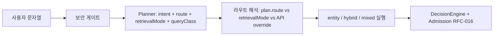

# 와인 사용자 질의 — SOTA++ 커버리지 매트릭스

**목적:** 사용자 **자연어 입력**이 시스템에서 어떻게 해석·라우팅·결정되는지, **강함 / 약함 / 불가·거절**을 코드·RFC에 맞춰 구분한다.  
**비범위:** 단일 버전의 “정답율” 수치; **데이터·임계값·인덱스 스냅샷**은 전제 조건으로만 언급한다.

**근거 파일 (핵심):**  
`planner.ts` (`determineRoute`, `determineRetrievalMode`, `determineQueryClass`), `planner-intent-detection.ts` (`detectQueryIntent`), `search-usecase-route-resolution.ts` (`resolveRouteFromPlanAndOptionMode`), `retrieval-mode.ts`, `query-intent.ts`, `query-class.ts`, `constraint-sat.ts`, `query-entry-security.ts`, RFC-000 / RFC-016, `scripts/etl/types.ts` (골든).

**Last updated:** 2026-04-06

---

## 0. 입력 → 실행 한눈에 (SSOT 흐름)



- **`plan.route`**와 **`plan.retrievalMode`**는 서로 다른 축이다. **실제 검색 분기는 `effectiveRoute`** (`buildSearchRouteResolutionContext`)가 만든다.  
- **`resolved`**는 랭킹 점수가 아니라 **Admission Gate를 통과한 경우에만** (RFC-016).

---

## 1. 용어 (혼동 방지)

| 기호 | 의미 | 소스 |
|------|------|------|
| **QueryIntent** | `entity_exact`, `facet_search`, `comparison_search`, … (8종) | `query-intent.ts` |
| **QueryRoute (`plan.route`)** | `entity` \| `hybrid` \| `mixed` — 플래너 1차 라우팅 | `planner.ts` `determineRoute` |
| **RetrievalMode (`plan.retrievalMode`)** | 세부 전략 12종 (`entity_lookup`, `compare_candidates`, …) | `retrieval-mode.ts` |
| **QueryClass** | 임계값·캘리브레이션용 **7종** + `unknown` | `query-class.ts` |
| **GoldenQueryClass** | 평가용 라벨 **9종** — 런타임 `QueryClass`와 **집합이 다름** | `scripts/etl/types.ts` |
| **effectiveRoute** | compiled execution contract 기준 실행 라우트. retained generic tooling request에서는 `retrieval_mode` / `options.mode` override가 가능하지만, public primitive HTTP는 path authority로 고정 | `search-usecase-route-resolution.ts`, `primitive-search.schema.ts` |

---

## 2. 코드 기준: `plan.route` (determineRoute)

| Intent | `plan.route` | 메모 |
|--------|--------------|------|
| `entity_exact` | `entity` | |
| `entity_fuzzy` | **앵커 있으면** `entity`, **없으면** `hybrid` | 퍼지만 있고 앵커 실패 시 발견형으로 기대 |
| `comparison_search` | `entity` | 아래 §4 — **실행은 승격될 수 있음** |
| `mixed_query` | `mixed` | |
| `facet_search`, `semantic_discovery`, `pairing_search`, `budget_search` | `hybrid` | |

```247:266:src/domain/query/service/planner.ts
  private determineRoute(
    intent: QueryIntent,
    anchors: readonly AnchorCandidate[],
  ): QueryRoute {
    switch (intent) {
      case 'entity_exact':
        return 'entity';
      case 'entity_fuzzy':
        return anchors.length > 0 ? 'entity' : 'hybrid';
      case 'comparison_search':
        return 'entity';
      case 'mixed_query':
        return 'mixed';
      case 'facet_search':
      case 'semantic_discovery':
      case 'pairing_search':
      case 'budget_search':
        return 'hybrid';
    }
  }
```

---

## 3. 코드 기준: `plan.retrievalMode` (determineRetrievalMode)

우선순위는 소스 상 **위에서 아래로** (주석 RFC-017 §8.3, Epic 7).

| 조건 (요약) | RetrievalMode |
|-------------|----------------|
| `intent === comparison_search` | `compare_candidates` |
| `(entity_exact \| mixed_query)` + 강한 앵커 + `best|top|great|famous wines` 패턴 | `producer_browse` |
| `(facet_search \| semantic_discovery \| budget_search)` + **지역 경로 슬래시 ≥ 2** (`A / B / …`) | `region_browse` |
| `entity_fuzzy` + 앵커에 **복수 `candidateEntityIds`** | `entity_resolution` |
| `entity_exact` + 강한 앵커 | `entity_lookup` |
| `mixed_query` + 앵커 있음 | `similar_items` |
| `pairing_search` | `recommendation` |
| `(facet_search \| budget_search)` + **앵커 없음** | `constraint_filter` |
| `semantic_discovery` | `attribute_search` |
| (기본) | `attribute_search` |

**참고:** `no_match_detection`은 `RETRIEVAL_MODES`·매핑에 존재하나, **현 `Planner.determineRetrievalMode` 분기에는 미포함** — 평가/태깅·확장용 타입으로 두고, OOV는 **리졸버·결정·failed**로 처리되는 경로가 일반적이다.

```283:356:src/domain/query/service/planner.ts
  private determineRetrievalMode(
    intent: QueryIntent,
    anchors: readonly AnchorCandidate[],
    normalizedQuery: string,
  ): RetrievalMode {
    const hasStrongAnchor = anchors.some(
      (a) => a.confidence >= EXACT_ANCHOR_CONFIDENCE,
    );
    const hasAnyAnchor = anchors.some(
      (a) => a.confidence >= ANCHOR_PRESENT_CONFIDENCE,
    );
    const hasMultipleCandidates = anchors.some(
      (a) => a.candidateEntityIds.length > 1,
    );

    // Comparison search: multiple anchors or explicit comparison intent
    if (intent === 'comparison_search') {
      return 'compare_candidates';
    }

    // Producer catalog browse ("Domaine X best wines", Epic 7)
    if (
      (intent === 'entity_exact' || intent === 'mixed_query') &&
      hasStrongAnchor &&
      PRODUCER_BROWSE_QUERY_PATTERN.test(normalizedQuery)
    ) {
      return 'producer_browse';
    }

    // Region / appellation hierarchy path ("… / Napa Valley / …", Epic 7 + golden)
    if (
      (intent === 'facet_search' ||
        intent === 'semantic_discovery' ||
        intent === 'budget_search') &&
      regionHierarchySlashCount(normalizedQuery) >= 2
    ) {
      return 'region_browse';
    }

    // Ambiguous entity: single anchor with multiple candidate entities
    if (intent === 'entity_fuzzy' && hasMultipleCandidates) {
      return 'entity_resolution';
    }

    // Strong single entity lookup (exact match)
    if (intent === 'entity_exact' && hasStrongAnchor) {
      return 'entity_lookup';
    }

    // Similar items: mixed query with an anchor
    if (intent === 'mixed_query' && hasAnyAnchor) {
      return 'similar_items';
    }

    // Pairing-based recommendation
    if (intent === 'pairing_search') {
      return 'recommendation';
    }

    // Pure constraint filtering (no entity involved)
    if (
      (intent === 'facet_search' || intent === 'budget_search') &&
      !hasAnyAnchor
    ) {
      return 'constraint_filter';
    }

    // Semantic discovery and generic searches
    if (intent === 'semantic_discovery') {
      return 'attribute_search';
    }

    // Default: attribute search (hybrid vector + constraints)
    return 'attribute_search';
  }
```

**보조 상수:** `PRODUCER_BROWSE_QUERY_PATTERN` · `regionHierarchySlashCount` — `planner.ts` 상단(약 41–47행).

---

## 4. SOTA++ 핵심: `plan.route` vs `effectiveRoute` (반드시 이해)

`comparison_search`는 `plan.route === 'entity'`이지만 `plan.retrievalMode === 'compare_candidates'`이다.  
`resolveRouteFromPlanAndOptionMode`는 `mode === auto`일 때 아래 **retrievalMode면 `plan.route`를 무시하고 `hybrid`로 승격**한다:

- `producer_browse`, `region_browse`, `compare_candidates`, `recommendation`

```8:24:src/application/search/search-usecase-route-resolution.ts
export function resolveRouteFromPlanAndOptionMode(
  plan: QueryPlanV1,
  mode?: 'auto' | 'entity' | 'hybrid' | 'mixed',
): QueryRoute {
  if (mode === undefined || mode === 'auto') {
    if (
      plan.retrievalMode === 'producer_browse' ||
      plan.retrievalMode === 'region_browse' ||
      plan.retrievalMode === 'compare_candidates' ||
      plan.retrievalMode === 'recommendation'
    ) {
      return 'hybrid';
    }
    return plan.route;
  }
  return mode;
}
```

→ **비교 질의**는 문서상 “entity 트랙”이 아니라 **실행상 hybrid 파이프라인**(후보·랭킹)으로 가는 것이 정상이다.  
→ **`POST /v1/search/hybrid`** 등 API 오버라이드는 `retrievalModeSource: 'api_override'`로 별도 추적.

---

## 5. Intent는 어떻게 잡히나 (detectQueryIntent 요지)

앵커 신뢰도·비교 마커·한영 혼합·가격/페어링/제약 키워드 조합으로 결정된다 (`planner-intent-detection.ts`).

| 대략적 사용자 모습 | 흔한 Intent |
|-------------------|-------------|
| 강한 앵커만, 가격·제약 키워드 없음 | `entity_exact` |
| 약한 앵커, 제약/가격 없음 | `entity_fuzzy` |
| 비교 마커 + 앵커, 또는 앵커 2개 이상 + 비교 | `comparison_search` |
| 한영 혼합 + 앵커 | `mixed_query` |
| 강한 앵커 + 제약 키워드 | `mixed_query` |
| 페어링 키워드 | `pairing_search` |
| 가격 키워드 | `budget_search` |
| 제약 키워드만 | `facet_search` |
| 위에 안 걸리면 | `semantic_discovery` |

---

## 6. QueryClass (런타임 7종 + unknown)

`determineQueryClass` 요지 (`planner.ts`):

| 조건 | QueryClass |
|------|------------|
| 사전 기반 **애매한 표현** (전체 쿼리 또는 앵커) | `ambiguous_short_form` |
| 짧은 쿼리(토큰 ≤2) + 앵커 + 후보 수·신뢰도 조합 | `short_entity` 또는 `ambiguous_short_form` |
| `entity_exact` / `entity_fuzzy` (위 특례 없음) | `short_entity` |
| `comparison_search` | `comparison_query` |
| `mixed_query` | `anchored_similarity` |
| `facet_search` / `budget_search` | `pure_constraint` |
| `semantic_discovery` / `pairing_search` | `semantic_preference` |
| 그 외 | `unknown` |

```362:415:src/domain/query/service/planner.ts
  private async determineQueryClass(
    normalizedQuery: string,
    intent: QueryIntent,
    anchors: readonly AnchorCandidate[],
  ): Promise<QueryClass> {
    // Check whether the full normalized query is itself a known ambiguous form.
    const fullQueryAmbiguous =
      await this.ambiguityDict.isKnownAmbiguous(normalizedQuery);
    if (fullQueryAmbiguous) {
      return 'ambiguous_short_form';
    }

    // Check for known ambiguous terms.
    for (const anchor of anchors) {
      const isAmbiguous = await this.ambiguityDict.isKnownAmbiguous(
        anchor.normalizedForm,
      );
      if (isAmbiguous) {
        return 'ambiguous_short_form';
      }
    }

    // Short queries (1-2 tokens) with an anchor -> short_entity.
    const tokenCount = normalizedQuery.split(/\s+/).length;
    if (tokenCount <= 2 && anchors.length > 0) {
      // Multiple candidate entities for a short query -> ambiguous.
      const totalCandidates = anchors.reduce(
        (sum, a) => sum + a.candidateEntityIds.length,
        0,
      );
      if (totalCandidates > 1 && anchors.some((a) => a.confidence < 0.8)) {
        return 'ambiguous_short_form';
      }
      return 'short_entity';
    }

    switch (intent) {
      case 'entity_exact':
      case 'entity_fuzzy':
        return 'short_entity';
      case 'comparison_search':
        return 'comparison_query';
      case 'mixed_query':
        return 'anchored_similarity';
      case 'facet_search':
      case 'budget_search':
        return 'pure_constraint';
      case 'semantic_discovery':
      case 'pairing_search':
        return 'semantic_preference';
      default:
        return 'unknown';
    }
  }
```

**파이프라인 순서 (같은 파일 `plan`):** 정규화 → 앵커 → `detectQueryIntent` → `determineRoute` → `determineRetrievalMode` → `determineQueryClass` — 약 `111:149`행.

---

## 7. 강함 — 기대 품질이 높은 사용자 질의 (전제: 인덱스·별칭·정책 일치)

| 구분 | 사용자 질의 성격 | 실행상 특징 |
|------|------------------|-------------|
| **A** | 풀 라벨 + 빈티지 등 **강한 앵커** | `entity_lookup` → entity 실행 |
| **B** | 짧지만 **사전에 등록된 비모호** 표기 | `short_entity` + 단일 후보 |
| **C** | **슬래시 지역 계층** (Epic 7 golden) | `region_browse` + 브라우즈/폴백 |
| **D** | “Château X **best wines**” 류 | `producer_browse` (패턴 + 강 앵커) |
| **E** | 제약·가격만 명확 (`constraint_filter`) | 앵커 없이 필터 중심 hybrid |
| **F** | “X **vs** Y” 등 **분해 가능** 비교 | `decomposition-detector` + 분해 유스케이스 |
| **G** | 앵커 + “비슷한” (`similar_items`) | `mixed` + 유사 검색 |
| **의도적 비확정** | 충돌 후보 | `ambiguous` **≥ 틀린 resolved** (RFC-000) |

---

## 8. 약함 — 가능하지만 분산·민감 (품질 변동 큼)

| 원인 | 증상 | 코드/도메인 앵커 |
|------|------|------------------|
| **ambiguous_short_form** | 다중 후보·임계 근처 | `ambiguityDict`, `ambiguous_short_form` |
| **entity_fuzzy** + 무앵커 | `plan.route`가 `hybrid` | `determineRoute` |
| **producer_browse** 시드 추출 실패 | 빈 전문 경로 → **풀 폴백** | `search-usecase-hybrid-candidates.ts` |
| **region_browse** | 슬래시 계층·제약 미스 | `regionHierarchySlashCount` |
| **compare_candidates** | 앵커 리졸브 실패 | `compareAgainstAnchor` 전 앵커 필요 |
| **NL 제약** | 매핑 누락·부분 파싱 | `NLMapper`, soft/hard 구분 (`SOFT_ATTRIBUTES`) |
| **pairing → recommendation** | 태그·코퍼스 커버 | 인덱스 `pairing` 필드 |
| **세션 없음** | 지시어 “그 와인” | `sessionContext` 미전달 |
| **다국어** | 정규화·앵커 불일치 | `QueryNormalizer`, 별칭 투영 |

---

## 9. 불가·거절·실패 — 사용자가 “막히는” 케이스

| 층 | 상황 | 결과 |
|----|------|------|
| **진입** | 인젝션·정책 | `PolicyBlockedError` → **403** |
| **진입** | 과도 요청 | Rate limit → **429** (전역 핸들러) |
| **플랜 전** | 하드 제약 **논리 모순** | `ConstraintSAT` → 조기 응답 |
| **결정** | Admission 미충족 | **`resolved` 금지** (RFC-016) |
| **결정** | 증거·시그니처·스냅샷 불일치 | `failed` / `failure_reason` |
| **범위 밖** | 실시간 재고·POS | 인덱스 스냅샷 ≠ 실시간 |
| **범위 밖** | 비와인·안전 영역 밖 | 보안/무의미 응답 |

---

## 10. 골든 `query_class` / `scenario` (평가 전용) vs 런타임 `QueryClass`

| GoldenQueryClass (`types.ts`) | 런타임 QueryClass와 관계 |
|-------------------------------|---------------------------|
| `exact_entity`, `ambiguous_short_form`, `semantic_preference`, `pure_constraint`, `no_match`, `noisy_recall` | 이름이 겹치거나 대응 가능 |
| **`exploration`**, **`similar_compare`**, **`catalog_browse`** | **골든 생성기 전용 라벨** — `QUERY_CLASSES` 7종에 **직접 없음** |
| **Scenario A–H** | 시나리오 슬라이스; 플래너 Intent와 **1:1 고정 아님** |

평가·리포트는 Golden 축, **런타임 튜닝**은 `QueryClass` + `RetrievalMode` 축으로 본다.

---

## 11. 별도 부록: 누가 라우트를 결정하나

| 입력 | 효과 |
|------|------|
| public primitive HTTP `POST /v1/search/hybrid` | **항상 hybrid lane**. body의 `options.mode` / `retrieval_mode`는 거부 |
| public primitive HTTP `POST /v1/search/semantic` | **항상 semantic lane**. body override 없음 |
| public primitive HTTP `POST /v1/search/lexical` | **항상 lexical lane**. body override 없음 |
| retained generic tooling request `retrieval_mode` (non-auto) | 플래너/compiled contract보다 **우선** (`apiOverrideMode`) |
| retained generic tooling request `options.mode` | `retrieval_mode`가 없을 때만 `resolveRouteFromPlanAndOptionMode`와 함께 해석 |

공개 surface와 내부 tooling surface를 섞어 읽으면 오판합니다.
`SearchRouteResolutionContext`의 override 규칙은 retained generic request용입니다.
현재 public primitive surface는 `PrimitiveSearchRequestSchema`에서 lane override field를
막고 route handler가 path로 lane을 주입합니다.

---

## 12. SOTA++ 리뷰 체크리스트

- [ ] **비교 질의**를 `plan.route === entity`만 보고 판단하지 않았는가? → §4 승격 규칙  
- [ ] **강함**에 인덱스·별칭·임계값 전제를 붙였는가?  
- [ ] **약함**이 “틀린 확정”을 정당화하지 않고 **ambiguous·failed**와 구분되는가? (RFC-000)  
- [ ] **403 / 429 / SAT / Admission**이 같은 “실패”로 뭉개지지 않았는가?  
- [ ] **Golden 라벨**과 **런타임 QueryClass** 혼동을 제거했는가? — §10  

**관련:** [`retriever-pipeline.md`](./retriever-pipeline.md), [`ingestion-pipeline.md`](./ingestion-pipeline.md), [`docs/RFC-INDEX.md`](../RFC-INDEX.md).
